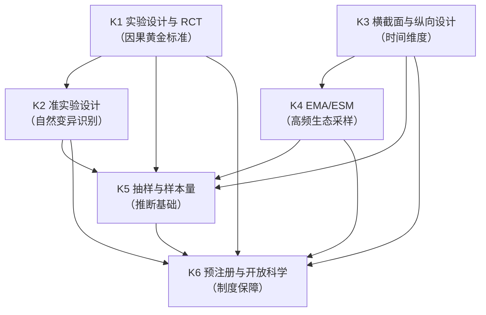
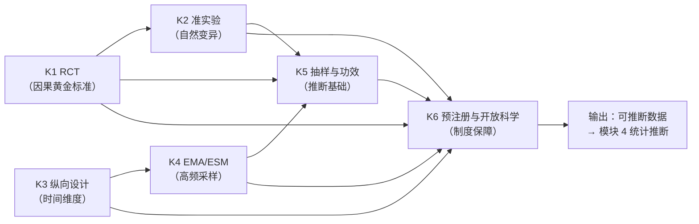

# MOD-03 · 模块 3：研究设计与抽样（变量范式 × 状态范式对比）

> **来源与性质**：变量范式集体学习模块系列第 3/7 模块，与 15-X-112／113 议案七模块清单同源；本件依主理转入稿整理，去除呈现层过渡结构（四层次包装），知识内容全量保留。库内锚点引用前须自核（见 rn）。

>
> **框架声明（15-RPT-115 #1/#2·v0.1.1 订正批增）**：本件「四层次」结构系输出构造、非库内文档框架；模块 MECE 编号与知识点清单照 15-X-112 原文展开。

## 1.1 模块定位表

| 项 | 内容 |
|---|---|
| 所属范式 | 变量范式 |
| MECE 编号 | 模块 3 / 共 7 模块 |
| 核心问题 | 如何获得可推断的数据？ |
| 关键知识 | 实验、RCT、准实验、横截面、纵向、EMA、抽样、样本量、预注册 |
| 代表方法/工具 | 实验设计、RCT、纵向追踪、经验采样、开放科学 |
| 在知识生产链中的位置 | **第三环**——上游承接模块 2“可测变量”，下游供给模块 4“统计推断”与模块 5“因果识别”以可推断数据 |
| 状态范式对位模块 | **模块 4“环境参照”**（S-P、E(t) 环境驱动项）＋**模块 5“动力学与计算引擎”**（PSE-M 仿真、PSE-C 校准）＋**模块 7“干预与验证”**（RCT、D-R-S 序列、DMD） |
| 本模块的真正分歧 | 数据目标：估计因果效应 vs 反解状态轨迹；数据形态：静态/离散时点 vs 连续时间动态；环境角色：控制变量 vs 驱动项 E(t)；研究设计：外部干预识别 vs 内部机制生成 |
| 变量范式的历史地位 | 这是变量范式的**强项领域**（RCT 是因果推断的黄金标准）；但 15-X-112 §六也指出，因果推断（模块 5）是“变量范式最坚固的堡垒”之一 |
| 关键张力 | 变量范式的 RCT 在**群体平均处理效应**上不可替代；状态范式需要**个体化状态轨迹**，要求密集纵向 + 多模态，二者数据需求不同 |

## 1.2 知识点清单表

| # | 知识点 | 一句话定位 | 在变量范式中的角色 |
|---|---|---|---|
| K1 | 实验设计与 RCT | 随机化 + 对照组 = 因果推断的黄金标准 | 因果识别的最高标准 |
| K2 | 准实验设计 | 无随机化时利用自然变异识别因果；IV、RDD、DID、PSM | RCT 不可行时的替代方案 |
| K3 | 横截面与纵向设计 | 单时点 vs 多时点；追踪变化与个体内动态 | 时间维度的基础设计 |
| K4 | 经验采样法（EMA/ESM） | 在自然情境中高频采样，捕捉实时动态 | 连接实验室与真实世界 |
| K5 | 抽样与样本量 | 如何获得有代表性/有推断力的样本；功效分析 | 推断的外部有效性基础 |
| K6 | 预注册与开放科学 | 研究前冻结假设与分析计划；开放数据/材料 | 可信度革命的制度基础 |

## 1.3 每个知识点的大纲解释表

| 知识点 | 简要大纲解释 |
|---|---|
| **K1 实验设计与 RCT** | 随机分配被试到处理组/对照组，通过随机化平衡混淆变量。RCT 在伦理可行、外部有效性可控、成本允许的条件下，是因果推断的黄金标准（15-RPT-115 #7 条件性订正）。核心要素：随机化、对照组、盲法、意向性分析（ITT）。类型：平行组、交叉、析因、阶梯楔形。局限：外部有效性、伦理限制、成本高、难以研究长期动态。 |
| **K2 准实验设计** | 无随机化时利用自然变异识别因果。主要工具：工具变量（IV）、断点回归（RDD）、双重差分（DID）、倾向得分匹配（PSM）、合成控制。核心挑战：排除混淆、满足识别假设。适用场景：政策评估、自然实验、伦理受限研究。 |
| **K3 横截面与纵向设计** | 横截面：单时点数据，描述群体状态、估计变量间关系。纵向：多时点追踪，区分个体间与个体内效应。类型：面板、队列、追踪。核心优势：捕捉时间变化、因果时序。核心挑战：脱落、测量不变性、时间间隔选择。 |
| **K4 EMA/ESM** | 经验采样法（Experience Sampling Method）：在自然情境中通过手机/电子设备高频采样，捕捉实时情绪、行为、情境。优势：生态效度高、个体内动态、减少回忆偏差。挑战：依从性、反应性、数据分析复杂（密集纵向模型）。 |
| **K5 抽样与样本量** | 抽样：概率抽样（简单随机、分层、整群）、非概率抽样（便利、雪球）。样本量：功效分析（power analysis）确定所需 N。关键概念：效应量、显著性水平、功效（1-β）、脱落率。外部有效性：WEIRD 样本问题、代表性。 |
| **K6 预注册与开放科学** | 预注册：研究前冻结假设、分析计划、主要结局。开放科学：开放数据、开放材料、开放代码、预印本。目的：减少 p-hacking、发表偏差、研究者自由度。制度工具：OSF、ClinicalTrials.gov、多宇宙分析、注册报告。 |

## 2.1 K1 实验设计与 RCT —— 详细对比

| 维度 | 变量范式（RCT） | 状态范式（干预实验设计） |
|---|---|---|
| 核心目标 | 估计群体平均处理效应（ATE） | 估计个体化状态轨迹变化 + 干预效果 |
| 随机化对象 | 被试随机分配到处理/对照组 | 可保留随机化，但需密集纵向追踪状态 |
| 因果推断逻辑 | 随机化消除混淆 → 组间差异 = 处理效应 | 状态转移方程 + 干预算子 → 轨迹预测 + 效果归因 |
| 数据形态 | 前后测 + 少数时点 | 密集纵向 + 多模态 + 连续时间 |
| 分析单位 | 组间均值差异 | 个体内状态轨迹 |
| 干预定义 | 处理包（如 CBT 组） | G-M-A-R 操作序列（可分解） |
| 结果测量 | 主要结局（如 RRS-Brooding） | 状态向量变化 + 级联路径 + 风险时点 |
| 效果量 | Hedges g、Cohen's d | 轨迹预测精度、干预靶点效应 |
| 外部有效性 | 受限于样本和情境 | 需跨基质/跨模型泛化（M4b/M4c） |
| 库内对应 | — | 03-C-13（DMD-P2a/P2b/P2c）；18-DIVE；26-SIPE |
| 关键分歧 | 变量范式：RCT 估计 ATE；状态范式：RCT 需改造为密集纵向 + 状态估计 + 干预分解 | 前者关注群体平均效应；后者关注个体状态轨迹与最优干预序列 |

## 2.2 K2 准实验设计 —— 详细对比

| 维度 | 变量范式（准实验） | 状态范式（自然实验 + 状态建模） |
|---|---|---|
| 核心工具 | IV、RDD、DID、PSM、合成控制 | 状态空间模型 + 环境驱动项 E(t) + 自然实验 |
| 识别逻辑 | 利用自然变异 + 排除混淆 | 利用自然变异 + 状态转移方程约束 |
| 因果推断 | 局部平均处理效应（LATE） | 状态轨迹变化 + 干预效果归因 |
| 假设条件 | 排除性约束、连续性、平行趋势 | 观测函数稳定性 + 状态转移方程正确性 |
| 数据需求 | 观测数据 + 工具变量/断点 | 密集纵向 + 多模态 + 环境数据 |
| 外部有效性 | 受限于识别假设 | 需跨基质/跨模型泛化 |
| 库内对应 | — | 01-M-03 §四（E(t) 驱动项）；01-M-09（S-P 环境参照系） |
| 关键分歧 | 变量范式：准实验识别因果效应；状态范式：准实验 + 状态建模识别状态轨迹变化 | 前者关注因果效应；后者关注状态演化与干预靶点 |

## 2.3 K3 横截面与纵向设计 —— 详细对比

| 维度 | 变量范式（横截面/纵向） | 状态范式（密集纵向 + 状态估计） |
|---|---|---|
| 时间维度 | 静态横截面；或离散时间点（T1、T2…） | 连续时间动态演化（dΨ/dt）；轨迹 |
| 核心目标 | 描述群体状态、估计变量间关系 | 反解状态轨迹、预测未来状态、识别干预靶点 |
| 分析单位 | 变量间关系（组间/组内） | 个体内状态向量 |
| 个体内 vs 个体间 | DSEM 可区分，但仍以变量为对象 | Ψ_t 本身就是个体内状态；个体间差异是参数差异 |
| 测量频率 | 通常低（数次） | 高（密集纵向、EMA、连续监测） |
| 动态建模 | DSEM、潜增长模型、交叉滞后 | 状态空间模型 + 贝叶斯滤波 |
| 因果推断 | 交叉滞后、RI-CLPM | 状态转移方程 + 干预算子 |
| 库内对应 | — | 01-M-11（L2 状态估计）；03-A-07 §7.4（密集纵向与 DSEM） |
| 关键分歧 | 变量范式：纵向设计追踪变量变化；状态范式：密集纵向反解状态轨迹 | 前者关注变量间动态关系；后者关注状态演化与干预靶点 |

## 2.4 K4 EMA/ESM —— 详细对比

| 维度 | 变量范式（EMA/ESM） | 状态范式（多模态密集采样） |
|---|---|---|
| 核心目标 | 捕捉自然情境中的实时动态 | 反解状态轨迹 + 估计观测函数参数 |
| 数据形态 | 自评为主（手机问卷） | 多模态（语义/行为/神经）+ 环境数据 |
| 采样频率 | 每日数次至数十次 | 连续/高频 + 多模态同步 |
| 生态效度 | 高 | 高 + 多模态约束 |
| 分析工具 | 密集纵向模型、DSEM、多层模型 | 状态空间模型 + 贝叶斯滤波 + 多模态融合 |
| 测量对象 | 变量（情绪、行为） | 状态 Ψ（42 维） |
| 观测函数 | 通常不显式建模 | 显式建模 y = h(Ψ, E) + ε |
| 库内对应 | — | 01-M-10（L1-I 接口规范）；01-M-11（L2 状态估计）；03-A-07 §7.4 |
| 关键分歧 | 变量范式：EMA 捕捉变量动态；状态范式：EMA 数据 + 多模态 + 状态估计反解 Ψ | 前者仍以变量为对象；后者以状态向量为对象 |

## 2.5 K5 抽样与样本量 —— 详细对比

| 维度 | 变量范式（抽样与功效） | 状态范式（个体化状态估计） |
|---|---|---|
| 抽样目标 | 代表性样本 → 群体推断 | 个体化状态轨迹 → 个体内推断 |
| 样本量逻辑 | 功效分析（效应量、α、1-β） | 密集纵向 + 多模态 + 个体化校准 |
| 分析单位 | 群体平均 | 个体内状态 |
| 外部有效性 | WEIRD 样本问题、代表性 | 跨基质/跨模型泛化（M4b/M4c） |
| 样本策略 | 大样本、随机抽样 | 小样本密集纵向 + 多模态 + 跨模型泛化 |
| 个体差异 | 随机效应、调节变量 | 个体化参数（层级贝叶斯） |
| 库内对应 | — | 01-M-03 §七（群体→个体校准轴）；03-A-19（逆问题） |
| 关键分歧 | 变量范式：大样本群体推断；状态范式：小样本密集纵向个体化状态估计 | 前者关注群体平均；后者关注个体状态轨迹与个体化干预 |

## 2.6 K6 预注册与开放科学 —— 详细对比

| 维度 | 变量范式（预注册/开放科学） | 状态范式（冻结件 + 治理规程） |
|---|---|---|
| 核心目标 | 减少 p-hacking、发表偏差、研究者自由度 | 冻结判据、保证可复现、治理实验全过程 |
| 工具 | OSF、ClinicalTrials.gov、注册报告 | IEGP、判据冻结件、预注册冻结件、ACCP |
| 冻结对象 | 假设、分析计划、主要结局 | 判据、分析计划、种子、判者名册 |
| 治理层级 | 研究层面 | 实验治理规程 + 证据分级（IET） |
| 可复现性 | 开放数据/材料/代码 | 可复现包四要素 + 外部独立复验 |
| 证据分级 | 通常无统一分级 | IET 证据分级 + IEGP 分级（M0-M5） |
| 库内对应 | — | 26-WP-S3-36（IEGP v3.1）；05-R-01（压力测试）；26-WP-S3-14（预注册冻结件） |
| 关键分歧 | 变量范式：预注册是研究实践；状态范式：预注册是治理规程的一部分 | 前者关注研究可信度；后者关注实验治理 + 产出分级 + 可复现包 |

## 3.1 K1 实验设计与 RCT —— 知识库链接表

| 类别 | 内容 | 库内/库外对应 |
|---|---|---|
| 核心工具 | 随机化、对照组、盲法、ITT、析因设计 | — |
| 相关理论 | 潜在结果模型、随机化推断 | Rubin (1974)；Fisher (1935) |
| 心理学表现 | 临床试验、心理治疗 RCT | — |
| 状态范式对位 | 干预实验设计、DMD-P2a/P2b/P2c、D-R-S 序列 | 03-C-13；18-DIVE；26-SIPE |
| 关键文档 | 03-C-13《DMD》；18-DIVE（DMD 迭代验证工程）；26-SIPE（硅基探针工程） | 库内 |
| 关键论证 | RCT 估计 ATE ↔ 状态范式需密集纵向 + 状态估计 + 干预分解 | 03-C-13 §六（DMD-P2a/P2b/P2c） |
| 延伸阅读 | Fisher (1935)；Rubin (1974)；Shadish, Cook & Campbell (2002) | 库外 |
| 相关争议 | RCT 的外部有效性；伦理限制；长期动态难以研究 | — |

## 3.2 K2 准实验设计 —— 知识库链接表

| 类别 | 内容 | 库内/库外对应 |
|---|---|---|
| 核心工具 | IV、RDD、DID、PSM、合成控制 | — |
| 相关理论 | 自然实验、识别策略 | Angrist & Pischke (2009)；Imbens & Rubin (2015) |
| 心理学表现 | 政策评估、自然实验 | — |
| 状态范式对位 | 自然实验 + 状态空间模型 + E(t) 驱动项 | 01-M-03 §四；01-M-09 |
| 关键文档 | 01-M-03《PSE》§四（E(t) 驱动项）；01-M-09《S-P 环境参照系》 | 库内 |
| 关键论证 | 准实验识别因果效应 ↔ 自然实验 + 状态建模识别状态轨迹变化 | 01-M-03 §四 |
| 延伸阅读 | Angrist & Pischke (2009)；Imbens & Rubin (2015) | 库外 |
| 相关争议 | 识别假设的可检验性；LATE vs ATE | — |

## 3.3 K3 横截面与纵向设计 —— 知识库链接表

| 类别 | 内容 | 库内/库外对应 |
|---|---|---|
| 核心工具 | 横截面、面板、队列、追踪、DSEM、RI-CLPM | — |
| 相关理论 | 纵向数据分析、个体内 vs 个体间 | Hamaker & Wichers (2017)；Asparouhov et al. (2018) |
| 心理学表现 | 追踪研究、发展心理学 | — |
| 状态范式对位 | 密集纵向 + 状态空间模型 + 贝叶斯滤波 | 01-M-11；03-A-07 §7.4 |
| 关键文档 | 01-M-11《L2 状态估计》；03-A-07《走出洞穴》§7.4 | 库内 |
| 关键论证 | 纵向设计追踪变量变化 ↔ 密集纵向反解状态轨迹 | 03-A-07 §7.4 |
| 延伸阅读 | Hamaker & Wichers (2017)；Asparouhov et al. (2018)；Molenaar (2004) | 库外 |
| 相关争议 | 时间间隔选择；脱落；测量不变性 | — |

## 3.4 K4 EMA/ESM —— 知识库链接表

| 类别 | 内容 | 库内/库外对应 |
|---|---|---|
| 核心工具 | EMA、ESM、手机采样、可穿戴设备 | — |
| 相关理论 | 生态瞬时评估、密集纵向 | Shiffman et al. (2008)；Csikszentmihalyi & Larson (1987) |
| 心理学表现 | 情绪动态、行为监测 | — |
| 状态范式对位 | 多模态密集采样 + 状态估计 + 观测函数 | 01-M-10；01-M-11；03-A-07 §7.4 |
| 关键文档 | 01-M-10《L1-I 接口规范》；01-M-11《L2 状态估计》 | 库内 |
| 关键论证 | EMA 捕捉变量动态 ↔ EMA + 多模态 + 状态估计反解 Ψ | 03-A-07 §7.4；01-M-11 |
| 延伸阅读 | Shiffman et al. (2008)；Csikszentmihalyi & Larson (1987) | 库外 |
| 相关争议 | 依从性；反应性；数据分析复杂 | — |

## 3.5 K5 抽样与样本量 —— 知识库链接表

| 类别 | 内容 | 库内/库外对应 |
|---|---|---|
| 核心工具 | 概率抽样、功效分析、脱落率估计 | — |
| 相关理论 | 抽样理论、统计功效 | Cohen (1988)；Maxwell et al. (2008) |
| 心理学表现 | 样本代表性、WEIRD 问题 | Henrich et al. (2010) |
| 状态范式对位 | 个体化状态估计、层级贝叶斯、跨模型泛化 | 01-M-03 §七；03-A-19 |
| 关键文档 | 01-M-03《PSE》§七（群体→个体校准轴）；03-A-19《从观测到状态向量》 | 库内 |
| 关键论证 | 大样本群体推断 ↔ 小样本密集纵向个体化状态估计 | 01-M-03 §七 |
| 延伸阅读 | Cohen (1988)；Maxwell et al. (2008)；Henrich et al. (2010) | 库外 |
| 相关争议 | 功效分析的局限性；样本代表性 vs 个体化 | — |

## 3.6 K6 预注册与开放科学 —— 知识库链接表

| 类别 | 内容 | 库内/库外对应 |
|---|---|---|
| 核心工具 | OSF、ClinicalTrials.gov、注册报告、多宇宙分析 | — |
| 相关理论 | 开放科学、可复现性 | Nosek et al. (2015)；Open Science Collaboration (2015) |
| 心理学表现 | 预注册、开放数据、预印本 | — |
| 状态范式对位 | IEGP 治理规程、判据冻结件、ACCP、IET 证据分级 | 26-WP-S3-36；05-R-01；26-WP-S3-14 |
| 关键文档 | 26-WP-S3-36《IEGP v3.1》；05-R-01《内部理论压力测试报告》；26-WP-S3-14《预注册冻结件》 | 库内 |
| 关键论证 | 预注册是研究实践 ↔ 预注册是治理规程的一部分 | 26-WP-S3-36 §6.7；05-R-01 §三 |
| 延伸阅读 | Nosek et al. (2015)；Open Science Collaboration (2015)；Steegen et al. (2016) | 库外 |
| 相关争议 | 预注册的灵活性；探索性研究的地位 | — |

## 4.1 依赖关系总表

| 知识点 | 依赖 | 被依赖 | 依赖类型 | 说明 |
|---|---|---|---|---|
| K1 实验设计与 RCT | 模块 1（K4 因果推断假设）、模块 2（K4 效度） | K2、K5、K6 | 因果识别核心 | RCT 是因果识别的黄金标准；准实验是其替代方案 |
| K2 准实验设计 | K1、模块 1（K4） | K5、K6 | 替代方案 | 准实验在 RCT 不可行时提供识别策略 |
| K3 横截面与纵向设计 | 模块 2（K5 测量不变性） | K4、K6 | 时间维度基础 | 纵向设计是 EMA 和因果时序的基础 |
| K4 EMA/ESM | K3 | K5、K6 | 高频采样 | EMA 是密集纵向的现代化工具 |
| K5 抽样与样本量 | K1、K2、K3、K4 | K6 | 推断基础 | 抽样与功效决定推断的外部有效性 |
| K6 预注册与开放科学 | K1-K5 | — | 制度保障 | 预注册与开放科学为整个研究设计提供可信度保障 |

## 4.2 依赖关系图

## 4.3 依赖关系深度解剖表

| 依赖对 | 依赖内容 | 深度 | 结构性后果 |
|---|---|---|---|
| K1 → K2 | RCT → 准实验 | 强 | RCT 不可行时准实验是替代方案；准实验依赖 RCT 的因果推断框架 |
| K1 → K5 | RCT → 抽样与功效 | 强 | RCT 的样本量和功效分析依赖 K5 |
| K2 → K5 | 准实验 → 抽样与功效 | 中 | 准实验的功效分析更复杂（识别假设） |
| K3 → K4 | 纵向设计 → EMA | 强 | EMA 是纵向设计的高频版本；纵向设计是 EMA 的基础 |
| K3 → K5 | 纵向设计 → 抽样与功效 | 中 | 纵向设计的样本量需考虑脱落和重复测量 |
| K4 → K5 | EMA → 抽样与功效 | 中 | EMA 的样本量需考虑依从性和密集采样 |
| K5 → K6 | 抽样与功效 → 预注册 | 强 | 预注册需冻结样本量与分析计划 |
| K1 → K6 | RCT → 预注册 | 强 | RCT 预注册是临床试验标准 |
| K2 → K6 | 准实验 → 预注册 | 中 | 准实验也需预注册分析计划 |
| K3 → K6 | 纵向设计 → 预注册 | 中 | 纵向设计需预注册时间点和分析计划 |
| K4 → K6 | EMA → 预注册 | 中 | EMA 需预注册采样方案和分析计划 |

## 4.4 与状态范式的依赖关系对比

| 变量范式依赖 | 状态范式对应 | 差异 |
|---|---|---|
| K1 RCT → K2 准实验 | 干预实验 → 自然实验 + 状态建模 | 变量范式从随机化出发；状态范式从状态转移方程 + 自然变异出发 |
| K1 RCT → K5 抽样与功效 | 干预实验 → 个体化状态估计 | 变量范式用大样本估计 ATE；状态范式用小样本密集纵向估计个体状态轨迹 |
| K3 纵向设计 → K4 EMA | 密集纵向 → 多模态密集采样 | 变量范式用 EMA 捕捉变量动态；状态范式用多模态密集采样反解状态 Ψ |
| K4 EMA → K5 抽样与功效 | 多模态密集采样 → 层级贝叶斯 | 变量范式用大样本；状态范式用个体化参数 + 群体先验 |
| K5 抽样与功效 → K6 预注册 | 层级贝叶斯 → 治理规程（IEGP） | 变量范式预注册是研究实践；状态范式预注册是治理规程的一部分 |
| K1-K5 → K6 | 干预实验 + 自然实验 + 纵向 + EMA + 抽样 → IEGP 治理规程 | 变量范式的预注册关注可信度；状态范式的 IEGP 关注实验治理 + 产出分级 + 可复现包 |

## 4.5 关键依赖链：从 RCT 到开放科学

**关键结论：**

1. **RCT 在伦理可行、外部有效性可控、成本允许条件下是因果识别的黄金标准**（15-RPT-115 #7）：但受限于外部有效性、伦理、成本、长期动态难以研究。
2. **准实验是 RCT 的替代方案**：在随机化不可行时提供识别策略，但依赖更强的假设。
3. **纵向设计是时间维度的基础**：EMA 是纵向设计的高频版本，捕捉实时动态。
4. **抽样与功效决定推断的外部有效性**：大样本群体推断 ↔ 小样本密集纵向个体化状态估计。
5. **预注册与开放科学是制度保障**：变量范式用预注册减少研究者自由度；状态范式用 IEGP 治理规程 + 判据冻结件 + 可复现包。
6. **模块 3 的输出是可推断数据**：这些数据供给模块 4（统计推断）、模块 5（因果识别）。
7. **与状态范式的根本差异**：变量范式追求群体平均处理效应（ATE）；状态范式追求个体化状态轨迹 + 干预靶点。变量范式用大样本 + 少数时点；状态范式用小样本 + 密集纵向 + 多模态。变量范式的环境是控制变量；状态范式的环境是驱动项 E(t)。

## 4.6 模块间依赖：模块 3 与相邻模块的关系

| 关系 | 上游 | 下游 | 依赖内容 |
|---|---|---|---|
| 模块 2 → 模块 3 | 可测变量 | 研究设计与抽样 | 模块 2 提供测量工具，模块 3 设计研究获取数据 |
| 模块 3 → 模块 4 | 可推断数据 | 统计推断与数据建模 | 模块 3 提供数据，模块 4 建模变量间关系 |
| 模块 3 → 模块 5 | 实验/准实验设计 | 因果识别与因果推断 | 模块 3 的设计决定因果识别策略 |
| 模块 3 → 模块 7 | 研究实践 | 制度、实践与批判 | 模块 3 的预注册/开放科学受模块 7 的制度批判约束 |
| 模块 3 ↔ 模块 4/5 | 数据设计 ↔ 分析策略 | 双向依赖 | 研究设计影响分析策略，分析需求影响研究设计 |

## 疑问解答（附属·v0.2.0 增）

本节系主理 Agent 2026-10-13 会话转入之附属疑问解答（12 条·逐条以表格作答），与正文四节互为补充、不替代；内容逐字落盘未改一字。

### 疑问 1：模块三“本模块的真正分歧”指出数据目标、数据形态、环境角色、研究设计四重分歧。这四重分歧如何与模块二、模块一的预设衔接？

| 维度 | 变量范式 | 状态范式 |
|---|---|---|
| 数据目标 | 估计因果效应（ATE） | 反解状态轨迹 + 干预靶点 |
| 数据形态 | 静态/离散时点 | 连续时间动态演化 |
| 环境角色 | 控制变量/调节变量 | 驱动项 E(t) |
| 研究设计 | 外部干预识别（RCT、IV、DID） | 内部机制生成（状态转移方程 + 干预算子） |
| 与模块一衔接 | 模块一决定“变量是什么”，模块三决定“如何获得可推断的数据”；数据目标继承变量实在论 | 模块一决定“功能层是什么”，模块三决定“如何反解状态轨迹”；数据目标继承约束功能主义 |
| 与模块二衔接 | 模块二提供可测变量，模块三设计研究获取数据 | 模块二提供观测函数 h，模块三设计密集纵向采样 |
| 一句话 | 模块三是变量范式的“数据引擎”，上承测量模型，下接统计推断与因果识别；状态范式把数据目标从“估计处理效应”换为“反解状态轨迹” |

---

### 疑问 2：K1 实验设计与 RCT 的核心逻辑是“随机化消除混淆”。这一逻辑在状态范式中如何被继承和改造？

| 维度 | 变量范式（RCT） | 状态范式（干预实验设计） |
|---|---|---|
| 核心目标 | 估计群体平均处理效应（ATE） | 估计个体化状态轨迹变化 + 干预效果 |
| 随机化对象 | 被试随机分配到处理/对照组 | 可保留随机化，但需密集纵向追踪状态 |
| 因果推断逻辑 | 随机化消除混淆 → 组间差异 = 处理效应 | 状态转移方程 + 干预算子 → 轨迹预测 + 效果归因 |
| 数据形态 | 前后测 + 少数时点 | 密集纵向 + 多模态 + 连续时间 |
| 分析单位 | 组间均值差异 | 个体内状态轨迹 |
| 干预定义 | 处理包（如 CBT 组） | G-M-A-R 操作序列（可分解） |
| 结果测量 | 主要结局（如 RRS-Brooding） | 状态向量变化 + 级联路径 + 风险时点 |
| 效果量 | Hedges g、Cohen's d | 轨迹预测精度、干预靶点效应 |
| 继承与改造 | 继承随机化逻辑，改造为密集纵向 + 状态估计 + 干预分解 | — |
| 一句话 | RCT 估计 ATE；状态范式保留随机化但要求密集纵向 + 状态估计 + 干预分解，目标从“群体平均效应”换为“个体状态轨迹与最优干预序列” |

---

### 疑问 3：RCT 被称为“因果推断的黄金标准”，但在什么条件下这一地位成立？它在状态范式中是否仍是黄金标准？

| 维度 | 解答 |
|---|---|
| 黄金标准成立条件 | 伦理可行、外部有效性可控、成本允许（15-RPT-115 #7） |
| 不成立场景 | 伦理受限（如随机分配吸烟）、外部有效性差（WEIRD 样本）、成本过高、难以研究长期动态 |
| 核心优势 | 随机化消除混淆，组间差异可直接归因于处理 |
| 核心局限 | 外部有效性受限、伦理限制、成本高、难以研究长期动态 |
| 在状态范式中的地位 | 仍是干预验证的核心设计，但需改造为密集纵向 + 多模态 + 状态估计 |
| 状态范式的补充 | 不仅问“处理是否有效”，还问“哪个功能操作有效、通过什么状态路径产生改变” |
| 一句话 | RCT 在特定条件下仍是因果识别的黄金标准；状态范式继承其随机化逻辑，但追问机制与个体轨迹 |

---

### 疑问 4：K2 准实验设计在 RCT 不可行时提供识别策略。这些策略（IV、RDD、DID、PSM）在状态范式中如何对应？

| 准实验工具 | 变量范式逻辑 | 状态范式对应 |
|---|---|---|
| IV（工具变量） | 利用与处理相关但与混淆无关的变量识别 LATE | 自然实验 + 状态空间模型 + E(t) 驱动项 |
| RDD（断点回归） | 利用阈值附近的断点识别局部处理效应 | 阈值触发（L3.9）+ 状态转移方程 |
| DID（双重差分） | 利用处理组与对照组的前后变化差异识别 ATT | 干预实验 + 状态空间模型 + 干预算子 |
| PSM（倾向得分匹配） | 用倾向得分平衡协变量识别 ATT | 层级贝叶斯 + 状态估计 + 个体化匹配 |
| 核心差异 | 识别处理效应 | 识别状态轨迹变化 + 干预效果归因 |
| 共同前提 | 节点已被合理定义 | 节点 = 功能组件，由坐标系定义 |
| 一句话 | 准实验工具识别处理效应；状态范式用自然实验 + 状态建模识别状态轨迹变化 |

---

### 疑问 5：K3 横截面与纵向设计的核心区分是个体间 vs 个体内效应。这一区分在状态范式中如何被超越？

| 维度 | 变量范式（横截面/纵向） | 状态范式（密集纵向 + 状态估计） |
|---|---|---|
| 时间维度 | 静态横截面；或离散时间点（T1、T2…） | 连续时间动态演化（dΨ/dt）；轨迹 |
| 核心目标 | 描述群体状态、估计变量间关系 | 反解状态轨迹、预测未来状态、识别干预靶点 |
| 分析单位 | 变量间关系（组间/组内） | 个体内状态向量 |
| 个体内 vs 个体间 | DSEM 可区分，但仍以变量为对象 | Ψ_t 本身就是个体内状态；个体间差异是参数差异 |
| 测量频率 | 通常低（数次） | 高（密集纵向、EMA、连续监测） |
| 动态建模 | DSEM、潜增长模型、交叉滞后 | 状态空间模型 + 贝叶斯滤波 |
| 因果推断 | 交叉滞后、RI-CLPM | 状态转移方程 + 干预算子 |
| 超越方式 | 变量范式追踪变量变化；状态范式反解状态轨迹 | — |
| 一句话 | 变量范式的纵向设计追踪变量变化；状态范式的密集纵向反解状态轨迹，Ψ_t 本身就是个体内状态 |

---

### 疑问 6：K4 EMA/ESM 捕捉自然情境中的实时动态。它在状态范式中如何被改造为多模态密集采样？

| 维度 | 变量范式（EMA/ESM） | 状态范式（多模态密集采样） |
|---|---|---|
| 核心目标 | 捕捉自然情境中的实时动态 | 反解状态轨迹 + 估计观测函数参数 |
| 数据形态 | 自评为主（手机问卷） | 多模态（语义/行为/神经）+ 环境数据 |
| 采样频率 | 每日数次至数十次 | 连续/高频 + 多模态同步 |
| 生态效度 | 高 | 高 + 多模态约束 |
| 分析工具 | 密集纵向模型、DSEM、多层模型 | 状态空间模型 + 贝叶斯滤波 + 多模态融合 |
| 测量对象 | 变量（情绪、行为） | 状态 Ψ（42 维） |
| 观测函数 | 通常不显式建模 | 显式建模 `y = h(Ψ, E) + ε` |
| 改造方式 | 变量范式用 EMA 捕捉变量动态；状态范式用 EMA 数据 + 多模态 + 状态估计反解 Ψ | — |
| 一句话 | EMA 仍以变量为对象；状态范式用多模态密集采样 + 状态估计反解状态向量 |

---

### 疑问 7：K5 抽样与样本量的逻辑是“大样本群体推断”。状态范式为何转向“小样本密集纵向个体化估计”？

| 维度 | 变量范式（抽样与功效） | 状态范式（个体化状态估计） |
|---|---|---|
| 抽样目标 | 代表性样本 → 群体推断 | 个体化状态轨迹 → 个体内推断 |
| 样本量逻辑 | 功效分析（效应量、α、1-β） | 密集纵向 + 多模态 + 个体化校准 |
| 分析单位 | 群体平均 | 个体内状态 |
| 外部有效性 | WEIRD 样本问题、代表性 | 跨基质/跨模型泛化（M4b/M4c） |
| 样本策略 | 大样本、随机抽样 | 小样本密集纵向 + 多模态 + 跨模型泛化 |
| 个体差异 | 随机效应、调节变量 | 个体化参数（层级贝叶斯） |
| 转向原因 | 变量范式关注群体平均；状态范式关注个体状态轨迹与个体化干预 | — |
| 一句话 | 变量范式用大样本估计群体平均；状态范式用小样本密集纵向估计个体化状态轨迹 |

---

### 疑问 8：K6 预注册与开放科学在变量范式中是研究实践。状态范式为何将其升格为“治理规程的一部分”？

| 维度 | 变量范式（预注册/开放科学） | 状态范式（冻结件 + 治理规程） |
|---|---|---|
| 核心目标 | 减少 p-hacking、发表偏差、研究者自由度 | 冻结判据、保证可复现、治理实验全过程 |
| 工具 | OSF、ClinicalTrials.gov、注册报告 | IEGP、判据冻结件、预注册冻结件、ACCP |
| 冻结对象 | 假设、分析计划、主要结局 | 判据、分析计划、种子、判者名册 |
| 治理层级 | 研究层面 | 实验治理规程 + 证据分级（IET） |
| 可复现性 | 开放数据/材料/代码 | 可复现包四要素 + 外部独立复验 |
| 证据分级 | 通常无统一分级 | IET 证据分级 + IEGP 分级（M0-M5） |
| 升格方式 | 预注册是研究实践；状态范式将其纳入治理规程 | — |
| 一句话 | 变量范式的预注册关注研究可信度；状态范式的 IEGP 关注实验治理 + 产出分级 + 可复现包 |

---

### 疑问 9：模块三的知识点依赖链是否闭合？状态范式如何对应？

| 变量范式依赖 | 状态范式对应 | 差异 |
|---|---|---|
| K1 RCT → K2 准实验 | 干预实验 → 自然实验 + 状态建模 | 变量范式从随机化出发；状态范式从状态转移方程 + 自然变异出发 |
| K1 RCT → K5 抽样与功效 | 干预实验 → 个体化状态估计 | 变量范式用大样本估计 ATE；状态范式用小样本密集纵向估计个体状态轨迹 |
| K3 纵向设计 → K4 EMA | 密集纵向 → 多模态密集采样 | 变量范式用 EMA 捕捉变量动态；状态范式用多模态密集采样反解状态 Ψ |
| K4 EMA → K5 抽样与功效 | 多模态密集采样 → 层级贝叶斯 | 变量范式用大样本；状态范式用个体化参数 + 群体先验 |
| K5 抽样与功效 → K6 预注册 | 层级贝叶斯 → 治理规程（IEGP） | 变量范式预注册是研究实践；状态范式预注册是治理规程的一部分 |
| K1-K5 → K6 | 干预实验 + 自然实验 + 纵向 + EMA + 抽样 → IEGP 治理规程 | 变量范式的预注册关注可信度；状态范式的 IEGP 关注实验治理 + 产出分级 + 可复现包 |
| 依赖链是否闭合 | 从 RCT 出发，经由准实验、纵向设计、EMA、抽样与功效，到达预注册与开放科学；预注册又反馈回整个研究设计 | 状态范式从干预实验出发，经由自然实验、密集纵向、多模态密集采样、个体化状态估计，到达 IEGP 治理规程 |
| 一句话 | 变量范式的依赖链以“RCT 黄金标准”为起点；状态范式以“状态转移方程 + 密集纵向”为起点 |

---

### 疑问 10：模块三与模块二、模块四、模块五、模块七的模块间依赖关系如何？

| 关系 | 上游 | 下游 | 依赖内容 |
|---|---|---|---|
| 模块 2 → 模块 3 | 可测变量 | 研究设计与抽样 | 模块 2 提供测量工具，模块 3 设计研究获取数据 |
| 模块 3 → 模块 4 | 可推断数据 | 统计推断与数据建模 | 模块 3 提供数据，模块 4 建模变量间关系 |
| 模块 3 → 模块 5 | 实验/准实验设计 | 因果识别与因果推断 | 模块 3 的设计决定因果识别策略 |
| 模块 3 → 模块 7 | 研究实践 | 制度、实践与批判 | 模块 3 的预注册/开放科学受模块 7 的制度批判约束 |
| 模块 3 ↔ 模块 4/5 | 数据设计 ↔ 分析策略 | 双向依赖 | 研究设计影响分析策略，分析需求影响研究设计 |
| 一句话 | 模块三是变量范式的“数据引擎”，上承测量模型，下接统计推断、因果识别、制度批判 | — | — |

---

### 疑问 11：模块三被称为“变量范式的强项领域”，这一判断如何理解？状态范式如何对待这一强项？

| 维度 | 解答 |
|---|---|
| 判断来源 | RCT 是因果推断的黄金标准；15-X-112 §六指出因果推断是“变量范式最坚固的堡垒”之一 |
| 强项表现 | 随机化、对照组、盲法、ITT 等工具成熟；准实验设计（IV、RDD、DID、PSM）体系完整 |
| 强项的核心 | 处理效应识别在特定假设下高度可靠 |
| 状态范式如何对待 | 不否定 RCT 的价值，而是重新定位：RCT 用于检验 G-M-A-R 操作的因果效力 |
| 状态范式的增量 | 追问“为什么有效、对谁有效、哪个成分有效、通过什么功能路径有效” |
| 关键张力 | 变量范式的 RCT 在群体平均处理效应上不可替代；状态范式需要个体化状态轨迹，要求密集纵向 + 多模态 |
| 一句话 | RCT 是变量范式的强项，状态范式继承其随机化逻辑，但追问机制与个体轨迹，二者数据需求不同 |

---

### 疑问 12：模块三的“环境角色”从控制变量变为驱动项 E(t)。这一转变对研究设计意味着什么？

| 维度 | 变量范式（环境=控制变量） | 状态范式（环境=驱动项 E(t)） |
|---|---|---|
| 环境定位 | 控制变量、调节变量、混淆变量 | 动力学方程的外部驱动项 |
| 在模型中的位置 | 协变量、交互项 | `dΨ/dt = Σ w_k·f_k(Ψ, E(t), θ_k)` |
| 时间性 | 通常静态 | 时变驱动项 |
| 研究设计含义 | 需要控制环境变量以识别处理效应 | 需要采集环境数据以建模 E(t) 对状态演化的驱动 |
| 与 S-P 关系 | 无 | E(t) 来自 S-P 环境参照系 + L1 环境观测 + MET 假设 |
| 数据需求 | 协变量测量 | 密集环境数据 + 多模态同步 |
| 一句话 | 变量范式把环境当作需要控制的混淆；状态范式把环境当作驱动状态演化的时变输入 E(t) |

## 版本记录

| 版本 | 日期 | 变更说明 |
|---|---|---|
| v0.3.0 | 2026-10-29 | 双范式正名批（DR-2026-10-29-TERM-002 v1.4.0）：正文「结构范式」→「状态范式」；判升 Minor。 |
| v0.2.1 | 2026-10-16 | Patch·B261016-04：外审机械订正批：rn v0.1.1 条拆碎段还原（外审候选×本窗独立解码双路对撞·并与末表 v0.1.1 同义行对撞）。… |
| v0.2.0 | 2026-10-13 | Minor·B261013-05：疑问解答增补批：增「疑问解答（附属）」一节（12 条）。 |
| v0.1.1 | 2026-10-13 | Patch·B261013-04：订正批：#7 RCT 黄金标准条件性限定 2 处；框架声明增（#1/#2）。判升 Patch。 |
| v0.1.0 | 2026-10-13 | 建件·B261013-02：模块 3/7 知识落盘（去四层次过渡包装改四节直陈·含 4.6 模块间依赖·mermaid 2 枚与全部表格零删减保留·库内锚点抽验见 rn 余未逐条复核）。… |

> 全量版本 v0.1.0–v0.2.1（共 4 版）见 [HIST-MOD §MOD-03-研究设计与抽样-v0.1-2026-10-13](HIST-MOD_双范式对比学习模块-MOD系版本沿革-v1.0-2026-10-18.md#doc-21)；当前无外迁版本。
