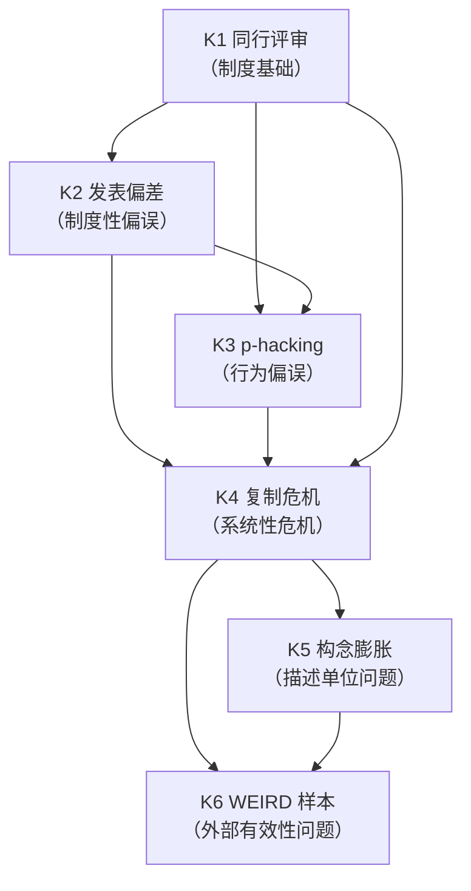
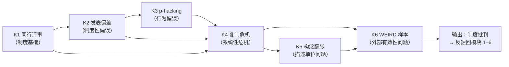

# MOD-07 · 模块 7：制度、实践与批判（变量范式 × 状态范式对比）

> **来源与性质**：变量范式集体学习模块系列第 7/7 模块，与 15-X-112／113 议案七模块清单同源；本件依主理转入稿整理，去除呈现层过渡结构（四层次包装），知识内容全量保留。库内锚点引用前须自核（见 rn）。

>
> **框架声明（15-RPT-115 #1/#2·v0.1.1 订正批增）**：本件「四层次」结构系输出构造、非库内文档框架；模块 MECE 编号与知识点清单照 15-X-112 原文展开。

## 1.1 模块定位表

| 项 | 内容 |
|---|---|
| 所属范式 | 变量范式 |
| MECE 编号 | 模块 7 / 共 7 模块 |
| 核心问题 | 知识如何被评价、传播、修正？ |
| 关键知识 | 同行评审、发表偏差、p-hacking、复制危机、构念膨胀、WEIRD 样本 |
| 代表方法/工具 | 预注册、开放数据、元分析、多宇宙分析 |
| 在知识生产链中的位置 | **第七环·元层反馈**——上游承接模块 1–6 的全部实践，下游反馈回模块 1–6 的问题诊断与修正方向 |
| 状态范式对位模块 | **模块 8“治理与证据”**（IET 证据分级、ACCP、IEGP、预注册、六道隔离（源稿「七道」系偏·15-RPT-115 T-1 订正）、边界登记）＋**模块 10“元方法与建构”**（CI 训练、Cognitec-2、Constructec-2、CrystalOps、C6、ANA） |
| 本模块的真正分歧 | 批判对象：方法缺陷/制度缺陷 vs 描述单位/数学对象错位；修正路径：方法改进/制度改进 vs 换数学工具/换描述单位；自我修正极限：可信度问题可修 vs 描述单位问题不可修；治理层级：研究层面 vs 实验治理规程 + 证据分级 |
| 变量范式的历史地位 | 这是变量范式**最坚固的堡垒之一**（15-X-112 §六）；也是变量范式**自我反思最深刻**的领域；03-A-07 §五以库恩框架诊断：心理学处于**危机晚期** |
| 关键张力 | 变量范式的制度批判在**可信度问题**上高度成熟；状态范式追问**描述单位问题**，要求换数学工具；二者批判层次不同 |

## 1.2 知识点清单表

| # | 知识点 | 一句话定位 | 在变量范式中的角色 |
|---|---|---|---|
| K1 | 同行评审 | 学术知识的质量控制机制 | 知识生产的制度基础 |
| K2 | 发表偏差 | 显著结果更易发表，导致文献系统性偏误 | 制度性偏误的核心 |
| K3 | p-hacking | 研究者自由度导致 p 值操纵 | 研究者行为偏误 |
| K4 | 复制危机 | 高影响力研究复现率低（36%） | 范式的系统性危机 |
| K5 | 构念膨胀 | 27,000 个量表，56% 未被引用 | 描述单位问题的表现 |
| K6 | WEIRD 样本 | 样本过度代表西方、受过教育、工业化、富裕、民主人群 | 外部有效性问题 |

## 1.3 每个知识点的大纲解释表

| 知识点 | 简要大纲解释 |
|---|---|
| **K1 同行评审** | 学术知识的质量控制机制：研究发表前由同行专家评审。核心功能：筛选质量、提供反馈、维护标准。问题：评审者偏见、评审质量不稳定、保守倾向、耗时、无偿劳动。改革方向：开放评审、注册报告、发表后评审。 |
| **K2 发表偏差** | 显著结果更易发表，导致文献系统性偏误。表现：文件抽屉问题（不显著结果不发表）、阳性结果偏倚、期刊偏好。后果：元分析效应量高估、文献系统性偏误、复制失败。改革方向：预注册、注册报告、结果无关发表、开放数据。 |
| **K3 p-hacking** | 研究者自由度导致 p 值操纵。表现：选择性报告、停止规则灵活、协变量选择、结果变量选择、数据排除。后果：假阳性率膨胀、效应量高估、复制失败。改革方向：预注册、多宇宙分析、盲分析、分析计划冻结。 |
| **K4 复制危机** | 高影响力研究复现率低。Open Science Collaboration (2015)：100 项高影响力心理学研究复现中，仅 36% 达到原始统计显著性（原始 97%——基数口径＝该 100 项原始研究报告自身的显著率·15-RPT-115 #14 补注）。根源：发表偏差、p-hacking、低统计功效、构念膨胀、情境依赖性。改革方向：开放科学、预注册、大样本复现、多中心合作。 |
| **K5 构念膨胀** | PsycTests 数据库约 27,000 个量表，56% 未被任何论文引用。根源：变量范式将有限功能状态在不同情境下的无限投影读数当作独立构念加以命名。后果：构念体系碎片化、知识累积困难、测量工具冗余。改革方向：构念整合、法则网络、统一描述单位。 |
| **K6 WEIRD 样本** | 样本过度代表西方、受过教育、工业化、富裕、民主（WEIRD）人群。Henrich et al. (2010)：心理学研究样本中 96% 来自 WEIRD 人群，但仅占世界人口 12%。后果：外部有效性受限、跨文化普适性未验证。改革方向：跨文化研究、多样化样本、文化适配。 |

## 2.1 K1 同行评审 —— 详细对比

| 维度 | 变量范式（同行评审） | 状态范式（治理规程 + 证据分级） |
|---|---|---|
| 核心功能 | 研究发表前质量筛选 | 实验全过程治理 + 产出分级 |
| 治理层级 | 研究层面（单篇论文） | 实验治理规程（IEGP）+ 证据分级（IET） |
| 质量控制对象 | 论文质量、方法严谨性 | 判据冻结、可复现性、证据等级 |
| 评审者 | 匿名同行专家 | 多席外审 + 内审 + AI 评审团 |
| 评审标准 | 新颖性、方法严谨性、显著性 | 判据冻结、可复现包、证据分级 |
| 透明度 | 通常匿名 | 审计帧自守纪律、六席往返账 |
| 改革方向 | 开放评审、注册报告 | IEGP 治理规程 + 六门控一回环 |
| 库内对应 | — | 26-WP-S3-36（IEGP）；05-R-01（压力测试）；26-RPT-01（边界巡检） |
| 关键分歧 | 变量范式：同行评审是研究层面质量控制；状态范式：治理规程是实验全过程治理 + 产出分级 | 前者关注单篇论文质量；后者关注实验全过程 + 证据等级 |

## 2.2 K2 发表偏差 —— 详细对比

| 维度 | 变量范式（发表偏差） | 状态范式（预注册冻结 + 负结果入册） |
|---|---|---|
| 核心问题 | 显著结果更易发表，导致文献系统性偏误 | 预注册冻结假设 + 负结果入册即合格结论 |
| 偏误来源 | 期刊偏好、作者行为、文件抽屉 | 预注册 + 冻结判据减少研究者自由度 |
| 后果 | 元分析效应量高估、复制失败 | 预注册冻结 + 负结果入册保证证据完整性 |
| 改革工具 | 预注册、注册报告、结果无关发表 | IEGP 预注册冻结件 + 判据冻结件 + 可复现包 |
| 证据完整性 | 开放数据、开放材料 | 可复现包四要素 + 外部独立复验 |
| 制度保障 | 开放科学、OSF | IEGP 治理规程 + IET 证据分级 |
| 库内对应 | — | 26-WP-S3-36（IEGP）；26-WP-S3-14（预注册冻结件）；05-R-01（压力测试） |
| 关键分歧 | 变量范式：预注册减少发表偏差；状态范式：预注册冻结 + 负结果入册保证证据完整性 | 前者关注减少偏误；后者关注证据完整性 + 可复现性 |

## 2.3 K3 p-hacking —— 详细对比

| 维度 | 变量范式（p-hacking） | 状态范式（判据冻结 + 多宇宙分析） |
|---|---|---|
| 核心问题 | 研究者自由度导致 p 值操纵 | 判据冻结 + 分析计划冻结减少自由度 |
| 自由度来源 | 选择性报告、停止规则、协变量选择 | 预注册冻结件 + 判据冻结件 |
| 后果 | 假阳性率膨胀、效应量高估 | 冻结判据 + 多宇宙分析保证稳健性 |
| 改革工具 | 预注册、多宇宙分析、盲分析 | IEGP 预注册冻结件 + 判据冻结件 + 分析计划 |
| 分析透明度 | 开放代码、开放数据 | 可复现包四要素 + 机检留痕 |
| 制度保障 | 注册报告、分析计划冻结 | IEGP 治理规程 + ACCP 控制点 |
| 库内对应 | — | 26-WP-S3-36（IEGP）；26-WP-S3-14（预注册冻结件）；26-WP-S3-15（控制点五件套） |
| 关键分歧 | 变量范式：预注册减少 p-hacking；状态范式：判据冻结 + 机检留痕保证分析透明度 | 前者关注减少自由度；后者关注判据冻结 + 可复现性 |

## 2.4 K4 复制危机 —— 详细对比

| 维度 | 变量范式（复制危机） | 状态范式（强反例协议 + 边界登记） |
|---|---|---|
| 核心问题 | 高影响力研究复现率低（36%） | 强反例协议 + 边界登记 + 替代测试 |
| 根源诊断 | 发表偏差、p-hacking、低功效、构念膨胀、情境依赖 | 描述单位错位、数学对象错位 |
| 后果 | 范式信任危机、知识累积困难 | 强反例协议 + 替代测试保证可证伪性 |
| 改革工具 | 开放科学、预注册、大样本复现 | IET 证据分级 + IEGP 治理规程 + 替代测试 |
| 复现标准 | 统计显著性复现 | 可复现包四要素 + 外部独立复验 |
| 制度保障 | 多中心合作、开放数据 | 26-SIPE + 18-DIVE + 治理规程 |
| 库内对应 | — | 03-A-07（走出洞穴）；05-R-01（压力测试）；26-WP-S3-36（IEGP） |
| 关键分歧 | 变量范式：复制危机是方法/制度问题；状态范式：复制危机是描述单位/数学对象错位 | 前者用方法改进修复；后者用换数学工具修复 |

## 2.5 K5 构念膨胀 —— 详细对比

| 维度 | 变量范式（构念膨胀） | 状态范式（统一功能坐标系） |
|---|---|---|
| 核心问题 | 27,000 个量表，56% 未被引用 | 统一功能坐标系 + PCUI 映射 |
| 根源诊断 | 变量范式将有限功能状态在不同情境下的无限投影读数当作独立构念 | 功能状态有限（42 维），观测投影无限 |
| 后果 | 构念体系碎片化、知识累积困难 | 统一坐标系 + PCUI 映射保证知识累积 |
| 改革工具 | 构念整合、法则网络、网络理论 | IODS 坐标系 + PCUI-L + D 矩阵 |
| 描述单位 | 构念（现象层） | 功能组件（功能层） |
| 知识累积 | 构念之间关系网 | 功能组件生成架构 + 观测函数 h |
| 库内对应 | — | 01-M-02（IODS）；01-M-03（PSE）；03-A-07 §4.2 |
| 关键分歧 | 变量范式：构念膨胀是测量工具冗余；状态范式：构念膨胀是描述单位错位 | 前者用构念整合修复；后者用统一功能坐标系修复 |

## 2.6 K6 WEIRD 样本 —— 详细对比

| 维度 | 变量范式（WEIRD 样本） | 状态范式（跨基质 + 跨文化 + 跨模型） |
|---|---|---|
| 核心问题 | 样本过度代表 WEIRD 人群 | 跨基质对照 + 跨文化适配 + 跨模型泛化 |
| 外部有效性 | 受限于 WEIRD 样本 | 跨基质/跨模型泛化（M4b/M4c） |
| 普适性 | 跨文化普适性未验证 | 基质无关性逐基质实证 |
| 改革工具 | 跨文化研究、多样化样本 | 22-A-01（基质运行栈）+ 22-DEF-01 §3.3.1 |
| 样本策略 | 多样化样本、跨文化比较 | 碳基/硅基双柱 + 跨模型泛化 |
| 文化适配 | 文化适配、测量不变性 | DMD 文化考量（03-C-13 §8.3） |
| 库内对应 | — | 22-A-01（基质运行栈）；22-DEF-01 §3.3.1；03-C-13 §8.3 |
| 关键分歧 | 变量范式：WEIRD 样本是外部有效性问题；状态范式：跨基质/跨文化/跨模型是普适性问题 | 前者关注样本代表性；后者关注基质无关性 + 跨模型泛化 |

## 3.1 K1 同行评审 —— 知识库链接表

| 类别 | 内容 | 库内/库外对应 |
|---|---|---|
| 核心工具 | 同行评审、开放评审、注册报告 | — |
| 相关理论 | 科学社会学、知识生产 | Merton (1973)；Ziman (2000) |
| 心理学表现 | 期刊评审、基金评审 | — |
| 状态范式对位 | IEGP 治理规程 + IET 证据分级 + 六席外审 | 26-WP-S3-36；05-R-01；26-RPT-01 |
| 关键文档 | 26-WP-S3-36《IEGP v3.1》；05-R-01《内部理论压力测试报告》；26-RPT-01《边界巡检》 | 库内 |
| 关键论证 | 同行评审是研究层面质量控制 ↔ IEGP 治理规程是实验全过程治理 + 产出分级 | 26-WP-S3-36 §5.2（五门签字序）；05-R-01 §三 |
| 延伸阅读 | Merton (1973)；Ziman (2000) | 库外 |
| 相关争议 | 评审者偏见；评审质量不稳定；保守倾向 | — |

## 3.2 K2 发表偏差 —— 知识库链接表

| 类别 | 内容 | 库内/库外对应 |
|---|---|---|
| 核心工具 | 预注册、注册报告、结果无关发表 | — |
| 相关理论 | 发表偏差、文件抽屉问题 | Rosenthal (1979)；Ferguson & Heene (2012) |
| 心理学表现 | 期刊偏好、文件抽屉 | — |
| 状态范式对位 | 预注册冻结件 + 判据冻结件 + 可复现包 | 26-WP-S3-36；26-WP-S3-14；05-R-01 |
| 关键文档 | 26-WP-S3-36《IEGP》§6.7（生效条）；26-WP-S3-14《预注册冻结件》；05-R-01《压力测试》 | 库内 |
| 关键论证 | 预注册减少发表偏差 ↔ 预注册冻结 + 负结果入册保证证据完整性 | 26-WP-S3-36 §6.5（纪律红线）；05-R-01 §三 |
| 延伸阅读 | Rosenthal (1979)；Ferguson & Heene (2012)；Nosek et al. (2015) | 库外 |
| 相关争议 | 预注册的灵活性；探索性研究的地位 | — |

## 3.3 K3 p-hacking —— 知识库链接表

| 类别 | 内容 | 库内/库外对应 |
|---|---|---|
| 核心工具 | 预注册、多宇宙分析、盲分析 | — |
| 相关理论 | 研究者自由度、p 值操纵 | Simmons et al. (2011)；Steegen et al. (2016) |
| 心理学表现 | 选择性报告、停止规则灵活 | — |
| 状态范式对位 | 判据冻结 + 机检留痕 + 多宇宙分析 | 26-WP-S3-36；26-WP-S3-14；26-WP-S3-15 |
| 关键文档 | 26-WP-S3-36《IEGP》§6.5（纪律红线）；26-WP-S3-14《预注册冻结件》；26-WP-S3-15《控制点五件套》 | 库内 |
| 关键论证 | 预注册减少 p-hacking ↔ 判据冻结 + 机检留痕保证分析透明度 | 26-WP-S3-36 §3.2（工具格）；26-WP-S3-15 |
| 延伸阅读 | Simmons et al. (2011)；Steegen et al. (2016)；Wicherts et al. (2016) | 库外 |
| 相关争议 | 研究者自由度的界定；预注册的灵活性 | — |

## 3.4 K4 复制危机 —— 知识库链接表

| 类别 | 内容 | 库内/库外对应 |
|---|---|---|
| 核心工具 | 开放科学、预注册、大样本复现 | — |
| 相关理论 | 复制危机、可复现性 | Open Science Collaboration (2015)；Nosek et al. (2015) |
| 心理学表现 | 高影响力研究复现率低（36%） | — |
| 状态范式对位 | 强反例协议 + 边界登记 + 替代测试 | 05-R-01；26-RPT-01；03-A-07 |
| 关键文档 | 03-A-07《走出洞穴》；05-R-01《压力测试》；26-RPT-01《边界巡检》 | 库内 |
| 关键论证 | 复制危机是方法/制度问题 ↔ 复制危机是描述单位/数学对象错位 | 03-A-07 §4.3；05-R-01 §三 |
| 延伸阅读 | Open Science Collaboration (2015)；Nosek et al. (2015)；Baker (2016) | 库外 |
| 相关争议 | 复制危机的根源；方法改进 vs 换数学工具 | 03-A-07 §4.3 |

## 3.5 K5 构念膨胀 —— 知识库链接表

| 类别 | 内容 | 库内/库外对应 |
|---|---|---|
| 核心工具 | 构念整合、法则网络、网络理论 | — |
| 相关理论 | 构念效度、法则网络 | Cronbach & Meehl (1955)；Borsboom (2017) |
| 心理学表现 | PsycTests 数据库 27,000 个量表 | — |
| 状态范式对位 | 统一功能坐标系 + PCUI 映射 + D 矩阵 | 01-M-02；01-M-03；03-A-07 §4.2 |
| 关键文档 | 01-M-02《IODS》；01-M-03《PSE》；03-A-07《走出洞穴》§4.2 | 库内 |
| 关键论证 | 构念膨胀是测量工具冗余 ↔ 构念膨胀是描述单位错位 | 03-A-07 §4.2；01-M-02 §五 |
| 延伸阅读 | Cronbach & Meehl (1955)；Borsboom (2017) | 库外 |
| 相关争议 | 构念整合的可能性；描述单位问题 | 03-A-07 §4.5 |

## 3.6 K6 WEIRD 样本 —— 知识库链接表

| 类别 | 内容 | 库内/库外对应 |
|---|---|---|
| 核心工具 | 跨文化研究、多样化样本、测量不变性 | — |
| 相关理论 | WEIRD 样本、文化心理学 | Henrich et al. (2010) |
| 心理学表现 | 样本过度代表 WEIRD 人群 | — |
| 状态范式对位 | 跨基质对照 + 跨文化适配 + 跨模型泛化 | 22-A-01；22-DEF-01 §3.3.1；03-C-13 §8.3 |
| 关键文档 | 22-A-01《基质运行栈》；22-DEF-01《智能科学公理化定义》§3.3.1；03-C-13《DMD》§8.3 | 库内 |
| 关键论证 | WEIRD 样本是外部有效性问题 ↔ 跨基质/跨文化/跨模型是普适性问题 | 22-A-01 §三；22-DEF-01 §3.3.1 |
| 延伸阅读 | Henrich et al. (2010)；Vandenberg & Lance (2000) | 库外 |
| 相关争议 | 跨文化普适性；测量不变性；文化适配 | — |

## 4.1 依赖关系总表

| 知识点 | 依赖 | 被依赖 | 依赖类型 | 说明 |
|---|---|---|---|---|
| K1 同行评审 | 模块 1–6 全部实践 | K2、K3、K4 | 制度基础 | 同行评审是知识生产的制度基础；其缺陷导致发表偏差、p-hacking、复制危机 |
| K2 发表偏差 | K1、模块 4（K1 NHST） | K3、K4 | 制度性偏误 | 发表偏差源于同行评审和 NHST 制度 |
| K3 p-hacking | K1、K2、模块 4（K1 NHST） | K4 | 研究者行为偏误 | p-hacking 源于研究者自由度和发表压力 |
| K4 复制危机 | K1、K2、K3 | K5、K6 | 系统性危机 | 复制危机是发表偏差、p-hacking、低功效、构念膨胀、情境依赖的综合后果 |
| K5 构念膨胀 | K1–K4、模块 2（K4 效度） | K6 | 描述单位问题 | 构念膨胀是变量范式描述单位问题的表现 |
| K6 WEIRD 样本 | K1–K5、模块 3（K5 抽样） | — | 外部有效性问题 | WEIRD 样本是变量范式外部有效性问题 |

## 4.2 依赖关系图

## 4.3 依赖关系深度解剖表

| 依赖对 | 依赖内容 | 深度 | 结构性后果 |
|---|---|---|---|
| K1 → K2 | 同行评审 → 发表偏差 | 强 | 同行评审偏好显著结果，导致发表偏差 |
| K1 → K3 | 同行评审 → p-hacking | 中 | 发表压力导致研究者 p-hacking |
| K2 → K3 | 发表偏差 → p-hacking | 强 | 发表偏差激励 p-hacking |
| K2 → K4 | 发表偏差 → 复制危机 | 强 | 发表偏差导致文献系统性偏误，复制失败 |
| K3 → K4 | p-hacking → 复制危机 | 强 | p-hacking 导致假阳性率膨胀，复制失败 |
| K1 → K4 | 同行评审 → 复制危机 | 中 | 同行评审未能有效筛选低质量研究 |
| K4 → K5 | 复制危机 → 构念膨胀 | 中 | 复制失败未迫使研究者放弃原有对象观，反而引入新调节变量 |
| K4 → K6 | 复制危机 → WEIRD 样本 | 弱 | 复制危机部分源于样本局限性 |
| K5 → K6 | 构念膨胀 → WEIRD 样本 | 弱 | 构念膨胀与 WEIRD 样本共同导致外部有效性受限 |

## 4.4 与状态范式的依赖关系对比

| 变量范式依赖 | 状态范式对应 | 差异 |
|---|---|---|
| K1 同行评审 → K2 发表偏差 | IEGP 治理规程 → 预注册冻结 + 判据冻结 | 变量范式用同行评审；状态范式用治理规程 + 证据分级 |
| K2 发表偏差 → K3 p-hacking | 预注册冻结 → 判据冻结 + 多宇宙分析 | 变量范式用预注册减少偏误；状态范式用判据冻结 + 机检留痕保证透明度 |
| K3 p-hacking → K4 复制危机 | 判据冻结 → 强反例协议 + 边界登记 | 变量范式用方法改进修复；状态范式用换数学工具修复 |
| K4 复制危机 → K5 构念膨胀 | 强反例协议 → 统一功能坐标系 | 变量范式用构念整合修复；状态范式用统一功能坐标系修复 |
| K5 构念膨胀 → K6 WEIRD 样本 | 统一功能坐标系 → 跨基质/跨文化/跨模型 | 变量范式用多样化样本修复；状态范式用跨基质对照 + 跨模型泛化修复 |
| K1–K6 | IEGP + IET + 强反例协议 + 边界登记 | 变量范式用方法/制度改进；状态范式用换描述单位/换数学工具 |

## 4.5 关键依赖链：从同行评审到 WEIRD 样本

**关键结论：**

1. **同行评审是制度基础**：其缺陷（偏好显著结果、评审质量不稳定）导致发表偏差、p-hacking、复制危机。
2. **发表偏差和 p-hacking 是制度性/行为性偏误**：二者共同导致文献系统性偏误。
3. **复制危机是系统性危机**：发表偏差、p-hacking、低统计功效、构念膨胀、情境依赖的综合后果。
4. **构念膨胀是描述单位问题**：复制失败未迫使研究者放弃原有对象观，反而引入新调节变量——这是库恩所说的辅助假设增生。
5. **WEIRD 样本是外部有效性问题**：样本过度代表西方人群，跨文化普适性未验证。
6. **模块 7 的输出是制度批判**：这些批判反馈回模块 1–6 的问题诊断与修正方向。
7. **与状态范式的根本差异**：变量范式的批判对象是**方法缺陷/制度缺陷**；状态范式的批判对象是**描述单位/数学对象错位**。变量范式的修正路径是**方法改进/制度改进**；状态范式的修正路径是**换数学工具/换描述单位**。变量范式的自我修正极限是**可信度问题可修**；状态范式追问**描述单位问题不可修**——必须换数学工具。

## 4.6 模块间依赖：模块 7 与相邻模块的关系

| 关系 | 上游 | 下游 | 依赖内容 |
|---|---|---|---|
| 模块 1 → 模块 7 | 本体论预设 | 制度、实践与批判 | 模块 1 的本体论预设（变量实在论）是构念膨胀的根源 |
| 模块 2 → 模块 7 | 测量模型 | 制度、实践与批判 | 模块 2 的测量实践受模块 7 的制度批判约束（构念膨胀、测量不变性困难） |
| 模块 3 → 模块 7 | 研究设计 | 制度、实践与批判 | 模块 3 的预注册/开放科学受模块 7 的制度批判约束 |
| 模块 4 → 模块 7 | 统计模型 | 制度、实践与批判 | 模块 4 的 NHST 制度受模块 7 的批判（p-hacking、复制危机） |
| 模块 5 → 模块 7 | 因果结论 | 制度、实践与批判 | 模块 5 的因果推断受模块 7 的制度批判约束（节点本体不清、可忽略性不可检验） |
| 模块 6 → 模块 7 | 形式模型 | 制度、实践与批判 | 模块 6 的形式模型受模块 7 的制度批判约束（预测能力 vs 可解释性） |
| 模块 7 → 模块 1–6 | 制度批判 | 反馈修正 | 模块 7 的制度批判反馈回模块 1–6 的问题诊断与修正方向 |

## 疑问解答（附属·v0.2.0 增）

本节系主理 Agent 2026-10-13 会话转入之附属疑问解答（13 条·逐条以表格作答），与正文四节互为补充、不替代；内容逐字落盘未改一字。

### 疑问 1：模块七“本模块的真正分歧”指出批判对象、修正路径、自我修正极限、治理层级四重分歧。这四重分歧如何与模块一至模块六的预设衔接？

| 维度 | 变量范式 | 状态范式 |
|---|---|---|
| 批判对象 | 方法缺陷/制度缺陷 | 描述单位/数学对象错位 |
| 修正路径 | 方法改进/制度改进 | 换数学工具/换描述单位 |
| 自我修正极限 | 可信度问题可修 | 描述单位问题不可修 |
| 治理层级 | 研究层面 | 实验治理规程 + 证据分级 |
| 与模块一衔接 | 模块一决定“变量是什么”，模块七反思“这套知识生产制度是否可靠”；批判对象继承变量实在论 | 模块一决定“功能层是什么”，模块七追问“描述单位是否错位”；批判对象继承约束功能主义 |
| 与模块二至六衔接 | 模块二至六的实践（测量、设计、统计、因果、计算）全部成为模块七的批判素材 | 模块二至六对应的状态范式实践（观测函数、密集纵向、状态空间模型、生成机制、统一功能坐标系）成为模块七的对照基准 |
| 一句话 | 模块七是变量范式的“元层反馈”，上承模块一至六的全部实践，下游反馈回模块一至六的问题诊断与修正方向；状态范式把批判层次从“方法/制度”提升到“描述单位/数学对象” |

---

### 疑问 2：K1 同行评审在变量范式中是知识生产的制度基础。状态范式如何将其升格为“治理规程 + 证据分级”？

| 维度 | 变量范式（同行评审） | 状态范式（治理规程 + 证据分级） |
|---|---|---|
| 核心功能 | 研究发表前质量筛选 | 实验全过程治理 + 产出分级 |
| 治理层级 | 研究层面（单篇论文） | 实验治理规程（IEGP）+ 证据分级（IET） |
| 质量控制对象 | 论文质量、方法严谨性 | 判据冻结、可复现性、证据等级 |
| 评审者 | 匿名同行专家 | 多席外审 + 内审 + AI 评审团 |
| 评审标准 | 新颖性、方法严谨性、显著性 | 判据冻结、可复现包、证据分级 |
| 透明度 | 通常匿名 | 审计帧自守纪律、六席往返账 |
| 改革方向 | 开放评审、注册报告 | IEGP 治理规程 + 六门控一回环 |
| 升格方式 | 同行评审是研究层面质量控制；状态范式用治理规程覆盖实验全过程 + 产出分级 | — |
| 一句话 | 变量范式的同行评审关注单篇论文质量；状态范式的治理规程关注实验全过程 + 证据等级 |

---

### 疑问 3：K1 同行评审的问题（评审者偏见、评审质量不稳定、保守倾向）在状态范式中是否被解决？面临什么新问题？

| 维度 | 变量范式（同行评审问题） | 状态范式（治理规程新问题） |
|---|---|---|
| 评审者偏见 | 匿名同行专家可能带有学派、方法偏好 | 多席外审 + AI 评审团，但席位选择、基座差异仍可能引入偏见 |
| 评审质量不稳定 | 评审者水平参差，标准不一 | 判据冻结 + 判读协议 + 判者资格与执行度（JQC/JECC） |
| 保守倾向 | 偏好符合主流范式的论文 | 判据冻结 + 预注册，减少事后调整空间 |
| 耗时/无偿劳动 | 评审周期长，评审者无偿 | 治理规程复杂，执行成本高 |
| 新问题1 | — | 治理规程的复杂度：五门签字序、六类角色席位、漏洞六类制、止损线 G1-G4 |
| 新问题2 | — | 判据冻结件更新机制：一旦冻结，如何应对新证据 |
| 新问题3 | — | 审计帧自守纪律：外审在途期间受审窗只加行、不改已被判读数 |
| 一句话 | 状态范式用治理规程应对同行评审的偏见与不稳定，但引入了治理复杂度、判据冻结更新、审计帧自守等新问题 |

---

### 疑问 4：K2 发表偏差的核心问题是“显著结果更易发表”。状态范式如何用预注册冻结 + 负结果入册来应对？

| 维度 | 变量范式（发表偏差） | 状态范式（预注册冻结 + 负结果入册） |
|---|---|---|
| 核心问题 | 显著结果更易发表，导致文献系统性偏误 | 预注册冻结假设 + 负结果入册即合格结论 |
| 偏误来源 | 期刊偏好、作者行为、文件抽屉 | 预注册 + 冻结判据减少研究者自由度 |
| 后果 | 元分析效应量高估、复制失败 | 预注册冻结 + 负结果入册保证证据完整性 |
| 改革工具 | 预注册、注册报告、结果无关发表 | IEGP 预注册冻结件 + 判据冻结件 + 可复现包 |
| 证据完整性 | 开放数据、开放材料 | 可复现包四要素 + 外部独立复验 |
| 制度保障 | 开放科学、OSF | IEGP 治理规程 + IET 证据分级 |
| 应对方式 | 预注册减少发表偏差；状态范式用预注册冻结 + 负结果入册保证证据完整性 | — |
| 一句话 | 变量范式关注减少偏误；状态范式关注证据完整性 + 可复现性 |

---

### 疑问 5：K3 p-hacking 的核心问题是“研究者自由度”。状态范式如何用判据冻结 + 机检留痕来应对？

| 维度 | 变量范式（p-hacking） | 状态范式（判据冻结 + 多宇宙分析） |
|---|---|---|
| 核心问题 | 研究者自由度导致 p 值操纵 | 判据冻结 + 分析计划冻结减少自由度 |
| 自由度来源 | 选择性报告、停止规则、协变量选择 | 预注册冻结件 + 判据冻结件 |
| 后果 | 假阳性率膨胀、效应量高估 | 冻结判据 + 多宇宙分析保证稳健性 |
| 改革工具 | 预注册、多宇宙分析、盲分析 | IEGP 预注册冻结件 + 判据冻结件 + 分析计划 |
| 分析透明度 | 开放代码、开放数据 | 可复现包四要素 + 机检留痕 |
| 制度保障 | 注册报告、分析计划冻结 | IEGP 治理规程 + ACCP 控制点 |
| 应对方式 | 预注册减少 p-hacking；状态范式用判据冻结 + 机检留痕保证分析透明度 | — |
| 一句话 | 变量范式关注减少自由度；状态范式关注判据冻结 + 可复现性 |

---

### 疑问 6：K4 复制危机的诊断是“方法/制度问题”。状态范式为何将其诊断为“描述单位/数学对象错位”？

| 维度 | 变量范式（复制危机） | 状态范式（强反例协议 + 边界登记） |
|---|---|---|
| 核心问题 | 高影响力研究复现率低（36%） | 强反例协议 + 边界登记 + 替代测试 |
| 根源诊断 | 发表偏差、p-hacking、低功效、构念膨胀、情境依赖 | 描述单位错位、数学对象错位 |
| 后果 | 范式信任危机、知识累积困难 | 强反例协议 + 替代测试保证可证伪性 |
| 改革工具 | 开放科学、预注册、大样本复现 | IET 证据分级 + IEGP 治理规程 + 替代测试 |
| 复现标准 | 统计显著性复现 | 可复现包四要素 + 外部独立复验 |
| 制度保障 | 多中心合作、开放数据 | 26-SIPE + 18-DIVE + 治理规程 |
| 诊断差异 | 复制危机是方法/制度问题；状态范式诊断为描述单位/数学对象错位 | — |
| 一句话 | 变量范式用方法改进修复复制危机；状态范式用换数学工具修复 |

---

### 疑问 7：K4 复制危机与“原始 97% 显著率”的基数口径是什么？这一数据如何支持状态范式的诊断？

| 维度 | 解答 |
|---|---|
| 数据来源 | Open Science Collaboration (2015)：100 项高影响力心理学研究复现中，仅 36% 达到原始统计显著性 |
| 原始 97% 的含义 | 该 100 项原始研究报告自身的显著率（基数口径＝该 100 项原始研究） |
| 对比含义 | 原始研究 97% 报告显著结果，复现研究仅 36% 仍达到显著 |
| 变量范式的解释 | 方法缺陷、发表偏差、p-hacking、低统计功效 |
| 状态范式的解释 | 观测函数 h 高度依赖情境参数，而变量范式未显式建模这一依赖关系 |
| 情境依赖性 | 样本特征、环境背景、实施细节的改变，都可能导致投影形态的变化 |
| 状态范式的判断 | 复制危机不完全是方法缺陷所致；变量范式在跨情境稳定承载上受其数学对象边界约束 |
| 一句话 | 36% 复现率是变量范式的系统性危机信号；状态范式将其诊断为“未建模观测函数 h 的情境漂移” |

---

### 疑问 8：K5 构念膨胀的核心诊断是“27,000 个量表，56% 未被引用”。状态范式如何将其诊断为“描述单位错位”？

| 维度 | 变量范式（构念膨胀） | 状态范式（统一功能坐标系） |
|---|---|---|
| 核心问题 | 27,000 个量表，56% 未被引用 | 统一功能坐标系 + PCUI 映射 |
| 根源诊断 | 变量范式将有限功能状态在不同情境下的无限投影读数当作独立构念 | 功能状态有限（42 维），观测投影无限 |
| 库恩框架定位 | 构念膨胀是库恩所说的辅助假设增生的表现 | — |
| 后果 | 构念体系碎片化、知识累积困难 | 统一坐标系 + PCUI 映射保证知识累积 |
| 改革工具 | 构念整合、法则网络、网络理论 | IODS 坐标系 + PCUI-L + D 矩阵 |
| 描述单位 | 构念（现象层） | 功能组件（功能层） |
| 知识累积 | 构念之间关系网 | 功能组件生成架构 + 观测函数 h |
| 诊断差异 | 构念膨胀是测量工具冗余；状态范式诊断为描述单位错位 | — |
| 一句话 | 变量范式用构念整合修复构念膨胀；状态范式用统一功能坐标系修复 |

---

### 疑问 9：K6 WEIRD 样本的核心问题是“样本过度代表西方人群”。状态范式如何用跨基质 + 跨文化 + 跨模型来应对？

| 维度 | 变量范式（WEIRD 样本） | 状态范式（跨基质 + 跨文化 + 跨模型） |
|---|---|---|
| 核心问题 | 样本过度代表 WEIRD 人群 | 跨基质对照 + 跨文化适配 + 跨模型泛化 |
| 外部有效性 | 受限于 WEIRD 样本 | 跨基质/跨模型泛化（M4b/M4c） |
| 普适性 | 跨文化普适性未验证 | 基质无关性逐基质实证 |
| 改革工具 | 跨文化研究、多样化样本 | 22-A-01（基质运行栈）+ 22-DEF-01 §3.3.1 |
| 样本策略 | 多样化样本、跨文化比较 | 碳基/硅基双柱 + 跨模型泛化 |
| 文化适配 | 文化适配、测量不变性 | DMD 文化考量（03-C-13 §8.3） |
| 应对方式 | WEIRD 样本是外部有效性问题；状态范式用跨基质/跨文化/跨模型应对 | — |
| 一句话 | 变量范式关注样本代表性；状态范式关注基质无关性 + 跨模型泛化 |

---

### 疑问 10：模块七的知识点依赖链是否闭合？状态范式如何对应？

| 变量范式依赖 | 状态范式对应 | 差异 |
|---|---|---|
| K1 同行评审 → K2 发表偏差 | IEGP 治理规程 → 预注册冻结 + 判据冻结 | 变量范式用同行评审；状态范式用治理规程 + 证据分级 |
| K2 发表偏差 → K3 p-hacking | 预注册冻结 → 判据冻结 + 多宇宙分析 | 变量范式用预注册减少偏误；状态范式用判据冻结 + 机检留痕保证透明度 |
| K3 p-hacking → K4 复制危机 | 判据冻结 → 强反例协议 + 边界登记 | 变量范式用方法改进修复；状态范式用换数学工具修复 |
| K4 复制危机 → K5 构念膨胀 | 强反例协议 → 统一功能坐标系 | 变量范式用构念整合修复；状态范式用统一功能坐标系修复 |
| K5 构念膨胀 → K6 WEIRD 样本 | 统一功能坐标系 → 跨基质/跨文化/跨模型 | 变量范式用多样化样本修复；状态范式用跨基质对照 + 跨模型泛化修复 |
| K1-K6 | IEGP + IET + 强反例协议 + 边界登记 | 变量范式用方法/制度改进；状态范式用换描述单位/换数学工具 |
| 依赖链是否闭合 | 从同行评审出发，经由发表偏差、p-hacking、复制危机、构念膨胀，到达 WEIRD 样本；WEIRD 样本又反馈回整个知识生产制度 | 状态范式从 IEGP 治理规程出发，经由预注册冻结、判据冻结、强反例协议、统一功能坐标系，到达跨基质/跨文化/跨模型 |
| 一句话 | 变量范式的依赖链以“同行评审”为制度基础；状态范式以“治理规程 + 证据分级”为制度基础 |

---

### 疑问 11：模块七与模块一至模块六的模块间依赖关系如何？

| 关系 | 上游 | 下游 | 依赖内容 |
|---|---|---|---|
| 模块 1 → 模块 7 | 本体论预设 | 制度、实践与批判 | 模块 1 的本体论预设（变量实在论）是构念膨胀的根源 |
| 模块 2 → 模块 7 | 测量模型 | 制度、实践与批判 | 模块 2 的测量实践受模块 7 的制度批判约束（构念膨胀、测量不变性困难） |
| 模块 3 → 模块 7 | 研究设计 | 制度、实践与批判 | 模块 3 的预注册/开放科学受模块 7 的制度批判约束 |
| 模块 4 → 模块 7 | 统计模型 | 制度、实践与批判 | 模块 4 的 NHST 制度受模块 7 的批判（p-hacking、复制危机） |
| 模块 5 → 模块 7 | 因果结论 | 制度、实践与批判 | 模块 5 的因果推断受模块 7 的制度批判约束（节点本体不清、可忽略性不可检验） |
| 模块 6 → 模块 7 | 形式模型 | 制度、实践与批判 | 模块 6 的形式模型受模块 7 的制度批判约束（预测能力 vs 可解释性） |
| 模块 7 → 模块 1–6 | 制度批判 | 反馈修正 | 模块 7 的制度批判反馈回模块 1–6 的问题诊断与修正方向 |
| 一句话 | 模块七是变量范式的“元层反馈”，上承模块一至六的全部实践，下游反馈回模块一至六的问题诊断与修正方向 | — | — |

---

### 疑问 12：模块七被称为“变量范式自我反思最深刻的部分”。这一判断如何理解？状态范式如何对待这一强项？

| 维度 | 解答 |
|---|---|
| 判断来源 | 15-X-112 §六指出制度批判是“变量范式最坚固的堡垒”之一；03-A-07 §五以库恩框架诊断心理学处于危机晚期 |
| 强项表现 | 复制危机、构念膨胀、WEIRD 样本等批判，揭示了变量范式的结构性困境 |
| 强项的核心 | 自我反思能力强，能够识别并命名自身的问题 |
| 状态范式如何对待 | 不否定制度批判的价值，而是重新定位：变量范式的制度批判为状态范式提供问题清单 |
| 状态范式的增量 | 把批判层次从“方法/制度”提升到“描述单位/数学对象”；把修正路径从“方法改进”换为“换数学工具” |
| 关键张力 | 变量范式的制度批判在可信度问题上高度成熟；状态范式追问描述单位问题，要求换数学工具；二者批判层次不同 |
| 一句话 | 制度批判是变量范式自我反思最深刻的部分，状态范式不否定其成就，而是将其问题清单作为自身合法性的论证资源 |

---

### 疑问 13：模块七的“自我修正极限”判断——可信度问题可修，描述单位问题不可修——如何理解？

| 维度 | 变量范式 | 状态范式 |
|---|---|---|
| 可信度问题 | 可通过预注册、开放科学、多宇宙分析修复 | 同样需要治理规程 + 证据分级 |
| 描述单位问题 | 构念膨胀、复制危机深层根源；方法改进无法修复 | 通过换数学工具（状态空间模型）、换描述单位（功能状态 Ψ）修复 |
| 自我修正极限 | 预注册、开放科学、多宇宙分析可以修复可信度问题，但无法修复描述单位问题 | — |
| 关键区分 | 可信度问题 vs 描述单位问题 | — |
| 状态范式的判断 | 变量范式的自我修正极限在于：它可以在范式内部优化，但无法消除“基本描述单位”的结构性错位 | — |
| 一句话 | 变量范式的自我修正极限是：可信度问题可修，描述单位问题不可修——后者需要换数学工具，而非改进方法 |

## 版本记录

| 版本 | 日期 | 变更说明 |
|---|---|---|
| v0.3.0 | 2026-10-29 | 双范式正名批（DR-2026-10-29-TERM-002 v1.4.0）：正文「结构范式」→「状态范式」；判升 Minor。 |
| v0.2.2 | 2026-10-16 | Patch·B261016-07：中立化续订批：「面临结构性困难」一句订正为「受数学对象边界约束」。 |
| v0.2.1 | 2026-10-16 | Patch·B261016-04：外审机械订正批：rn v0.1.1 条拆碎段还原（外审候选×本窗独立解码双路对撞·并与末表 v0.1.1 同义行对撞）。… |
| v0.2.0 | 2026-10-13 | Minor·B261013-05：疑问解答增补批：增「疑问解答（附属）」一节（13 条）。 |
| v0.1.1 | 2026-10-13 | Patch·B261013-04：订正批：#14 「原始 97%」基数口径补注；#22 七道→六道 1 处；框架声明增（#1/#2）。判升 Patch。 |
| v0.1.0 | 2026-10-13 | 建件·B261013-02：模块 7/7 知识落盘（去四层次过渡包装改四节直陈·含 4.6 模块间依赖·mermaid 3 枚与全部表格零删减保留·库内锚点抽验见 rn 余未逐条复核）。… |

> 全量版本 v0.1.0–v0.2.2（共 5 版）见 [HIST-MOD §MOD-07-制度实践与批判-v0.1-2026-10-13](HIST-MOD_双范式对比学习模块-MOD系版本沿革-v1.0-2026-10-18.md#doc-25)；当前无外迁版本。
