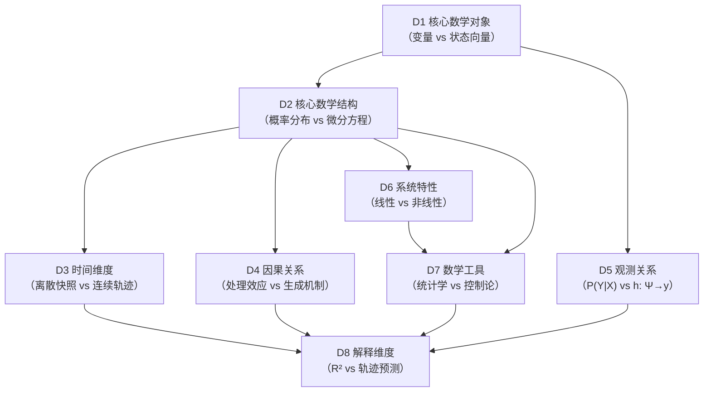
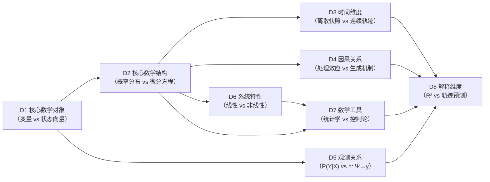

# MOD-08 · 范式间比较模块 8：两套范式的数学本质对比（变量范式 × 状态范式）

> **来源与性质**：范式间比较枢纽·承变量范式 MOD-01~07 与状态范式 SMOD-01~10 两系；本件依主理转入稿整理，去除呈现层过渡结构（四层次包装），知识内容全量保留。库内锚点引用前须自核（见 rn）。

>
> **框架声明（15-RPT-115 #1/#2·v0.1.1 订正批增）**：本件「四层次」结构系输出构造、非库内文档框架；模块 MECE 编号与知识点清单照 15-X-112 原文展开。

## 一、模块定位与知识点总览

### 1.1 模块定位表

| 项 | 内容 |
|---|---|
| 所属层级 | **范式间比较模块**（不属于变量范式内部模块，是模块 1–7 与状态范式十模块之间的过渡枢纽） |
| 来源 | 15-X-112 第三章（八维对比）＋15-X-113 核心命题（P(Y)/P(Y\|X) vs h、f） |
| 核心命题 | 变量范式是**概率空间中的协方差几何学**；状态范式是**状态空间中的生成动力学** |
| 八个对比维度 | D1 核心数学对象／D2 核心数学结构／D3 时间维度／D4 因果关系／D5 观测关系／D6 系统特性／D7 数学工具／D8 解释维度 |
| 对位模块 | 状态范式模块 5“动力学与计算引擎”（PSE）＋模块 2“状态语法”（M-R-D-S）＋模块 6“测量与观测”（观测函数 h） |
| 本模块的真正分歧 | **数学对象是否匹配心理现象的本体论性质**（15-X-113 核心命题） |
| 与 15-X-113 的关系 | 15-X-113 提供“条件必要”论证；本模块提供“八维对比”展开 |
| 与 15-X-112 的关系 | 15-X-112 第三章直接来源；15-X-112 §六指出测量理论、因果推断、统计建模、制度批判是“变量范式最坚固的堡垒” |

### 1.2 八个维度清单表

| # | 对比维度 | 变量范式 | 状态范式 | 深层差异 |
|---|---|---|---|---|
| D1 | 核心数学对象 | 变量（随机变量、潜变量） | 状态向量（42 维空间中的点） | 观测读数 vs 隐状态 |
| D2 | 核心数学结构 | 概率分布、协方差矩阵、代数方程 | 微分/差分方程、状态空间模型 | 静态结构 vs 动态生成 |
| D3 | 时间维度 | 静态横截面；或离散时间点 | 连续时间动态演化（dΨ/dt）；轨迹 | 离散快照 vs 连续轨迹 |
| D4 | 因果关系 | 外部干预推断（RCT、IV、DAG） | 内部机制生成（状态转移方程 + 干预算子） | 处理效应 vs 生成机制 |
| D5 | 观测关系 | 变量间相关/回归（P(Y\|X)） | 观测映射（h: Ψ → y），逆问题反解 | 关系描述 vs 映射反解 |
| D6 | 系统特性 | 线性、叠加、可逆 | 非线性、反馈、阈值、涌现 | 线性代数 vs 非线性动力学 |
| D7 | 数学工具 | 统计学、概率论、回归分析 | 控制论、动力系统、贝叶斯滤波 | 统计推断 vs 控制与滤波 |
| D8 | 解释维度 | 方差解释（R²） | 轨迹预测、级联路径、干预靶点 | 方差分解 vs 生成解释 |

### 1.3 每个维度的大纲解释表

| 维度 | 简要大纲解释 |
|---|---|
| **D1 核心数学对象** | 变量范式的数学对象是变量（随机变量、潜变量）——观测读数的统计抽象。状态范式的数学对象是状态向量 Ψ（42 维空间中的点）——功能状态的坐标表示。核心差异：观测读数 vs 隐状态。 |
| **D2 核心数学结构** | 变量范式用概率分布、协方差矩阵、代数方程描述变量间关系。状态范式用微分/差分方程、状态空间模型描述状态演化。核心差异：静态结构 vs 动态生成。 |
| **D3 时间维度** | 变量范式的时间维度是静态横截面或离散时间点（T1、T2…）。状态范式的时间维度是连续时间动态演化（dΨ/dt）与轨迹。核心差异：离散快照 vs 连续轨迹。 |
| **D4 因果关系** | 变量范式用外部干预推断（RCT、IV、DAG）识别处理效应。状态范式用内部机制生成（状态转移方程 + 干预算子）刻画生成机制。核心差异：处理效应 vs 生成机制。 |
| **D5 观测关系** | 变量范式的观测关系是变量间相关/回归（P(Y\|X)）——输出空间的关系分析。状态范式的观测关系是观测映射（h: Ψ → y）——状态到观测的映射 + 逆问题反解。核心差异：关系描述 vs 映射反解。 |
| **D6 系统特性** | 变量范式的系统特性假设线性、叠加、可逆。状态范式的系统特性是**非线性、反馈、阈值、涌现**。核心差异：线性代数 vs 非线性动力学。 |
| **D7 数学工具** | 变量范式的数学工具是统计学、概率论、回归分析。状态范式的数学工具是控制论、动力系统、贝叶斯滤波。核心差异：统计推断 vs 控制与滤波。 |
| **D8 解释维度** | 变量范式的解释维度是方差解释（R²）——变量间共变的比例。状态范式的解释维度是**轨迹预测、级联路径、干预靶点**。核心差异：方差分解 vs 生成解释。 |

### 1.4 核心差异公式表

| 维度 | 变量范式公式 | 状态范式公式 |
|---|---|---|
| D1 | X（随机变量）、θ（潜变量） | Ψ ∈ R^42（状态向量） |
| D2 | Σ（协方差矩阵）、Y = BX + ε | dΨ/dt = Σ w_k·f_k(Ψ, E, θ_k) |
| D3 | Y_t（离散时点） | Ψ(t)（连续轨迹） |
| D4 | P(Y\|do(X))（干预分布） | do(G-M-A-R) 作用于 Ψ |
| D5 | P(Y\|X)（条件分布） | y = h(Ψ, E) + ε |
| D6 | 线性、叠加、可逆 | 非线性、反馈、阈值、涌现 |
| D7 | 回归、SEM、HLM | 卡尔曼滤波、粒子滤波、BMA |
| D8 | R²（方差解释） | 轨迹预测 + 级联路径 + 干预靶点 |

### 1.5 核心论断：数学对象决定能力边界（15-X-117 采·15-RPT-117 甲案·v0.1.1 增；与可表达性论证合流——数学对象决定 E(F)，见《可表达性论证三档》）

> **中立标准注（2026-10-16·15-X-124 采）**：本节及 §二 各行对「能不能」的判定，以心理学通用四目标（描述／解释／预测／控制）为中立标准——通行框架、非状态范式私有；INTRE 01-M-00 §六 仅作级映射、非发明。判据统一为「数学对象决定能力边界」：变量范式数学对象＝观测变量概率结构（承载变量间关系／方差解释／条件均值／处理效应）；状态范式数学对象＝生成映射＋状态演化（承载状态描述／生成解释／轨迹分布／操作序列）。

> **15-X-112 §三「核心差异」段引（15-RPT-115 #31 补引）**：
>
> - 变量范式是**概率空间中的协方差几何学**——描述观测数据的静态结构。
> - 状态范式是**状态空间中的生成动力学**——刻画产生观测数据的系统本身。

> **正式表述（15-X-117 §二·经 15-RPT-117 §二 微调三条后采入）**：
>
> **数学对象决定能力边界：变量范式与状态范式在预测与控制上的不可通约性**（incommensurability·库恩术语渊源标注·对外使用候裁）
>
> 变量范式的主流数学对象是观测变量的概率结构：P(Y)、P(Y|X)、潜变量及其关系参数。其核心数学工具处理的是变量之间的协方差结构、条件分布和路径关系。这一数学对象决定了两个能力边界：预测上，变量范式能预测的是条件均值 E(Y|X)；控制上，变量范式能估计的是处理效应。它不承载功能状态轨迹、级联路径、风险时点的预测（变量范式内的 DSEM 类工具承载离散变量动态预测，属另一射程——15-RPT-117 §二之一限定语），也不搜索最优操作序列、不做闭环调节。
>
> 状态范式的数学对象是生成映射与状态演化：h: Ψ → y 和 f: Ψₜ → Ψₜ₊₁。其核心数学工具处理的是状态在时间轴上的轨迹、系统在约束下的最优控制。这一数学对象承载变量范式数学对象所不承载的能力：轨迹预测——在状态空间上积分，输出未来状态分布、级联路径、风险时点；最优控制——在约束下搜索最优操作序列，做状态反馈、闭环调节、D→R→S 序列规划。
>
> 变量范式在预测上做到最好，是条件均值；在控制上做到最好，是处理效应。状态范式承载的轨迹预测与最优控制，不是变量范式在同一目标上的改进版，而是变量范式的数学对象根本不承载的另一类目标。变量范式数学对象不承载的，状态范式的数学对象承载。这个判断是数学层面的，不是经验层面的。
>
> **三层判据指路（v0.3.0 增）**：其数学层面的具体所指，见 §1.6——第一层可求导（双方均通过）、第二层变化率有无系统语义（变量范式止步于此）、第三层约束是否锚定功能架构（变量范式标准工具链不内建）。
>
> 〔采入注：本节系 15-X-117 提炼型议案·经 15-RPT-117 核账（背书 9／带修正 1）后依主理 2026-10-13 会话令批准执行（14-ENGRAM-B261013-04）；「功能状态轨迹」限定语与「不可通约性」渊源标注系采入时微调；末句限定为原议案自带·依 15-RPT-117 §二之三保留。与已签发的对比表修订决议线（15-B261013-08~11）文本合流候同步批。〕

### 1.6 三层判据：从可求导性到约束动力学（v0.3.0 增·15-X-131/132 采·主理 2026-10-25 签发）

> **关系声明**：三层判据是 §1.5 所引 E(F) 可表达性框架（见《可表达性论证三档》）的展开程序——第一层承认数值可求导，第二层判定变化率有无系统语义，第三层判定约束是否锚定功能架构；三层合起来回答「为什么可表达性集合是这个」。它是基本单位差异（DISC-01 §七：基本单位的挑战没有上游）在动力学问题上的展开，**不构成新的上游**。

**第一层：数值可求导性——双方均通过。** 变量范式的动态工具（DSEM、交叉滞后、潜状态空间模型）与 Ψ 均可求导：读数序列可差分，隐状态可递推估计，Ψ 可微分积分。此层不构成范式区分；承认它是为了堵住「旧范式明明在动」的反驳。

**第二层：变化率的系统语义——分水岭。** 区分点不在「能不能求导」，在「求导出来的变化率是否对应功能架构中的具体部位」。变量范式的隐状态可以变、可以估、可以求导，但其身份是「为解释观测协方差而假设的共同原因」——变化率无功能语义、无账本可对；Ψ 的每个分量对应 RES 存量／DSP 流量／STR 结构参数的具体角色（01-M-02 §2.2「存量-流量-结构」模型），变化率可对账。可判定程序三条同时满足（J1-J3）：

| 判据 | 内容 | 变量范式隐状态 | Ψ 分量 |
|---|---|---|---|
| J1 独立于观测的定义 | 身份不随测量工具改变 | 不满足（观测协方差定义，换量表即漂移） | 满足（功能架构定义，01-M-02 §二；换量表仅 h 参数变） |
| J2 系统动力学角色 | 在状态方程中承担明确存量/流量/结构角色 | 不满足（「共同原因」无存量-流量-结构语义） | 满足（RES 存量、DSP 流量、STR 结构参数，01-M-02 §2.2） |
| J3 干预靶点对应 | 变化可对应可执行干预操作 | 不满足（无靶点合法性映射） | 满足（G-M-A-R 靶点合法性矩阵，01-M-08 §3.1） |

**第三层：约束动力学承载——能力边界落点。** 判据不是「有无任何约束」（变量范式阵营内存在带阈值的非线性模型），而是**系统有没有显式受约束的被控状态量，且约束能否与可施加的干预耦合**——这是通用控制论口径，不依赖任一方的构件命名。变量范式标准工具链的约束作用于统计模型参数：既不在被控状态量上成立，也与干预脱钩；状态范式的约束绑定在功能分量上，并与靶点合法性耦合。落地的两条可判定程序（J4-J5）如下，**其尺为上述通用口径；01-M-02 §3.5、01-M-03 §L3、01-M-08 §3.1 只作实例锚点，不作判据来源**：

| 判据 | 内容 | 变量范式标准工具链 | 状态范式 |
|---|---|---|---|
| J4 约束绑定被控状态量 | 守恒／阈值等约束施加于系统的状态量，而非观测读数的统计性质（本框架中状态量即功能分量） | 不满足（约束作用于统计参数） | 满足（六条动力学约束作用于资源层存量等，01-M-02 §3.5；26 条动力学假设见 01-M-03 §L3） |
| J5 约束与干预可耦合 | 约束体系能回答「施加某个干预会不会违反约束」（可行域判断）；本框架以靶点合法性矩阵落地 | 不满足（无靶点概念） | 满足（G-M-A-R 靶点合法性矩阵与六条约束耦合，01-M-08 §3.1） |

**双口径注**：状态范式约束的 L0 语义层＝01-M-02 §3.5「六条动力学约束」（资源流守恒／恢复不对称／级联阈值／改变耗时／弹性回滞／系统-环境耦合）；动力学假设层本体＝01-M-03 §L3 的 26 条动力学假设（含 L3.7 恢复不对称、L3.9 阈值触发、L4.1 资源预算硬约束）——两层不同名，引用时同句注明。

**三层合判**：第一层不分胜负；第二层分出「变化率有无系统语义」（变量范式止步于此）；第三层决定「能否承载轨迹预测、级联路径、风险时点与操作序列」。这是有/无之别，不是好/差之别。

**维度→判据层映射**（口径：第一层仅作「双方均通过」的中性判定，差异维度自第二层起判）：

| 维度 | 判据所在层 |
|---|---|
| D1 核心数学对象 | 第二层（分水岭：变化率有无功能语义） |
| D2 核心数学结构 | 第二层（判：结构是否承载状态演化）＋第三层（判：方程约束是否锚定功能架构） |
| D3 时间维度 | 第二层（离散快照与连续轨迹之别，深层是变化率有无功能语义） |
| D4 因果关系 | 第三层（约束与靶点合法性） |
| D5 观测关系 | 第二层（读数能否反解出有功能语义的状态） |
| D6 系统特性 | 第三层（系统特性是否锚定功能架构） |
| D7 数学工具 | 第二层（工具刻画的关系有无功能语义）＋第三层（工具能否承载约束演化） |
| D8 解释维度 | 第三层（承载边界的最终表现） |

> **中立口径**（沿 §1.5 四目标中立标准注）：三层判据判定的是承载范围之别，非工具优劣——变量范式动态工具在第一、二层内有效、合法且不可替代（详见疑问解答与 03-A-07 §7.10）；批判对象仅限「用第二层工具承担第三层任务」的越界用法（承载边界错置）。词汇纪律：不使用「伪动力学」作术语（15-X-131 §六）。

---

## 二、维度详解对比

### 2.1 D1 核心数学对象 —— 详细对比

> **判据层定位（v0.3.0 增）**：本节差异的判据在第二层——变量与 Ψ 的差别不在「能否求导」（第一层双方均通过），在「变化率有无功能语义」（第二层分水岭）。 详见 §1.6。

| 维度 | 变量范式（变量） | 状态范式（状态向量 Ψ） |
|---|---|---|
| 数学对象 | 随机变量、潜变量 | 42 维状态向量（6 模块 × 7 维度） |
| 对象性质 | 观测读数的统计抽象 | 功能状态的坐标表示 |
| 存在性 | 潜变量是否真实存在有争议 | Ψ 是功能因果网络中的角色实体 |
| 定义方式 | 观测协方差定义潜变量 | 功能架构定义 Ψ（IODS 坐标系） |
| 维度数 | 通常低维（少数变量） | 42 维（6 模块 × 7 维度） |
| 可观测性 | 潜变量不可直接观测 | Ψ 不可直接观测，需逆问题反解 |
| 时间性 | 静态属性 | 动态状态（Ψ_t 随时间演化） |
| 干预对应 | 无直接对应 | G-M-A-R 靶点合法性矩阵 |
| 变化率的系统语义〔判据层：第二层〕 | 无——隐状态变化不对应功能架构中的任何具体部位 | 有——RES 存量／DSP 流量／STR 结构参数各有身份，变化率可对账（01-M-02 §2.2） |
| 库内对应 | — | 01-M-02 §二（42 维坐标系）；01-M-03 §四（核心方程） |
| 关键分歧 | 变量是观测读数的统计抽象；Ψ 是功能状态的坐标表示 | 前者是统计对象；后者是功能对象 |

### 2.2 D2 核心数学结构 —— 详细对比

> **判据层定位（v0.3.0 增）**：本节差异的判据在第二层（结构是否承载状态演化）＋第三层（方程约束是否锚定功能架构）。 详见 §1.6。

| 维度 | 变量范式（概率分布/代数方程） | 状态范式（微分/差分方程/状态空间模型） |
|---|---|---|
| 数学结构 | 概率分布、协方差矩阵、代数方程 | 微分/差分方程、状态空间模型 |
| 关系类型 | 变量间共变关系 | 状态演化关系 |
| 方程形式 | Y = BX + ε（代数方程） | dΨ/dt = Σ w_k·f_k(Ψ, E, θ_k)（微分方程） |
| 时间性 | 静态 | 动态 |
| 非线性 | 线性假设 | 非线性（阈值、反馈、涌现） |
| 可逆性 | 可逆 | 不可逆（演化有方向） |
| 模型选择 | 模型拟合指标 | BMA 权重 w_k |
| 约束类型〔判据层：第三层〕 | 无系统级约束体系（标准工具链不内建；约束不锚定功能架构） | 六条动力学约束（01-M-02 §3.5）＋26 条动力学假设（01-M-03 §L3）＋G-M-A-R 靶点合法性矩阵（01-M-08 §3.1） |
| 库内对应 | — | 01-M-03 §四（核心方程）；01-M-03 §六（BMA） |
| 关键分歧 | 变量范式用代数方程描述静态结构；状态范式用微分方程描述动态生成 | 前者是静态结构；后者是动态生成 |

### 2.3 D3 时间维度 —— 详细对比

> **判据层定位（v0.3.0 增）**：本节差异的判据在第二层——离散快照与连续轨迹之别，深层是变化率有无功能语义。 详见 §1.6。

| 维度 | 变量范式（离散时点） | 状态范式（连续轨迹） |
|---|---|---|
| 时间表示 | 静态横截面；或离散时间点（T1、T2…） | 连续时间动态演化（dΨ/dt）；轨迹 |
| 时间尺度 | 通常低（数次测量） | 高频（密集纵向、连续监测） |
| 动态建模 | DSEM、交叉滞后、潜增长模型 | 状态空间模型 + 贝叶斯滤波 |
| 个体内 vs 个体间 | RI-CLPM 可分离 | Ψ_t 本身就是个体内状态 |
| 时间间隔 | 固定或离散 | 连续或自适应 |
| 时间与因果 | 交叉滞后推断因果时序 | 状态转移方程刻画因果时序 |
| 库内对应 | — | 01-M-03 §四（核心方程）；01-M-11（L2 状态估计）；03-A-07 §7.4 |
| 关键分歧 | 变量范式用离散时点快照；状态范式用连续轨迹 | 前者是离散快照；后者是连续轨迹 |

### 2.4 D4 因果关系 —— 详细对比

> **判据层定位（v0.3.0 增）**：本节差异的判据在第三层——处理效应与生成机制之别不在「能否识别效应」，在约束是否锚定功能架构、干预是否对应合法靶点。 详见 §1.6。

| 维度 | 变量范式（外部干预推断） | 状态范式（内部机制生成） |
|---|---|---|
| 因果定义 | 潜在结果框架下的处理效应 | 状态转移方程 + 干预算子 |
| 因果识别 | 外部干预推断（RCT、IV、DAG） | 内部机制生成（状态转移方程 + 干预算子） |
| 因果对象 | 变量间因果效应（ATE、ATT、LATE） | 状态演化与干预靶点 |
| 因果形式化 | P(Y\|do(X)) | do(G-M-A-R) 作用于 Ψ |
| 因果时序 | 交叉滞后、DID 平行趋势 | 状态转移方程刻画因果时序 |
| 前置条件 | 节点已被合理定义 | 节点 = 功能组件，由坐标系定义 |
| 因果结构 | 需假设（DAG 结构） | 由 D 矩阵 + 级联规则定义 |
| 库内对应 | — | 01-M-03 §四；01-M-08（操作语法）；01-M-02 §三（结构约束） |
| 关键分歧 | 变量范式用外部干预推断处理效应；状态范式用内部机制生成刻画因果 | 前者是处理效应；后者是生成机制 |

### 2.5 D5 观测关系 —— 详细对比

> **判据层定位（v0.3.0 增）**：本节差异的判据在第二层——观测关系之别的深层，是读数能否反解出有功能语义的状态。 详见 §1.6。

| 维度 | 变量范式（关系描述） | 状态范式（映射反解） |
|---|---|---|
| 观测关系 | 变量间相关/回归（P(Y\|X)） | 观测映射（h: Ψ → y） |
| 关系形式 | 条件分布、协方差 | 观测函数 h + 观测噪声 ε |
| 反解问题 | 通常无反解 | 逆问题：从 y 反解 Ψ |
| 观测噪声 | 随机误差 | 观测噪声 + 状态不确定性 |
| 多模态 | 多变量模型 | 多模态融合（语义/行为/神经） |
| 测量理论负载 | 雷达测距理论无关（理想化） | p(y_b\|Ψ) 理论构成（观测与理论耦合） |
| 库内对应 | — | 01-M-03 §九（L2-L3 接口）；01-M-11（L2 状态估计）；03-A-19（逆问题） |
| 关键分歧 | 变量范式描述变量间关系；状态范式建立状态到观测的映射 + 逆问题反解 | 前者是关系描述；后者是映射反解 |

### 2.6 D6 系统特性 —— 详细对比

> **判据层定位（v0.3.0 增）**：本节差异的判据在第三层——系统特性是否锚定功能架构。 详见 §1.6。

| 维度 | 变量范式（线性/可逆） | 状态范式（非线性/不可逆） |
|---|---|---|
| 线性性 | 线性假设 | 非线性 |
| 叠加性 | 叠加 | 非叠加 |
| 可逆性 | 可逆 | 不可逆（演化有方向） |
| 反馈 | 通常无反馈 | 反馈回路 |
| 阈值 | 通常无阈值 | 阈值触发（L3.9） |
| 涌现 | 通常无涌现 | 涌现（L3.14 临界点相变） |
| 系统动力学 | 代数方程 | 微分方程 |
| 库内对应 | — | 01-M-03 §五（L3.9 阈值、L3.14 临界点）；01-M-02 §三（六条动力学约束） |
| 关键分歧 | 变量范式假设线性、叠加、可逆；状态范式处理非线性、反馈、阈值、涌现 | 前者是线性代数；后者是非线性动力学 |

### 2.7 D7 数学工具 —— 详细对比

> **判据层定位（v0.3.0 增）**：本节差异的判据在第二层（工具刻画的关系有无功能语义）＋第三层（工具能否承载约束演化）。 详见 §1.6。

| 维度 | 变量范式（统计学） | 状态范式（控制论/动力系统） |
|---|---|---|
| 核心工具 | 统计学、概率论、回归分析 | 控制论、动力系统、贝叶斯滤波 |
| 估计方法 | 极大似然、最小二乘 | 卡尔曼滤波、粒子滤波、BMA |
| 模型类型 | 回归、SEM、HLM | 状态空间模型、微分方程 |
| 推断框架 | 频率派 + 贝叶斯派 | 贝叶斯滤波 + 变分推断 |
| 模型选择 | 拟合指标、AIC/BIC | BMA 权重 w_k |
| 数值方法 | 矩阵运算 | 数值积分（隐式 Runge-Kutta） |
| 库内对应 | — | 01-M-03 §四（核心方程）；01-M-11（L2 状态估计）；01-M-03 §六（BMA） |
| 关键分歧 | 变量范式用统计学工具；状态范式用控制论/动力系统工具 | 前者是统计推断；后者是控制与滤波 |

### 2.8 D8 解释维度 —— 详细对比

> **判据层定位（v0.3.0 增）**：本节差异的判据在第三层（承载边界的最终表现——方差解释与轨迹预测之别）。 详见 §1.6。

| 维度 | 变量范式（方差解释） | 状态范式（生成解释） |
|---|---|---|
| 解释目标 | 方差解释（R²） | 轨迹预测、级联路径、干预靶点 |
| 解释形式 | 变量间共变的比例 | 状态演化机制 |
| 解释深度 | 描述共变 | 生成机制 |
| 因果解释 | 处理效应 | 生成机制 |
| 预测形式 | 条件均值预测 | 轨迹分布预测 |
| 干预形式 | 处理效应 | 最优干预序列 |
| 库内对应 | — | 01-M-03 §四（核心方程）；01-M-08（操作语法）；01-M-03 §五（级联路径） |
| 关键分歧 | 变量范式用方差解释；状态范式用生成解释 | 前者是方差分解；后者是生成解释 |

## 三、知识库链接

### 3.1 D1 核心数学对象 —— 知识库链接表

| 类别 | 内容 | 库内/库外对应 |
|---|---|---|
| 核心工具 | 随机变量、潜变量模型、CFA、SEM | — |
| 相关理论 | 概率论、潜变量模型、状态空间 | Bollen (1989)；Kalman (1960) |
| 心理学表现 | 构念、潜变量 | — |
| 状态范式对位 | 42 维状态向量 Ψ、IODS 坐标系 | 01-M-02 §二 |
| 关键文档 | 01-M-02《IODS》§二（42 维坐标系）；01-M-03《PSE》§四 | 库内 |
| 关键论证 | 变量是观测读数的统计抽象；Ψ 是功能状态的坐标表示 | 01-M-02 §2.3；01-M-03 §4.1 |
| 延伸阅读 | Bollen (1989)；Kalman (1960) | 库外 |
| 相关争议 | 潜变量是否真实存在；Ψ 的本体论地位 | 04-A-01 §7.1 |

### 3.2 D2 核心数学结构 —— 知识库链接表

| 类别 | 内容 | 库内/库外对应 |
|---|---|---|
| 核心工具 | 协方差矩阵、代数方程、微分方程 | — |
| 相关理论 | 结构方程模型、动力系统、状态空间模型 | Bollen (1989)；Strogatz (2015) |
| 心理学表现 | SEM 路径图、DSEM | — |
| 状态范式对位 | 状态转移方程 f、观测函数 h | 01-M-03 §四 |
| 关键文档 | 01-M-03《PSE》§四（核心方程）；01-M-03《PSE》§六（BMA） | 库内 |
| 关键论证 | 变量范式用代数方程描述静态结构；状态范式用微分方程描述动态生成 | 01-M-03 §四 |
| 延伸阅读 | Bollen (1989)；Strogatz (2015)；Gelman et al. (2013) | 库外 |
| 相关争议 | 线性 vs 非线性；静态 vs 动态 | — |

### 3.3 D3 时间维度 —— 知识库链接表

| 类别 | 内容 | 库内/库外对应 |
|---|---|---|
| 核心工具 | 纵向模型、DSEM、交叉滞后、状态空间模型 | — |
| 相关理论 | 纵向数据分析、动态系统 | Hamaker et al. (2015)；Asparouhov et al. (2018) |
| 心理学表现 | 追踪研究、密集纵向 | — |
| 状态范式对位 | dΨ/dt、连续时间演化、轨迹 | 01-M-03 §四；01-M-11 |
| 关键文档 | 01-M-03《PSE》§四；01-M-11《L2 状态估计》；03-A-07 §7.4 | 库内 |
| 关键论证 | 变量范式用离散时点快照；状态范式用连续轨迹 | 03-A-07 §7.4 |
| 延伸阅读 | Hamaker et al. (2015)；Asparouhov et al. (2018)；Molenaar (2004) | 库外 |
| 相关争议 | 时间间隔选择；离散 vs 连续 | — |

### 3.4 D4 因果关系 —— 知识库链接表

| 类别 | 内容 | 库内/库外对应 |
|---|---|---|
| 核心工具 | 潜在结果、DAG、IV/RDD/DID、状态转移方程、干预算子 | — |
| 相关理论 | 因果推断、控制论、动力系统 | Pearl (2009)；Rubin (1974)；Wiener (1948) |
| 心理学表现 | 中介分析、干预效果评估 | — |
| 状态范式对位 | 状态转移方程 + 干预算子 | 01-M-03 §四；01-M-08 |
| 关键文档 | 01-M-03《PSE》§四；01-M-08《G-M-A-R 操作语法》；01-M-02 §三 | 库内 |
| 关键论证 | 变量范式用外部干预推断处理效应；状态范式用内部机制生成刻画因果 | 01-M-03 §四；03-A-07 §7.3 |
| 延伸阅读 | Pearl (2009)；Rubin (1974)；Wiener (1948) | 库外 |
| 相关争议 | 节点本体不清；因果结构内生 | 03-A-07 §7.3 |

### 3.5 D5 观测关系 —— 知识库链接表

| 类别 | 内容 | 库内/库外对应 |
|---|---|---|
| 核心工具 | 回归、相关、观测函数 h、逆问题、贝叶斯滤波 | — |
| 相关理论 | 回归分析、逆问题、贝叶斯滤波 | Gelman et al. (2013)；Kalman (1960) |
| 心理学表现 | 变量间关系、测量模型 | — |
| 状态范式对位 | 观测函数 h: Ψ → y、逆问题反解 | 01-M-03 §九；01-M-11；03-A-19 |
| 关键文档 | 01-M-03《PSE》§九；01-M-11《L2 状态估计》；03-A-19《从观测到状态向量》 | 库内 |
| 关键论证 | 变量范式描述变量间关系；状态范式建立状态到观测的映射 + 逆问题反解 | 01-M-03 §九；03-A-19 |
| 延伸阅读 | Gelman et al. (2013)；Kalman (1960)；Tarantola (2005) | 库外 |
| 相关争议 | 逆问题病态；测量理论负载 | 03-A-19；01-M-00 §8.2 |

### 3.6 D6 系统特性 —— 知识库链接表

| 类别 | 内容 | 库内/库外对应 |
|---|---|---|
| 核心工具 | 线性模型、非线性动力学、阈值、反馈 | — |
| 相关理论 | 线性代数、非线性动力学、控制论 | Strogatz (2015)；Wiener (1948) |
| 心理学表现 | 线性回归、非线性动态 | — |
| 状态范式对位 | 非线性、反馈、阈值、涌现 | 01-M-03 §五（L3.9、L3.14）；01-M-02 §三 |
| 关键文档 | 01-M-03《PSE》§五（L3.9 阈值、L3.14 临界点）；01-M-02《IODS》§三（六条动力学约束） | 库内 |
| 关键论证 | 变量范式假设线性、叠加、可逆；状态范式处理非线性、反馈、阈值、涌现 | 01-M-03 §五；01-M-02 §三 |
| 延伸阅读 | Strogatz (2015)；Wiener (1948)；Prigogine & Stengers (1984) | 库外 |
| 相关争议 | 线性假设的局限；非线性建模的复杂性 | — |

### 3.7 D7 数学工具 —— 知识库链接表

| 类别 | 内容 | 库内/库外对应 |
|---|---|---|
| 核心工具 | 统计学、概率论、回归分析、控制论、动力系统、贝叶斯滤波 | — |
| 相关理论 | 统计推断、控制论、动力系统 | Gelman et al. (2013)；Wiener (1948)；Strogatz (2015) |
| 心理学表现 | 回归、SEM、HLM；状态空间模型、贝叶斯滤波 | — |
| 状态范式对位 | 卡尔曼滤波、粒子滤波、BMA | 01-M-03 §四；01-M-11；01-M-03 §六 |
| 关键文档 | 01-M-03《PSE》§四；01-M-11《L2 状态估计》；01-M-03《PSE》§六（BMA） | 库内 |
| 关键论证 | 变量范式用统计学工具；状态范式用控制论/动力系统工具 | 01-M-03 §四；01-M-11 |
| 延伸阅读 | Gelman et al. (2013)；Wiener (1948)；Strogatz (2015)；Kalman (1960) | 库外 |
| 相关争议 | 统计推断 vs 控制与滤波；频率派 vs 贝叶斯派 | — |

### 3.8 D8 解释维度 —— 知识库链接表

| 类别 | 内容 | 库内/库外对应 |
|---|---|---|
| 核心工具 | R²、效应量、轨迹预测、级联路径、干预靶点 | — |
| 相关理论 | 方差解释、生成解释、控制论 | Gelman et al. (2013)；Wiener (1948) |
| 心理学表现 | 方差解释、效应量 | — |
| 状态范式对位 | 轨迹预测、级联路径、干预靶点 | 01-M-03 §四；01-M-08；01-M-03 §五 |
| 关键文档 | 01-M-03《PSE》§四；01-M-08《G-M-A-R 操作语法》；01-M-03《PSE》§五（级联路径） | 库内 |
| 关键论证 | 变量范式用方差解释；状态范式用生成解释 | 01-M-03 §四；01-M-08 |
| 延伸阅读 | Gelman et al. (2013)；Wiener (1948)；Pearl (2009) | 库外 |
| 相关争议 | 方差解释 vs 生成解释；预测 vs 干预 | — |

## 四、维度依赖关系

### 4.1 依赖关系总表

| 维度 | 依赖 | 被依赖 | 依赖类型 | 说明 |
|---|---|---|---|---|
| D1 核心数学对象 | — | D2、D5 | 最上游 | 对象决定结构：变量 → 概率分布；状态 → 微分方程 |
| D2 核心数学结构 | D1 | D3、D4、D6、D7 | 核心枢纽 | 结构决定时间、因果、系统特性、数学工具 |
| D3 时间维度 | D2 | D8 | 时间基础 | 结构决定时间表示：代数方程 → 离散；微分方程 → 连续 |
| D4 因果关系 | D2 | D8 | 因果基础 | 结构决定因果形式：概率分布 → 外部干预；微分方程 → 内部生成 |
| D5 观测关系 | D1 | D8 | 观测基础 | 对象决定观测关系：变量 → 关系描述；状态 → 映射反解 |
| D6 系统特性 | D2 | D7 | 系统基础 | 结构决定系统特性：代数方程 → 线性；微分方程 → 非线性 |
| D7 数学工具 | D2、D6 | D8 | 工具基础 | 结构 + 系统特性决定工具：统计学 vs 控制论 |
| D8 解释维度 | D3、D4、D5、D7 | — | 最下游 | 时间 + 因果 + 观测 + 工具共同决定解释维度 |

### 4.2 依赖关系图

### 4.3 依赖关系深度解剖表

| 依赖对 | 依赖内容 | 深度 | 结构性后果 | 判据层 |
|---|---|---|---|---|
| D1 → D2 | 核心数学对象 → 核心数学结构 | 强 | 对象是变量 → 结构是概率分布；对象是状态 → 结构是微分方程 | 第二层 |
| D1 → D5 | 核心数学对象 → 观测关系 | 强 | 对象是变量 → 关系描述；对象是状态 → 映射反解 | 第二层 |
| D2 → D3 | 核心数学结构 → 时间维度 | 强 | 代数方程 → 离散时点；微分方程 → 连续轨迹 | 第二层 |
| D2 → D4 | 核心数学结构 → 因果关系 | 强 | 概率分布 → 外部干预推断；微分方程 → 内部机制生成 | 第三层 |
| D2 → D6 | 核心数学结构 → 系统特性 | 强 | 代数方程 → 线性；微分方程 → 非线性 | 第三层 |
| D2 → D7 | 核心数学结构 → 数学工具 | 强 | 概率分布 → 统计学；微分方程 → 控制论 | 第二层＋第三层 |
| D6 → D7 | 系统特性 → 数学工具 | 中 | 线性 → 线性代数；非线性 → 非线性动力学 | 第三层 |
| D3 → D8 | 时间维度 → 解释维度 | 中 | 离散快照 → 方差解释；连续轨迹 → 轨迹预测 | 第二层 |
| D4 → D8 | 因果关系 → 解释维度 | 强 | 处理效应 → 效应量；生成机制 → 干预靶点 | 第三层 |
| D5 → D8 | 观测关系 → 解释维度 | 强 | 关系描述 → R²；映射反解 → 状态估计 | 第二层 |
| D7 → D8 | 数学工具 → 解释维度 | 中 | 统计学 → 方差解释；控制论 → 干预靶点 | 第三层 |

### 4.4 与状态范式十模块的依赖关系对比

| 模块 8 维度 | 状态范式对应模块 | 差异 |
|---|---|---|
| D1 核心数学对象 | 模块 2 状态语法（M-R-D-S、42 维、状态向量） | 变量范式用变量/潜变量；状态范式用状态向量 Ψ |
| D2 核心数学结构 | 模块 5 动力学与计算引擎（PSE、dΨ/dt） | 变量范式用概率分布/代数方程；状态范式用微分方程/状态空间模型 |
| D3 时间维度 | 模块 5 动力学与计算引擎（连续时间演化） | 变量范式用离散时点；状态范式用连续轨迹 |
| D4 因果关系 | 模块 5 动力学与计算引擎（状态转移方程 + 干预算子） | 变量范式用外部干预推断；状态范式用内部机制生成 |
| D5 观测关系 | 模块 6 测量与观测（观测函数 h、逆问题） | 变量范式用关系描述；状态范式用映射反解 |
| D6 系统特性 | 模块 5 动力学与计算引擎（非线性、反馈、阈值、涌现） | 变量范式假设线性/可逆；状态范式处理非线性/反馈/阈值/涌现 |
| D7 数学工具 | 模块 5 动力学与计算引擎（控制论、动力系统、贝叶斯滤波） | 变量范式用统计学；状态范式用控制论/动力系统 |
| D8 解释维度 | 模块 5 动力学与计算引擎 + 模块 7 干预与验证 | 变量范式用方差解释；状态范式用生成解释 |

### 4.5 关键依赖链：从 D1 到 D8

**关键结论：**

1. **D1（核心数学对象）是最上游维度**：变量 vs 状态向量，决定 D2 和 D5。
2. **D2（核心数学结构）是核心枢纽**：概率分布/代数方程 vs 微分方程/状态空间模型，决定 D3、D4、D6、D7。
3. **D6（系统特性）影响 D7（数学工具）**：线性 → 线性代数；非线性 → 非线性动力学。
4. **D8（解释维度）是最下游维度**：被 D3、D4、D5、D7 共同决定。
5. **整条依赖链**：**D1 → D2 → {D3, D4, D6, D7} → D8**，D5 由 D1 直接决定并汇入 D8。
6. **与状态范式十模块的对应**：D1→模块 2；D2/D3/D4/D6/D7→模块 5；D5→模块 6；D8→模块 5+7。

### 4.6 模块间依赖：模块 8 与相邻模块的关系

| 关系 | 上游 | 下游 | 依赖内容 |
|---|---|---|---|
| 模块 1–7 → 模块 8 | 变量范式七模块 | 两套范式的数学本质对比 | 模块 1–7 是变量范式内部地图；模块 8 是范式间比较 |
| 模块 8 → 状态范式十模块 | 两套范式的数学本质对比 | 状态范式十模块 | 模块 8 的八个维度分别对位状态范式十模块的 1–2 个模块 |
| 模块 8 ↔ 模块 1–7 | 数学本质对比 ↔ 变量范式内部 | 双向依赖 | 数学对比揭示变量范式结构性困境；变量范式内部实践提供对比素材 |
| 模块 8 ↔ 状态范式十模块 | 数学本质对比 ↔ 状态范式内部 | 双向依赖 | 数学对比指导状态范式建模；状态范式建模验证数学对比 |

### 4.7 模块 8 在整体框架中的位置

**逻辑链条：**
1. **模块 1–7** = 变量范式的完整地图；
2. **模块 8** = 两套范式的数学坐标差；
3. **状态范式十模块** = 下一步的展开对象；
4. **模块 8 是“承上启下”的过渡模块**，把模块 1–7 的观察提升为范式间比较，再引出状态范式。

### 4.8 对应索引：15-X-113 四层论证·六条反驳·七条行动建议（15-RPT-115 #32 增·v0.1.1）

| 15-X-113 组成 | 内容一行 | 与本模块对位 |
|---|---|---|
| 四层论证·第一层 匹配原则 | 工具必须匹配对象（对应而非优越） | §1.1「本模块的真正分歧」 |
| 四层论证·第二层 工作假设 | 心理现象是动态系统（可检验·非信仰） | D3 时间维度／D6 系统特性 |
| 四层论证·第三层 四大目标 | 描述、解释、预测、控制无法在变量范式内同时实现 | D4 因果关系／D8 解释维度 |
| 四层论证·第四层 碎片化 | 变量范式动态工具是局部扩展非统一框架 | D2 数学结构／D7 数学工具 |
| 六条反驳回应 | 难≠错／DSEM 局部性／参数校准工程问题／动力学必要性／测量工具阶段性／工作假设可检验 | §二 各行素材 |
| 七条行动建议 | 攻击数学对象错位／重新定位非否定／匹配原则提问／条件必要表述／本体论前提显式化／回应「太难」／不陷入不可证伪 | 本模块引用纪律 |

## 疑问解答（附属·v0.2.0 增）

本节系主理 Agent 2026-10-13 会话转入之附属疑问解答（15 条·逐条以表格作答），与正文四节互为补充、不替代；内容逐字落盘未改一字。

### 疑问 1：模块八“本模块的真正分歧”指出核心命题是“数学对象是否匹配心理现象的本体论性质”。这一命题如何与模块一至模块七的预设衔接？

| 维度 | 变量范式 | 状态范式 |
|---|---|---|
| 核心命题 | 数学对象是否匹配心理现象的本体论性质 | 数学对象是否匹配心理现象的本体论性质 |
| 与模块一衔接 | 模块一决定“变量是什么”，模块八追问“变量作为数学对象是否匹配心理现象” | 模块一决定“功能层是什么”，模块八追问“状态向量作为数学对象是否匹配心理现象” |
| 与模块二至六衔接 | 模块二至六的测量、设计、统计、因果、计算建模全部基于概率空间数学对象 | 模块二至六对应的状态范式实践基于状态空间数学对象 |
| 与模块七衔接 | 模块七的制度批判揭示可信度问题；模块八追问更深层的数学对象错位问题 | 模块七的制度批判为状态范式提供问题清单；模块八把问题提升到数学对象层面 |
| 一句话 | 模块八是范式间比较枢纽，把模块一至七的观察提升为数学对象层面的比较 |

---

### 疑问 2：模块八的八个对比维度（D1-D8）是如何选取的？它们之间是什么关系？

| 维度 | 变量范式 | 状态范式 | 深层差异 |
|---|---|---|---|
| D1 核心数学对象 | 变量（随机变量、潜变量） | 状态向量（42 维空间中的点） | 观测读数 vs 隐状态 |
| D2 核心数学结构 | 概率分布、协方差矩阵、代数方程 | 微分/差分方程、状态空间模型 | 静态结构 vs 动态生成 |
| D3 时间维度 | 静态横截面；或离散时间点 | 连续时间动态演化；轨迹 | 离散快照 vs 连续轨迹 |
| D4 因果关系 | 外部干预推断 | 内部机制生成 | 处理效应 vs 生成机制 |
| D5 观测关系 | 变量间相关/回归 | 观测映射 h: Ψ→y + 逆问题反解 | 关系描述 vs 映射反解 |
| D6 系统特性 | 线性、叠加、可逆 | 非线性、反馈、阈值、涌现 | 线性代数 vs 非线性动力学 |
| D7 数学工具 | 统计学、概率论、回归分析 | 控制论、动力系统、贝叶斯滤波 | 统计推断 vs 控制与滤波 |
| D8 解释维度 | 方差解释（R²） | 轨迹预测、级联路径、干预靶点 | 方差分解 vs 生成解释 |
| 选取逻辑 | 八个维度覆盖数学对象、结构、时间、因果、观测、系统、工具、解释 | — | — |
| 关系 | D1 最上游，D2 核心枢纽，D3/D4/D6/D7 由 D2 决定，D5 由 D1 决定，D8 最下游 | — | — |
| 一句话 | 八个维度覆盖从“数学对象是什么”到“解释维度是什么”的完整链条 |

---

### 疑问 3：D1 核心数学对象——变量与状态向量 Ψ 的本体论地位有何根本差异？

| 维度 | 变量范式（变量） | 状态范式（状态向量 Ψ） |
|---|---|---|
| 数学对象 | 随机变量、潜变量 | 42 维状态向量（6 模块 × 7 维度） |
| 对象性质 | 观测读数的统计抽象 | 功能状态的坐标表示 |
| 存在性 | 潜变量是否真实存在有争议 | Ψ 是功能因果网络中的角色实体 |
| 定义方式 | 观测协方差定义潜变量 | 功能架构定义 Ψ（IODS 坐标系） |
| 维度数 | 通常低维（少数变量） | 42 维（6 模块 × 7 维度） |
| 可观测性 | 潜变量不可直接观测 | Ψ 不可直接观测，需逆问题反解 |
| 时间性 | 静态属性 | 动态状态（Ψ_t 随时间演化） |
| 干预对应 | 无直接对应 | G-M-A-R 靶点合法性矩阵 |
| 关键差异 | 变量是观测读数的统计抽象；Ψ 是功能状态的坐标表示 | — |
| 一句话 | 前者是统计对象；后者是功能对象 |

---

### 疑问 4：D2 核心数学结构——概率分布/代数方程与微分方程/状态空间模型有何本质差异？

| 维度 | 变量范式（概率分布/代数方程） | 状态范式（微分/差分方程/状态空间模型） |
|---|---|---|
| 数学结构 | 概率分布、协方差矩阵、代数方程 | 微分/差分方程、状态空间模型 |
| 关系类型 | 变量间共变关系 | 状态演化关系 |
| 方程形式 | `Y = BX + ε`（代数方程） | `dΨ/dt = Σ w_k·f_k(Ψ, E, θ_k)`（微分方程） |
| 时间性 | 静态 | 动态 |
| 非线性 | 线性假设 | 非线性（阈值、反馈、涌现） |
| 可逆性 | 可逆 | 不可逆（演化有方向） |
| 模型选择 | 模型拟合指标 | BMA 权重 w_k |
| 关键差异 | 代数方程描述静态结构；微分方程描述动态生成 | — |
| 一句话 | 前者是静态结构；后者是动态生成 |

---

### 疑问 5：D3 时间维度——离散快照与连续轨迹的差异对研究设计意味着什么？

| 维度 | 变量范式（离散时点） | 状态范式（连续轨迹） |
|---|---|---|
| 时间表示 | 静态横截面；或离散时间点（T1、T2…） | 连续时间动态演化（dΨ/dt）；轨迹 |
| 时间尺度 | 通常低（数次测量） | 高频（密集纵向、连续监测） |
| 动态建模 | DSEM、交叉滞后、潜增长模型 | 状态空间模型 + 贝叶斯滤波 |
| 个体内 vs 个体间 | RI-CLPM 可分离 | Ψ_t 本身就是个体内状态 |
| 时间间隔 | 固定或离散 | 连续或自适应 |
| 时间与因果 | 交叉滞后推断因果时序 | 状态转移方程刻画因果时序 |
| 对研究设计的含义 | 需在离散时点上采集数据 | 需密集纵向 + 多模态 + 连续时间 |
| 关键差异 | 离散快照 vs 连续轨迹 | — |
| 一句话 | 前者是离散快照；后者是连续轨迹 |

---

### 疑问 6：D4 因果关系——外部干预推断与内部机制生成有何本质差异？

| 维度 | 变量范式（外部干预推断） | 状态范式（内部机制生成） |
|---|---|---|
| 因果定义 | 潜在结果框架下的处理效应 | 状态转移方程 + 干预算子 |
| 因果识别 | 外部干预推断（RCT、IV、DAG） | 内部机制生成（状态转移方程 + 干预算子） |
| 因果对象 | 变量间因果效应（ATE、ATT、LATE） | 状态演化与干预靶点 |
| 因果形式化 | `P(Y|do(X))` | `do(G-M-A-R)` 作用于 Ψ |
| 因果时序 | 交叉滞后、DID 平行趋势 | 状态转移方程刻画因果时序 |
| 前置条件 | 节点已被合理定义 | 节点 = 功能组件，由坐标系定义 |
| 因果结构 | 需假设（DAG 结构） | 由 D 矩阵 + 级联规则定义 |
| 关键差异 | 处理效应 vs 生成机制 | — |
| 一句话 | 前者是处理效应；后者是生成机制 |

---

### 疑问 7：D5 观测关系——关系描述与映射反解有何本质差异？

| 维度 | 变量范式（关系描述） | 状态范式（映射反解） |
|---|---|---|
| 观测关系 | 变量间相关/回归 `P(Y|X)` | 观测映射 `h: Ψ → y` |
| 关系形式 | 条件分布、协方差 | 观测函数 h + 观测噪声 ε |
| 反解问题 | 通常无反解 | 逆问题：从 y 反解 Ψ |
| 观测噪声 | 随机误差 | 观测噪声 + 状态不确定性 |
| 多模态 | 多变量模型 | 多模态融合（语义/行为/神经） |
| 测量理论负载 | 雷达测距理论无关（理想化） | `p(y_b|Ψ)` 理论构成（观测与理论耦合） |
| 关键差异 | 关系描述 vs 映射反解 | — |
| 一句话 | 前者是关系描述；后者是映射反解 |

---

### 疑问 8：D6 系统特性——线性/可逆与非线性/不可逆有何本质差异？

| 维度 | 变量范式（线性/可逆） | 状态范式（非线性/不可逆） |
|---|---|---|
| 线性性 | 线性假设 | 非线性 |
| 叠加性 | 叠加 | 非叠加 |
| 可逆性 | 可逆 | 不可逆（演化有方向） |
| 反馈 | 通常无反馈 | 反馈回路 |
| 阈值 | 通常无阈值 | 阈值触发（L3.9） |
| 涌现 | 通常无涌现 | 涌现（L3.14 临界点相变） |
| 系统动力学 | 代数方程 | 微分方程 |
| 关键差异 | 线性代数 vs 非线性动力学 | — |
| 一句话 | 前者是线性代数；后者是非线性动力学 |

---

### 疑问 9：D7 数学工具——统计学与控制论/动力系统有何本质差异？

| 维度 | 变量范式（统计学） | 状态范式（控制论/动力系统） |
|---|---|---|
| 核心工具 | 统计学、概率论、回归分析 | 控制论、动力系统、贝叶斯滤波 |
| 估计方法 | 极大似然、最小二乘 | 卡尔曼滤波、粒子滤波、BMA |
| 模型类型 | 回归、SEM、HLM | 状态空间模型、微分方程 |
| 推断框架 | 频率派 + 贝叶斯派 | 贝叶斯滤波 + 变分推断 |
| 模型选择 | 拟合指标、AIC/BIC | BMA 权重 w_k |
| 数值方法 | 矩阵运算 | 数值积分（隐式 Runge-Kutta） |
| 关键差异 | 统计推断 vs 控制与滤波 | — |
| 一句话 | 前者是统计推断；后者是控制与滤波 |

---

### 疑问 10：D8 解释维度——方差解释与生成解释有何本质差异？

| 维度 | 变量范式（方差解释） | 状态范式（生成解释） |
|---|---|---|
| 解释目标 | 方差解释（R²） | 轨迹预测、级联路径、干预靶点 |
| 解释形式 | 变量间共变的比例 | 状态演化机制 |
| 解释深度 | 描述共变 | 生成机制 |
| 因果解释 | 处理效应 | 生成机制 |
| 预测形式 | 条件均值预测 | 轨迹分布预测 |
| 干预形式 | 处理效应 | 最优干预序列 |
| 关键差异 | 方差分解 vs 生成解释 | — |
| 一句话 | 前者是方差分解；后者是生成解释 |

---

### 疑问 11：§1.5 核心论断“数学对象决定能力边界”如何理解？它为何是“数学层面”而非“经验层面”的判断？

| 维度 | 变量范式 | 状态范式 |
|---|---|---|
| 数学对象 | `P(Y)`、`P(Y|X)`、潜变量及其关系参数 | `h: Ψ → y` 和 `f: Ψₜ → Ψₜ₊₁` |
| 预测边界 | 能预测条件均值 `E(Y|X)` | 能预测轨迹分布 + 级联路径 + 风险时点 |
| 控制边界 | 能估计处理效应 | 能搜索最优操作序列、做闭环调节 |
| 为何是数学层面 | 不是经验层面“做得不够好”，而是数学对象本身不承载轨迹预测与最优控制 | — |
| 变量范式能做到最好 | 预测上做到条件均值；控制上做到处理效应 | — |
| 状态范式承载的 | — | 轨迹预测与最优控制，不是变量范式在同一目标上的改进版，而是另一类目标 |
| 15-X-112 §三核心差异段引 | 变量范式是概率空间中的协方差几何学——描述观测数据的静态结构 | 状态范式是状态空间中的生成动力学——刻画产生观测数据的系统本身 |
| 限定语 | 变量范式内的 DSEM 类工具承载离散变量动态预测，属另一射程 | — |
| 一句话 | 变量范式数学对象不承载的，状态范式的数学对象承载；这个判断是数学层面的，不是经验层面的 |

---

### 疑问 12：§4.8 对应索引中，15-X-113 的四层论证如何与本模块的八个维度对应？

| 15-X-113 组成 | 内容一行 | 与本模块对位 |
|---|---|---|
| 四层论证·第一层 匹配原则 | 工具必须匹配对象（对应而非优越） | §1.1 本模块的真正分歧 |
| 四层论证·第二层 工作假设 | 心理现象是动态系统（可检验·非信仰） | D3 时间维度 / D6 系统特性 |
| 四层论证·第三层 四大目标 | 描述、解释、预测、控制无法在变量范式内同时实现 | D4 因果关系 / D8 解释维度 |
| 四层论证·第四层 碎片化 | 变量范式动态工具是局部扩展非统一框架 | D2 数学结构 / D7 数学工具 |
| 六条反驳回应 | 难≠错 / DSEM 局部性 / 参数校准工程问题 / 动力学必要性 / 测量工具阶段性 / 工作假设可检验 | §二 各行素材 |
| 七条行动建议 | 攻击数学对象错位 / 重新定位非否定 / 匹配原则提问 / 条件必要表述 / 本体论前提显式化 / 回应太难 / 不陷入不可证伪 | 本模块引用纪律 |
| 一句话 | 15-X-113 提供条件必要论证；本模块提供八维对比展开 | — |

---

### 疑问 13：模块八在整体框架中的位置如何理解？它为何是“承上启下的过渡模块”？

| 维度 | 解答 |
|---|---|
| 逻辑链条 | 模块 1–7 = 变量范式的完整地图；模块 8 = 两套范式的数学坐标差；状态范式十模块 = 下一步的展开对象 |
| 承上 | 把模块 1–7 的观察提升为范式间比较 |
| 启下 | 引出状态范式十模块 |
| 过渡枢纽 | 不属于变量范式内部模块，是模块 1–7 与状态范式十模块之间的过渡 |
| 核心贡献 | 把“变量范式内部问题”提升为“数学对象是否匹配心理现象的本体论性质”的比较 |
| 一句话 | 模块八是承上启下的过渡模块，把模块 1–7 的观察提升为范式间比较，再引出状态范式 |

---

### 疑问 14：模块八的八个维度依赖链是否闭合？状态范式如何对应？

| 变量范式依赖 | 状态范式对应 | 差异 |
|---|---|---|
| D1 核心数学对象 → D2 核心数学结构 | 对象决定结构：变量 → 概率分布；状态 → 微分方程 | 对象是变量 → 结构是概率分布；对象是状态 → 结构是微分方程 |
| D1 核心数学对象 → D5 观测关系 | 对象决定观测关系：变量 → 关系描述；状态 → 映射反解 | — |
| D2 核心数学结构 → D3 时间维度 | 结构决定时间表示：代数方程 → 离散；微分方程 → 连续 | — |
| D2 核心数学结构 → D4 因果关系 | 结构决定因果形式：概率分布 → 外部干预；微分方程 → 内部生成 | — |
| D2 核心数学结构 → D6 系统特性 | 结构决定系统特性：代数方程 → 线性；微分方程 → 非线性 | — |
| D2 核心数学结构 → D7 数学工具 | 结构决定工具：概率分布 → 统计学；微分方程 → 控制论 | — |
| D6 系统特性 → D7 数学工具 | 线性 → 线性代数；非线性 → 非线性动力学 | — |
| D3/D4/D5/D7 → D8 解释维度 | 时间 + 因果 + 观测 + 工具共同决定解释维度 | — |
| 依赖链是否闭合 | 整条依赖链：D1 → D2 → {D3, D4, D6, D7} → D8，D5 由 D1 直接决定并汇入 D8 | — |
| 与状态范式十模块对应 | D1→模块 2；D2/D3/D4/D6/D7→模块 5；D5→模块 6；D8→模块 5+7 | — |
| 一句话 | 模块八的依赖链以 D1 为最上游，D2 为核心枢纽，D8 为最下游 | — |

---

### 疑问 15：模块八与变量范式七模块、状态范式十模块的关系如何？

| 关系 | 上游 | 下游 | 依赖内容 |
|---|---|---|---|
| 模块 1–7 → 模块 8 | 变量范式七模块 | 两套范式的数学本质对比 | 模块 1–7 是变量范式内部地图；模块 8 是范式间比较 |
| 模块 8 → 状态范式十模块 | 两套范式的数学本质对比 | 状态范式十模块 | 模块 8 的八个维度分别对位状态范式十模块的 1–2 个模块 |
| 模块 8 ↔ 模块 1–7 | 数学本质对比 ↔ 变量范式内部 | 双向依赖 | 数学对比揭示变量范式结构性困境；变量范式内部实践提供对比素材 |
| 模块 8 ↔ 状态范式十模块 | 数学本质对比 ↔ 状态范式内部 | 双向依赖 | 数学对比指导状态范式建模；状态范式建模验证数学对比 |
| 一句话 | 模块八是范式间比较枢纽，承变量范式七模块，启状态范式十模块 | — | — |

## 附录：SNA 与 LPA 的承载边界案例（v0.3.0 增·15-X-131 采）

> 本附录为 D1-D8 抽象维度的具体案例补充（限一页），不替代主表；批判对象是越界用法，不是工具本身（限定语纪律同 §1.6 中立口径）。

| 案例 | 旧范式工具的承载边界 | 判定 | 限定语 |
|---|---|---|---|
| 横截面 SNA 声称动力学 | 边＝共变关系，不承载级联传导的方向与阈值；功能层 D 矩阵的边＝依赖关系，有方向、可算级联 | 卡在第二层（变化率无功能语义） | SNA 本身在现象层关系描述上合法；纵向 SNA 可刻画变量间动态关系，但仍停第二层 |
| 用 LPA 亚组声称动力学相变 | 亚组识别≠动力学相变；「同一系统在不同参数下走向不同吸引子」才是相变语言 | 卡在第二层 | LPA 本身是合法异质性识别工具；亚组之间无动力学关系 |

词汇挪用对照：「动态网络」「轨迹」「系统异质性」在旧范式语境所指＝变量间时序关系／读数序列／亚组差异，在 INTRE 所指＝约束下的演化／状态轨迹／参数域分岔——同名异实，引用须辨。展开论证见 DISC-11。

## 版本记录

| 版本 | 日期 | 变更说明 |
|---|---|---|
| v0.4.0 | 2026-10-29 | 双范式正名批（DR-2026-10-29-TERM-002 v1.4.0）：正文「结构范式」→「状态范式」；判升 Minor。 |
| v0.3.2 | 2026-10-26 | Patch·B261026-01：第三层判据去中心化表述——§1.6 与 J4/J5 改通用控制论口径（绑定被控状态量／可与干预耦合）并自陈来源（库内构件仅作实例锚点）。判词与结论未动 |
| v0.3.1 | 2026-10-25 | Patch·B261025-02：外审吸纳——§1.6 J4 补 26 条同句注（d 律） |
| v0.3.0 | 2026-10-25 | Minor·B261025-01：三层判据落位批——§1.6（三层递进＋J1-J5＋E(F) 声明＋映射）＋§1.5 指路句＋八节定位句＋§4.3 判据层列＋D1/D2 增行＋SNA/LPA 附录（15-X-131/132/133 采·主理签发）。 |
| v0.2.4 | 2026-10-17 | Patch·B261016-15：类比降位与可表达性论证接入批：MOD-08 §1.5 与可表达性论证合流挂指针 |
| v0.2.3 | 2026-10-16 | Patch·B261016-07：中立化续订批：「做不了/才能做」「无法承载的能力」三处订正为「不承载/承载」对偶表述。 |
| v0.2.2 | 2026-10-16 | Patch·B261016-06：评价标准中立化批：§1.5 增四目标中立标准注（数学对象决定能力边界升格为总评价标准）。 |
| v0.2.1 | 2026-10-16 | Patch·B261016-04：外审机械订正批：rn v0.1.1 条拆碎段还原（外审候选×本窗独立解码双路对撞·并与末表 v0.1.1 同义行对撞）。… |
| v0.2.0 | 2026-10-13 | Minor·B261013-05：疑问解答增补批：增「疑问解答（附属）」一节（15 条）。 |
| v0.1.0 | 2026-10-13 | 建件·B261013-03：范式间比较模块落盘（D1-D8 八维对比·含 1.4 核心差异公式表与 4.7 整体框架定位·mermaid 3 枚·去四层次包装改四节直陈）。B261013-03。 |

> 更早版本 v0.1.1（全量 v0.1.0–v0.2.4，共 7 版；外迁 1 版）见 [HIST-MOD §MOD-08-两套范式的数学本质对比-v0.1-2026-10-13](HIST-MOD_双范式对比学习模块-MOD系版本沿革-v1.0-2026-10-18.md#doc-26)。
