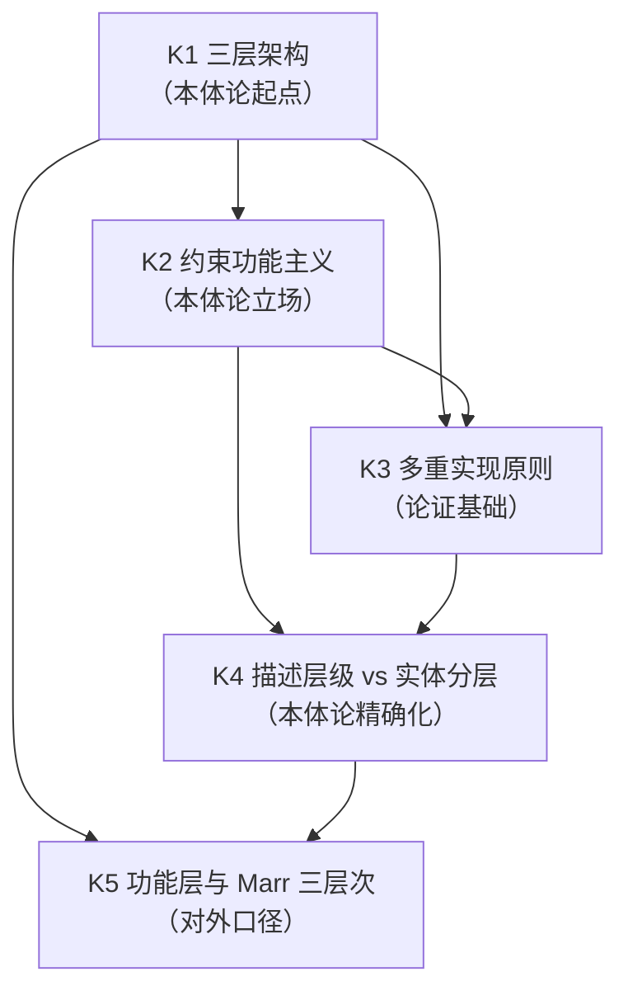

# SMOD-01 · 状态范式模块 1：本体论与层级（× 变量范式对位）

> **来源与性质**：状态范式模块 1/10·与变量范式 MOD 系对位（对位模块见 1.1 定位表）；本件依主理转入稿整理，去除呈现层过渡结构（四层次包装），知识内容全量保留。库内锚点引用前须自核（见 rn）。

>
> **框架声明（15-RPT-115 #1/#2·v0.1.1 订正批增）**：本件「四层次」结构系输出构造、非库内文档框架；模块 MECE 编号与知识点清单照 15-X-112 原文展开。

## 一、模块定位与知识点总览

### 1.1 模块定位表

| 项 | 内容 |
|---|---|
| 所属范式 | 状态范式（功能层） |
| MECE 编号 | 模块 1 / 共 10 模块 |
| 核心问题 | 功能层是什么？为何独立？ |
| 关键知识 | 三层架构、约束功能主义、多重实现、描述层级 |
| 代表工具/方法 | 04-A-01、外部脚手架对照（Marr·教学入口） |
| 当前状态 | **已形式化** |
| 在知识生产链中的位置 | **最上游**——决定“研究单位是什么”，下游状态语法、操作语法、动力学全部受其约束 |
| 变量范式对位模块 | 模块 1“哲学与本体论预设”（实证主义、操作主义、变量实在论、潜变量） |
| 本模块的真正分歧 | 本体论地位：功能层是描述层级还是实体分层；与神经层关系：独立但不孤立；与观测关系：功能状态是隐状态，观测是投影 |

### 1.2 知识点清单表

| # | 知识点 | 一句话定位 | 在状态范式中的角色 |
|---|---|---|---|
| K1 | 三层架构（现象层-功能层-神经层） | 功能层是连接现象与神经的中间描述层级 | 本体论定位的起点 |
| K2 | 约束功能主义 | 功能描述自主但不自足，须接受物理边界约束 | 本体论立场的核心 |
| K3 | 多重实现原则 | 同一功能可由迥异神经配置承载 | 功能层独立性的论证基础 |
| K4 | 描述层级 vs 实体分层 | 功能层是描述视角，不是物理实体 | 本体论地位的精确化 |
| K5 | 功能层与外部脚手架的关系 | 功能层对应外部脚手架算法层位；外部框架仅教学入口·不作论证依据（06-S-06 §7.11） | 对外口径的边界 |

### 1.3 每个知识点的大纲解释表

| 知识点 | 简要大纲解释 |
|---|---|
| **K1 三层架构** | INTRE 在神经科学与心理学之间建立功能层：现象层（主观体验、症状）→ 功能层（M-R-D-S 状态向量、G-M-A-R 操作语法）→ 神经层（脑区激活、神经递质、突触可塑性）。功能层是“双向接口”：向下刻画神经层的物理规律（描述视角，非因果中介），向上对应现象层的主观体验。 |
| **K2 约束功能主义** | 功能描述是**自主的**（不可被神经描述替代），但**非独立的**（必须接受神经实现的物理边界约束）。自主性：功能描述有自己的一套语法（M-R-D-S、G-M-A-R）、验证标准（级联预测的 ROI 差异、动力学轨迹拟合度）、理论对象（功能组件）。非独立性：功能描述不能违反下层实现的物理极限。 |
| **K3 多重实现原则** | 同一功能可由迥异的神经配置承载。功能描述的真值条件不绑定于特定物理实现。INTRE 的 RELINK 操作定义为对 STR-C 连接权重的更新；其证伪条件是 RELINK 是否稳定产出连接权重变化及其预期行为后果，而非“RELINK 是否必须依赖蛋白质合成”。 |
| **K4 描述层级 vs 实体分层** | 功能层不是物理实体或空间位置，而是一种对神经系统的组织描述视角。类比计算机中软件层/操作系统层/硬件层的区分：它们不是三个“东西”，而是对同一物理系统的三种抽象描述。功能层的合法性取决于预测-干预效能，而非本体论地位。 |
| **K5 功能层与 Marr 三层次** | INTRE 的三层架构与 Marr 的“计算层-算法层-实现层”形成对照（教学入口·非论证依据）。INTRE 的功能层对应 Marr 的算法层。但 Marr 在 INTRE 体系中仅作教学入口（沟通桥梁），不作为论证依据、不作为合法性来源。INTRE 的三层结构从 N-S-R 元公理 + 系统动力学 + 控制论第一性原理独立推演而来。 |

## 二、知识点详解对比

### 2.1 K1 三层架构 —— 详细对比

| 维度 | 变量范式（本体论预设） | 状态范式（三层架构） |
|---|---|---|
| 层级结构 | 无明确层级；变量是观测读数的统计抽象 | 现象层-功能层-神经层三层架构 |
| 功能层地位 | 无对应概念 | 独立描述层级，连接现象与神经 |
| 与神经关系 | 多不涉及，或倾向还原 | 功能层独立但不孤立，接受物理边界约束 |
| 与现象关系 | 变量直接对应现象 | 功能层向上对应现象层的主观体验 |
| 本体论立场 | 实证主义、操作主义、变量实在论 | 约束功能主义、描述层级 |
| 数学对象 | P(Y)/P(Y\|X) | h: Ψ→y、f: Ψₜ→Ψₜ₊₁ |
| 库内对应 | — | 01-M-00 §1.2；04-A-01 §二、§三 |
| 关键分歧 | 变量范式无层级结构；状态范式用三层架构定位功能层 | 前者是单层本体论；后者是三层架构 |

### 2.2 K2 约束功能主义 —— 详细对比

| 维度 | 变量范式（实证主义/操作主义） | 状态范式（约束功能主义） |
|---|---|---|
| 本体论立场 | 只承认可观察物；理论概念须连接到观察 | 功能描述自主但不自足，接受物理边界约束 |
| 自主性 | 不承认功能层的独立存在 | 功能描述有自己的一套语法和验证标准 |
| 约束性 | 无物理约束概念 | 功能描述不能违反下层实现的物理极限 |
| 与神经关系 | 多不涉及，或倾向还原 | 功能层独立但不孤立 |
| 典型表述 | “不能测量的东西不应作为科学对象” | “功能层是描述层级，其合法性取决于预测-干预效能” |
| 库内对应 | — | 04-A-01 §六；01-M-00 §1.1 |
| 关键分歧 | 变量范式是实证主义/操作主义；状态范式是约束功能主义 | 前者只承认可观察物；后者承认功能层的独立描述地位 |

### 2.3 K3 多重实现原则 —— 详细对比

| 维度 | 变量范式（潜变量实在论） | 状态范式（多重实现） |
|---|---|---|
| 核心主张 | 潜变量是真实存在的心理属性 | 同一功能可由迥异神经配置承载 |
| 真值条件 | 绑定于构念的测量操作 | 不绑定于特定物理实现 |
| 实现路径 | 通常不涉及 | 同一功能可由杏仁核快速通路、皮层精细分析、硅基神经网络等实现 |
| 证伪条件 | 构念效度检验 | RELINK 是否稳定产出连接权重变化及其预期行为后果 |
| 与神经关系 | 多不涉及 | 神经层标记物理可实现性边界，但不定义功能描述真值 |
| 层级梯度 | 无 | 化学→物理：多重实现度极低；心理学→神经科学：多重实现度极高 |
| 库内对应 | — | 04-A-01 §二；01-M-00 §1.2 |
| 关键分歧 | 变量范式用潜变量实在论；状态范式用多重实现原则 | 前者绑定测量操作；后者不绑定物理实现 |

### 2.4 K4 描述层级 vs 实体分层 —— 详细对比

| 维度 | 变量范式（变量实在论） | 状态范式（描述层级） |
|---|---|---|
| 本体论地位 | 变量/构念是真实存在的心理属性 | 功能层是描述视角，不是物理实体 |
| 类比（教学入口·非论证依据） | 无 | 计算机软件层/操作系统层/硬件层 |
| 合法性判据 | 构念效度、法则网络 | 预测-干预效能 |
| 与物理世界关系 | 变量具有因果力 | 功能层不否认神经实现的存在，主张功能描述具有不可被实现描述替代的解释力 |
| 层级性质 | 单层 | 描述层级（level of description） |
| 库内对应 | — | 04-A-01 §7.1；01-M-00 §1.2（本体论地位备注） |
| 关键分歧 | 变量范式用变量实在论；状态范式用描述层级 | 前者把变量当实体；后者把功能层当描述视角 |

### 2.5 K5 功能层与 Marr 三层次 —— 详细对比

| 维度 | 变量范式（无 Marr 对应） | 状态范式（Marr 对照） |
|---|---|---|
| 三层对应 | 无 | 计算层→现象层；算法层→功能层；实现层→神经层 |
| Marr 的地位 | 无 | 仅作教学入口（沟通桥梁） |
| 论证依据 | 无 | N-S-R 元公理 + 系统动力学 + 控制论第一性原理 |
| 与外部框架的关系 | 无 | INTRE 从工程实践推演出三层架构；与 Marr 框架的对照仅作教学入口 |
| 对外口径 | 无 | 统一对外口径见 15-RPT-25 §第二部分与 15-RPT-29（Marr FAQ） |
| 库内对应 | — | 01-M-00 §1.2；04-A-01 §三 |
| 关键分歧 | 变量范式无 Marr 对应；状态范式以 Marr 三层次为教学入口 | 前者无层级结构；后者用 Marr 框架辅助理解 |

## 三、知识库链接

### 3.1 K1 三层架构 —— 知识库链接表

| 类别 | 内容 | 库内/库外对应 |
|---|---|---|
| 核心工具 | 三层架构（现象层-功能层-神经层） | — |
| 相关理论 | 功能主义、多重实现、Marr 三层次 | Putnam (1967)；Fodor (1974)；Marr (1982) |
| 心理学表现 | 功能层定位、层级划分 | — |
| 状态范式对位 | 01-M-00 §1.2；04-A-01 §二、§三 | 库内 |
| 关键文档 | 01-M-00《INTRE 核心纲要》§1.2；04-A-01《功能层作为独立分析层级的认识论辩护》§二、§三 | 库内 |
| 关键论证 | 三层架构与 Marr 三层次的对照仅作教学入口；功能层是“双向接口” | 01-M-00 §1.2；04-A-01 §三 |
| 延伸阅读 | Marr (1982)；Putnam (1967)；Fodor (1974) | 库外 |
| 相关争议 | 功能层的本体论地位；与神经层关系 | 04-A-01 §7.1 |

### 3.2 K2 约束功能主义 —— 知识库链接表

| 类别 | 内容 | 库内/库外对应 |
|---|---|---|
| 核心工具 | 约束功能主义 | — |
| 相关理论 | 功能主义、多重实现 | Putnam (1967)；Fodor (1974) |
| 心理学表现 | 功能描述自主但不自足 | — |
| 状态范式对位 | 04-A-01 §六；01-M-00 §1.1 | 库内 |
| 关键文档 | 04-A-01《功能层作为独立分析层级的认识论辩护》§六；01-M-00《INTRE 核心纲要》§1.1 | 库内 |
| 关键论证 | 功能描述是自主的（不可被神经描述替代），但非独立的（必须接受神经实现的物理边界约束） | 04-A-01 §六 |
| 延伸阅读 | Putnam (1967)；Fodor (1974) | 库外 |
| 相关争议 | 功能层的自主性程度；物理约束的范围 | 04-A-01 §7.2 |

### 3.3 K3 多重实现原则 —— 知识库链接表

| 类别 | 内容 | 库内/库外对应 |
|---|---|---|
| 核心工具 | 多重实现原则 | — |
| 相关理论 | 功能主义、多重实现 | Putnam (1967)；Fodor (1974) |
| 心理学表现 | 同一功能可由迥异神经配置承载 | — |
| 状态范式对位 | 04-A-01 §二；01-M-00 §1.2 | 库内 |
| 关键文档 | 04-A-01《功能层作为独立分析层级的认识论辩护》§二；01-M-00《INTRE 核心纲要》§1.2 | 库内 |
| 关键论证 | 功能描述的真值条件不绑定于特定物理实现 | 04-A-01 §二 |
| 延伸阅读 | Putnam (1967)；Fodor (1974)；Marr (1982) | 库外 |
| 相关争议 | 多重实现的层级梯度；物理约束的范围 | 04-A-01 §二 |

### 3.4 K4 描述层级 vs 实体分层 —— 知识库链接表

| 类别 | 内容 | 库内/库外对应 |
|---|---|---|
| 核心工具 | 描述层级（level of description） | — |
| 相关理论 | 功能主义、多重实现 | Putnam (1967)；Fodor (1974) |
| 心理学表现 | 功能层是描述视角，不是物理实体 | — |
| 状态范式对位 | 04-A-01 §7.1；01-M-00 §1.2（本体论地位备注） | 库内 |
| 关键文档 | 04-A-01《功能层作为独立分析层级的认识论辩护》§7.1；01-M-00《INTRE 核心纲要》§1.2 | 库内 |
| 关键论证 | 功能层不是物理实体或空间位置，而是一种对神经系统的组织描述视角 | 04-A-01 §7.1 |
| 延伸阅读 | Marr (1982)；Putnam (1967) | 库外 |
| 相关争议 | 功能层的本体论地位；描述层级 vs 实体分层 | 04-A-01 §7.1 |

### 3.5 K5 功能层与 Marr 三层次 —— 知识库链接表

| 类别 | 内容 | 库内/库外对应 |
|---|---|---|
| 核心工具 | Marr 三层次（计算层-算法层-实现层） | — |
| 相关理论 | 计算神经科学、认知科学 | Marr (1982) |
| 心理学表现 | 功能层对应 Marr 算法层 | — |
| 状态范式对位 | 01-M-00 §1.2；04-A-01 §三 | 库内 |
| 关键文档 | 01-M-00《INTRE 核心纲要》§1.2；04-A-01《功能层作为独立分析层级的认识论辩护》§三 | 库内 |
| 关键论证 | INTRE 的三层架构从 N-S-R 元公理＋系统动力学＋控制论第一性原理独立推演；Marr 框架仅作教学入口 | 01-M-00 §1.2；04-A-01 §三 |
| 延伸阅读 | Marr (1982)；15-RPT-25；15-RPT-29（Marr FAQ） | 库内/库外 |
| 相关争议 | Marr 在 INTRE 体系中的地位（教学入口·非论证依据） | 01-M-00 §1.2 |

## 四、知识点依赖关系

### 4.1 依赖关系总表

| 知识点 | 依赖 | 被依赖 | 依赖类型 | 说明 |
|---|---|---|---|---|
| K1 三层架构 | — | K2、K3、K4、K5 | 本体论起点 | 三层架构是功能层定位的起点 |
| K2 约束功能主义 | K1 | K3、K4 | 本体论立场 | 约束功能主义是功能层独立性的核心论证 |
| K3 多重实现原则 | K1、K2 | K4 | 论证基础 | 多重实现是功能层独立性的论证基础 |
| K4 描述层级 vs 实体分层 | K1、K2、K3 | K5 | 本体论精确化 | 描述层级是功能层本体论地位的精确化 |
| K5 功能层与 Marr 三层次 | K1、K4 | — | 对外口径 | Marr 对照是对外沟通的教学入口 |

### 4.2 依赖关系图

### 4.3 依赖关系深度解剖表

| 依赖对 | 依赖内容 | 深度 | 结构性后果 |
|---|---|---|---|
| K1 → K2 | 三层架构 → 约束功能主义 | 强 | 三层架构定义功能层位置；约束功能主义定义功能层立场 |
| K1 → K3 | 三层架构 → 多重实现原则 | 强 | 三层架构预设功能层独立；多重实现提供论证基础 |
| K2 → K3 | 约束功能主义 → 多重实现原则 | 强 | 约束功能主义依赖多重实现原则论证功能层独立性 |
| K2 → K4 | 约束功能主义 → 描述层级 | 强 | 约束功能主义是描述层级的理论基础 |
| K3 → K4 | 多重实现原则 → 描述层级 | 强 | 多重实现是描述层级独立性的论证基础 |
| K1 → K5 | 三层架构 → Marr 对照 | 中 | 三层架构与 Marr 框架的对照仅作教学入口 |
| K4 → K5 | 描述层级 → Marr 对照 | 中 | 描述层级定位决定 Marr 对照的口径 |

### 4.4 与变量范式的依赖关系对比

| 状态范式依赖 | 变量范式对应 | 差异 |
|---|---|---|
| K1 三层架构 → K2 约束功能主义 | 本体论预设 → 实证主义 | 状态范式用三层架构；变量范式无层级结构 |
| K2 约束功能主义 → K3 多重实现原则 | 实证主义 → 操作主义 | 状态范式用约束功能主义；变量范式用操作主义 |
| K3 多重实现原则 → K4 描述层级 | 操作主义 → 变量实在论 | 状态范式用多重实现；变量范式用变量实在论 |
| K4 描述层级 → K5 Marr 对照 | 变量实在论 → 潜变量 | 状态范式用描述层级；变量范式用潜变量 |
| K1–K5 | 实证主义 + 操作主义 + 变量实在论 + 潜变量 | 状态范式用三层架构 + 约束功能主义 + 多重实现 + 描述层级；变量范式用实证主义 + 操作主义 + 变量实在论 + 潜变量 |

### 4.5 关键依赖链：从三层架构到 Marr 对照

**关键结论：**

1. **K1 三层架构是本体论起点**：定义功能层的位置（现象层-功能层-神经层）。
2. **K2 约束功能主义是本体论立场**：功能描述自主但不自足，接受物理边界约束。
3. **K3 多重实现原则是论证基础**：同一功能可由迥异神经配置承载。
4. **K4 描述层级是本体论精确化**：功能层是描述视角，不是物理实体。
5. **K5 Marr 对照是对外口径**：Marr 仅作教学入口，不作为论证依据。
6. **模块 1 的输出是功能层定位**：这个定位供给模块 2（状态语法）作为本体论基础。
7. **与变量范式的根本差异**：变量范式用实证主义、操作主义、变量实在论、潜变量；状态范式用三层架构、约束功能主义、多重实现、描述层级。

### 4.6 模块间依赖：模块 1 与相邻模块的关系

| 关系 | 上游 | 下游 | 依赖内容 |
|---|---|---|---|
| 模块 1 → 模块 2 | 功能层定位 | 状态语法 | 模块 1 定义功能层是什么，模块 2 定义功能状态如何描述 |
| 模块 1 → 模块 5 | 功能层定位 | 动力学与计算引擎 | 模块 1 定义功能层独立，模块 5 定义功能状态如何演化 |
| 模块 1 → 模块 6 | 功能层定位 | 测量与观测 | 模块 1 定义功能层是隐状态，模块 6 定义如何从观测反解 |
| 模块 1 ↔ 模块 8 | 功能层定位 ↔ 治理与证据 | 双向依赖 | 功能层定位影响证据分级；证据分级验证功能层定位 |

## 疑问解答（附属·v0.2.0 增）

本节系主理 Agent 2026-10-13 会话转入之附属疑问解答（9 条·逐条以表格作答），与正文四节互为补充、不替代；内容逐字落盘未改一字。

### 疑问 1：本模块“真正分歧”的本体论地位、与神经层关系、与观测关系三重分歧如何与变量范式镜像？

| 维度 | 变量范式 | 状态范式 |
|---|---|---|
| 本体论地位 | 变量/构念是真实存在的心理属性 | 功能层是描述层级还是实体分层 |
| 与神经层关系 | 多不涉及，或倾向还原 | 功能层独立但不孤立，接受物理边界约束 |
| 与观测关系 | 变量直接对应现象 | 功能状态是隐状态，观测是投影 |
| 镜像关系 | 用实证主义、操作主义、变量实在论 | 用三层架构、约束功能主义、多重实现、描述层级 |
| 一句话 | 变量范式是单层本体论，状态范式是三层架构；前者把变量当实体，后者把功能层当描述视角 |

---

### 疑问 2：K1 三层架构（现象层-功能层-神经层）与 Marr 三层次是何关系（对照·非汇聚）？

| 维度 | 状态范式（三层架构） | Marr 三层次 |
|---|---|---|
| 顶层 | 现象层（主观体验、症状） | 计算层（系统要解决什么问题） |
| 中层 | 功能层（M-R-D-S、G-M-A-R） | 算法层（表征格式与操作过程） |
| 底层 | 神经层（脑区激活、神经递质） | 实现层（物理载体） |
| 对应关系 | 现象层↔计算层；功能层↔算法层；神经层↔实现层 | 三层一一对应 |
| Marr 的地位 | 仅作教学入口（沟通桥梁），不作论证依据、不作合法性来源 | — |
| 独立汇聚 | INTRE 从 N-S-R 元公理 + 系统动力学 + 控制论第一性原理独立推演而来；与 Marr 框架的对照仅作教学入口 | — |
| 一句话 | 三层架构与 Marr 三层次的对照仅作教学入口；INTRE 的三层结构从第一性原理独立推演而来 |

---

### 疑问 3：K2 约束功能主义的核心主张“功能描述自主但不自足”如何理解？

| 维度 | 解答 |
|---|---|
| 自主性 | 功能描述有自己的一套语法（M-R-D-S、G-M-A-R）、验证标准（级联预测的 ROI 差异、动力学轨迹拟合度）、理论对象（功能组件） |
| 非自足性 | 功能描述不能违反下层实现的物理极限 |
| 物理约束举例 | M1-RES-D 恢复速率不能超越代谢极限；STR-C 连接重塑时间常数不能脱离突触可塑性已知范围；GATE 操作执行时延不能绕过神经传导速度 |
| 与副现象论区别 | 约束功能主义不认为功能状态是神经活动的“影子”；功能描述具有不可被实现描述替代的解释力 |
| 与平行论区别 | 约束功能主义不认为功能层与神经层无关；功能层接受神经层的物理边界约束 |
| 一句话 | 功能描述自主但不自足：它有自己的一套语法和验证标准，但必须接受下层实现的物理边界约束 |

---

### 疑问 4：K3 多重实现原则的层级梯度如何理解？

| 层级关系 | 多重实现度 | 举例 |
|---|---|---|
| 化学→物理 | 极低 | 产生水只有一种路径：两个氢原子和一个氧原子结合 |
| 生物学→化学 | 中等 | 飞行可以用羽毛翅膀、膜翅、皮膜、滑翔鳍实现，但都受空气动力学和代谢约束 |
| 心理学→神经科学 | 极高 | 同一认知任务可以由不同神经网络配置完成，同一情绪状态可以被不同神经调质系统支持 |
| 梯度含义 | 神经层对功能层的约束，远不如物理层对化学层的约束紧密 | — |
| 神经层标记的 | 物理可实现性的边界 | — |
| 神经层不定义的 | 功能描述的真值 | — |
| 一句话 | 多重实现度是梯度分布的；神经层标记物理可实现性边界，但不定义功能描述的真值 |

---

### 疑问 5：K4 描述层级 vs 实体分层的区分如何理解？

| 维度 | 变量范式（变量实在论） | 状态范式（描述层级） |
|---|---|---|
| 本体论地位 | 变量/构念是真实存在的心理属性 | 功能层是描述视角，不是物理实体 |
| 类比 | 无 | 计算机软件层/操作系统层/硬件层 |
| 合法性判据 | 构念效度、法则网络 | 预测-干预效能 |
| 与物理世界关系 | 变量具有因果力 | 功能层不否认神经实现的存在，主张功能描述具有不可被实现描述替代的解释力 |
| 层级性质 | 单层 | 描述层级（level of description） |
| 关键差异 | 变量范式把变量当实体；状态范式把功能层当描述视角 | — |
| 一句话 | 功能层不是物理实体或空间位置，而是一种对神经系统的组织描述视角 |

---

### 疑问 6：功能层定位与外部框架对照的关系（原“独立汇聚”之问）

| 维度 | 解答 |
|---|---|
| 论证内容 | INTRE 在建构过程中并未刻意引用马尔著作；功能层定位是从系统动力学、控制论与临床实践的“实战泥坑”中推演出来的 |
| 与外部框架的关系 | 最终沉淀的三层架构与马尔框架形成对照，这只是教学入口层面的并置，不构成论证证据 |
| 论证强度 | INTRE 三层结构的论证力来自其内部推演（N-S-R 元公理＋系统动力学＋控制论第一性原理），不来自与外部框架的汇聚；把后者当客观性证据，即以外都脚手架充当论证承重，为 §7.11 所禁 |
| 与“同构”的区别 | 与外部框架的对照不是“同构”；Marr 仅作教学入口，INTRE 的论证不依赖 Marr |
| 一句话 | 外部框架对照仅作教学入口；INTRE 三层结构从 N-S-R 元公理＋系统动力学＋控制论第一性原理独立推演而来，其论证力不依赖与任何外部框架的汇聚 |

---

### 疑问 7：本模块知识点依赖链是否闭合？状态范式如何对应？

| 状态范式依赖 | 内容 | 差异 |
|---|---|---|
| K1 三层架构 → K2 约束功能主义 | 三层架构定义功能层位置；约束功能主义定义功能层立场 | — |
| K1 三层架构 → K3 多重实现原则 | 三层架构预设功能层独立；多重实现提供论证基础 | — |
| K2 约束功能主义 → K3 多重实现原则 | 约束功能主义依赖多重实现原则论证功能层独立性 | — |
| K2 约束功能主义 → K4 描述层级 | 约束功能主义是描述层级的理论基础 | — |
| K3 多重实现原则 → K4 描述层级 | 多重实现是描述层级独立性的论证基础 | — |
| K1 三层架构 → K5 Marr 对照 | 三层架构与 Marr 框架的对照仅作教学入口 | — |
| K4 描述层级 → K5 Marr 对照 | 描述层级定位决定 Marr 对照的口径 | — |
| 依赖链是否闭合 | 从三层架构出发，经由约束功能主义、多重实现、描述层级，到达 Marr 对照 | — |
| 一句话 | 变量范式从实证主义出发；状态范式从三层架构出发，到达 Marr 对照 |

---

### 疑问 8：本模块与变量范式的依赖关系如何镜像？

| 状态范式依赖 | 变量范式对应 | 差异 |
|---|---|---|
| K1 三层架构 → K2 约束功能主义 | 本体论预设 → 实证主义 | 状态范式用三层架构；变量范式无层级结构 |
| K2 约束功能主义 → K3 多重实现原则 | 实证主义 → 操作主义 | 状态范式用约束功能主义；变量范式用操作主义 |
| K3 多重实现原则 → K4 描述层级 | 操作主义 → 变量实在论 | 状态范式用多重实现；变量范式用变量实在论 |
| K4 描述层级 → K5 Marr 对照 | 变量实在论 → 潜变量 | 状态范式用描述层级；变量范式用潜变量 |
| 一句话 | 状态范式用三层架构 + 约束功能主义 + 多重实现 + 描述层级；变量范式用实证主义 + 操作主义 + 变量实在论 + 潜变量 |

---

### 疑问 9：本模块与相邻状态范式模块的依赖关系如何？

| 关系 | 上游 | 下游 | 依赖内容 |
|---|---|---|---|
| 本模块 → SMOD-02 | 功能层定位 | 状态语法 | 本模块定义功能层是什么，SMOD-02 定义功能状态如何描述 |
| 本模块 → SMOD-05 | 功能层定位 | 动力学与计算引擎 | 本模块定义功能层独立，SMOD-05 定义功能状态如何演化 |
| 本模块 → SMOD-06 | 功能层定位 | 测量与观测 | 本模块定义功能层是隐状态，SMOD-06 定义如何从观测反解 |
| 本模块 ↔ SMOD-08 | 功能层定位 ↔ 治理与证据 | 双向依赖 | 功能层定位影响证据分级；证据分级验证功能层定位 |
| 一句话 | 本模块是状态范式的“本体论起点”，上无上游，下接状态语法、动力学、测量与观测 | — | — |

## 版本记录

| 版本 | 日期 | 变更说明 |
|---|---|---|
| v0.4.0 | 2026-10-29 | 双范式正名批（DR-2026-10-29-TERM-002 v1.4.0）：正文「结构范式」→「状态范式」；判升 Minor。 |
| v0.3.0 | 2026-10-17 | Minor·B261017-23：件内口径统一：10 处“跨时空对应/独立汇聚/认知脚手架”改为“对照（教学入口·非论证依据）”；补内部推演正表述。 |
| v0.2.4 | 2026-10-17 | Patch·B261017-22：疑问 6 整表去“独立汇聚＝客观性证据”承重（外延三行）；:114 类比列补标教学入口；其余残位乙档登记。 |
| v0.2.3 | 2026-10-17 | Patch·B261017-21：越界回退批：恢复 dependencies 15-RPT-25 行（v0.2.2 越权删除·自设口径经外审否证）。 |
| v0.2.2 | 2026-10-17 | Patch·B261016-17：deps 引用位删 15-RPT-25 一行（同族答复并 29 保留）·工具列与 K5 行改外部脚手架口径。 |
| v0.2.1 | 2026-10-16 | Patch·B261016-04：外审机械订正批：rn v0.1.1 条拆碎段还原（外审候选×本窗独立解码双路对撞·并与末表 v0.1.1 同义行对撞）。… |
| v0.2.0 | 2026-10-13 | Minor·B261013-06：疑问解答增补批：增「疑问解答（附属）」一节（9 条）。 |
| v0.1.0 | 2026-10-13 | 建件·B261013-03：结构范式模块 1/10 落盘（去四层次包装改四节直陈·第四层次系「与变量范式的依赖关系对比」反向对位·表格与 mermaid 2 枚零删减保留）。B261013-03。 |

> 更早版本 v0.1.1（全量 v0.1.0–v0.3.0，共 8 版；外迁 1 版）见 [HIST-SMOD §SMOD-01-本体论与层级-v0.1-2026-10-13](HIST-SMOD_双范式对比学习模块-SMOD系版本沿革-v1.0-2026-10-18.md#doc-34)。
