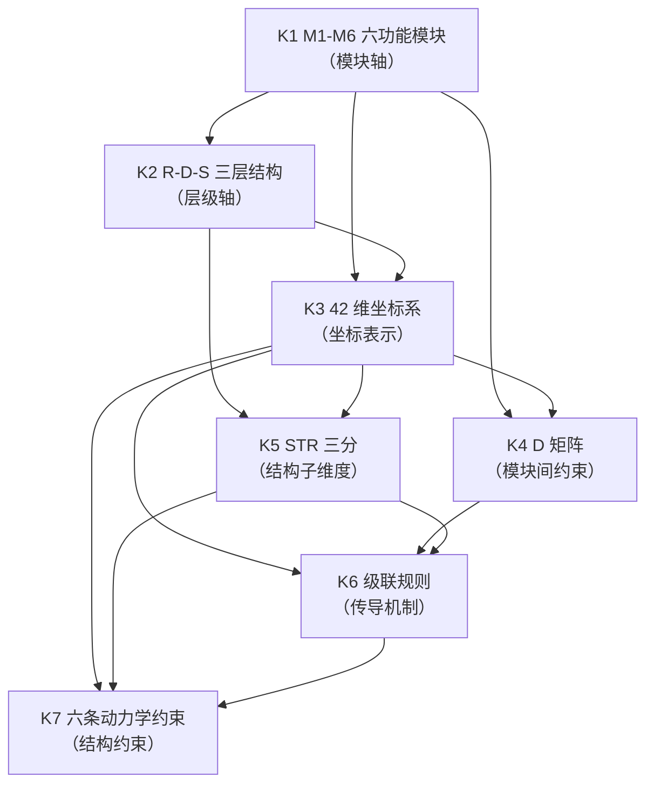
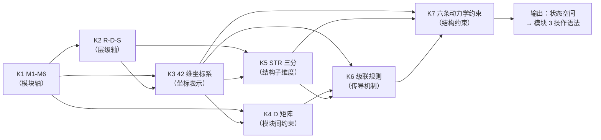

# SMOD-02 · 状态范式模块 2：状态语法（× 变量范式对位）

> **来源与性质**：状态范式模块 2/10·与变量范式 MOD 系对位（对位模块见 1.1 定位表）；本件依主理转入稿整理，去除呈现层过渡结构（四层次包装），知识内容全量保留。库内锚点引用前须自核（见 rn）。

>
> **框架声明（15-RPT-115 #1/#2·v0.1.1 订正批增）**：本件「四层次」结构系输出构造、非库内文档框架；模块 MECE 编号与知识点清单照 15-X-112 原文展开。

## 一、模块定位与知识点总览

### 1.1 模块定位表

| 项 | 内容 |
|---|---|
| 所属范式 | 状态范式（功能层） |
| MECE 编号 | 模块 2 / 共 10 模块 |
| 核心问题 | 心理状态如何描述？ |
| 关键知识 | M-R-D-S：M1-M6、R-D-S 七子维、42 维、D 矩阵、STR 三分、级联规则、六条动力学约束 |
| 代表工具/方法 | IODS（01-M-02） |
| 当前状态 | **已形式化** |
| 在知识生产链中的位置 | **第二环**——上游承接模块 1“本体论与层级”，下游供给模块 3“操作语法”与模块 5“动力学与计算引擎”以状态空间 |
| 变量范式对位模块 | 模块 2“构念与测量”（心理测量学、CTT、IRT、信度、效度、测量不变性）＋模块 4“统计推断与数据建模”（SEM、HLM、贝叶斯） |
| 本模块的真正分歧 | 状态表示：变量/潜变量 vs 42 维状态向量；状态结构：变量间关系 vs 功能组件生成架构；状态维度：少数变量 vs 42 维；状态约束：无 vs D 矩阵、STR 三分、级联规则、六条动力学约束 |

### 1.2 知识点清单表

| # | 知识点 | 一句话定位 | 在状态范式中的角色 |
|---|---|---|---|
| K1 | M1-M6 六功能模块 | 人类心智的六个功能组件 | 状态空间的模块轴 |
| K2 | R-D-S 三层结构 | 资源-调度-结构三层 | 状态空间的层级轴 |
| K3 | 42 维坐标系 | 6 模块 × 7 维度 = 42 维状态空间 | 状态空间的坐标表示 |
| K4 | D 矩阵 | 6×6 模块间依赖矩阵 | 模块间因果约束 |
| K5 | STR 三分 | STR-R/STR-C/STR-S 三类稳定配置 | 结构层的子维度 |
| K6 | 级联规则 | 跨模块异常传导规则 | 状态演化的传导机制 |
| K7 | 六条动力学约束 | 资源流守恒、恢复不对称等 | 状态演化的结构约束 |

### 1.3 每个知识点的大纲解释表

| 知识点 | 简要大纲解释 |
|---|---|
| **K1 M1-M6 六功能模块** | M1 具身（物理基座与能量引擎）、M2 认知（建模引擎与知识库）、M3 意志（中央调度器）、M4 情绪（价值评估中心）、M5 言语（符号接口与社会连接）、M6 行为（外部执行器）。是功能层面的逻辑抽象，非神经解剖实体。工程判断，非公理级别绝对断言。 |
| **K2 R-D-S 三层结构** | R 层（资源，存量维度）：RES-D 调度资源（小时至天）、RES-B 基底资源（周至年）。D 层（调度，流量维度）：DSP-F 前台调度（需意识参与）、DSP-B 后台调度（自动化）。S 层（结构，控制方程维度）：STR-R 规则结构、STR-C 连接结构、STR-S 序列结构。 |
| **K3 42 维坐标系** | 状态空间由 6 模块 × 7 维度张量积构成。每模块含 RES-D/RES-B/DSP-F/DSP-B/STR-R/STR-C/STR-S 七个维度，共 42 个基本诊断维度。状态向量记作 Ψ ∈ R^42。 |
| **K4 D 矩阵** | 6×6 模块间依赖矩阵。D[i][j] 表示模块 i 对模块 j 的功能影响强度。M4（情绪）在结构上占据枢纽位置（最高出度+入度），M3 次之。边强度数值属 L3 参数子层。 |
| **K5 STR 三分** | STR-R 规则内容（决定“如何评估”）、STR-C 连接关系（决定“什么与什么绑定”）、STR-S 序列程序（决定“按什么顺序执行”）。三类在功能上互斥且联合覆盖结构层。 |
| **K6 级联规则** | 跨模块级联指一个模块或层级的异常经 D 矩阵与跨层依赖传导至其他模块/层级的过程。典型传导机制：资源供给受限（M1→M3/M2）、调度控制降级（M3→M6/M4/M2）、结构性错误归因（M4/M6→M2→M5）。 |
| **K7 六条动力学约束** | 资源流守恒、恢复不对称、级联阈值、改变耗时、弹性回滞、系统-环境耦合。是结构规律的操作化表述，非动力学方程本身。 |

## 二、知识点详解对比

### 2.1 K1 M1-M6 六功能模块 —— 详细对比

| 维度 | 变量范式（构念/潜变量） | 状态范式（M1-M6 功能模块） |
|---|---|---|
| 基本单位 | 构念、潜变量 | 功能模块（M1-M6） |
| 定义方式 | 观测协方差定义潜变量 | 功能角色定义（N-S-R 推导） |
| 模块数 | 通常少数变量 | 6 个功能模块 |
| 存在性 | 潜变量是否真实存在有争议 | 功能模块是工程判断，非神经解剖实体 |
| 完备性 | 无完备性论证 | 否定性证明 + 进化论证 + 系统动力学论证 |
| 与神经关系 | 多不涉及 | 功能层面的逻辑抽象，非神经解剖实体 |
| 库内对应 | — | 01-M-01 §3.2（M1-M6 定义）；01-M-02 §2.1 |
| 关键分歧 | 变量范式用构念/潜变量；状态范式用 M1-M6 功能模块 | 前者是统计抽象；后者是功能组件 |

### 2.2 K2 R-D-S 三层结构 —— 详细对比

| 维度 | 变量范式（潜变量/因子） | 状态范式（R-D-S 三层结构） |
|---|---|---|
| 层级结构 | 无 | R 层（资源）、D 层（调度）、S 层（结构） |
| R 层 | 无对应 | RES-D（调度资源）、RES-B（基底资源） |
| D 层 | 无对应 | DSP-F（前台调度）、DSP-B（后台调度） |
| S 层 | 无对应 | STR-R（规则）、STR-C（连接）、STR-S（序列） |
| 时间尺度 | 无 | RES-D（小时至天）、RES-B（周至年）、STR（月） |
| 与系统动力学关系 | 无 | R-D-S 对应存量-流量-控制方程 |
| 库内对应 | — | 01-M-02 §2.2；02-A-05（R-D-S 数学基础） |
| 关键分歧 | 变量范式用潜变量/因子；状态范式用 R-D-S 三层结构 | 前者是统计维度；后者是功能层级 |

### 2.3 K3 42 维坐标系 —— 详细对比

| 维度 | 变量范式（少数变量/因子） | 状态范式（42 维坐标系） |
|---|---|---|
| 维度数 | 通常少数变量或因子 | 42 维（6 模块 × 7 维度） |
| 坐标系 | 无统一坐标系 | M-R-D-S 坐标系 |
| 状态表示 | 变量向量 | Ψ ∈ R^42 |
| 覆盖范围 | 局部现象 | 全部功能性心理状态 |
| 降维必然性 | 无 | 42 维是功能层精确描述与精准干预的必要代价 |
| 库内对应 | — | 01-M-02 §2.3；05-R-01 #16（降维必然性测试） |
| 关键分歧 | 变量范式用少数变量；状态范式用 42 维坐标系 | 前者是局部；后者是全局 |

### 2.4 K4 D 矩阵 —— 详细对比

| 维度 | 变量范式（相关矩阵/路径图） | 状态范式（D 矩阵） |
|---|---|---|
| 核心工具 | 相关矩阵、路径图 | 6×6 模块间依赖矩阵 |
| 矩阵性质 | 对称相关矩阵 | 有向加权矩阵 |
| 因果方向 | 需假设（DAG） | D[i][j] 表示模块 i 对模块 j 的影响 |
| 枢纽结构 | 无 | M4 最高 Hub Score（约 0.82） |
| 循环依赖 | 无 | 有向无环性质 |
| 与动力学关系 | 无 | D 矩阵是级联规则的静态结构 |
| 库内对应 | — | 01-M-02 §3.1；01-M-01 §3.3 |
| 关键分歧 | 变量范式用相关矩阵/路径图；状态范式用 D 矩阵 | 前者是观测层相关；后者是功能层依赖 |

### 2.5 K5 STR 三分 —— 详细对比

| 维度 | 变量范式（知识类型） | 状态范式（STR 三分） |
|---|---|---|
| 三分结构 | 陈述性知识、程序性知识 | STR-R（规则）、STR-C（连接）、STR-S（序列） |
| STR-R | 陈述性知识 | “如果 X，则 Y”的算法库 |
| STR-C | 无对应 | “X 与 Y 的连接强度” |
| STR-S | 程序性知识 | “先做 X，再做 Y”的固定程序 |
| 独立性论证 | 无 | STR-C 不可被 STR-R 或 STR-S 归并 |
| 图灵机对应 | 无 | STR-R=规则表、STR-C=纸带、STR-S=读写头移动协议 |
| 库内对应 | — | 01-M-02 §3.2；01-M-01 §4.3 |
| 关键分歧 | 变量范式用陈述性/程序性知识；状态范式用 STR 三分 | 前者是知识类型；后者是结构子维度 |

### 2.6 K6 级联规则 —— 详细对比

| 维度 | 变量范式（中介/调节） | 状态范式（级联规则） |
|---|---|---|
| 传导机制 | 中介效应、调节效应 | 资源供给受限、调度控制降级、结构性错误归因 |
| 传导路径 | 变量间路径 | 模块间级联路径 |
| 闭合性 | 无 | 级联回路闭合性遍历检验（05-R-01 #10） |
| 与 D 矩阵关系 | 无 | 级联规则基于 D 矩阵与跨层依赖 |
| 与干预关系 | 无直接对应 | 级联分析识别高杠杆干预点 |
| 库内对应 | — | 01-M-02 §3.4；01-M-01 §3.3；05-R-01 #10 |
| 关键分歧 | 变量范式用中介/调节；状态范式用级联规则 | 前者是变量间关系；后者是模块间传导 |

### 2.7 K7 六条动力学约束 —— 详细对比

| 维度 | 变量范式（无对应） | 状态范式（六条动力学约束） |
|---|---|---|
| 约束内容 | 无 | 资源流守恒、恢复不对称、级联阈值、改变耗时、弹性回滞、系统-环境耦合 |
| 约束性质 | 无 | 结构规律的操作化表述 |
| 与动力学方程关系 | 无 | 约束定义存在性与结构语义；方程在 L3 展开 |
| 与变量范式关系 | 无 | 变量范式无对应概念 |
| 库内对应 | — | 01-M-02 §3.5 |
| 关键分歧 | 变量范式无对应；状态范式用六条动力学约束 | 前者无约束；后者有结构约束 |

## 三、知识库链接

### 3.1 K1 M1-M6 六功能模块 —— 知识库链接表

| 类别 | 内容 | 库内/库外对应 |
|---|---|---|
| 核心工具 | M1-M6 功能模块 | — |
| 相关理论 | 功能主义、模块论 | Fodor (1983)；01-M-01 |
| 心理学表现 | 功能组件分解 | — |
| 状态范式对位 | 01-M-01 §3.2；01-M-02 §2.1 | 库内 |
| 关键文档 | 01-M-01《BASE 论证与模块详解》§3.2；01-M-02《IODS》§2.1 | 库内 |
| 关键论证 | 否定性证明 + 进化论证 + 系统动力学论证 | 01-M-01 §3.1；01-M-01 §4.1 |
| 延伸阅读 | Fodor (1983)；02-A-31（模块划分论证强度评估） | 库内/库外 |
| 相关争议 | 模块划分的工程判断地位；与 Fodor 模块论的关系 | 01-M-01 §3.1 |

### 3.2 K2 R-D-S 三层结构 —— 知识库链接表

| 类别 | 内容 | 库内/库外对应 |
|---|---|---|
| 核心工具 | R-D-S 三层结构 | — |
| 相关理论 | 系统动力学、存量-流量-结构 | Forrester (1961) |
| 心理学表现 | 资源-调度-结构三层 | — |
| 状态范式对位 | 01-M-02 §2.2；02-A-05（R-D-S 数学基础） | 库内 |
| 关键文档 | 01-M-02《IODS》§2.2；02-A-05《R-D-S 数学基础》 | 库内 |
| 关键论证 | R-D-S 对应存量-流量-控制方程 | 01-M-02 §2.2；02-A-05 |
| 延伸阅读 | Forrester (1961)；02-A-05 | 库内/库外 |
| 相关争议 | R-D-S 三层的正交性；与变量范式因子结构的区别 | 05-R-01 #06 |

### 3.3 K3 42 维坐标系 —— 知识库链接表

| 类别 | 内容 | 库内/库外对应 |
|---|---|---|
| 核心工具 | 42 维坐标系（6 模块 × 7 维度） | — |
| 相关理论 | 状态空间、张量积 | Kalman (1960) |
| 心理学表现 | 状态向量 Ψ ∈ R^42 | — |
| 状态范式对位 | 01-M-02 §2.3；05-R-01 #16 | 库内 |
| 关键文档 | 01-M-02《IODS》§2.3；05-R-01《压力测试》#16 | 库内 |
| 关键论证 | 降维必然性测试证明 42 维是必要代价 | 05-R-01 #16 |
| 延伸阅读 | Kalman (1960)；05-V-23（42 维替代测试） | 库内/库外 |
| 相关争议 | 42 维的完备性；维度数是否任意 | 05-R-01 #16 |

> **挂接指路注（15-RPT-115 #16·候核标注）**：01-M-02 v3.1.2 挂接指路行未独立核验（含与 08-导论教材的关联），引用前须回源。

### 3.4 K4 D 矩阵 —— 知识库链接表

| 类别 | 内容 | 库内/库外对应 |
|---|---|---|
| 核心工具 | 6×6 模块间依赖矩阵 | — |
| 相关理论 | 网络科学、依赖矩阵 | Barabási (2016) |
| 心理学表现 | 模块间因果依赖 | — |
| 状态范式对位 | 01-M-02 §3.1；01-M-01 §3.3 | 库内 |
| 关键文档 | 01-M-02《IODS》§3.1；01-M-01《BASE》§3.3 | 库内 |
| 关键论证 | D 矩阵性质：有向加权、枢纽结构、有向无环 | 01-M-02 §3.1 |
| 延伸阅读 | Barabási (2016)；02-A-23（耦合即工程） | 库内/库外 |
| 相关争议 | D 矩阵边强度数值的校准 | 01-M-01 §3.3 |

### 3.5 K5 STR 三分 —— 知识库链接表

| 类别 | 内容 | 库内/库外对应 |
|---|---|---|
| 核心工具 | STR-R/STR-C/STR-S | — |
| 相关理论 | 结构主义、图灵机 | Chomsky (1965)；Turing (1936) |
| 心理学表现 | 规则-连接-序列三分 | — |
| 状态范式对位 | 01-M-02 §3.2；01-M-01 §4.3 | 库内 |
| 关键文档 | 01-M-02《IODS》§3.2；01-M-01《BASE》§4.3 | 库内 |
| 关键论证 | STR-C 不可被 STR-R 或 STR-S 归并 | 01-M-01 §4.3 |
| 延伸阅读 | Chomsky (1965)；Turing (1936)；02-A-09 | 库内/库外 |
| 相关争议 | STR-C 的独立性；与图灵机的对应 | 01-M-01 §4.3 |

### 3.6 K6 级联规则 —— 知识库链接表

| 类别 | 内容 | 库内/库外对应 |
|---|---|---|
| 核心工具 | 级联规则（资源供给受限、调度控制降级、结构性错误归因） | — |
| 相关理论 | 系统动力学、网络传播 | Forrester (1961)；Barabási (2016) |
| 心理学表现 | 跨模块异常传导 | — |
| 状态范式对位 | 01-M-02 §3.4；01-M-01 §3.3；05-R-01 #10 | 库内 |
| 关键文档 | 01-M-02《IODS》§3.4；01-M-01《BASE》§3.3；05-R-01《压力测试》#10 | 库内 |
| 关键论证 | 级联回路闭合性遍历检验（05-R-01 #10） | 05-R-01 #10 |
| 延伸阅读 | Forrester (1961)；Barabási (2016)；01-M-01 §3.3 | 库内/库外 |
| 相关争议 | 级联路径的开放性与穷尽性 | 01-M-02 §3.4 |

### 3.7 K7 六条动力学约束 —— 知识库链接表

| 类别 | 内容 | 库内/库外对应 |
|---|---|---|
| 核心工具 | 资源流守恒、恢复不对称、级联阈值、改变耗时、弹性回滞、系统-环境耦合 | — |
| 相关理论 | 系统动力学、控制论 | Forrester (1961)；Wiener (1948) |
| 心理学表现 | 状态演化的结构约束 | — |
| 状态范式对位 | 01-M-02 §3.5 | 库内 |
| 关键文档 | 01-M-02《IODS》§3.5 | 库内 |
| 关键论证 | 六条动力学约束是结构规律的操作化表述，非动力学方程本身 | 01-M-02 §3.5 |
| 延伸阅读 | Forrester (1961)；Wiener (1948)；01-M-03 §四 | 库内/库外 |
| 相关争议 | 约束的定量形态；实证校准 | 01-M-02 §3.5 |

## 四、知识点依赖关系

### 4.1 依赖关系总表

| 知识点 | 依赖 | 被依赖 | 依赖类型 | 说明 |
|---|---|---|---|---|
| K1 M1-M6 六功能模块 | 模块 1（K1 三层架构） | K2、K3、K4 | 模块轴 | M1-M6 是状态空间的模块轴 |
| K2 R-D-S 三层结构 | K1 | K3、K5 | 层级轴 | R-D-S 是状态空间的层级轴 |
| K3 42 维坐标系 | K1、K2 | K4、K5、K6、K7 | 坐标表示 | 42 维坐标系是状态空间的坐标表示 |
| K4 D 矩阵 | K1、K3 | K6 | 模块间约束 | D 矩阵定义模块间依赖 |
| K5 STR 三分 | K2、K3 | K6、K7 | 结构子维度 | STR 三分是 S 层的子维度 |
| K6 级联规则 | K3、K4、K5 | K7 | 传导机制 | 级联规则基于 D 矩阵与跨层依赖 |
| K7 六条动力学约束 | K3、K5、K6 | — | 结构约束 | 六条动力学约束定义状态演化的结构约束 |

### 4.2 依赖关系图

### 4.3 依赖关系深度解剖表

| 依赖对 | 依赖内容 | 深度 | 结构性后果 |
|---|---|---|---|
| K1 → K2 | M1-M6 → R-D-S | 强 | 每个模块的内部状态遵循 R-D-S 三层结构 |
| K1 → K3 | M1-M6 → 42 维坐标系 | 强 | 6 模块 × 7 维度 = 42 维 |
| K2 → K3 | R-D-S → 42 维坐标系 | 强 | R-D-S 七子维度是 42 维的维度轴 |
| K1 → K4 | M1-M6 → D 矩阵 | 强 | D 矩阵定义 6 模块间依赖 |
| K3 → K4 | 42 维坐标系 → D 矩阵 | 中 | D 矩阵是 42 维状态空间的模块间约束 |
| K2 → K5 | R-D-S → STR 三分 | 强 | STR 三分是 S 层的子维度 |
| K3 → K5 | 42 维坐标系 → STR 三分 | 中 | STR 三分是 42 维中 S 层的细分 |
| K3 → K6 | 42 维坐标系 → 级联规则 | 中 | 级联规则在 42 维状态空间中传导 |
| K4 → K6 | D 矩阵 → 级联规则 | 强 | 级联规则基于 D 矩阵与跨层依赖 |
| K5 → K6 | STR 三分 → 级联规则 | 中 | STR 三分影响级联路径 |
| K3 → K7 | 42 维坐标系 → 六条动力学约束 | 中 | 六条动力学约束定义 42 维状态空间的结构约束 |
| K5 → K7 | STR 三分 → 六条动力学约束 | 中 | STR 三分影响结构约束 |
| K6 → K7 | 级联规则 → 六条动力学约束 | 中 | 级联规则是六条动力学约束的一部分 |

### 4.4 与变量范式的依赖关系对比

| 状态范式依赖 | 变量范式对应 | 差异 |
|---|---|---|
| K1 M1-M6 → K2 R-D-S | 构念/潜变量 → 因子结构 | 状态范式用 M1-M6 功能模块；变量范式用构念/潜变量 |
| K2 R-D-S → K3 42 维坐标系 | 因子结构 → 变量向量 | 状态范式用 R-D-S 三层结构；变量范式用因子结构 |
| K3 42 维坐标系 → K4 D 矩阵 | 变量向量 → 相关矩阵 | 状态范式用 42 维坐标系；变量范式用少数变量 |
| K4 D 矩阵 → K5 STR 三分 | 相关矩阵 → 知识类型 | 状态范式用 D 矩阵；变量范式用相关矩阵 |
| K5 STR 三分 → K6 级联规则 | 知识类型 → 中介/调节 | 状态范式用 STR 三分；变量范式用知识类型 |
| K6 级联规则 → K7 六条动力学约束 | 中介/调节 → 无对应 | 状态范式用级联规则；变量范式用中介/调节 |
| K1–K7 | 构念 + 潜变量 + 因子 + 相关矩阵 | 状态范式用 M1-M6 + R-D-S + 42 维 + D 矩阵 + STR 三分 + 级联规则 + 六条动力学约束；变量范式用构念 + 潜变量 + 因子 + 相关矩阵 |

### 4.5 关键依赖链：从 M1-M6 到六条动力学约束

**关键结论：**

1. **K1 M1-M6 是模块轴**：定义状态空间的模块维度。
2. **K2 R-D-S 是层级轴**：定义状态空间的层级维度。
3. **K3 42 维坐标系是坐标表示**：6 模块 × 7 维度 = 42 维。
4. **K4 D 矩阵是模块间约束**：定义 6 模块间依赖关系。
5. **K5 STR 三分是结构子维度**：S 层的三分结构。
6. **K6 级联规则是传导机制**：基于 D 矩阵与跨层依赖。
7. **K7 六条动力学约束是结构约束**：定义状态演化的结构约束。
8. **模块 2 的输出是状态空间**：这个状态空间供给模块 3（操作语法）作为操作靶点。
9. **与变量范式的根本差异**：变量范式用构念、潜变量、因子、相关矩阵；状态范式用 M1-M6、R-D-S、42 维、D 矩阵、STR 三分、级联规则、六条动力学约束。

### 4.6 模块间依赖：模块 2 与相邻模块的关系

| 关系 | 上游 | 下游 | 依赖内容 |
|---|---|---|---|
| 模块 1 → 模块 2 | 功能层定位 | 状态语法 | 模块 1 定义功能层是什么，模块 2 定义功能状态如何描述 |
| 模块 2 → 模块 3 | 状态空间 | 操作语法 | 模块 2 定义状态空间，模块 3 定义操作靶点 |
| 模块 2 → 模块 5 | 状态空间 | 动力学与计算引擎 | 模块 2 定义状态空间，模块 5 定义状态如何演化 |
| 模块 2 → 模块 6 | 状态空间 | 测量与观测 | 模块 2 定义状态空间，模块 6 定义如何从观测反解状态 |
| 模块 2 ↔ 模块 8 | 状态语法 ↔ 治理与证据 | 双向依赖 | 状态语法影响证据分级；证据分级验证状态语法 |

## 疑问解答（附属·v0.2.0 增）

本节系主理 Agent 2026-10-13 会话转入之附属疑问解答（10 条·逐条以表格作答），与正文四节互为补充、不替代；内容逐字落盘未改一字。

### 疑问 1：本模块“真正分歧”的状态表示、状态结构、状态维度、状态约束四重分歧如何与变量范式镜像？

| 维度 | 变量范式 | 状态范式 |
|---|---|---|
| 状态表示 | 变量/潜变量 | 42 维状态向量 |
| 状态结构 | 变量间关系 | 功能组件生成架构 |
| 状态维度 | 少数变量 | 42 维 |
| 状态约束 | 无 | D 矩阵、STR 三分、级联规则、六条动力学约束 |
| 镜像关系 | 用构念、潜变量、因子、相关矩阵 | 用 M1-M6、R-D-S、42 维、D 矩阵、STR 三分、级联规则、六条动力学约束 |
| 一句话 | 变量范式是“变量间关系网”，状态范式是“功能组件生成架构” |

---

### 疑问 2：K1 M1-M6 六功能模块的划分是“工程判断”还是“公理级别断言”？

| 维度 | 解答 |
|---|---|
| 定位 | 工程判断，非公理级别的绝对断言 |
| 适用范围 | 针对人类心智的功能分解，旨在为诊断与干预提供可操作的功能接口 |
| 不声称 | 所有智能体都必须具备这六个模块 |
| 完备性论证 | 否定性证明 + 进化论证 + 系统动力学论证 |
| 与 Fodor 模块论的关系 | INTRE 关注“中央管理与调度”，Fodor 关注“外围输入处理”；两者不矛盾 |
| 一句话 | M1-M6 是针对人类心智的工程判断，其有效性由解释力与实用性评判，而非神经对应性 |

---

### 疑问 3：K2 R-D-S 三层结构的正交性如何理解？

| 维度 | 解答 |
|---|---|
| R 层（资源） | 描述系统拥有什么（存量） |
| D 层（调度） | 描述系统如何运行（流量） |
| S 层（结构） | 描述系统为何这样运行（控制方程） |
| 正交性定义 | 正交性定义在功能定义层面：R 描述存量，D 描述流量，S 描述结构规则与拓扑 |
| 正交性不承诺 | 测量数据中的不相关；由于系统动力学，数据中往往呈现相关 |
| 互斥性 | 三种维度在逻辑上不重叠：RES 描述“有什么”，DSP 描述“怎么变”，STR 描述“谁让变” |
| 一句话 | R-D-S 三层在功能定义层面正交：存量、流量、控制方程三个维度互不重叠 |

---

### 疑问 4：K3 42 维坐标系的“降维必然性”如何论证？

| 维度 | 解答 |
|---|---|
| 论证来源 | 05-R-01 #16（降维必然性测试） |
| 测试方法 | 设计精简版竞争框架（12 维），评估信息损失 |
| 精简版损失 | 丧失“状态性 vs 特质性”“资源层 vs 结构层”的关键区分能力 |
| 关键损失举例 | 意志瘫痪无法区分 M3-RES-D 枯竭 vs M3-STR-C 价值脱钩；拖延无法区分四种机制分型 |
| 结论 | 42 维的复杂度是功能层精确描述与精准干预所必需的代价 |
| 实际使用 | 临床操作中可通过聚焦核心致病模块进行动态降维，但作为工程意义上的完整框架，全维坐标系在理论建模中是必需的 |
| 一句话 | 42 维不是冗余参数，而是工程精度的必要代价；每个维度的增设都与特定的诊断区分或干预逻辑直接挂钩 |

---

### 疑问 5：K4 D 矩阵的性质与变量范式的相关矩阵有何根本差异？

| 维度 | 变量范式（相关矩阵/路径图） | 状态范式（D 矩阵） |
|---|---|---|
| 矩阵性质 | 对称相关矩阵 | 有向加权矩阵 |
| 因果方向 | 需假设（DAG） | D[i][j] 表示模块 i 对模块 j 的影响 |
| 枢纽结构 | 无 | M4 最高 Hub Score（约 0.82） |
| 循环依赖 | 无 | 有向无环性质 |
| 与动力学关系 | 无 | D 矩阵是级联规则的静态结构 |
| 边强度 | 统计估计 | 数值属 L3 参数子层 |
| 一句话 | 变量范式用观测层相关矩阵；状态范式用功能层依赖矩阵 D |

---

### 疑问 6：K5 STR 三分的独立性如何论证？STR-C 为何不可被归并？

| 维度 | 解答 |
|---|---|
| STR-R | 规则内容：决定“如何评估”（解释模型、信念、决策算法） |
| STR-C | 连接关系：决定“什么与什么绑定”（情感连接、概念关联、意义绑定） |
| STR-S | 序列程序：决定“按什么顺序执行”（习惯脚本、行为序列、作息节律） |
| STR-C 不可被 STR-R 归并 | 规则定义的是“如果 X 则 Y”的逻辑条件关系；连接定义的是两个节点之间的关联权重；创伤形成的刺激-恐惧绑定是典型示例 |
| STR-C 不可被 STR-S 归并 | 序列定义的是操作在时间轴上的固定执行顺序；连接定义的是共存的关联性；前者是时间逻辑，后者是网络逻辑 |
| 图灵机对应 | STR-R=规则表、STR-C=纸带、STR-S=读写头移动协议 |
| 一句话 | STR-C 是关联权重，既非逻辑规则，也非时间序列；这一独立性为 RELINK 操作的独立性提供了理论基础 |

---

### 疑问 7：K6 级联规则的三种传导机制如何闭合？

| 传导机制 | 内容 | 举例 |
|---|---|---|
| 资源供给受限 | M1 能量枯竭 → M3 意志瘫痪 | M1-RES-D↓ → M3-RES-D↓ |
| 调度控制降级 | M3 失效 → M6/M4 自动化接管 | M3-DSP-F↓ → M6-DSP-B↑ |
| 结构性错误归因 | 行为/情绪失控 → M2 生成错误规则 | M4-DSP-B↑ → M2-STR-R“我是失败者” |
| 闭合性论证 | 05-R-01 #10：四个典型精神病理回路（反刍-失眠、焦虑-回避、成瘾-戒断、拖延-自责）均可在仅使用三种机制下实现完整因果链闭合 | — |
| 开放性 | 典型机制未穷尽所有级联可能性；是否存在其他重要传导机制是开放的理论与实证问题 | — |
| 一句话 | 三种核心传导机制在已建模的临床核心动力学范围内具有充分的工程描述能力 |

---

### 疑问 8：K7 六条动力学约束是“动力学方程”还是“结构规律”？

| 维度 | 解答 |
|---|---|
| 定位 | 结构规律的操作化表述，非动力学方程本身 |
| 约束1 资源流守恒 | 模块间的资源消耗、转移与补充构成总量约束下的闭合回路 |
| 约束2 恢复不对称 | 资源消耗速率与恢复速率在结构上不对称 |
| 约束3 级联阈值 | 模块间影响存在触发阈值结构 |
| 约束4 改变耗时 | 结构性改变的时间尺度慢于资源层与调度层 |
| 约束5 弹性回滞 | 系统偏离基线后的恢复路径存在回滞结构 |
| 约束6 系统-环境耦合 | 系统与环境之间存在双向耦合 |
| 与动力学方程关系 | L0 只定义存在性与结构语义；方程形式与参数数值在 L3 展开 |
| 一句话 | 六条动力学约束是结构规律的操作化表述，不是动力学方程本身 |

---

### 疑问 9：本模块知识点依赖链是否闭合？状态范式如何对应？

| 状态范式依赖 | 内容 | 差异 |
|---|---|---|
| K1 M1-M6 → K2 R-D-S | 每个模块的内部状态遵循 R-D-S 三层结构 | — |
| K1 M1-M6 → K3 42 维坐标系 | 6 模块 × 7 维度 = 42 维 | — |
| K2 R-D-S → K3 42 维坐标系 | R-D-S 七子维度是 42 维的维度轴 | — |
| K1 M1-M6 → K4 D 矩阵 | D 矩阵定义 6 模块间依赖 | — |
| K3 42 维坐标系 → K4 D 矩阵 | D 矩阵是 42 维状态空间的模块间约束 | — |
| K2 R-D-S → K5 STR 三分 | STR 三分是 S 层的子维度 | — |
| K3 42 维坐标系 → K5 STR 三分 | STR 三分是 42 维中 S 层的细分 | — |
| K3 42 维坐标系 → K6 级联规则 | 级联规则在 42 维状态空间中传导 | — |
| K4 D 矩阵 → K6 级联规则 | 级联规则基于 D 矩阵与跨层依赖 | — |
| K3 42 维坐标系 → K7 六条动力学约束 | 六条动力学约束定义 42 维状态空间的结构约束 | — |
| 依赖链是否闭合 | 从 M1-M6 出发，经由 R-D-S、42 维坐标系、D 矩阵、STR 三分、级联规则，到达六条动力学约束 | — |
| 一句话 | 变量范式以“构念 + 潜变量 + 因子 + 相关矩阵”为地基；状态范式以“M1-M6 + R-D-S + 42 维 + D 矩阵 + STR 三分 + 级联规则 + 六条动力学约束”为地基 |

---

### 疑问 10：本模块与相邻状态范式模块的依赖关系如何？

| 关系 | 上游 | 下游 | 依赖内容 |
|---|---|---|---|
| SMOD-01 → 本模块 | 功能层定位 | 状态语法 | SMOD-01 定义功能层是什么，本模块定义功能状态如何描述 |
| 本模块 → SMOD-03 | 状态空间 | 操作语法 | 本模块定义状态空间，SMOD-03 定义操作靶点 |
| 本模块 → SMOD-05 | 状态空间 | 动力学与计算引擎 | 本模块定义状态空间，SMOD-05 定义状态如何演化 |
| 本模块 → SMOD-06 | 状态空间 | 测量与观测 | 本模块定义状态空间，SMOD-06 定义如何从观测反解状态 |
| 本模块 ↔ SMOD-08 | 状态语法 ↔ 治理与证据 | 双向依赖 | 状态语法影响证据分级；证据分级验证状态语法 |
| 一句话 | 本模块是状态范式的“状态描述引擎”，上承本体论定位，下接操作语法、动力学、测量与观测 | — | — |

## 版本记录

| 版本 | 日期 | 变更说明 |
|---|---|---|
| v0.3.0 | 2026-10-29 | 双范式正名批（DR-2026-10-29-TERM-002 v1.4.0）：正文「结构范式」→「状态范式」；判升 Minor。 |
| v0.2.1 | 2026-10-16 | Patch·B261016-04：外审机械订正批：rn v0.1.1 条拆碎段还原（外审候选×本窗独立解码双路对撞·并与末表 v0.1.1 同义行对撞）。… |
| v0.2.0 | 2026-10-13 | Minor·B261013-06：疑问解答增补批：增「疑问解答（附属）」一节（10 条）。 |
| v0.1.1 | 2026-10-13 | Patch·B261013-04：订正批：#12 已载核对（05-R-01 #16／05-V-23 引用 8 处在册·不改动）；#16 补 01-M-02 v3.1.2 挂接指路注（候核标注）… |
| v0.1.0 | 2026-10-13 | 建件·B261013-03：结构范式模块 2/10 落盘（去四层次包装改四节直陈·第四层次系「与变量范式的依赖关系对比」反向对位·表格与 mermaid 2 枚零删减保留）。B261013-03。 |

> 全量版本 v0.1.0–v0.2.1（共 4 版）见 [HIST-SMOD §SMOD-02-状态语法-v0.1-2026-10-13](HIST-SMOD_双范式对比学习模块-SMOD系版本沿革-v1.0-2026-10-18.md#doc-35)；当前无外迁版本。
