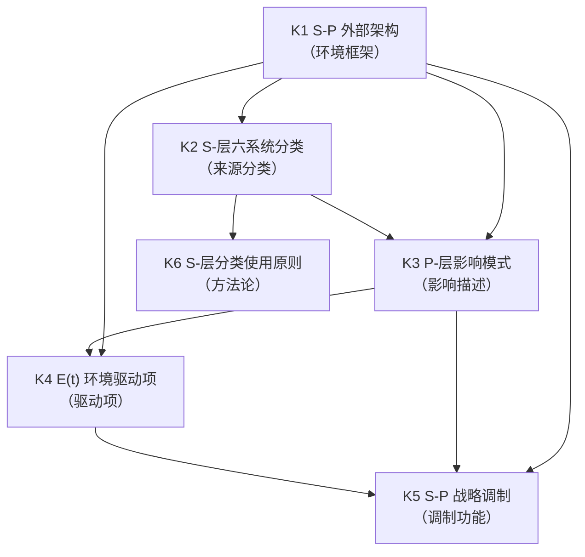
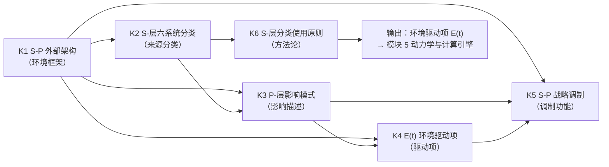

# SMOD-04 · 状态范式模块 4：环境参照（× 变量范式对位）

> **来源与性质**：状态范式模块 4/10·与变量范式 MOD 系对位（对位模块见 1.1 定位表）；本件依主理转入稿整理，去除呈现层过渡结构（四层次包装），知识内容全量保留。库内锚点引用前须自核（见 rn）。

>
> **框架声明（15-RPT-115 #1/#2·v0.1.1 订正批增）**：本件「四层次」结构系输出构造、非库内文档框架；模块 MECE 编号与知识点清单照 15-X-112 原文展开。

## 一、模块定位与知识点总览

### 1.1 模块定位表

| 项 | 内容 |
|---|---|
| 所属范式 | 状态范式（功能层） |
| MECE 编号 | 模块 4 / 共 10 模块 |
| 核心问题 | 系统在什么环境中运行？ |
| 关键知识 | S-P：Source-Pattern、微-中-外-宏-时间-数字系统、E(t) |
| 代表工具/方法 | 01-M-09 |
| 当前状态 | **已形式化** |
| 在知识生产链中的位置 | **第四环·环境维度**——上游承接模块 2“状态语法”，下游供给模块 5“动力学与计算引擎”以环境驱动项 E(t) |
| 变量范式对位模块 | 模块 3“研究设计与抽样”（情境变量、调节变量）＋模块 5“因果识别与因果推断”（情境混淆） |
| 本模块的真正分歧 | 环境角色：控制变量/调节变量 vs 驱动项 E(t)；环境结构：无统一分类 vs S-P 六层分类；环境与状态关系：变量间关系 vs 环境驱动状态演化；环境时间性：静态 vs 动态驱动项 |

### 1.2 知识点清单表

| # | 知识点 | 一句话定位 | 在状态范式中的角色 |
|---|---|---|---|
| K1 | S-P 外部架构 | 环境参照系：Source-Pattern | 环境维度的顶层框架 |
| K2 | S-层六系统分类 | 微系统、中系统、外系统、宏系统、时间系统、数字系统 | 环境来源的分类 |
| K3 | P-层影响模式 | 环境对 M-R-D-S 的影响模式 | 环境作用的描述 |
| K4 | E(t) 环境驱动项 | 环境作为动力学方程的外部驱动 | 状态演化的外部输入 |
| K5 | S-P 的战略调制功能 | 环境决定操作的执行优先级、时序、风险阈值 | 环境对干预的调制 |
| K6 | S-层分类的使用原则 | 分析单元是“环境影响类型”而非“环境实体” | 环境分类的方法论 |

### 1.3 每个知识点的大纲解释表

| 知识点 | 简要大纲解释 |
|---|---|
| **K1 S-P 外部架构** | S-P 是 M-R-D-S 系统的“环境感官”，解析外部环境如何以规律性模式（Pattern）影响人的内部架构。S 层识别环境影响来源（如微系统家庭、宏系统文化），P 层描述这些影响具体作用于 M-R-D-S 的哪个模块和层级。 |
| **K2 S-层六系统分类** | 微系统（个体直接参与，面对面互动）、中系统（微系统之间的相互作用）、外系统（个体未直接参与但受影响）、宏系统（广阔的文化价值观、意识形态）、时间系统（环境事件与随时间的变化）、数字系统（数字信息环境本身的媒介特性）。是环境影响来源类型的分类，而非环境实体的分类。 |
| **K3 P-层影响模式** | P 层采用与 M-R-D-S 可类比的命名规则，对环境影响的模式进行结构化描述。二值标记（+/−/0）为简化入门版，更精细的分析可采用多靶点向量格式。P 层描述环境作用于 M-R-D-S 的哪个模块和层级。 |
| **K4 E(t) 环境驱动项** | 环境作为动力学方程的外部驱动项。核心方程 dΨ/dt = Σ w_k·f_k(Ψ, E(t), θ_k) 中，E(t) 是 S-P 环境驱动项（时变）。E(t) 来自 L0-S-P 环境参照系 + L1 环境观测 + MET 假设（方程子层）。 |
| **K5 S-P 的战略调制功能** | S-P 架构不改变 G-M-A-R 原子操作的功能定义，但作为战略上下文注入器，决定其执行优先级、时序和风险阈值。S-P 架构使 INTRE 从主要关注内部状态的心智模型，扩展为包含环境参照系的环境适应性心理工程系统。 |
| **K6 S-层分类的使用原则** | S-层的六系统是对环境影响来源类型的分类，而非对环境实体的分类。在分析一个复杂环境（如社交媒体、职场）时，不应追问“它属于哪个系统”，而应将其分解为多个层面，分别识别每个层面对应的环境影响类型，并归入相应的 S-层系统。 |

## 二、知识点详解对比

### 2.1 K1 S-P 外部架构 —— 详细对比

| 维度 | 变量范式（情境变量） | 状态范式（S-P 外部架构） |
|---|---|---|
| 核心对象 | 情境变量、调节变量 | S-P 外部架构（Source-Pattern） |
| 环境表示 | 变量（如情境、文化） | S 层（来源）+ P 层（模式） |
| 环境分类 | 无统一分类 | S 层六系统分类 |
| 环境作用 | 调节效应 | P 层影响模式（作用于 M-R-D-S） |
| 与状态关系 | 变量间关系 | 环境驱动状态演化 |
| 时间性 | 静态 | 动态驱动项 E(t) |
| 库内对应 | — | 01-M-09《S-P 环境参照系》 |
| 关键分歧 | 变量范式用情境变量；状态范式用 S-P 外部架构 | 前者是变量；后者是环境参照系 |

### 2.2 K2 S-层六系统分类 —— 详细对比

| 维度 | 变量范式（环境变量） | 状态范式（S-层六系统分类） |
|---|---|---|
| 分类结构 | 无统一分类 | 微系统、中系统、外系统、宏系统、时间系统、数字系统 |
| 分类单元 | 环境实体 | 环境影响类型 |
| 理论来源 | 无 | Bronfenbrenner 生态系统理论 + 数字系统扩展 |
| 互斥性 | 无 | 六系统定义核心互斥（05-R-01 #15） |
| 复合环境处理 | 无 | 多层面分解（社交媒体分解为微/宏/外/数字） |
| 库内对应 | — | 01-M-09；05-R-01 #15 |
| 关键分歧 | 变量范式无统一环境分类；状态范式用 S-层六系统分类 | 前者是环境变量；后者是环境影响类型分类 |

### 2.3 K3 P-层影响模式 —— 详细对比

| 维度 | 变量范式（调节效应） | 状态范式（P-层影响模式） |
|---|---|---|
| 核心工具 | 调节效应、交互项 | P 层影响模式（+/−/0 标记或多靶点向量） |
| 作用描述 | 变量间交互 | 环境作用于 M-R-D-S 的哪个模块和层级 |
| 命名规则 | 无 | 与 M-R-D-S 可类比的命名规则 |
| 精细度 | 通常二值或连续 | 二值标记（入门）→ 多靶点向量（精细） |
| 库内对应 | — | 01-M-09 |
| 关键分歧 | 变量范式用调节效应；状态范式用 P-层影响模式 | 前者是统计交互；后者是结构化影响模式 |

### 2.4 K4 E(t) 环境驱动项 —— 详细对比

| 维度 | 变量范式（情境混淆） | 状态范式（E(t) 环境驱动项） |
|---|---|---|
| 核心对象 | 情境混淆、随时间变化的混淆 | E(t) 环境驱动项 |
| 在模型中的位置 | 控制变量或混淆 | 动力学方程的外部驱动项 |
| 数学形式 | 协变量 | dΨ/dt = Σ w_k·f_k(Ψ, E(t), θ_k) |
| 时间性 | 通常静态 | 时变驱动项 |
| 与状态关系 | 变量间关系 | 环境驱动状态演化 |
| 来源 | 无 | S-P 环境参照系 + L1 环境观测 + MET 假设 |
| 库内对应 | — | 01-M-03 §四（核心方程）；01-M-09 |
| 关键分歧 | 变量范式用情境混淆；状态范式用 E(t) 环境驱动项 | 前者是混淆；后者是驱动项 |

### 2.5 K5 S-P 的战略调制功能 —— 详细对比

| 维度 | 变量范式（无对应） | 状态范式（S-P 战略调制） |
|---|---|---|
| 核心功能 | 无 | 决定操作的执行优先级、时序、风险阈值 |
| 与操作关系 | 无 | 不改变 G-M-A-R 功能定义，但调制执行 |
| 战略地位 | 无 | 使 INTRE 从内部状态模型扩展为环境适应性心理工程系统 |
| 库内对应 | — | 01-M-09 §三 |
| 关键分歧 | 变量范式无对应；状态范式用 S-P 战略调制 | 前者无环境调制；后者有环境调制 |

### 2.6 K6 S-层分类的使用原则 —— 详细对比

| 维度 | 变量范式（无对应） | 状态范式（S-层分类使用原则） |
|---|---|---|
| 分析单元 | 环境实体 | 环境影响类型 |
| 复合环境处理 | 无 | 多层面分解 |
| 使用误区 | 无 | “事物归类”误区（试图将环境实体归入单一系统） |
| 框架澄清 | 无 | 框架需澄清“影响类型”与“环境实体”的区分 |
| 库内对应 | — | 01-M-09；05-R-01 #15 |
| 关键分歧 | 变量范式无使用原则；状态范式用 S-层分类使用原则 | 前者无环境分类；后者有环境分类使用原则 |

## 三、知识库链接

### 3.1 K1 S-P 外部架构 —— 知识库链接表

| 类别 | 内容 | 库内/库外对应 |
|---|---|---|
| 核心工具 | S-P 外部架构（Source-Pattern） | — |
| 相关理论 | 生态系统理论、环境心理学 | Bronfenbrenner (1979) |
| 心理学表现 | 环境参照系 | — |
| 状态范式对位 | 01-M-09《S-P 环境参照系》 | 库内 |
| 关键文档 | 01-M-09《L0-S-P-环境参照系》 | 库内 |
| 关键论证 | S-P 解析外部环境如何以规律性模式影响内部架构 | 01-M-09 |
| 延伸阅读 | Bronfenbrenner (1979)；01-M-09 | 库内/库外 |
| 相关争议 | S-P 的层次结构；与变量范式情境变量的区别 | 01-M-09 |

### 3.2 K2 S-层六系统分类 —— 知识库链接表

| 类别 | 内容 | 库内/库外对应 |
|---|---|---|
| 核心工具 | 微系统、中系统、外系统、宏系统、时间系统、数字系统 | — |
| 相关理论 | 生态系统理论、数字环境 | Bronfenbrenner (1979) |
| 心理学表现 | 环境来源分类 | — |
| 状态范式对位 | 01-M-09；05-R-01 #15 | 库内 |
| 关键文档 | 01-M-09《S-P 环境参照系》；05-R-01《压力测试》#15 | 库内 |
| 关键论证 | S-层六系统互斥性压力测试（05-R-01 #15） | 05-R-01 #15 |
| 延伸阅读 | Bronfenbrenner (1979)；01-M-09 | 库内/库外 |
| 相关争议 | 数字系统的理论扩展提议；复合环境的归类 | 05-R-01 #15 |

### 3.3 K3 P-层影响模式 —— 知识库链接表

| 类别 | 内容 | 库内/库外对应 |
|---|---|---|
| 核心工具 | P 层影响模式（+/−/0 标记、多靶点向量） | — |
| 相关理论 | 生态系统理论、环境心理学 | Bronfenbrenner (1979) |
| 心理学表现 | 环境作用描述 | — |
| 状态范式对位 | 01-M-09 | 库内 |
| 关键文档 | 01-M-09《S-P 环境参照系》 | 库内 |
| 关键论证 | P 层采用与 M-R-D-S 可类比的命名规则 | 01-M-09 |
| 延伸阅读 | Bronfenbrenner (1979)；01-M-09 | 库内/库外 |
| 相关争议 | P 层的精细度；二值 vs 多靶点向量 | 01-M-09 |

### 3.4 K4 E(t) 环境驱动项 —— 知识库链接表

| 类别 | 内容 | 库内/库外对应 |
|---|---|---|
| 核心工具 | E(t) 环境驱动项 | — |
| 相关理论 | 动力系统、控制论 | Strogatz (2015)；Wiener (1948) |
| 心理学表现 | 环境驱动状态演化 | — |
| 状态范式对位 | 01-M-03 §四；01-M-09 | 库内 |
| 关键文档 | 01-M-03《PSE》§四（核心方程）；01-M-09《S-P 环境参照系》 | 库内 |
| 关键论证 | E(t) 是动力学方程的外部驱动项 | 01-M-03 §四 |
| 延伸阅读 | Strogatz (2015)；Wiener (1948)；01-M-03 §四 | 库内/库外 |
| 相关争议 | E(t) 的慢变/中变分量；与变量范式混淆的区别 | 01-M-03 §二 |

### 3.5 K5 S-P 的战略调制功能 —— 知识库链接表

| 类别 | 内容 | 库内/库外对应 |
|---|---|---|
| 核心工具 | S-P 战略调制（执行优先级、时序、风险阈值） | — |
| 相关理论 | 生态系统理论、控制论 | Bronfenbrenner (1979)；Wiener (1948) |
| 心理学表现 | 环境调制干预 | — |
| 状态范式对位 | 01-M-09 §三 | 库内 |
| 关键文档 | 01-M-09《S-P 环境参照系》§三 | 库内 |
| 关键论证 | S-P 决定操作的执行优先级、时序、风险阈值 | 01-M-09 §三 |
| 延伸阅读 | Bronfenbrenner (1979)；Wiener (1948)；01-M-09 §三 | 库内/库外 |
| 相关争议 | S-P 与 G-M-A-R 的关系 | 01-M-09 §三 |

### 3.6 K6 S-层分类的使用原则 —— 知识库链接表

| 类别 | 内容 | 库内/库外对应 |
|---|---|---|
| 核心工具 | S-层分类使用原则 | — |
| 相关理论 | 生态系统理论 | Bronfenbrenner (1979) |
| 心理学表现 | 环境影响类型分解 | — |
| 状态范式对位 | 01-M-09；05-R-01 #15 | 库内 |
| 关键文档 | 01-M-09《S-P 环境参照系》；05-R-01《压力测试》#15 | 库内 |
| 关键论证 | S-层分类的分析单元是环境影响类型而非环境实体 | 05-R-01 #15 |
| 延伸阅读 | Bronfenbrenner (1979)；01-M-09 | 库内/库外 |
| 相关争议 | 复合环境的归类；使用误区 | 05-R-01 #15 |

## 四、知识点依赖关系

### 4.1 依赖关系总表

| 知识点 | 依赖 | 被依赖 | 依赖类型 | 说明 |
|---|---|---|---|---|
| K1 S-P 外部架构 | 模块 2（状态语法） | K2、K3、K4、K5、K6 | 环境框架 | S-P 是环境参照系的顶层框架 |
| K2 S-层六系统分类 | K1 | K3、K6 | 来源分类 | S 层六系统分类是环境影响来源的分类 |
| K3 P-层影响模式 | K1、K2 | K4、K5 | 影响描述 | P 层描述环境对 M-R-D-S 的影响模式 |
| K4 E(t) 环境驱动项 | K1、K3 | K5 | 驱动项 | E(t) 是动力学方程的外部驱动项 |
| K5 S-P 战略调制 | K1、K3、K4 | K6 | 调制功能 | S-P 决定操作的执行优先级、时序、风险阈值 |
| K6 S-层分类使用原则 | K2 | — | 方法论 | S-层分类使用原则是环境分类的方法论 |

### 4.2 依赖关系图

### 4.3 依赖关系深度解剖表

| 依赖对 | 依赖内容 | 深度 | 结构性后果 |
|---|---|---|---|
| K1 → K2 | S-P 外部架构 → S-层六系统分类 | 强 | S-层六系统分类是 S-P 的 S 层实现 |
| K1 → K3 | S-P 外部架构 → P-层影响模式 | 强 | P-层影响模式是 S-P 的 P 层实现 |
| K2 → K3 | S-层六系统分类 → P-层影响模式 | 强 | S 层来源决定 P 层影响模式 |
| K1 → K4 | S-P 外部架构 → E(t) 环境驱动项 | 强 | E(t) 来自 S-P 环境参照系 |
| K3 → K4 | P-层影响模式 → E(t) 环境驱动项 | 强 | P 层影响模式转化为 E(t) 驱动项 |
| K1 → K5 | S-P 外部架构 → S-P 战略调制 | 强 | S-P 决定操作的执行优先级、时序、风险阈值 |
| K3 → K5 | P-层影响模式 → S-P 战略调制 | 中 | P 层影响模式影响战略调制 |
| K4 → K5 | E(t) 环境驱动项 → S-P 战略调制 | 中 | E(t) 驱动项影响战略调制 |
| K2 → K6 | S-层六系统分类 → S-层分类使用原则 | 强 | S-层分类使用原则是 S-层分类的方法论 |

### 4.4 与变量范式的依赖关系对比

| 状态范式依赖 | 变量范式对应 | 差异 |
|---|---|---|
| K1 S-P 外部架构 → K2 S-层六系统分类 | 情境变量 → 无对应 | 状态范式用 S-P 外部架构；变量范式用情境变量 |
| K2 S-层六系统分类 → K3 P-层影响模式 | 无对应 → 调节效应 | 状态范式用 S-层六系统分类；变量范式无统一环境分类 |
| K3 P-层影响模式 → K4 E(t) 环境驱动项 | 调节效应 → 情境混淆 | 状态范式用 P-层影响模式；变量范式用调节效应 |
| K4 E(t) 环境驱动项 → K5 S-P 战略调制 | 情境混淆 → 无对应 | 状态范式用 E(t) 驱动项；变量范式用情境混淆 |
| K5 S-P 战略调制 → K6 S-层分类使用原则 | 无对应 → 无对应 | 状态范式用 S-P 战略调制；变量范式无对应 |
| K1–K6 | 情境变量 + 调节效应 + 情境混淆 | 状态范式用 S-P 外部架构 + S-层六系统 + P-层影响模式 + E(t) + 战略调制 + 使用原则；变量范式用情境变量 + 调节效应 + 情境混淆 |

### 4.5 关键依赖链：从 S-P 外部架构到使用原则

**关键结论：**

1. **K1 S-P 外部架构是环境框架**：定义 S 层（来源）+ P 层（模式）的顶层框架。
2. **K2 S-层六系统分类是来源分类**：微系统、中系统、外系统、宏系统、时间系统、数字系统。
3. **K3 P-层影响模式是影响描述**：描述环境对 M-R-D-S 的影响模式。
4. **K4 E(t) 环境驱动项是驱动项**：动力学方程的外部驱动项。
5. **K5 S-P 战略调制是调制功能**：决定操作的执行优先级、时序、风险阈值。
6. **K6 S-层分类使用原则是方法论**：分析单元是环境影响类型而非环境实体。
7. **模块 4 的输出是环境驱动项 E(t)**：这个驱动项供给模块 5（动力学与计算引擎）作为状态演化的外部输入。
8. **与变量范式的根本差异**：变量范式用情境变量、调节效应、情境混淆；状态范式用 S-P 外部架构、S-层六系统、P-层影响模式、E(t) 驱动项、战略调制、使用原则。

### 4.6 模块间依赖：模块 4 与相邻模块的关系

| 关系 | 上游 | 下游 | 依赖内容 |
|---|---|---|---|
| 模块 2 → 模块 4 | 状态语法 | 环境参照 | 模块 2 定义状态空间，模块 4 定义环境参照系 |
| 模块 4 → 模块 5 | 环境驱动项 E(t) | 动力学与计算引擎 | 模块 4 提供 E(t)，模块 5 将其纳入动力学方程 |
| 模块 4 → 模块 7 | 环境参照 | 干预与验证 | 模块 4 提供环境约束，模块 7 在环境中验证干预 |
| 模块 4 ↔ 模块 8 | 环境参照 ↔ 治理与证据 | 双向依赖 | 环境参照影响证据分级；证据分级验证环境参照 |

## 疑问解答（附属·v0.2.0 增）

本节系主理 Agent 2026-10-13 会话转入之附属疑问解答（9 条·逐条以表格作答），与正文四节互为补充、不替代；内容逐字落盘未改一字。

### 疑问 1：本模块“真正分歧”的环境角色、环境结构、环境与状态关系、环境时间性四重分歧如何与变量范式镜像？

| 维度 | 变量范式 | 状态范式 |
|---|---|---|
| 环境角色 | 控制变量/调节变量 | 驱动项 E(t) |
| 环境结构 | 无统一分类 | S-P 六层分类 |
| 环境与状态关系 | 变量间关系 | 环境驱动状态演化 |
| 环境时间性 | 静态 | 动态驱动项 |
| 镜像关系 | 用情境变量 + 调节效应 + 情境混淆 | 用 S-P 外部架构 + S-层六系统 + P-层影响模式 + E(t) + 战略调制 + 使用原则 |
| 一句话 | 变量范式把环境当作需要控制的混淆；状态范式把环境当作驱动状态演化的时变输入 E(t) |

---

### 疑问 2：K1 S-P 外部架构的 S 层与 P 层分别承担什么功能？

| 层级 | 功能 | 内容 |
|---|---|---|
| S 层（Source） | 识别环境影响来源 | 微系统、中系统、外系统、宏系统、时间系统、数字系统 |
| P 层（Pattern） | 描述环境作用模式 | 环境对 M-R-D-S 的影响模式；二值标记（+/−/0）或多靶点向量 |
| 二者关系 | S 层识别来源，P 层描述作用 | S 层来源决定 P 层影响模式 |
| 一句话 | S 层回答“环境来自哪里”，P 层回答“环境如何作用于 M-R-D-S” |

---

### 疑问 3：K2 S-层六系统分类的互斥性如何保证？

| 维度 | 解答 |
|---|---|
| 分类单元 | 环境影响来源类型，而非环境实体 |
| 互斥性检验 | 05-R-01 #15：S-层六系统定义核心在概念上互斥 |
| 复合环境处理 | 社交媒体分解为微系统（私信互动）、宏系统（文化叙事）、外系统（算法推荐）、数字系统（技术架构） |
| 使用误区 | 试图将环境实体直接映射到单一系统，而非将环境影响按类型分解 |
| 一句话 | S-层六系统是对环境影响来源类型的分类；复杂环境应分解为多个层面，分别归入相应系统 |

---

### 疑问 4：K3 P-层影响模式的命名规则如何与 M-R-D-S 类比？

| 维度 | 解答 |
|---|---|
| 命名规则 | 与 M-R-D-S 可类比的命名规则 |
| 二值标记 | P-M4-RES-B+ 表示环境补充安全感；P-M4-RES-D- 表示环境消耗情绪容限 |
| 多靶点向量 | 更精细的分析可采用多靶点向量格式 |
| 与 M-R-D-S 关系 | P 层描述环境作用于 M-R-D-S 的哪个模块和层级 |
| 一句话 | P 层采用与 M-R-D-S 可类比的命名规则，对环境影响的模式进行结构化描述 |

---

### 疑问 5：K4 E(t) 环境驱动项在核心方程中的位置与来源如何？

| 维度 | 解答 |
|---|---|
| 在核心方程中的位置 | `dΨ/dt = Σ w_k·f_k(Ψ, E(t), θ_k)` |
| 来源 | L0-S-P 环境参照系 + L1 环境观测 + MET 假设（方程子层） |
| 时间性 | 时变驱动项 |
| 慢变/中变分量 | DPR 持有 E(t) 慢变/中变分量（Tax_rate、ELI） |
| 一句话 | E(t) 是动力学方程的外部驱动项，来自 S-P 环境参照系与 L1 环境观测 |

---

### 疑问 6：K5 S-P 战略调制功能如何不改变 G-M-A-R 的功能定义？

| 维度 | 解答 |
|---|---|
| 核心功能 | 决定操作的执行优先级、时序、风险阈值 |
| 不改变的内容 | G-M-A-R 原子操作的功能定义 |
| 改变的内容 | 执行优先级、时序、风险阈值 |
| 战略地位 | 使 INTRE 从主要关注内部状态的心智模型，扩展为包含环境参照系的环境适应性心理工程系统 |
| 一句话 | S-P 作为战略上下文注入器，决定 G-M-A-R 操作的执行优先级、时序和风险阈值，但不改变操作本身的功能定义 |

---

### 疑问 7：K6 S-层分类使用原则的核心是什么？

| 维度 | 解答 |
|---|---|
| 分析单元 | 环境影响类型，而非环境实体 |
| 复合环境处理 | 多层面分解 |
| 使用误区 | “事物归类”误区：试图将环境实体归入单一系统 |
| 框架澄清 | 框架需澄清“影响类型”与“环境实体”的区分 |
| 一句话 | S-层分类的分析单元是环境影响类型；复杂环境应分解为多个层面，分别识别每个层面对应的环境影响类型 |

---

### 疑问 8：本模块知识点依赖链是否闭合？状态范式如何对应？

| 状态范式依赖 | 内容 | 差异 |
|---|---|---|
| K1 S-P 外部架构 → K2 S-层六系统分类 | S-层六系统分类是 S-P 的 S 层实现 | — |
| K1 S-P 外部架构 → K3 P-层影响模式 | P-层影响模式是 S-P 的 P 层实现 | — |
| K2 S-层六系统分类 → K3 P-层影响模式 | S 层来源决定 P 层影响模式 | — |
| K1 S-P 外部架构 → K4 E(t) 环境驱动项 | E(t) 来自 S-P 环境参照系 | — |
| K3 P-层影响模式 → K4 E(t) 环境驱动项 | P 层影响模式转化为 E(t) 驱动项 | — |
| K1 S-P 外部架构 → K5 S-P 战略调制 | S-P 决定操作的执行优先级、时序、风险阈值 | — |
| K3 P-层影响模式 → K5 S-P 战略调制 | P 层影响模式影响战略调制 | — |
| K4 E(t) 环境驱动项 → K5 S-P 战略调制 | E(t) 驱动项影响战略调制 | — |
| K2 S-层六系统分类 → K6 S-层分类使用原则 | S-层分类使用原则是 S-层分类的方法论 | — |
| 依赖链是否闭合 | 从 S-P 外部架构出发，经由 S-层六系统分类、P-层影响模式、E(t) 环境驱动项、S-P 战略调制，到达 S-层分类使用原则 | — |
| 一句话 | 变量范式用情境变量 + 调节效应 + 情境混淆；状态范式用 S-P 外部架构 + S-层六系统 + P-层影响模式 + E(t) + 战略调制 + 使用原则 |

---

### 疑问 9：本模块与相邻状态范式模块的依赖关系如何？

| 关系 | 上游 | 下游 | 依赖内容 |
|---|---|---|---|
| SMOD-02 → 本模块 | 状态语法 | 环境参照 | SMOD-02 定义状态空间，本模块定义环境参照系 |
| 本模块 → SMOD-05 | 环境驱动项 E(t) | 动力学与计算引擎 | 本模块提供 E(t)，SMOD-05 将其纳入动力学方程 |
| 本模块 → SMOD-07 | 环境参照 | 干预与验证 | 本模块提供环境约束，SMOD-07 在环境中验证干预 |
| 本模块 ↔ SMOD-08 | 环境参照 ↔ 治理与证据 | 双向依赖 | 环境参照影响证据分级；证据分级验证环境参照 |
| 一句话 | 本模块是状态范式的“环境引擎”，上承状态语法，下接动力学、干预验证、治理证据 | — | — |

## 版本记录

| 版本 | 日期 | 变更说明 |
|---|---|---|
| v0.3.0 | 2026-10-29 | 双范式正名批（DR-2026-10-29-TERM-002 v1.4.0）：正文「结构范式」→「状态范式」；判升 Minor。 |
| v0.2.1 | 2026-10-16 | Patch·B261016-04：外审机械订正批：deps 3 行反斜杠归一（缺陷类全目录清零）。 |
| v0.2.0 | 2026-10-13 | Minor·B261013-06：疑问解答增补批：增「疑问解答（附属）」一节于版本记录之前——9 条疑问逐条以表格作答，内容自主理会话转入附件逐字落盘未改一字； 与正文四节互为补充、不替代。 |
| v0.1.1 | 2026-10-13 | Patch·B261013-04：订正批：框架声明增（#1/#2）；无其他成立待订项。判升 Patch。 |
| v0.1.0 | 2026-10-13 | 建件·B261013-03：结构范式模块 4/10 落盘（去四层次包装改四节直陈·第四层次系「与变量范式的依赖关系对比」反向对位·表格与 mermaid 2 枚零删减保留）。B261013-03。 |

> 全量版本 v0.1.0–v0.2.1（共 4 版）见 [HIST-SMOD §SMOD-04-环境参照-v0.1-2026-10-13](HIST-SMOD_双范式对比学习模块-SMOD系版本沿革-v1.0-2026-10-18.md#doc-37)；当前无外迁版本。
