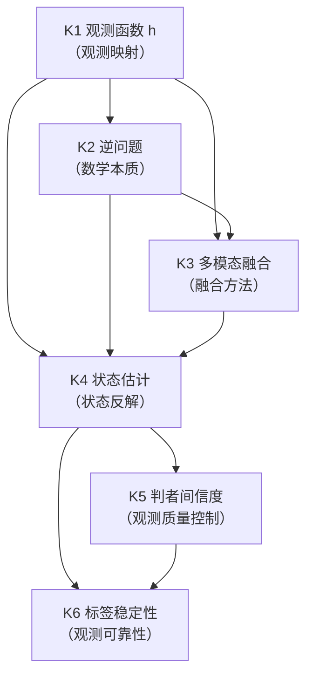
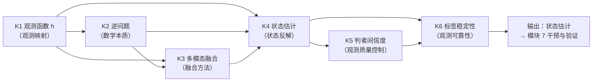

# SMOD-06 · 状态范式模块 6：测量与观测（× 变量范式对位）

> **来源与性质**：状态范式模块 6/10·与变量范式 MOD 系对位（对位模块见 1.1 定位表）；本件依主理转入稿整理，去除呈现层过渡结构（四层次包装），知识内容全量保留。库内锚点引用前须自核（见 rn）。

>
> **框架声明（15-RPT-115 #1/#2·v0.1.1 订正批增）**：本件「四层次」结构系输出构造、非库内文档框架；模块 MECE 编号与知识点清单照 15-X-112 原文展开。

## 一、模块定位与知识点总览

### 1.1 模块定位表

| 项 | 内容 |
|---|---|
| 所属范式 | 状态范式（功能层） |
| MECE 编号 | 模块 6 / 共 10 模块 |
| 核心问题 | 如何从观测反推状态？ |
| 关键知识 | 观测函数 h、逆问题、多模态融合、状态估计、判者间信度、标签稳定性 |
| 代表工具/方法 | VTS-P、判读协议、盲评 |
| 当前状态 | **部分工具在建** |
| 在知识生产链中的位置 | **第六环·观测反解**——上游承接模块 2“状态语法”与模块 5“动力学与计算引擎”，下游供给模块 7“干预与验证”以状态估计 |
| 变量范式对位模块 | 模块 2“构念与测量”（心理测量学、CTT、IRT、信度、效度）＋模块 4“统计推断与数据建模”（回归、SEM） |
| 本模块的真正分歧 | 测量对象：构念/潜变量 vs 功能状态 Ψ；测量关系：构念→指标 vs Ψ→y 观测函数 h；测量目标：稳定读取属性 vs 逆问题反解状态；测量误差：随机误差 vs 观测噪声 + 状态不确定性 |

### 1.2 知识点清单表

| # | 知识点 | 一句话定位 | 在状态范式中的角色 |
|---|---|---|---|
| K1 | 观测函数 h | 从状态到观测的生成映射 | 测量与观测的核心 |
| K2 | 逆问题 | 从观测反推状态 | 状态估计的数学本质 |
| K3 | 多模态融合 | 融合语义/行为/神经三模态观测 | 提高状态估计精度 |
| K4 | 状态估计 | 递推贝叶斯估计状态后验 | 状态反解的核心算法 |
| K5 | 判者间信度 | 判读协议、盲评、判者资格与执行度 | 观测质量控制 |
| K6 | 标签稳定性 | 观测标签的跨时间/跨情境稳定性 | 观测可靠性 |

### 1.3 每个知识点的大纲解释表

| 知识点 | 简要大纲解释 |
|---|---|
| **K1 观测函数 h** | 从状态 Ψ 到观测 y 的生成映射：y = h(Ψ, E) + ε。观测函数 h 是功能层与现象层的接口。变量范式对 h 的缺席是原则性的（语法中无位置）；状态范式对 h 的未完成是阶段性的（语法中有位置、参数待填充）。 |
| **K2 逆问题** | 从观测数据反推系统状态参数的过程，在数学上属于逆问题。逆问题通常具有病态性（测量噪声可能被放大为参数估计的巨大偏差）、解的不唯一性、对先验信息的强依赖性。PSE 用卡尔曼滤波、扩展/无迹卡尔曼滤波、粒子滤波等算法解决逆问题。 |
| **K3 多模态融合** | 融合语义/行为/神经三模态观测：p(Ψ_t\|y_t) ∝ p(y_s\|Ψ_t)·p(y_b\|Ψ_t)·p(y_n\|Ψ_t)·p(Ψ_t\|Ψ_{t-1})。多模态数据从不同角度约束同一个潜在状态，使逆问题更可解。但多模态并不自动等于功能层——仍需统一的生成模型来解释这些投影为何共同出现。 |
| **K4 状态估计** | 递推贝叶斯估计状态后验：基于群体先验初始化 → 利用状态方程预测下一时刻状态分布 → 获得新观测后计算后验分布 → 迭代。PSE 通过卡尔曼滤波的预测-更新递推循环，动态估计出系统状态及其不确定性边界。 |
| **K5 判者间信度** | 判读协议、盲评、判者资格与执行度（JQC/JECC）。是观测质量控制的核心工具。判者间信度衡量不同判者对同一观测的一致性；JQC/JECC 是内部件，名册与产物禁外引。 |
| **K6 标签稳定性** | 观测标签的跨时间/跨情境稳定性。标签稳定性是观测可靠性的重要指标；不稳定的标签会导致状态估计失效。〔归类订正（15-RPT-115 #10）：跨基质／跨模型／跨仪器对照移归 K4 状态估计的扩展检验，K6 保持观测标签域独立。〕 |

## 二、知识点详解对比

### 2.1 K1 观测函数 h —— 详细对比

| 维度 | 变量范式（构念→指标） | 状态范式（观测函数 h） |
|---|---|---|
| 核心映射 | 构念 → 指标 | 状态 Ψ → 观测 y |
| 数学形式 | y = λ·η + ε（因子模型） | y = h(Ψ, E) + ε |
| 映射方向 | 构念到指标（潜变量模型） | 状态到观测（生成模型） |
| 映射性质 | 线性、静态 | 非线性、动态 |
| 理论负载 | 通常不显式建模 | p(y_b\|Ψ) 理论构成（观测与理论耦合） |
| 缺席性质 | h 缺席是原则性的（语法中无位置） | h 未完成是阶段性的（语法中有位置、参数待填充） |
| 库内对应 | — | 01-M-03 §九；01-M-11；03-A-19 |
| 关键分歧 | 变量范式用构念→指标；状态范式用状态→观测 | 前者是潜变量模型；后者是生成模型 |

### 2.2 K2 逆问题 —— 详细对比

| 维度 | 变量范式（参数估计） | 状态范式（逆问题反解） |
|---|---|---|
| 核心目标 | 估计参数 | 从观测反推状态 |
| 数学性质 | 通常良态 | 病态性（测量噪声可能被放大） |
| 解的唯一性 | 通常唯一 | 不唯一 |
| 先验依赖 | 通常弱 | 强依赖先验信息 |
| 解决方法 | 极大似然、最小二乘 | 卡尔曼滤波、粒子滤波、变分推断 |
| 时间性 | 通常静态 | 递推贝叶斯估计 |
| 库内对应 | — | 03-A-19（逆问题算法路径）；01-M-11 |
| 关键分歧 | 变量范式用参数估计；状态范式用逆问题反解 | 前者是良态；后者是病态 |

### 2.3 K3 多模态融合 —— 详细对比

| 维度 | 变量范式（多元回归/因子分析） | 状态范式（多模态融合） |
|---|---|---|
| 融合方式 | 多元回归、因子分析 | 贝叶斯乘积融合 |
| 融合对象 | 多变量 | 语义/行为/神经三模态似然 |
| 融合公式 | Y = BX + ε | p(Ψ_t\|y_t) ∝ p(y_s\|Ψ_t)·p(y_b\|Ψ_t)·p(y_n\|Ψ_t)·p(Ψ_t\|Ψ_{t-1}) |
| 融合目标 | 预测因变量 | 估计状态后验 |
| 模态约束 | 通常不显式建模 | 多模态从不同角度约束同一状态 |
| 库内对应 | — | 01-M-11（L2 状态估计）；01-M-10（L1-I 接口规范） |
| 关键分歧 | 变量范式用多元回归/因子分析；状态范式用贝叶斯乘积融合 | 前者是统计模型；后者是状态估计 |

### 2.4 K4 状态估计 —— 详细对比

| 维度 | 变量范式（参数估计） | 状态范式（状态估计） |
|---|---|---|
| 核心目标 | 估计参数 θ | 估计状态后验 p(Ψ_t\|y_{1:t}) |
| 估计对象 | 参数分布 | 状态后验（42 维均值 + 协方差） |
| 估计方式 | 极大似然、贝叶斯 | 递推贝叶斯估计（预测-更新循环） |
| 时间性 | 通常静态 | 动态（递推更新） |
| 不确定性 | 参数置信区间 | 状态后验协方差 |
| 验证方式 | 模型拟合 | 间接验证（多模态一致性、L3 预测精度反推、临床专家交叉校准） |
| 扩展检验 | — | 跨基质对照、跨模型泛化、跨仪器（自 K6 移入·15-RPT-115 #10；22-A-01 §三） |
| 库内对应 | — | 01-M-11（L2 状态估计）；01-M-00 §4.3 |
| 关键分歧 | 变量范式估计参数；状态范式估计状态后验 | 前者是参数推断；后者是状态估计 |

### 2.5 K5 判者间信度 —— 详细对比

| 维度 | 变量范式（判者间信度） | 状态范式（判读协议 + 盲评） |
|---|---|---|
| 核心工具 | κ、ICC | 判读协议、盲评、JQC/JECC |
| 信度类型 | 判者间一致性 | 判者间一致性 + 判者资格与执行度 |
| 质量控制 | 判者培训 | 判读协议 + 判者资格与执行度（JQC/JECC） |
| 判者角色 | 评分者 | 判读协议执行者 |
| 信度阈值 | α、κ 标准 | 判读协议 + 内部件标准 |
| 库内对应 | — | 26-WP-S3-36 §5.3；26-WP-S3-15（控制点五件套） |
| 关键分歧 | 变量范式用 κ/ICC；状态范式用判读协议 + 盲评 + JQC/JECC | 前者是统计指标；后者是协议 + 资格 + 执行度 |

### 2.6 K6 标签稳定性 —— 详细对比

| 维度 | 变量范式（测量不变性） | 状态范式（标签稳定性） |
|---|---|---|
| 核心目标 | 跨群体/跨时间测量等价 | 观测标签的跨时间/跨情境稳定性 |
| 检验方式 | 多组 CFA、MGCFA、MIMIC | 观测域内检验（跨基质对照已移 K4·15-RPT-115 #10） |
| 稳定性层级 | 构型→度量→标量→严格 | 观测函数形式稳定性 → 参数稳定性 → 状态可比较性 |
| 失败后果 | 跨群体比较无效 | 观测函数漂移→状态估计失效 |
| 处理方式 | 部分不变性、近似不变性 | 观测函数重新校准、本地化锚件 |
| 库内对应 | — | 22-A-01（基质运行栈）；22-DEF-01 §3.3.1 |
| 关键分歧 | 变量范式用测量不变性；状态范式用标签稳定性 | 前者限于同一工具跨群体；后者涵盖跨基质、跨模型、跨仪器 |

## 三、知识库链接

### 3.1 K1 观测函数 h —— 知识库链接表

| 类别 | 内容 | 库内/库外对应 |
|---|---|---|
| 核心工具 | 观测函数 h: Ψ → y | — |
| 相关理论 | 生成模型、观测模型 | Gelman et al. (2013) |
| 心理学表现 | 测量模型、观测方程 | — |
| 状态范式对位 | 01-M-03 §九；01-M-11；03-A-19 | 库内 |
| 关键文档 | 01-M-03《PSE》§九；01-M-11《L2 状态估计》；03-A-19《从观测到状态向量》 | 库内 |
| 关键论证 | 变量范式对 h 的缺席是原则性的；状态范式对 h 的未完成是阶段性的 | 03-A-07 §8.1 |
| 延伸阅读 | Gelman et al. (2013)；03-A-19 | 库内/库外 |
| 相关争议 | 观测函数 h 的形式；理论负载 | 01-M-00 §8.2 |

### 3.2 K2 逆问题 —— 知识库链接表

| 类别 | 内容 | 库内/库外对应 |
|---|---|---|
| 核心工具 | 卡尔曼滤波、粒子滤波、变分推断 | — |
| 相关理论 | 逆问题、贝叶斯滤波 | Kalman (1960)；Tarantola (2005) |
| 心理学表现 | 状态反解 | — |
| 状态范式对位 | 03-A-19（逆问题算法路径）；01-M-11 | 库内 |
| 关键文档 | 03-A-19《从观测到状态向量》；01-M-11《L2 状态估计》 | 库内 |
| 关键论证 | 逆问题通常具有病态性、解的不唯一性、对先验信息的强依赖性 | 03-A-19 |
| 延伸阅读 | Kalman (1960)；Tarantola (2005)；03-A-19 | 库内/库外 |
| 相关争议 | 逆问题的病态性缓解；先验选择 | 03-A-19 |

### 3.3 K3 多模态融合 —— 知识库链接表

| 类别 | 内容 | 库内/库外对应 |
|---|---|---|
| 核心工具 | 贝叶斯乘积融合 | — |
| 相关理论 | 多模态融合、贝叶斯推断 | Gelman et al. (2013) |
| 心理学表现 | 三模态观测融合 | — |
| 状态范式对位 | 01-M-11；01-M-10（L1-I 接口规范） | 库内 |
| 关键文档 | 01-M-11《L2 状态估计》；01-M-10《L1-I 接口规范》 | 库内 |
| 关键论证 | 多模态数据从不同角度约束同一个潜在状态，使逆问题更可解 | 01-M-11 |
| 延伸阅读 | Gelman et al. (2013)；01-M-11 | 库内/库外 |
| 相关争议 | 多模态数据是否自动等于功能层；统一生成模型的必要性 | 03-A-07 §7.8 |

### 3.4 K4 状态估计 —— 知识库链接表

| 类别 | 内容 | 库内/库外对应 |
|---|---|---|
| 核心工具 | 递推贝叶斯估计、预测-更新循环 | — |
| 相关理论 | 状态估计、卡尔曼滤波 | Kalman (1960) |
| 心理学表现 | 状态后验估计 | — |
| 状态范式对位 | 01-M-11（L2 状态估计）；01-M-00 §4.3 | 库内 |
| 关键文档 | 01-M-11《L2 状态估计》；01-M-00《INTRE 核心纲要》§4.3 | 库内 |
| 关键论证 | PSE 通过卡尔曼滤波的预测-更新递推循环，动态估计出系统状态及其不确定性边界 | 03-A-07 §10.4 |
| 延伸阅读 | Kalman (1960)；01-M-11；03-A-07 §10.4 | 库内/库外 |
| 相关争议 | 无地面真值下的状态估计；间接验证路径 | 01-M-00 §4.3 |

### 3.5 K5 判者间信度 —— 知识库链接表

| 类别 | 内容 | 库内/库外对应 |
|---|---|---|
| 核心工具 | 判读协议、盲评、JQC/JECC | — |
| 相关理论 | 判者间信度、测量质量控制 | Shrout & Fleiss (1979) |
| 心理学表现 | 判者培训、盲评 | — |
| 状态范式对位 | 26-WP-S3-36 §5.3；26-WP-S3-15（控制点五件套） | 库内 |
| 关键文档 | 26-WP-S3-36《IEGP》§5.3；26-WP-S3-15《控制点五件套》 | 库内 |
| 关键论证 | 判读协议 + 盲评 + 判者资格与执行度（JQC/JECC） | 26-WP-S3-36 §5.3 |
| 延伸阅读 | Shrout & Fleiss (1979)；26-WP-S3-36 §5.3 | 库内/库外 |
| 相关争议 | 判者间信度的阈值；JQC/JECC 的内部件属性 | 26-WP-S3-36 §5.3 |

### 3.6 K6 标签稳定性 —— 知识库链接表

| 类别 | 内容 | 库内/库外对应 |
|---|---|---|
| 核心工具 | 跨基质对照、跨模型泛化、跨仪器 | — |
| 相关理论 | 测量不变性、跨基质对照 | Meredith (1993)；22-A-01 |
| 心理学表现 | 标签稳定性检验 | — |
| 状态范式对位 | 22-A-01（基质运行栈）；22-DEF-01 §3.3.1 | 库内 |
| 关键文档 | 22-A-01《基质运行栈三层模型》；22-DEF-01《智能科学公理化定义》§3.3.1 | 库内 |
| 关键论证 | 标签稳定性是观测可靠性的重要指标；不稳定的标签会导致状态估计失效 | 22-A-01 §三 |
| 延伸阅读 | Meredith (1993)；22-A-01；22-DEF-01 §3.3.1 | 库内/库外 |
| 相关争议 | 标签稳定性的检验；跨基质/跨模型/跨仪器 | 22-A-01 §三 |

## 四、知识点依赖关系

### 4.1 依赖关系总表

| 知识点 | 依赖 | 被依赖 | 依赖类型 | 说明 |
|---|---|---|---|---|
| K1 观测函数 h | 模块 2（状态语法）、模块 5（动力学） | K2、K3、K4 | 观测映射 | 观测函数 h 定义从状态到观测的生成映射 |
| K2 逆问题 | K1 | K3、K4 | 数学本质 | 逆问题是状态估计的数学本质 |
| K3 多模态融合 | K1、K2 | K4 | 融合方法 | 多模态融合提高状态估计精度 |
| K4 状态估计 | K1、K2、K3 | K5、K6 | 状态反解 | 状态估计是状态反解的核心算法 |
| K5 判者间信度 | K4 | K6 | 观测质量控制 | 判者间信度是观测质量控制 |
| K6 标签稳定性 | K4、K5 | — | 观测可靠性 | 标签稳定性是观测可靠性的重要指标 |

### 4.2 依赖关系图

### 4.3 依赖关系深度解剖表

| 依赖对 | 依赖内容 | 深度 | 结构性后果 |
|---|---|---|---|
| K1 → K2 | 观测函数 h → 逆问题 | 强 | 逆问题是观测函数的反解 |
| K1 → K3 | 观测函数 h → 多模态融合 | 强 | 多模态融合需要观测函数 h |
| K2 → K3 | 逆问题 → 多模态融合 | 中 | 多模态融合提高逆问题的可解性 |
| K1 → K4 | 观测函数 h → 状态估计 | 强 | 状态估计需要观测函数 h |
| K2 → K4 | 逆问题 → 状态估计 | 强 | 状态估计是逆问题的算法解法 |
| K3 → K4 | 多模态融合 → 状态估计 | 强 | 多模态融合提高状态估计精度 |
| K4 → K5 | 状态估计 → 判者间信度 | 中 | 判者间信度影响状态估计质量 |
| K4 → K6 | 状态估计 → 标签稳定性 | 中 | 标签稳定性影响状态估计可靠性 |
| K5 → K6 | 判者间信度 → 标签稳定性 | 中 | 判者间信度影响标签稳定性 |

### 4.4 与变量范式的依赖关系对比

| 状态范式依赖 | 变量范式对应 | 差异 |
|---|---|---|
| K1 观测函数 h → K2 逆问题 | 构念→指标 → 参数估计 | 状态范式用观测函数 h；变量范式用构念→指标 |
| K2 逆问题 → K3 多模态融合 | 参数估计 → 多元回归 | 状态范式用逆问题；变量范式用参数估计 |
| K3 多模态融合 → K4 状态估计 | 多元回归 → 因子分析 | 状态范式用多模态融合；变量范式用多元回归 |
| K4 状态估计 → K5 判者间信度 | 因子分析 → 判者间信度 | 状态范式用状态估计；变量范式用因子分析 |
| K5 判者间信度 → K6 标签稳定性 | 判者间信度 → 测量不变性 | 状态范式用判者间信度；变量范式用判者间信度 |
| K1–K6 | 构念→指标 + 参数估计 + 多元回归 + 因子分析 + 判者间信度 + 测量不变性 | 状态范式用观测函数 h + 逆问题 + 多模态融合 + 状态估计 + 判读协议 + 标签稳定性；变量范式用构念→指标 + 参数估计 + 多元回归 + 因子分析 + 判者间信度 + 测量不变性 |

### 4.5 关键依赖链：从观测函数 h 到标签稳定性

**关键结论：**

1. **K1 观测函数 h 是观测映射**：从状态 Ψ 到观测 y 的生成映射。
2. **K2 逆问题是数学本质**：从观测反推状态的数学本质。
3. **K3 多模态融合是融合方法**：融合语义/行为/神经三模态观测。
4. **K4 状态估计是状态反解**：递推贝叶斯估计状态后验。
5. **K5 判者间信度是观测质量控制**：判读协议、盲评、JQC/JECC。
6. **K6 标签稳定性是观测可靠性**：观测标签的跨时间/跨情境稳定性。
7. **模块 6 的输出是状态估计**：这个状态估计供给模块 7（干预与验证）作为干预规划输入。
8. **与变量范式的根本差异**：变量范式用构念→指标、参数估计、多元回归、因子分析、判者间信度、测量不变性；状态范式用观测函数 h、逆问题、多模态融合、状态估计、判读协议、标签稳定性。

### 4.6 模块间依赖：模块 6 与相邻模块的关系

| 关系 | 上游 | 下游 | 依赖内容 |
|---|---|---|---|
| 模块 2 → 模块 6 | 状态语法 | 测量与观测 | 模块 2 定义状态空间，模块 6 定义如何从观测反解状态 |
| 模块 5 → 模块 6 | 动力学与计算引擎 | 测量与观测 | 模块 5 提供动力学，模块 6 提供观测函数 h |
| 模块 6 → 模块 7 | 状态估计 | 干预与验证 | 模块 6 提供状态估计，模块 7 基于其设计干预 |
| 模块 6 ↔ 模块 8 | 测量与观测 ↔ 治理与证据 | 双向依赖 | 观测质量控制影响证据分级；证据分级验证观测质量 |

## 疑问解答（附属·v0.2.0 增）

本节系主理 Agent 2026-10-13 会话转入之附属疑问解答（9 条·逐条以表格作答），与正文四节互为补充、不替代；内容逐字落盘未改一字。

### 疑问 1：本模块“真正分歧”的测量对象、测量关系、测量目标、测量误差四重分歧如何与变量范式镜像？

| 维度 | 变量范式 | 状态范式 |
|---|---|---|
| 测量对象 | 构念/潜变量 | 功能状态 Ψ |
| 测量关系 | 构念 → 指标 | Ψ → y 观测函数 h |
| 测量目标 | 稳定读取属性 | 逆问题反解状态 |
| 测量误差 | 随机误差 | 观测噪声 + 状态不确定性 |
| 镜像关系 | 用构念→指标 + 参数估计 + 多元回归 + 因子分析 + 判者间信度 + 测量不变性 | 用观测函数 h + 逆问题 + 多模态融合 + 状态估计 + 判读协议 + 标签稳定性 |
| 一句话 | 变量范式的测量对象是构念/潜变量；状态范式的测量对象是功能状态 Ψ |

---

### 疑问 2：K1 观测函数 h 的形式与理论负载如何？

| 维度 | 解答 |
|---|---|
| 数学形式 | `y = h(Ψ, E) + ε` |
| 映射方向 | 状态 → 观测（生成模型） |
| 映射性质 | 非线性、动态 |
| 理论负载 | p(y_b\|Ψ) 理论构成（观测与理论耦合） |
| 与变量范式因子模型区别 | 因子模型 `y = λ·η + ε` 是潜变量到指标的映射；观测函数 h 是状态到观测的生成映射 |
| h 的未完成 | 语法中有位置、参数待填充；可通过参数校准解决 |
| 一句话 | 观测函数 h 是功能层与现象层的接口；变量范式对 h 的缺席是原则性的，状态范式对 h 的未完成是阶段性的 |

---

### 疑问 3：K2 逆问题的病态性如何缓解？

| 维度 | 解答 |
|---|---|
| 病态性表现 | 测量噪声可能被放大为参数估计的巨大偏差；解的不唯一性；对先验信息的强依赖性 |
| 缓解方法 | 卡尔曼滤波（线性高斯）、扩展/无迹卡尔曼滤波（非线性）、粒子滤波（非高斯） |
| 多模态约束 | 多模态数据从不同角度约束同一个潜在状态，使逆问题更可解 |
| 先验信息 | PSE-M 仿真先验 + PSE-C 后验校准 |
| 时间性 | 递推贝叶斯估计（预测-更新循环） |
| 一句话 | 逆问题通常具有病态性；PSE 用卡尔曼滤波、粒子滤波等算法解决逆问题，用多模态约束和先验信息缓解病态性 |

---

### 疑问 4：K3 多模态融合的贝叶斯乘积如何理解？

| 维度 | 解答 |
|---|---|
| 融合公式 | `p(Ψ_t|y_t) ∝ p(y_s|Ψ_t)·p(y_b|Ψ_t)·p(y_n|Ψ_t)·p(Ψ_t|Ψ_{t-1})` |
| 融合对象 | 语义/行为/神经三模态似然 |
| 融合目标 | 估计状态后验 |
| 模态约束 | 多模态从不同角度约束同一状态 |
| 但不自动等于功能层 | 多模态并不自动等于功能层；仍需统一的生成模型来解释这些投影为何共同出现 |
| 一句话 | 多模态融合通过贝叶斯乘积融合三模态似然，从不同角度约束同一个潜在状态 |

---

### 疑问 5：K4 状态估计的扩展检验（跨基质/跨模型/跨仪器）如何归属？

| 维度 | 解答 |
|---|---|
| 归属 | 跨基质对照、跨模型泛化、跨仪器归属 K4 状态估计的扩展检验 |
| 与 K6 区分 | K6 保持观测标签域独立；跨基质/跨模型/跨仪器对照归 K4 状态估计的扩展检验 |
| 一句话 | 跨基质/跨模型/跨仪器对照归 K4 状态估计的扩展检验；K6 保持观测标签域独立 |

---

### 疑问 6：K5 判者间信度与判读协议的关系如何？

| 维度 | 解答 |
|---|---|
| 判者间信度 | 不同判者对同一观测的一致性 |
| 判读协议 | 判读协议是观测质量控制的核心工具 |
| 判者资格与执行度 | JQC/JECC 是内部件，名册与产物禁外引 |
| 与变量范式区别 | 变量范式用 κ/ICC；状态范式用判读协议 + 盲评 + JQC/JECC |
| 一句话 | 状态范式用判读协议 + 盲评 + 判者资格与执行度（JQC/JECC）替代变量范式的 κ/ICC |

---

### 疑问 7：K6 标签稳定性的检验方式与变量范式的测量不变性有何对应？

| 维度 | 变量范式（测量不变性） | 状态范式（标签稳定性） |
|---|---|---|
| 核心目标 | 跨群体/跨时间测量等价 | 观测标签的跨时间/跨情境稳定性 |
| 检验方式 | 多组 CFA、MGCFA、MIMIC | 观测域内检验（跨基质对照已移 K4） |
| 稳定性层级 | 构型→度量→标量→严格 | 观测函数形式稳定性 → 参数稳定性 → 状态可比较性 |
| 失败后果 | 跨群体比较无效 | 观测函数漂移→状态估计失效 |
| 一句话 | 变量范式用测量不变性检验跨群体等价；状态范式用标签稳定性检验观测可靠性 |

---

### 疑问 8：本模块知识点依赖链是否闭合？状态范式如何对应？

| 状态范式依赖 | 内容 | 差异 |
|---|---|---|
| K1 观测函数 h → K2 逆问题 | 逆问题是观测函数的反解 | — |
| K1 观测函数 h → K3 多模态融合 | 多模态融合需要观测函数 h | — |
| K2 逆问题 → K3 多模态融合 | 多模态融合提高逆问题的可解性 | — |
| K1 观测函数 h → K4 状态估计 | 状态估计需要观测函数 h | — |
| K2 逆问题 → K4 状态估计 | 状态估计是逆问题的算法解法 | — |
| K3 多模态融合 → K4 状态估计 | 多模态融合提高状态估计精度 | — |
| K4 状态估计 → K5 判者间信度 | 判者间信度影响状态估计质量 | — |
| K4 状态估计 → K6 标签稳定性 | 标签稳定性影响状态估计可靠性 | — |
| K5 判者间信度 → K6 标签稳定性 | 判者间信度影响标签稳定性 | — |
| 依赖链是否闭合 | 从观测函数 h 出发，经由逆问题、多模态融合、状态估计、判者间信度，到达标签稳定性 | — |
| 一句话 | 变量范式用构念→指标 + 参数估计 + 多元回归 + 因子分析 + 判者间信度 + 测量不变性；状态范式用观测函数 h + 逆问题 + 多模态融合 + 状态估计 + 判读协议 + 标签稳定性 |

---

### 疑问 9：本模块与相邻状态范式模块的依赖关系如何？

| 关系 | 上游 | 下游 | 依赖内容 |
|---|---|---|---|
| SMOD-02 → 本模块 | 状态语法 | 测量与观测 | SMOD-02 定义状态空间，本模块定义如何从观测反解状态 |
| SMOD-05 → 本模块 | 动力学与计算引擎 | 测量与观测 | SMOD-05 提供动力学，本模块提供观测函数 h |
| 本模块 → SMOD-07 | 状态估计 | 干预与验证 | 本模块提供状态估计，SMOD-07 基于其设计干预 |
| 本模块 ↔ SMOD-08 | 测量与观测 ↔ 治理与证据 | 双向依赖 | 观测质量控制影响证据分级；证据分级验证观测质量 |
| 一句话 | 本模块是状态范式的“观测反解引擎”，上承状态语法与动力学，下接干预验证与治理证据 | — | — |

## 版本记录

| 版本 | 日期 | 变更说明 |
|---|---|---|
| v0.3.0 | 2026-10-29 | 双范式正名批（DR-2026-10-29-TERM-002 v1.4.0）：正文「结构范式」→「状态范式」；判升 Minor。 |
| v0.2.1 | 2026-10-16 | Patch·B261016-04：外审机械订正批：rn v0.1.1 条拆碎段还原（外审候选×本窗独立解码双路对撞·并与末表 v0.1.1 同义行对撞）。… |
| v0.2.0 | 2026-10-13 | Minor·B261013-06：疑问解答增补批：增「疑问解答（附属）」一节（9 条）。 |
| v0.1.1 | 2026-10-13 | Patch·B261013-04：订正批：#10 跨基质对照自 K6 移归 K4（三处）；#21/#25 已载核对（禁外引／缺席性质在册·不改动）；框架声明增（#1/#2）。判升 Patch。 |
| v0.1.0 | 2026-10-13 | 建件·B261013-03：结构范式模块 6/10 落盘（去四层次包装改四节直陈·第四层次系「与变量范式的依赖关系对比」反向对位·表格与 mermaid 2 枚零删减保留）。B261013-03。 |

> 全量版本 v0.1.0–v0.2.1（共 4 版）见 [HIST-SMOD §SMOD-06-测量与观测-v0.1-2026-10-13](HIST-SMOD_双范式对比学习模块-SMOD系版本沿革-v1.0-2026-10-18.md#doc-39)；当前无外迁版本。
