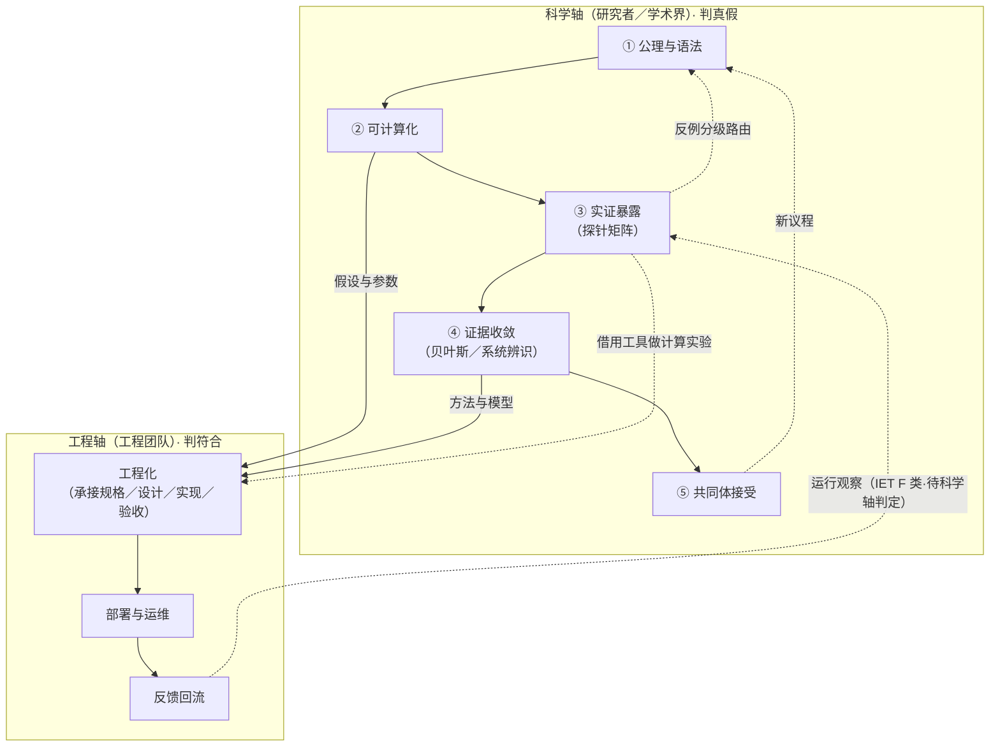

# APP-02 状态范式知识生产消费链：科学轴与工程轴（附 DMD 全链走查）

> **性质**：本页是状态范式「知识如何被生产、被消费」的宏观装配图，回答三个问题：链条有哪些功能位、科学活动与工程实现如何分轴、两轴之间交换什么。**演示性质**——§四 DMD 走查中 ④ 的结果为假设情景，不代表 DMD 已获实证支持；DMD 的在册判据以 `03-C-13` §六／§七 为准。
> **标注体系**：〔纪律〕＝不可越界的原则；〔假设〕＝演示用情景值，非实测；〔注记〕＝当前实例填充情况，非功能位本体。

## 一、六环节总览（功能位为主语）

| 功能位 | 核心职能 | 抽象产品 | 学习台对位 | 当前实例（注记） |
|---|---|---|---|---|
| **① 公理与语法** | 提炼不可再分的起点与描述语言 | 元公理、状态语法、操作语法、环境参照 | SMOD-01～04 | `01-M-00/01/02/08/09`、`02-A` 系列 |
| **② 可计算化** | 公理→假设／参数／候选模型 | 动力学假设、参数定义、候选方程族 | SMOD-05 | `01-M-03` L3 内部层 D1–D3（DEQ 方程／DPR 参数／DMS 模型选择；此 D 为 L3 层号，非治理档）：在册动力学假设 26 条（进入核心方程右端式的子集 19 条）、参数 340+；心智六论在此作分类脚手架 |
| **③ 实证暴露** | 假设撞独立证据源 | 观测数据、反例、边界登记 | SMOD-06、SMOD-09 | 探针矩阵，当前只填碳基、硅基两格：18-DIVE 第一位被试未进门（OSF 预注册提交待回执）；26-SIPE R1 正式批 Stage 1 已收口（2026-09-14，12 单元已采 6 格、384 条原始轨迹归档），Stage 2 七格待补 |
| **④ 证据收敛** | 证据→后验／权重／可用模型 | 后验分布、BMA 权重、状态轨迹 | SMOD-05、SMOD-06 | 贝叶斯推断、系统辨识、状态估计（通用方法） |
| **⑤ 共同体接受** | 成果→定义权／术语／议程 | 论文、术语条目、研究议程 | SMOD-08、SMOD-10 | 22-ISCE 材料；FSPE 纲领位 |
| **⑥ 下游转化** | 模型→可执行的干预与产品 | 干预序列、流派转译、白皮书 | SMOD-07 | `03-C-13` DMD、`03-E-07/09`、`15-IPDP` |

**关键口径**：③ 不是「18-DIVE／26-SIPE」，而是一个**探针矩阵**（被检验层次 × 检验基质 × 数据通道 × 判定标准 × 反例处置）。18／26 只是当前已填的两格：碳基格尚无数据，硅基格有首批数据（Stage 1 六格），矩阵远未填满。

## 二、分轴：科学轴与工程轴

**混淆的根源**：用一条链装了两类活动。PSE 出现在 ②④ 的「承载位」，是把「方法的产品」误当成「方法本身」。

**拆轴后的归属**：

| 轴 | 环节 | 主体 | 判定标准 | 产物 |
|---|---|---|---|---|
| **科学轴** | ①→②→③→④→⑤ | 研究者 | 预注册阈值、独立复现、证据分级（判**真假**；IET 标注见 `06-S-03`） | 知识（论文／后验／术语） |
| **工程轴** | 工程化→部署→回流 | 工程团队 | 规格符合性、冒烟／回归／可用性（判**符合**） | 工具（引擎／产品／日志） |

**PSE 的归属**：PSE 是**工程轴**的核心载体。它的方法成分（贝叶斯融合、PSE-I／M／P／C 四阶段校准流程）与内容成分（在册 26 条动力学假设、340+ 参数）来自科学轴，但「PSE 作为可部署引擎」属于工程轴。科学轴的核心推理**可以不经 PSE 实现**——④ 用通用的贝叶斯推断、系统辨识、状态估计工具即可执行。在册状态：PSE 的仿真与校准均未实际运行，相关读数一律标「预期可获、待仿真验证」（`01-M-03` v3.8.0）；这意味着当前所有科学轴产出都不依赖 PSE 已运行。

〔注记〕**主体的现实约束**：依 `06-S-06` §3.6.2 工程级资源硬边界，INTRE 现阶段两轴的「研究者」与「工程团队」都由主理 Agent 加 AI 席位承载。分轴区分的是**活动归属与判定标准**，不预设独立工程团队已经存在。

**两条边（两轴之间）**：

| 边 | 方向 | 性质 |
|---|---|---|
| 证据回流 | 工程 → 科学 | 运行数据／日志，先按 IET F 类（描述）登记为「运行观察」，不自动取得 E 类（证据）标注；是否升格由科学轴判定 |
| 工具借用 | 科学 → 工程 | 科学轴借用工程工具做计算实验（如仿真检验），工具所有权仍在工程轴 |

## 三、依赖图

**读图要点**：科学轴内部 ①→⑤ 不经过 PSE；工程轴从 ②④ 取「假设与参数」「方法与模型」，工程化后供 ⑥ 转化；两条反向边（证据回流、工具借用）性质不同，不可混。

## 四、DMD 全链走查

> **情景声明**：①② 取自 `03-C-13` v2.0.0 在册内容；③ 为该件 §六 的检验设计；④ 的结果为**假设值**——18-DIVE 第一位被试尚未进门，OSF 预注册提交待回执。工程轴部分以「假设验证通过」为前提推演。

### 4.1 科学轴：提出假设（①→②）

| 步骤 | DMD 内容 |
|---|---|
| ① 公理与语法 | 用状态语法与操作语法写出靶点坐标：反刍＝调度失衡及其上游通路——默认后台进程 M2-DSP-B 持续运行、前台调度 M1-DSP-F 失去切换与控制能力；主操作＝GATE–（抑制 M2-DSP-B）+ GATE+（激活 M1-DSP-F 感官注意）+ ALIGN（修正 M2-STR-R「想法不是命令」）。**双通道模型**：注意调度通路与内容信念通路并行，DMD 主攻调度通路、不否定内容通路；主张口径已由「调度缺陷是根因」修正为「上游／独立通路」（`03-C-13` §1.3 证据边界） |
| ② 可计算化 | 观测函数 y = h(Ψ, E) + ε；候选参数〔假设〕：门控耦合强度、恢复速率；神经口径＝DMN 内部动态稳定性重塑 + VAN/SN 门控耦合增强（`03-C-13` §1.2／§8.2.5）；替代机制的正式表述＝抽象→具体加工模式转换（工作记忆占位），感官锚定（5-4-3-2-1 等）只是执行载体，并承认一般分心成分的贡献——DMD 的不可替代性建立在多成分打包，而非单技术特异性（`03-C-13` §2.1 机制叙事修正） |

**预测清单（② 的产物；阈值依 `03-C-13` §六 v4.0 对齐清单，效果量一律 Hedges g）**

| 预测 | 内容 | 判定阈值 | 层级 |
|---|---|---|---|
| P1 | 单次 5-4-3-2-1 后反刍即刻中断（自评 0–100% 连续量表为主结局） | g ≥ 0.30；灰区 [0.20, 0.30) 判证据不足；假说性预估——5-4-3-2-1 无独立 RCT 校准 | L2 |
| P2a | 8 周后 RRS-Brooding 减分（核心主结局） | g ≥ 0.30；灰区 [0.20, 0.30) 判证据不足、转 WP-D3 追加检验；完成率 < 70% 或严重不良事件率 > 5% 即证伪 | L2 |
| P2b | 神经机制指标改善（三选一） | ① DMN 核心子系统动态稳定性回升（状态方差 +≥5% 或 g ≥ 0.30）；② VAN/SN 对 DMN 门控耦合 +≥0.10；③ dmPFC–MTL 功能分化 +≥0.05 | L2 |
| P2c | 神经参数变化与行为改善正相关（功能层中介命题） | r > 0.30 为必要条件；中介间接效应 95% CI 不含 0；神经→行为与行为→症状路径方向自洽 | L2 |
| P3 | 不劣于 CBT（分层：brooding 等价、reflection 不优于） | 非劣效边界 g = 0.25；N ≥ 128；前提为 CBT 显著优于等待组（assay sensitivity） | L2 |
| P4 | 效果不被认知重构完全中介 | 调度能力改善的增量 R² ≥ 0.05；客观测量＝眼动注意脱离潜伏期 + 任务态 fMRI | L2 |
| P5 | 脱落率分层 | 高反刍且无严重解离人群脱落率低于正念 ≥ 10%；高反刍伴严重失眠人群可能反转；入组前解离筛查（DES／DIS-Q）阳性者排除 | L3 |
| P6 | brooding／reflection 减分比 | 对数变换后比值 ≥ ln 1.5 ≈ 0.405，报 95% CI；探索性指标 | L3 |

### 4.2 科学轴：验证（③→④→⑤）

**③ 实证暴露**：预注册 RCT（N ≥ 128），主结局 RRS-Brooding；主动控制组，CBT 臂与等待组并设以检验 assay sensitivity；眼动注意脱离潜伏期与任务态 fMRI 作客观指标；EMA 自然情境采样；入组前解离筛查（DES／DIS-Q）阳性者排除；分析计划先冻结。

**④ 证据收敛（〔假设〕结果）**：

| 预测 | 假设结果 | 判定 |
|---|---|---|
| P2a | g = 0.45，95% CI [0.22, 0.68]；完成率 78%；严重不良事件 0 | 达标 |
| P2b | VAN/SN 门控耦合 +0.15；DMN 动态稳定性 g = 0.32；dmPFC–MTL 分化 +0.02（未达） | 三选一满足两项，达标 |
| P2c | r = 0.42；间接效应 95% CI 不含 0；路径方向自洽 | 达标 → 功能层中介命题初步支持（单试验，不构成确证） |
| P3 | CBT 优于等待组（assay sensitivity 成立）；CBT 相对 DMD 的差值 g = 0.10，95% CI [−0.02, 0.22]，上界 < 0.25 | 非劣效成立 |
| P4 | 增量 R² = 0.08；间接效应占比 46% | 达标 |

P1、P5、P6 未纳入本轮情景，维持「未验证」状态进入工程交接。

**⑤ 共同体接受**：发表 + 开放数据 + 术语进表 + 下一轮议程（长期维持、文化适配、与元认知疗法的分工）。

**〔纪律〕⑤ 的粒度**：DMD 论文发表 =「**成果被接受**」，不等于「学科被建立」。学科建制（设学位、办期刊、立学会）是另一层，两者不可混为一谈。

### 4.3 工程轴：落地

| 环节 | 动作 | 产物 |
|---|---|---|
| **承接** | 接收已验证规格（P2a／P2b／P2c／P3／P4 达标；7 模块；12 次会谈；入组前解离筛查闸）；**标注未验证项**（P1 假说性预估、P5 分层、P6 探索性、文化适配未验证、副作用发生率为理论预估） | 需求规格书（含未验证标注） |
| **设计与实现** | 治疗师端（脚本／引导／日志）+ 患者端（音频引导 5／10 分钟与睡前版、反刍日志、早期信号卡片、睡前调度协议）；降级路径（音频不可用→文字；解离筛查阳性→转介稳定化治疗；急性危机→熔断、转危机干预） | 可运行 App + 手册 |
| **工程验证** | 冒烟测试（7 模块走通）、可用性测试（治疗师在 20–24 小时培训加 2 小时个案督导内达标）、依从性基线（完成率 ≥ 70%）；**不验「理论真假」** | 验收报告 |
| **部署与运维** | 上线 + 培训认证 + 埋点（模块完成率、使用频次、中断自评、脱落预警、解离／惊恐事件上报）+ 风控（P5 分层人群加强随访） | 可交付产品 + 运行日志 |

**〔纪律〕工程轴的判定边界**：工程师不判定假设真假，只判定「实现是否符合规格」。规格里标着「未验证」的参数，工程照装但必须标注；运行中越界的事件，回流给科学轴当证据材料。

### 4.4 反馈回流（工程 → 科学）

| 回流数据 | 性质 | 科学轴用它做什么 |
|---|---|---|
| 真实世界中断成功率（vs 实验室） | 运行观察 | 校准 P1 生态效度；若显著偏低，提出「实施保真度」新假设 |
| 依从率曲线、脱落分层 | 运行观察 | 检验 P5 分层假设是否复现 |
| 边界越界事件（谁用了反而加重；解离／惊恐发作） | 安全信号 | 修订排除标准；多中心诱发解离／惊恐比例 > 10% 即触发 `03-C-13` §七 安全性条款（暂停推广、修订适应症） |
| 治疗师执行偏差（模块跳过率） | 实施数据 | 反向质疑「7 模块」结构是否必要 |

**〔纪律〕回流纪律**：回流数据登记为「运行观察」（IET F 类描述），科学轴决定是否升格为 E 类证据、是否触发假设修订。工程轴不替科学轴判定「DMD 有效／无效」。

## 五、两轴交接面总表

| 方向 | 交接物 | DMD 具体内容 | 判定权归属 |
|---|---|---|---|
| 科学→工程 | 已验证规格 | P2a／P2b／P2c／P3／P4 达标；7 模块；12 次会谈；解离筛查闸 | 科学轴 |
| 科学→工程 | 未验证标注 | P1 假说性、P5 分层、P6 探索性、文化适配、副作用预估 | 科学轴标注，工程照装但标「未验证」 |
| 工程→科学 | 运行观察（IET F 类） | 真实中断率、依从率、脱落分层、边界事件 | 科学轴（决定是否升格为 E 类证据） |
| 工程→科学 | 实施偏差 | 模块跳过率、培训达标率 | 科学轴（可能触发模块结构修订） |

## 六、核心结论

1. **链条是「公理→干预」的纵向加工流**，数据是燃料不是目的；这与变量范式「数据↔模型↔论文」的横向循环结构不同。
2. **③ 是一个待填的探针矩阵，不是两个工程**。完整性取决于「被检验层次 × 检验基质 × 数据通道」填了多少格。当前只填两格：碳基格（18-DIVE）无数据；硅基格（26-SIPE）Stage 1 已采 12 单元中的 6 格（2026-09-14 收口），Stage 2 待补。
3. **反例处置是分级的**：核心主张层→C1–C4 强反例触发条件（`01-M-01` §末／`02-A-16` §6.3）；架构层→反例四级（表层差异／编码分歧／局部反例／强反例）与强反例四条件（稳定性、不可归约性、增量预测力、排除操作化不足；`02-A-16` §6.2）；参数层→保护带修正（`META-01`）；干预层→疗法降级（`03-C-13` §六决策树／§七）。变量范式只能「修可信度」，状态范式可「换基本单位」——这是结构性能力，也是结构性代价。
4. **PSE 属工程轴，不是科学轴的中枢**。科学轴的核心推理用通用方法即可执行；PSE 是把方法产品化，且在册状态为仿真与校准均未实际运行。两轴是「平行借用」②④，不是上下级。
5. **两轴不可互替判定**：科学判真假（预注册阈值／证据分级／共同体），工程判符合（冒烟／回归／可用性）；回流数据是「运行观察」，升格权在科学轴。
6. **⑤ 有两层**：成果被接受（论文／术语／议程）与学科被建立（学位／期刊／学会）。DMD 走查演示的是前者，后者是 FSPE 纲领位的事。

## 七、疑问解答

**疑问 1：为什么不把 18／26 写进链里？**
它们是 ③ 的探针实例，不是 ③ 的本体。写进链会把「当前填格状态」误读为「结构上限」。探针矩阵还会填更多格（多中心临床、跨文化、群体、混合基质），不以 18／26 为限；26 号已有的 Stage 1 数据也只覆盖硅基格内 12 单元的一半。

**疑问 2：PSE 既然属工程轴，为什么 01-M-03 还在核心理论目录？**
文档归属（放在 `01-核心理论`）与活动归属（属工程轴）是两件事。01-M-03 承载了 ② 的内容（26 条假设、340+ 参数）与 ④ 的方法（校准流程），这些属于科学轴；PSE 作为可部署引擎的部分属于工程轴。同一份文档可以同时承载两轴的成分，但判定标准不同。

**疑问 3：工程轴可以不被科学驱动吗？**
可以。市场驱动的产品（如「反刍管理 App」）可能先于科学验证落地。此时工程轴的科学依据更薄，「未验证」标注的责任更重，回流数据对科学轴的价值也更大（真实世界数据可能是该假设的第一批证据）。DMD 案例是科学驱动的，不代表工程轴只能科学驱动。

**疑问 4：心智六论在这条链里是什么？**
② 的**分类脚手架**，横跨管线级（MCT→L1-S、MDT→L4、MTT/MKT/MPT→L3、MET→E(t) 驱动项，见 `01-M-03` §三）。它是教学与叙事标签体系，不构成独立架构层；对「知识流转」中性，对「知识组织与教学」非中性——比「目录」重，比「环节」轻。

**一句话**：状态范式是「公理→假设→暴露→收敛→接受」的纵向科学轴，加一条「承接→实现→验收→部署→回流」的工程轴；两轴在交接面交换「假设与参数」和「运行观察」，谁都不替对方做判定。DMD 走查演示了这条纪律：科学轴按 P1–P6 判真假，工程轴按规格判符合，回流数据标等级后由科学轴决定是否升格。

## 版本记录

| 版本 | 日期 | 变更说明 |
|---|---|---|
| v0.1.0 | 2026-11-02 | 建件：状态范式知识生产消费链宏观梳理，经三轮口径修正（探针实例≠功能位／PSE 属工程轴／两轴分离）后落盘；DMD 全链走查为演示（假设情景）；落盘前对表 03-C-13、01-M-03、02-A-16 与 26 号 README 现值。 |
