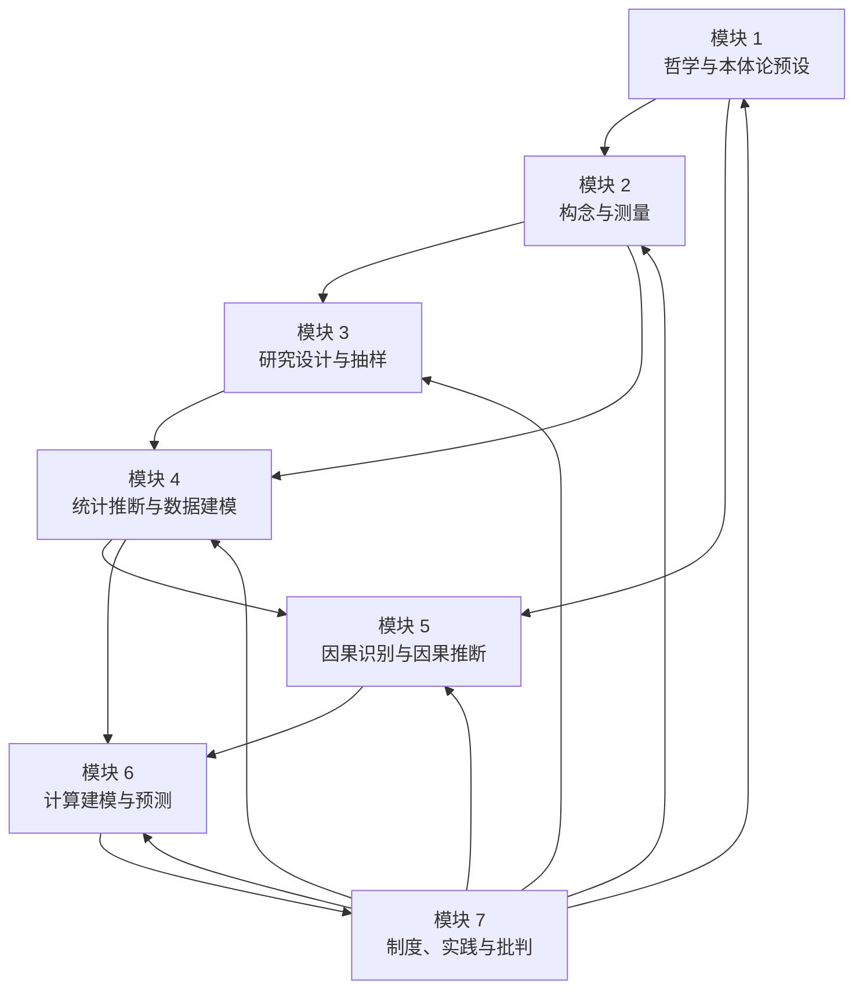

# MOD-00 · 模块 0：七模块总览与依赖总图（变量范式 × 状态范式对比）

> **来源与性质**：变量范式集体学习模块系列第 0/7 模块，

>
> **框架声明**：本件「四层次」结构系呈现层构造、非库内文档框架。

## 变量范式七模块总览：完整知识地图

| 模块 | 核心问题 | 关键知识 | 状态范式对位模块 |
|---|---|---|---|
| 1. 哲学与本体论预设 | 变量是什么？心理属性是否实在？ | 实证主义、操作主义、变量实在论、潜变量 | 模块 1 本体论与层级 |
| 2. 构念与测量 | 如何把心理属性变成可测变量？ | 心理测量学、CTT、IRT、信度、效度、测量不变性 | 模块 6 测量与观测 + 模块 2 状态语法 |
| 3. 研究设计与抽样 | 如何获得可推断的数据？ | 实验、RCT、准实验、纵向、EMA、抽样、预注册 | 模块 4 环境参照 + 模块 5 动力学 + 模块 7 干预与验证 |
| 4. 统计推断与数据建模 | 变量之间有什么关系？ | 回归、ANOVA、SEM、HLM、贝叶斯、DSEM | 模块 5 动力学与计算引擎 + 模块 6 测量与观测 |
| 5. 因果识别与因果推断 | 关系是否是因果？ | 潜在结果、DAG、IV、RDD、DID、PSM | 模块 5 动力学与计算引擎 + 模块 7 干预与验证 |
| 6. 计算建模与预测 | 能否用形式模型生成和预测？ | 计算精神病学、强化学习、DDM、预测加工、网络分析 | 模块 5 动力学与计算引擎 + 模块 9 跨基质与智能科学 |
| 7. 制度、实践与批判 | 知识如何被评价、传播、修正？ | 同行评审、发表偏差、p-hacking、复制危机、构念膨胀、WEIRD | 模块 8 治理与证据 + 模块 10 元方法与建构 |

---

## 七模块依赖总图

**版 A·含库恩反馈回边（原图·M7→M1–M6 反馈边）**：

**版 B·知识生产链版（不含反馈回边 分绘）**：

**七模块依赖总链：**

> **M1 本体论预设** → **M2 构念与测量** → **M3 研究设计与抽样** → **M4 统计推断与数据建模** → **M5 因果识别与因果推断** → **M6 计算建模与预测** → **M7 制度、实践与批判** → 反馈回 **M1–M6**

### 两条知识生产链粒度对应表

| 知识生产链阶段 | 变量范式模块 | 状态范式模块 | 粒度差异说明 |
|---|---|---|---|
| 最上游·本体论 | MOD-01 哲学与本体论预设 | SMOD-01 本体论与层级 | 一一对应 |
| 研究单位定义 | MOD-01→MOD-02（构念） | SMOD-02 状态语法（M-R-D-S 42 维） | 单个构念 vs 统一坐标系 |
| 测量 | MOD-02 构念与测量 | SMOD-06 测量与观测＋SMOD-05（L1 三端口） | 量表分数 vs 观测函数 h |
| 设计与环境 | MOD-03 研究设计与抽样 | SMOD-04 环境参照＋SMOD-07 干预与验证 | 数据设计 vs 环境驱动＋干预设计 |
| 分析引擎 | MOD-04 统计推断与数据建模 | SMOD-05 动力学与计算引擎 | 统计模型 vs 生成动力学 |
| 因果 | MOD-05 因果识别与因果推断 | SMOD-03 操作语法＋SMOD-07 | 处理效应 vs 操作序列 |
| 形式建模 | MOD-06 计算建模与预测 | SMOD-05（L3） | 任务局部 vs 统一管线 |
| 制度与治理 | MOD-07 制度、实践与批判 | SMOD-08 治理与证据 | 方法批判 vs 治理规程 |
| （无对位） | — | SMOD-09 跨基质与智能科学＋SMOD-10 元方法与建构 | 状态范式独有粒度 |
| 比较枢纽 | MOD-08 数学本质对比 | 对应全部十模块 | 范式间比较 |

**核心结论：**

1. **变量范式是完整闭环**：从本体论预设出发，经由测量、设计、统计、因果、计算建模，最终到达制度批判；制度批判又反馈回本体论预设。
2. **模块 7 是变量范式自我反思最深刻的部分**：复制危机、构念膨胀、WEIRD 样本等批判，揭示了变量范式的结构性困境。
3. **变量范式的自我修正极限**：预注册、开放科学、多宇宙分析等可以修复可信度问题，但无法修复描述单位问题（构念膨胀、复制危机深层根源）。
4. **状态范式的对位关系**：变量范式七模块分别对位状态范式十模块中的 1–2 个模块；核心差异在于描述单位（变量 vs 功能状态 Ψ）和数学对象（P(Y)/P(Y|X) vs h: Ψ→y、f: Ψₜ→Ψₜ₊₁）。
5. **最坚固的四块**：测量理论、因果推断、统计建模、制度批判四块是“变量范式最坚固的堡垒”，也是挑战时最可能遭遇的正面战场。

---

## 疑问解答（附属·v0.2.0 增）

本节为附属疑问解答（5 条），与正文互为补充、不替代。以下 5 条与 SMOD-00 疑问解答一一对称，视角为变量范式。

---

### 疑问 1：变量范式七模块总览与状态范式十模块总览表如何对称？

| 维度 | 变量范式 | 状态范式 |
|---|---|---|
| 模块数 | 7 模块 | 10 模块 |
| 核心问题域 | 哲学预设、构念测量、设计抽样、统计推断、因果识别、计算建模、制度批判 | 本体论、状态语法、操作语法、环境参照、动力学引擎、测量观测、干预验证、治理证据、跨基质、元方法 |
| 对位关系 | 变量范式七模块分别对位状态范式十模块中的 1–2 个模块 | 状态范式十模块分别对位变量范式七模块中的 1–3 个模块 |
| 对称性 | 7 vs 10，非一一对应；核心差异在描述单位与数学对象 | 10 vs 7，非一一对应；状态范式多出跨基质与元方法两个独有模块 |
| 一句话 | 两套总览表不对称：变量范式 7 模块，状态范式 10 模块；状态范式的 9、10 号模块（跨基质、元方法）在变量范式中无直接对位 | — |

---

### 疑问 2：MOD-00 依赖总图分绘版 A/版 B 与状态范式依赖总图的拓扑结构有何差异？

| 维度 | 变量范式（版 A·原图） | 变量范式（版 B·知识生产链） | 状态范式 |
|---|---|---|---|
| 拓扑结构 | M1→M2→M3→M4→M5→M6→M7→M1–M6 反馈回边 | M1→M2→M3→M4→M5→M6 链式（不含反馈回边） | S1→S2→S3/S4→S5→S6→S7→S8→S9→S10→S1–S9 反馈回边；S5↔S6 双向边 |
| 反馈回边 | M7→M1–M6（制度批判反馈回本体论至计算建模） | 无（仅呈现知识生产单向链） | S10→S1–S9（元方法反馈回全部模块） |
| 双向边 | 无 | 无 | S5↔S6（动力学与观测互相依赖） |
| 分绘理由 | 版 A 呈现含反馈回边的完整闭环；版 B 呈现知识生产链单向主干，避免反馈回边干扰主干阅读 | — | 未分绘，反馈回边与双向边同图呈现 |
| 关键差异 | 变量范式反馈回边从 M7 出发；状态范式反馈回边从 S10 出发，且 S5↔S6 双向 | — | — |
| 一句话 | 变量范式的依赖总图分绘两版（版 A 含库恩反馈回边，版 B 为知识生产链）；状态范式单图呈现，反馈回边与双向边同图 |

---

### 疑问 3：变量范式「完整闭环」与「自我反思最深刻的部分」分别包含什么？

| 维度 | 完整闭环 | 自我反思最深刻的部分 |
|---|---|---|
| 内容 | 从本体论预设出发，经由测量、设计、统计、因果、计算建模，最终到达制度批判；制度批判又反馈回本体论预设 | 模块 7 的复制危机、构念膨胀、WEIRD 样本等批判，揭示了变量范式的结构性困境 |
| 功能 | 标定变量范式的完整结构 | 标定变量范式的自我反思能力 |
| 所处位置 | 模块 1 → 模块 7 → 反馈回模块 1–6 | 模块 7 内部 |
| 一句话 | 第 1 条给总链，第 2 条给反思点；二者共同构成变量范式的自我定位 | — |

---

### 疑问 4：变量范式核心定位如何与两套范式的数学本质对比衔接？

| 维度 | 变量范式核心定位 | 八维对比 |
|---|---|---|
| 变量范式定位 | 概率空间中的协方差几何学 | D1 变量、D2 概率分布/代数方程、D5 关系描述、D8 方差解释 |
| 状态范式定位 | 状态空间中的生成动力学 | D1 状态向量、D2 微分方程/状态空间模型、D5 映射反解、D8 生成解释 |
| 衔接方式 | 总图给出总定位；八维对比把总定位展开为八个维度 | 八维对比是总图核心结论的详细展开 |
| 一句话 | 总图是总定位，八维对比是展开；二者是同一判断的不同粒度表述 | — |

---

### 疑问 5：变量范式核心结论中「四块堡垒」与「自我修正极限」分别指向什么？

| 维度 | 四块堡垒 | 自我修正极限 |
|---|---|---|
| 来源 | “最坚固的堡垒”论断 | 03-A-07 §五 + MOD-07 模块自身 |
| 内容 | 测量理论、因果推断、统计建模、制度批判四块是变量范式最坚固的堡垒 | 预注册、开放科学、多宇宙分析等可以修复可信度问题，但无法修复描述单位问题（构念膨胀、复制危机深层根源） |
| 功能 | 标定挑战时最可能遭遇的正面战场 | 标定变量范式内部优化的边界 |
| 对应模块 | 测量理论→MOD-02；因果推断→MOD-05；统计建模→MOD-04；制度批判→MOD-07 | 对应 MOD-01 本体论预设 + MOD-07 制度批判 |
| 一句话 | 四块堡垒标定战场，自我修正极限标定边界；二者共同构成变量范式的自我评估 | — |

---

## 版本记录

| 版本 | 日期 | 变更说明 |
|---|---|---|
| v0.3.1 | 2026-10-31 | 去过程化梳理批（14-ENGRAM-B261031-04·未 commit）：8 处清理。判升 Patch。 |
| v0.3.0 | 2026-10-29 | 双范式正名批（DR-2026-10-29-TERM-002 v1.4.0）：正文「结构范式」→「状态范式」；判升 Minor。 |
| v0.2.1 | 2026-10-16 | Patch·B261016-04：外审机械订正批：rn v0.1.1 条拆碎段还原（外审候选×本窗独立解码双路对撞·并与末表 v0.1.1 同义行对撞）。… |
| v0.2.0 | 2026-10-13 | Minor·B261013-07：疑问解答增补批：增「疑问解答（附属）」一节（5 条·与 SMOD-00 对称·变量范式视角）。 |
| v0.1.1 | 2026-10-13 | Patch·B261013-04：订正批：#6 依赖总图分绘两版（版 A 原图含库恩反馈回边·版 B 知识生产链版）；#9 增「两条知识生产链粒度对应表」… |
| v0.1.0 | 2026-10-13 | 建件·B261013-02：七模块总览与依赖总图落盘（总览表＋七模块依赖总图 mermaid＋总链与核心结论·承 MOD-01~07 七件为逐模块展开）。B261013-02。 |

> 全量版本 v0.1.0–v0.2.1（共 4 版）见 [HIST-MOD §MOD-00-七模块总览与依赖总图-v0.1-2026-10-13](HIST-MOD_双范式对比学习模块-MOD系版本沿革-v1.0-2026-10-18.md#doc-18)；当前无外迁版本。
