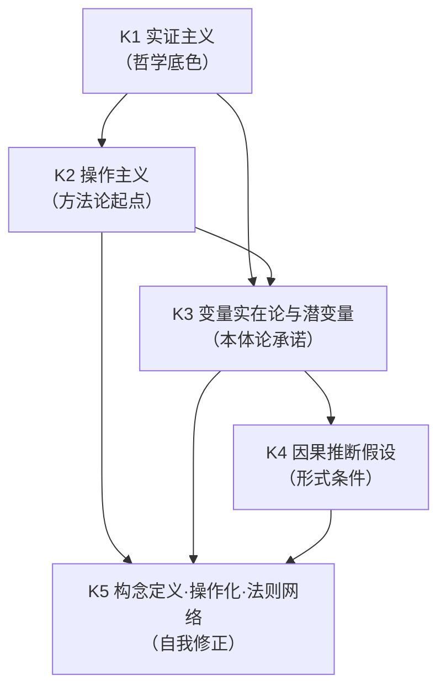

# MOD-01 · 模块 1：哲学与本体论预设（变量范式 × 状态范式对比）

> **来源与性质**：变量范式集体学习模块系列第 1/7 模块，与 15-X-112／113 议案七模块清单同源；本件依主理转入稿整理，去除呈现层过渡结构（四层次包装），知识内容全量保留。库内锚点引用前须自核（见 rn ③）。

>
> **框架声明（15-RPT-115 #1/#2·v0.1.1 订正批增）**：本件「四层次」结构系输出构造、非库内文档框架；模块 MECE 编号与知识点清单照 15-X-112 原文展开。

## 一、模块定位与知识点总览

### 1.1 模块定位表

| 项 | 内容 |
|---|---|
| 所属范式 | 变量范式 |
| MECE 编号 | 模块 1 / 共 7 模块 |
| 核心问题 | 变量是什么？心理属性是否实在？ |
| 关键知识 | 实证主义、操作主义、变量实在论、潜变量、因果推断假设 |
| 代表方法/工具 | 构念定义、操作化、法则网络 |
| 在知识生产链中的位置 | **最上游**——决定“研究单位是什么”，下游测量、设计、统计、因果全部受其约束 |
| 状态范式对位模块 | 模块 1“本体论与层级”（04-A-01、外部脚手架对照、约束功能主义） |
| 本模块的真正分歧 | 数学对象：P(Y)/P(Y\|X) vs h: Ψ→y、f: Ψₜ→Ψₜ₊₁ |

### 1.2 知识点清单

| # | 知识点 | 一句话定位 | 在变量范式中的角色 |
|---|---|---|---|
| K0 | 范式概念（库恩） | 范式＝特定科学共同体共享的学科基质 | 变量范式作为范式身份的元概念 |
| K1 | 实证主义 | 知识须建立在可观察、可验证的事实上 | 范式的哲学底色 |
| K2 | 操作主义 | 概念的意义 = 测量它的操作 | 构念定义的方法论起点 |
| K3 | 变量实在论与潜变量 | 变量/潜变量是真实心理属性 | 本体论承诺的核心 |
| K4 | 因果推断假设 | 潜在结果、可忽略性、SUTVA、DAG 等 | 因果识别的形式条件 |
| K5 | 构念定义·操作化·法则网络 | 构念通过理论网络中的位置定义 | 对操作主义的自我修正 |

### 1.3 知识点简要解释

| 知识点 | 简要解释 |
|---|---|
| **K0 范式概念（库恩）** | 库恩：范式是特定科学共同体共享的学科基质——符号概括、形而上承诺、价值、范例；常规科学在范式内解谜，反常积累导致危机与范式转换。变量范式即心理学现行为范式，K1-K5 皆在此范式内成立。（库外学理·延伸阅读 Kuhn 1962/1970·15-RPT-115 #4 增） |
| **K1 实证主义** | 科学知识应建立在可观察、可验证的事实上。心理学中的行为主义、操作主义均受其影响。理论概念若不能连接到观察，易被怀疑为形而上学。 |
| **K2 操作主义** | 一个心理概念的意义 = 测量它的操作。“智力”= 智力测验所测到的东西。优点是可检验、可重复；问题是操作与构念循环、跨操作构念失去统一性。 |
| **K3 变量实在论与潜变量** | 变量/构念是真实存在的心理属性，具有因果力。潜变量模型假设不可直接观测的潜变量是观测指标的共同原因。三种立场：潜变量实在论 / 工具主义 / 网络理论。 |
| **K4 因果推断假设** | 潜在结果模型、可忽略性、一致性、正性、SUTVA、DAG、IV、RDD、DID 等识别策略。前置问题：因果图中的节点已被合理定义了吗？ |
| **K5 构念定义·操作化·法则网络** | Cronbach & Meehl 的法则网络：构念通过其在理论网络中的位置来定义，而非单一操作。比朴素操作主义进步，但仍未改变基本描述单位。 |

## 二、知识点详解对比

### 2.1 K1 实证主义

| 维度 | 变量范式（实证主义底色） | 状态范式（约束功能主义） |
|---|---|---|
| 本体论立场 | 只承认可观察物；理论概念须连接到观察 | 承认功能层为独立描述层级，但不将其视为神经实体或纯统计构造 |
| 知识来源 | 观察 → 归纳 → 验证 | 第一性原理 + 功能角色 + 可检验预测 |
| 对“不可观察物”的态度 | 怀疑，倾向于还原为操作 | 承认功能层为功能因果网络中的角色实体 |
| 与神经层关系 | 多不涉及，或倾向还原 | 功能层独立但不孤立，接受物理边界约束 |
| 典型表述 | “不能测量的东西不应作为科学对象” | “功能层是描述层级，其合法性取决于预测-干预效能” |
| 库内对应 | 行为主义传统、操作主义 | 04-A-01 §一、§二；01-M-00 §1.1 |
| 关键分歧 | 是否承认功能层的独立存在 | 功能层不是实体分层，而是描述分层 |

### 2.2 K2 操作主义

| 维度 | 变量范式（操作主义） | 状态范式（功能角色定义） |
|---|---|---|
| 概念定义方式 | 概念意义 = 测量操作 | 概念意义 = 在 N-S-R 功能架构中的因果角色 |
| “智力”定义 | 智力测验所测到的东西 | 不是单一模块，而是 M2/M3/M4 协同的功能表现 |
| “焦虑”定义 | 焦虑量表得分 | M4-DSP-B 高唤醒 + M2-STR-R 威胁偏向 + M1-RES-D 下降 |
| 优点 | 可检验、可重复、避免空泛 | 保留可检验性，同时给出机制定位 |
| 问题 | 操作-构念循环；跨操作构念失去统一性；测量情境变化构念含义漂移 | 功能层组件精确边界是经验性资产，会在实证校准中被修正 |
| 库内对应 | 构念定义、操作化 | 01-M-01 §5.1 功能性抽象原则、语义自足性原则 |
| 关键分歧 | 定义来源：操作 vs 功能角色 | 功能角色定义不是操作定义，但也不是不可检验的实体 |

### 2.3 K3 变量实在论与潜变量

| 维度 | 变量范式（潜变量模型） | 状态范式（Ψ 状态向量） |
|---|---|---|
| 基本单位 | 潜变量（由观测协方差定义） | M-R-D-S 42 维功能状态向量 |
| 存在性 | 潜变量是否真实存在有争议（实在论/工具主义/网络理论） | Ψ 是功能因果网络中的角色实体 |
| 定义方式 | 观测指标的共同原因 | 功能架构中的位置 + 动力学 + 干预对应 |
| 动力学 | 通常无；SEM 为静态结构 | dΨ/dt = Σ w_k·f_k(Ψ, E(t), θ_k) |
| 干预对应 | 无直接对应 | G-M-A-R 靶点合法性矩阵 |
| 结构约束 | 无 | D 矩阵、STR 三分、级联规则、六条动力学约束 |
| 与神经关系 | 多不涉及 | 功能层独立但不孤立，接受物理边界约束 |
| 库内对应 | CFA/SEM 潜变量 | 01-M-02 §二（42 维坐标系）、01-M-03 §四（核心方程） |
| 关键分歧 | 潜变量只由观测协方差定义；Ψ 有动力学+干预+结构约束 | 二者可能重叠，但不自动等同 |

### 2.4 K4 因果推断假设

| 维度 | 变量范式（因果推断） | 状态范式（生成机制） |
|---|---|---|
| 因果定义 | 潜在结果框架下的处理效应 | 状态转移方程 + 干预算子 |
| 核心工具 | 潜在结果模型、DAG、IV、RDD、DID、PSM | 状态空间模型、控制论、贝叶斯滤波 |
| 前置条件 | 节点已被合理定义 | 节点 = 功能组件，由坐标系定义 |
| 因果识别方式 | 外部干预推断（RCT、IV、DAG） | 内部机制生成（状态转移方程 + 干预算子） |
| 解释对象 | 变量间因果效应 | 状态如何演化、干预哪里会改变轨迹 |
| 极限 | 节点本体不清；只能估计关联和部分可识别的因果效应 | 高维、逆问题、参数校准、因果结构内生 |
| 库内对应 | 潜在结果模型、Pearl 因果图 | 01-M-03 §四核心方程、01-M-08 操作语法 |
| 关键分歧 | 因果图节点是否已被合理定义 | 变量范式估计处理效应；状态范式追问状态演化与干预靶点 |

### 2.5 K5 构念定义·操作化·法则网络

| 维度 | 变量范式（法则网络） | 状态范式（功能架构） |
|---|---|---|
| 构念定义方式 | 通过理论网络中的位置定义 | 通过功能架构中的位置定义 |
| 网络类型 | 变量之间的关系网 | 功能组件之间的生成架构 + 观测函数 h: Ψ→y |
| 基本单位 | 构念（现象层） | 功能组件（功能层） |
| 与观测关系 | 构念通过指标定义 | 观测是状态的投影：y = h(Ψ, E) + ε |
| 自我修正 | 构念效度、法则网络、网络理论 | 强反例协议、边界声明、结构约束、替代测试 |
| 仍未解决的问题 | 基本描述单位仍是观测读数 | 功能层组件精确边界待实证；高维、逆问题、参数校准 |
| 库内对应 | Cronbach & Meehl 法则网络、Borsboom 网络理论 | 01-M-02 §五（PCUI-L）、03-A-07 §4.5 |
| 关键分歧 | 法则网络是变量之间关系网；状态范式是状态空间生成模型 | 前者未改变描述单位；后者尝试改变描述单位 |

## 三、知识库链接

### 3.1 K1 实证主义

| 类别 | 内容 | 库内/库外对应 |
|---|---|---|
| 核心工具 | 可观察性原则、验证逻辑 | 逻辑实证主义（维也纳学派） |
| 相关哲学流派 | 实证主义、逻辑实证主义、行为主义 | — |
| 心理学表现 | 行为主义（华生、斯金纳）、操作主义 | — |
| 状态范式对位 | 约束功能主义、描述层级、多重实现 | 04-A-01 §一、§二；01-M-00 §1.1 |
| 关键文档 | 04-A-01《功能层作为独立分析层级的认识论辩护》 | 库内 |
| 关键论证 | 多重实现原则、Marr 三层分析 | 04-A-01 §二、§三 |
| 延伸阅读 | Putnam (1967)、Fodor (1974)、Marr (1982) | 库外 |
| 相关争议 | 功能层是描述层级还是实体分层 | 04-A-01 §7.1 |

### 3.2 K2 操作主义

| 类别 | 内容 | 库内/库外对应 |
|---|---|---|
| 核心工具 | 操作定义、测量操作化 | Bridgman (1927) |
| 相关流派 | 操作主义、行为主义、实证主义 | — |
| 心理学表现 | 智力测验、量表编制、构念操作化 | — |
| 状态范式对位 | 功能角色定义、功能性抽象原则、语义自足性原则 | 01-M-01 §5.1 |
| 关键文档 | 01-M-01《BASE 论证与模块详解》§5.1 | 库内 |
| 关键论证 | 功能角色定义 vs 操作定义；语义自足性原则 | 01-M-01 §5.1 |
| 延伸阅读 | Bridgman (1927)、Cronbach & Meehl (1955) | 库外 |
| 相关争议 | 操作-构念循环；跨操作构念统一性 | 03-A-07 §4.5 |

### 3.3 K3 变量实在论与潜变量

| 类别 | 内容 | 库内/库外对应 |
|---|---|---|
| 核心工具 | CFA、SEM、IRT、潜变量模型 | — |
| 相关流派 | 潜变量实在论、工具主义、网络理论 | — |
| 心理学表现 | 大五人格因子、抑郁潜变量 | — |
| 状态范式对位 | M-R-D-S 42 维状态向量、Ψ 状态空间 | 01-M-02 §二 |
| 关键文档 | 01-M-02《IODS 本体定义体系》§二；01-M-03《PSE》§四 | 库内 |
| 关键论证 | 潜变量 vs Ψ 的区别；42 维坐标系的动力学+干预+结构约束 | 01-M-02 §2.3；01-M-03 §4.1 |
| 延伸阅读 | Borsboom (2017)、Bollen (1989) | 库外 |
| 相关争议 | 潜变量是否真实存在；网络理论 vs 潜变量模型 | 03-A-07 §4.5 |

### 3.4 K4 因果推断假设

| 类别 | 内容 | 库内/库外对应 |
|---|---|---|
| 核心工具 | 潜在结果模型、DAG、IV、RDD、DID、PSM | — |
| 相关流派 | 因果推断、图因果框架 | Pearl (2009)、Rubin (1974) |
| 心理学表现 | 中介效应、调节效应、因果识别 | 温忠麟工作 |
| 状态范式对位 | 状态转移方程、干预算子、控制论 | 01-M-03 §四；01-M-08 |
| 关键文档 | 01-M-03《PSE》§四；01-M-08《G-M-A-R 操作语法》 | 库内 |
| 关键论证 | 因果图节点是否已被合理定义；变量范式估计处理效应 vs 状态范式追问状态演化 | 15-X-113 §二；03-A-07 §6.2 |
| 延伸阅读 | Pearl (2009)、Hernán & Robins (2016) | 库外 |
| 相关争议 | 节点本体不清；因果结构内生 | 03-A-07 §7.3 |

### 3.5 K5 构念定义·操作化·法则网络

| 类别 | 内容 | 库内/库外对应 |
|---|---|---|
| 核心工具 | 法则网络、构念效度、网络分析 | Cronbach & Meehl (1955) |
| 相关流派 | 法则网络、网络理论、构念效度 | — |
| 心理学表现 | 构念定义、操作化、量表编制 | — |
| 状态范式对位 | PCUI-L 概念映射库、IODS 坐标系、观测函数 h | 01-M-02 §五；01-M-03 §四 |
| 关键文档 | 01-M-02《IODS》§五；03-A-07《走出洞穴》§4.5 | 库内 |
| 关键论证 | 法则网络未改变描述单位；状态范式用功能架构+观测函数替代 | 03-A-07 §4.5 |
| 延伸阅读 | Cronbach & Meehl (1955)、Borsboom (2017) | 库外 |
| 相关争议 | 法则网络 vs D 矩阵/动力学约束 | 03-A-07 §4.5 |

## 四、知识点依赖关系

### 4.1 依赖关系总表

| 知识点 | 依赖 | 被依赖 | 依赖类型 | 说明 |
|---|---|---|---|---|
| K0 范式概念（库恩） | — | K1、K2 | 元概念 | 范式概念为 K1-K5 的身份元层（15-RPT-115 #4 增） |
| K1 实证主义 | — | K2、K3 | 哲学基础 | 实证主义为操作主义和变量实在论提供哲学底色 |
| K2 操作主义 | K1 | K3、K5 | 方法论起点 | 操作主义是构念定义的方法论起点；K3 是对其的本体论回应 |
| K3 变量实在论与潜变量 | K1、K2 | K4、K5 | 本体论承诺 | 变量实在论是因果推断的前提；法则网络是对潜变量的重新定义 |
| K4 因果推断假设 | K3 | K5 | 形式条件 | 因果推断假设依赖变量本体论承诺；构念定义影响因果图节点 |
| K5 构念定义·操作化·法则网络 | K2、K3 | — | 自我修正 | 法则网络是对操作主义和变量实在论的自我修正 |

### 4.2 依赖关系图

### 4.3 依赖关系深度解剖

| 依赖对 | 依赖内容 | 深度 | 结构性后果 |
|---|---|---|---|
| K1 → K2 | 实证主义 → 操作主义 | 强 | 实证主义要求可观察性，操作主义将其转化为“概念 = 测量操作” |
| K1 → K3 | 实证主义 → 变量实在论 | 中 | 实证主义不必然导向变量实在论，但为“变量是真实属性”提供合法性 |
| K2 → K3 | 操作主义 → 变量实在论 | 强 | 操作主义定义变量，变量实在论赋予其本体论地位 |
| K2 → K5 | 操作主义 → 法则网络 | 中 | 法则网络是对操作主义的修正：构念通过理论网络定义 |
| K3 → K4 | 变量实在论 → 因果推断 | 强 | 因果推断假设变量是真实属性，具有因果力 |
| K3 → K5 | 变量实在论 → 法则网络 | 中 | 法则网络重新定义构念，但仍保留变量作为基本单位 |
| K4 → K5 | 因果推断 → 法则网络 | 弱 | 因果推断的节点问题促使法则网络重新思考构念定义 |

### 4.4 与状态范式的依赖关系对比

| 变量范式依赖 | 状态范式对应 | 差异 |
|---|---|---|
| K1 实证主义 → K2 操作主义 | 约束功能主义 → 功能角色定义 | 变量范式从观察出发；状态范式从功能角色出发 |
| K2 操作主义 → K3 变量实在论 | 功能角色定义 → Ψ 状态向量 | 变量范式定义变量；状态范式定义状态空间 |
| K3 变量实在论 → K4 因果推断 | Ψ 状态向量 → 状态转移方程 | 变量范式在变量间推断因果；状态范式在状态空间内生成因果 |
| K4 因果推断 → K5 法则网络 | 状态转移方程 → 观测函数 h | 变量范式修正构念定义；状态范式建立观测映射 |
| K5 法则网络 | PCUI-L + D 矩阵 | 变量范式：变量之间关系网；状态范式：功能组件生成架构 |

### 4.5 关键依赖链：从实证主义到法则网络

**关键结论：**

- 变量范式的本体论预设从实证主义出发，经由操作主义，到达变量实在论；
- 因果推断依赖变量实在论，但受制于节点本体不清；
- 法则网络是对操作主义和变量实在论的自我修正，但仍未改变基本描述单位；
- 状态范式从功能角色定义出发，建立 Ψ 状态空间、状态转移方程和观测函数 h，试图在数学对象层面完成从“观测层关系学”到“状态层生成学”的跃迁。

## 疑问解答（附属·v0.2.0 增）

本节系主理 Agent 2026-10-13 会话转入之附属疑问解答（13 条·逐条以表格作答），与正文四节互为补充、不替代；内容逐字落盘未改一字。

### 疑问 1：模块一“本模块的真正分歧”指出数学对象是 `P(Y)/P(Y|X)` 与 `h: Ψ→y`、`f: Ψₜ→Ψₜ₊₁` 的对立。这个总开关在模块一中如何体现？

| 维度 | 解答 |
|---|---|
| 变量范式的数学对象 | 观测变量的概率结构：`P(Y)`、`P(Y|X)`、潜变量及其关系参数 |
| 状态范式的数学对象 | 生成映射与状态演化：`h: Ψ→y` 和 `f: Ψₜ→Ψₜ₊₁` |
| 在 K3 中的体现 | 潜变量由观测协方差定义；状态范式的 Ψ 由功能架构定义并具有动力学与干预对应 |
| 在 K4 中的体现 | 因果推断的节点是观测变量，本体不清；状态范式的节点是功能组件，由坐标系定义 |
| 在 K5 中的体现 | 法则网络描述变量间关系；状态范式用功能架构 + 观测函数替代 |
| 预测能力边界 | 变量范式能预测条件均值 `E(Y|X)`；状态范式能输出未来状态分布、级联路径、风险时点 |
| 控制能力边界 | 变量范式能估计处理效应；状态范式能搜索最优 G-M-A-R 操作序列、做闭环调节 |
| 为何是数学层面的 | 不是经验层面“做得不够好”，而是数学对象本身不承载轨迹预测与最优控制 |
| 一句话 | 数学对象决定能力边界：变量范式数学对象不承载的，状态范式的数学对象承载 |

---

### 疑问 2：K0 范式概念（库恩）在变量范式中扮演什么角色？变量范式是否已进入库恩所说的危机阶段？

| 维度 | 解答 |
|---|---|
| 库恩范式概念 | 范式 = 特定科学共同体共享的学科基质：符号概括、形而上承诺、价值、范例 |
| K0 的来源 | 库外学理·延伸阅读 Kuhn 1962/1970 |
| 在变量范式中的角色 | 变量范式即心理学现行为范式，K1–K5 皆在此范式内成立；K0 是元概念 |
| 常规科学 | 在范式内解谜：测量、设计、统计、因果推断、计算建模 |
| 反常积累 | 复制危机、构念膨胀、WEIRD 样本、技术威胁 |
| 危机诊断 | 研究活动在技术层面持续精进，但理论层面收益边际递减 |
| 辅助假设增生 | 为解释效应不稳定性而引入的概念不断增多，如九种共同作用类型 |
| 当前定位 | 库恩框架下更接近危机晚期，而非早期 |
| 替代进路 | 状态范式被纳入严肃讨论，作为“能够解释旧范式成功条件、界定失效边界、提供新累积性语言”的替代框架 |
| 一句话 | 变量范式是库恩意义上的范式，已进入危机晚期；状态范式是危机中出现的替代进路 |

---

### 疑问 3：K1 实证主义与操作主义、变量实在论是什么关系？实证主义是否必然导向操作主义？

| 维度 | 解答 |
|---|---|
| 实证主义核心 | 科学知识应建立在可观察、可验证的事实上；理论概念若不能连接到观察，易被怀疑为形而上学 |
| 与操作主义关系 | 实证主义要求可观察性，操作主义将其转化为“概念 = 测量操作”；操作主义是实证主义在方法论上的具体化 |
| 是否必然导向操作主义 | 不必然，但为操作主义提供了合法性；心理学中的行为主义、操作主义均受其影响 |
| 与变量实在论关系 | 实证主义不必然导向变量实在论，但为“变量是真实属性”提供了合法性；变量实在论是操作主义在本体论上的延伸 |
| 状态范式对位 | 约束功能主义：承认功能层为独立描述层级，但不将其视为神经实体或纯统计构造 |
| 关键分歧 | 变量范式从观察出发；状态范式从功能角色出发 |
| 一句话 | 实证主义是变量范式的哲学底色，操作主义是其方法论起点，变量实在论是其本体论承诺；三者层层递进，但并非逻辑必然 |

---

### 疑问 4：K2 操作主义把“智力”定义为“智力测验所测到的东西”，它解决了什么问题，又留下了什么循环？

| 维度 | 解答 |
|---|---|
| 解决了什么 | 让“智力”变得可测、可重复、可检验；不再依赖哲学空谈，有尺子就能量 |
| 如何解决 | 一个概念的意义等于测量它的操作；“智力”即智力测验所测出的东西 |
| 留下什么循环 | 用测验定义智力，又用智力解释测验成绩——自己解释自己 |
| 循环形态 | “为何他智力高？”“因为测验分高。”“为何测验分高？”“因为他智力高。” |
| 另一后果 | 换一套测验，“智力”的含义随之变化；跨操作之间失去统一性 |
| 精确化 | 操作主义用可测性换来信度，但把效度问题悬置了 |
| 信度侧表现 | 内部一致性、重测信度、复本信度、评分者间信度均可做到很高 |
| 效度侧表现 | 内容效度、生态效度、增量效度均存在明显缺口 |
| 生态效度问题 | 智力测验在实验室与考场中管用，在真实生活情境中预测力弱 |
| 构念效度问题 | 测验覆盖的是窄版智力（逻辑、数学、言语），公众理解的是宽版智力（含实践智力、社交智力、情绪智力、创造力） |
| 循环的根源 | 操作主义把“测什么”和“是什么”焊在一起，拆不开 |
| 一句话 | 操作主义让心理学能开工，但把概念意义绑定于单一测量操作上，效度缺口被操作定义掩盖 |

---

### 疑问 5：K3 变量实在论与工具主义、网络理论的分歧在哪里？你更倾向哪一种？

| 立场 | 核心主张 | 潜变量是什么 | 优势 | 软肋 |
|---|---|---|---|---|
| 变量实在论 | 潜变量是真实存在的心理属性，具有因果力 | 真实实体 | 符合直觉，能谈因果 | 看不见摸不着，存在性难以证明 |
| 工具主义 | 潜变量只是预测工具，不必追问真假 | 便利的统计构造 | 务实，不背本体论包袱 | 因果图里的节点究竟在指什么 |
| 网络理论 | 潜变量假设可以放弃，症状之间相互激活即可 | 不需要潜变量 | 绕开实体争议，现象层直接建模 | 仍停在现象层，节点是临床表现，不是功能组件 |
| 分歧核心 | 潜变量是“真东西”“好用的假东西”还是“不需要的东西” | — | — | — |
| 三者共同局限 | 都停在“变量层”争论，未追问功能层的生成机制 | — | — | — |
| 倾向 | 状态范式换了个问法：不争潜变量真不真，先问功能层上对应什么组件、什么动力学、什么干预靶点 | — | — | — |

---

### 疑问 6：K3 潜变量与状态范式的 Ψ 状态向量在本体论地位上有何差异？

| 维度 | 变量范式（潜变量） | 状态范式（Ψ 状态向量） |
|---|---|---|
| 基本单位 | 潜变量（由观测协方差定义） | M-R-D-S 42 维功能状态向量 |
| 存在性 | 潜变量是否真实存在有争议（实在论/工具主义/网络理论） | Ψ 是功能因果网络中的角色实体 |
| 定义方式 | 观测指标的共同原因 | 功能架构中的位置 + 动力学 + 干预对应 |
| 动力学 | 通常无；SEM 为静态结构 | `dΨ/dt = Σ w_k·f_k(Ψ, E(t), θ_k)` |
| 干预对应 | 无直接对应 | G-M-A-R 靶点合法性矩阵 |
| 结构约束 | 无 | D 矩阵、STR 三分、级联规则、六条动力学约束 |
| 与神经关系 | 多不涉及 | 功能层独立但不孤立，接受物理边界约束 |
| 关键分歧 | 潜变量只由观测协方差定义；Ψ 有动力学 + 干预 + 结构约束 | 二者可能重叠，但不自动等同 |
| 一句话 | 潜变量是统计构造，Ψ 是功能组件；前者回答“什么共同因子解释协方差”，后者回答“什么功能状态生成观测” |

---

### 疑问 7：K4 因果推断中“节点本体不清”具体指什么？为什么状态范式认为这是根本问题？

| 层面 | 解释 |
|---|---|
| 是什么 | 因果图里的节点，究竟指什么，未被独立定义清楚 |
| 表现1 | 节点是量表分数、潜变量还是真实属性？三者混着用 |
| 表现2 | 节点边界不清：一个“自我效能感”可能混合了信念、情感、行动预期 |
| 表现3 | 节点之间是否独立不清：两个节点可能只是同一底层状态的两个投影 |
| 表现4 | 节点的因果力来源不清：潜变量实在论说有，工具主义说没有，网络理论说不需要 |
| 表现5 | 节点的跨情境身份不清：换量表、换样本、换情境，含义可能漂移 |
| 为什么是根本问题 | 因果推断的流程是“先定义节点，再画边，再识别效应”；节点不清，后面全悬空 |
| 状态范式的判断 | 这不是统计方法能修的，是基本描述单位的问题——须先用功能层坐标系定义节点 |
| 一个例子 | “自我效能感低导致拖延”，可能类似于“温度计水银柱下降导致水结冰”——把伴随现象误认为生成机制 |
| 更可能的底层过程 | 高压教养环境同时导致 M3-RES-D 和 M4-STR-C 功能障碍，该底层级联过程在认知接口上表现为“自我效能感低”，在行为接口上表现为“拖延” |
| 一句话 | 因果工具再精密，也只能回答“若节点和边成立，效应可否识别”；它回答不了“节点究竟是什么” |

---

### 疑问 8：K4 因果推断的识别假设（可忽略性、SUTVA、排除性等）在变量范式中是否可检验？状态范式如何替代？

| 维度 | 变量范式（识别假设） | 状态范式（生成机制） |
|---|---|---|
| 核心假设 | 可忽略性、一致性、正性、SUTVA、排除性、平行趋势、连续性 | 状态转移方程正确性 + 观测函数稳定性 |
| 可检验性 | 多数不可直接检验；依赖理论假设与敏感性分析 | 可通过预测精度、轨迹拟合、干预效果归因间接检验 |
| 因果识别方式 | 外部干预推断：RCT、IV、RDD、DID、PSM | 内部机制生成：状态转移方程 + 干预算子 |
| 节点定义 | 节点是观测变量，本体不清 | 节点 = 功能组件，由坐标系定义 |
| 因果结构 | 需假设（DAG 结构） | 由 D 矩阵 + 级联规则定义 |
| 时间维度 | 通常静态或两个时点 | 连续时间动态演化 |
| 干预形式 | 处理包（如 CBT 组） | G-M-A-R 操作序列（可分解） |
| 一句话 | 变量范式用外部干预推断处理效应，识别假设多不可检验；状态范式用内部机制生成状态轨迹，通过预测与干预间接检验 |

---

### 疑问 9：K5 法则网络比朴素操作主义进步在哪里？为什么它仍未改变“基本描述单位”？

| 维度 | 解答 |
|---|---|
| 朴素操作主义 | 一个概念等于一个测量操作；“智力”等于智力测验 |
| 法则网络进步之处 | 构念不再绑定单一操作，而是通过理论网络中的位置来定义 |
| 举例 | “自我效能感”不是某一个量表，而是它与成就、坚持、焦虑等构念的关系网 |
| 比操作主义强在哪 | 承认构念需要多条证据、多组关系来定义，不再是单操作循环 |
| 为何仍未改变基本单位 | 网络里的节点，仍然是现象层的观测读数或构念，不是功能层组件 |
| 换言之 | 它把“单点定义”升级为“网络定义”，但网络里的东西还是变量 |
| 状态范式的区别 | 不问“构念之间关系网长什么样”，而问“什么功能架构生成了这些观测读数” |
| 一句话 | 法则网络是变量范式的自我修正，但未换地基——变量仍在当中枢 |

---

### 疑问 10：K5 状态范式对观测函数 h 的“未完成”与变量范式对 h 的“缺席”，性质有何不同？

| 维度 | 变量范式 | 状态范式 |
|---|---|---|
| h 的状态 | 缺席 | 未完成 |
| 缺席性质 | 原则性：语法中无位置，基本描述单位是观测本身 | 阶段性：语法中有位置，参数待填充 |
| 含义 | 变量范式只能问“变量 A 与变量 B 有什么关系” | 状态范式问“什么生成机制产生了 A 与 B 的读数” |
| 可否通过改进方法解决 | 原则上不能 | 可以通过参数校准解决 |
| 类比 | 未填的槽位与不存在的槽位不是同一个问题 | — |
| 一句话 | 变量范式对 h 的缺席是语法结构问题；状态范式对 h 的未完成是工程进展问题 |

---

### 疑问 11：状态范式的“功能角色定义”是否避免了操作主义的循环？它自身又面临什么挑战？

| 维度 | 解答 |
|---|---|
| 操作主义循环 | 用测量定义概念，又用概念解释测量 |
| 功能角色定义的做法 | 不问“测什么就是什么”，而问“它在功能架构里扮演什么角色” |
| 举例 | “焦虑”不是焦虑量表得分，而是 M4-DSP-B 高唤醒 + M2-STR-R 威胁偏向 + M1-RES-D 下降 |
| 是否避免了循环 | 部分避免——定义来源从“测量操作”换成“功能架构中的位置 + 动力学 + 干预对应” |
| 但未完全免疫 | 功能架构本身是理论构造，其精确边界仍待实证校准，可能被修正 |
| 挑战1 | 功能层组件精确边界是经验性资产，会在实证中被修正 |
| 挑战2 | 观测函数 h 的形式和参数尚未填充，语法有位置但内容待定 |
| 挑战3 | 高维、逆问题、参数校准，工程难度大 |
| 挑战4 | 前提是“心理系统可建模为经典动态系统”；若前提失败，h 会从“阶段性未实例化”降级为“原则性无法实例化” |
| 一句话 | 功能角色定义换掉了操作主义的定义来源，但未换掉“需要实证校准”这件事——它把风险从“循环”转移到了“前提是否成立” |

---

### 疑问 12：状态范式对位的“约束功能主义”“描述层级 vs 实体分层”“Marr 对照”在模块一中如何与变量范式形成镜像？

| 维度 | 变量范式 | 状态范式 |
|---|---|---|
| 本体论立场 | 实证主义、操作主义、变量实在论 | 约束功能主义：功能描述自主但不自足，接受物理边界约束 |
| 层级结构 | 无明确层级；变量是观测读数的统计抽象 | 现象层–功能层–神经层三层架构 |
| 功能层地位 | 无对应概念 | 独立描述层级，连接现象与神经 |
| 与神经关系 | 多不涉及，或倾向还原 | 功能层独立但不孤立，接受物理边界约束 |
| 描述层级 vs 实体分层 | 变量被当作实体 | 功能层是描述视角，不是物理实体 |
| 外部脚手架对照 | 无 | 功能层对应外部脚手架算法层位；外部框架仅教学入口·不作论证依据（06-S-06 §7.11） |
| 一句话 | 变量范式是单层本体论，状态范式是三层架构；前者把变量当实体，后者把功能层当描述视角 |

---

### 疑问 13：模块一从实证主义到法则网络的依赖链是否闭合？状态范式如何对应？

| 变量范式依赖 | 状态范式对应 | 差异 |
|---|---|---|
| K1 实证主义 → K2 操作主义 | 约束功能主义 → 功能角色定义 | 变量范式从观察出发；状态范式从功能角色出发 |
| K2 操作主义 → K3 变量实在论 | 功能角色定义 → Ψ 状态向量 | 变量范式定义变量；状态范式定义状态空间 |
| K3 变量实在论 → K4 因果推断 | Ψ 状态向量 → 状态转移方程 | 变量范式在变量间推断因果；状态范式在状态空间内生成因果 |
| K4 因果推断 → K5 法则网络 | 状态转移方程 → 观测函数 h | 变量范式修正构念定义；状态范式建立观测映射 |
| K5 法则网络 | PCUI-L + D 矩阵 | 变量范式：变量之间关系网；状态范式：功能组件生成架构 |
| 依赖链是否闭合 | 变量范式从实证主义出发，经由操作主义、变量实在论、因果推断，到达法则网络；法则网络又反馈回本体论预设 | 状态范式从功能角色定义出发，建立 Ψ 状态空间、状态转移方程和观测函数 h，试图在数学对象层面完成从“观测层关系学”到“状态层生成学”的跃迁 |
| 一句话 | 变量范式是完整闭环，但闭环内部未改变基本描述单位；状态范式试图更换地基 |

## 版本记录

| 版本 | 日期 | 变更说明 |
|---|---|---|
| v0.3.0 | 2026-10-29 | 双范式正名批（DR-2026-10-29-TERM-002 v1.4.0）：正文「结构范式」→「状态范式」；判升 Minor。 |
| v0.2.3 | 2026-10-17 | Patch·B261016-17：对照表述两处由「Marr 对照」改「外部脚手架对照」并挂 §7.11 纪律（文献条目 Putnam/Fodor/Marr 属正当学术引用·保留不动）。 |
| v0.2.2 | 2026-10-16 | Patch·B261016-07：中立化续订批：「做不了/才能做」一句订正为「不承载/承载」对偶。 |
| v0.2.1 | 2026-10-16 | Patch·B261016-04：外审机械订正批：rn v0.1.1 条拆碎段还原（外审候选×本窗独立解码双路对撞·并与末表 v0.1.1 同义行对撞）。… |
| v0.2.0 | 2026-10-13 | Minor·B261013-05：疑问解答增补批：增「疑问解答（附属）」一节（13 条）。 |
| v0.1.1 | 2026-10-13 | Patch·B261013-04：订正批：#4 增 K0 范式概念（库恩）三处（1.2/1.3/4.1）；#17 补列 03-A-07 §4.5 末段摘引；框架声明增（#1/#2）。判升 Patch。 |
| v0.1.0 | 2026-10-13 | 建件·B261013-01：模块 1/7 知识落盘（去四层次过渡包装改四节直陈·表格与 mermaid 全量保留·库内锚点抽验四处余未逐条复核）。B261013-01。 |

> 全量版本 v0.1.0–v0.2.3（共 6 版）见 [HIST-MOD §MOD-01-哲学与本体论预设-v0.1-2026-10-13](HIST-MOD_双范式对比学习模块-MOD系版本沿革-v1.0-2026-10-18.md#doc-19)；当前无外迁版本。
