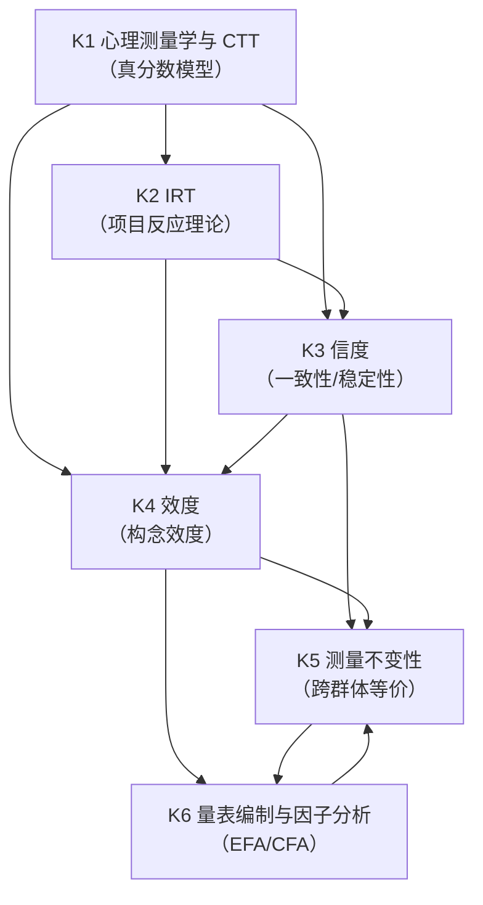
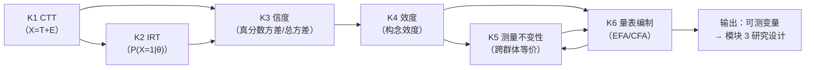

# MOD-02 · 模块 2：构念与测量（变量范式 × 状态范式对比）

> **来源与性质**：变量范式集体学习模块系列第 2/7 模块，与 15-X-112／113 议案七模块清单同源；本件依主理转入稿整理，去除呈现层过渡结构（四层次包装），知识内容全量保留。库内锚点引用前须自核（见 rn）。

>
> **框架声明（15-RPT-115 #1/#2·v0.1.1 订正批增）**：本件「四层次」结构系输出构造、非库内文档框架；模块 MECE 编号与知识点清单照 15-X-112 原文展开。

## 1.1 模块定位表

| 项 | 内容 |
|---|---|
| 所属范式 | 变量范式 |
| MECE 编号 | 模块 2 / 共 7 模块 |
| 核心问题 | 如何把心理属性变成可测变量？ |
| 关键知识 | 心理测量学、CTT、IRT、信度、效度、测量不变性 |
| 代表方法/工具 | 量表编制、EFA/CFA、IRT |
| 在知识生产链中的位置 | **第二环**——上游承接模块 1“本体论预设”，下游供给模块 3“研究设计”与模块 4“统计推断”以可测变量 |
| 状态范式对位模块 | **模块 6“测量与观测”**（观测函数 h、逆问题、多模态融合、状态估计、判者信度、标签稳定性）＋**模块 2“状态语法”**（M-R-D-S、42 维、状态向量） |
| 本模块的真正分歧 | 测量对象：构念/潜变量 vs 功能状态 Ψ；测量关系：构念→指标 vs Ψ→y 观测函数 h；测量目标：稳定读取属性 vs 逆问题反解状态 |
| 变量范式的历史地位 | 这是变量范式**最坚固的堡垒**（15-X-112 §六明确指出：测量理论、因果推断、统计建模、制度批判四块是“变量范式最坚固的堡垒”） |

## 1.2 知识点清单表

| # | 知识点 | 一句话定位 | 在变量范式中的角色 |
|---|---|---|---|
| K1 | 心理测量学与 CTT | 真分数 = 观测分数 + 误差；信度=真分数方差/总方差 | 测量理论的地基 |
| K2 | 项目反应理论（IRT） | 用项目特征曲线建模潜特质与作答概率的关系 | CTT 的现代化升级 |
| K3 | 信度 | 测量的一致性/稳定性；内部一致性、重测、判者间 | 测量质量的核心指标之一 |
| K4 | 效度 | 测量是否测到了它声称测的构念；内容/构念/效标/结构 | 测量质量的核心指标之二 |
| K5 | 测量不变性 | 跨群体/跨时间测量是否等价；构型/度量/标量/严格 | 跨群体比较的前提 |
| K6 | 量表编制与因子分析（EFA/CFA） | 从题项到维度；探索性 vs 验证性因子结构 | 构念操作化的主要工具链 |

## 1.3 每个知识点的大纲解释表

| 知识点 | 简要大纲解释 |
|---|---|
| **K1 心理测量学与 CTT** | 经典测验理论（Classical Test Theory）：X = T + E（观测分数 = 真分数 + 误差）。假设误差随机、与真分数独立。核心目标是通过多次测量逼近真分数。局限：真分数与误差依赖样本、项目难度与被试能力未分离。 |
| **K2 IRT** | 项目反应理论：用项目特征曲线（ICC）建模被试潜特质 θ 与作答概率 P(X=1\|θ) 的关系。常用模型：Rasch（1PL）、2PL（加区分度）、3PL（加猜测）。优点：项目难度与被试能力分离、信息函数、自适应测验（CAT）。 |
| **K3 信度** | 测量的一致性/稳定性。类型：内部一致性（α、ω、分半）、重测信度、复本信度、判者间信度（κ、ICC）。概化理论（G-theory）将信度分解为多个方差成分。信度是效度的必要非充分条件。 |
| **K4 效度** | 测量是否测到了声称测的构念。类型：内容效度（专家判断）、构念效度（收敛/区分/预测/增量/法则网络）、效标效度（同时/预测）、结构效度（内部结构）。效度不是一次性的，是持续累积的证据。 |
| **K5 测量不变性** | 跨群体/跨时间测量是否等价。层级：构型（形态相同）→ 度量（载荷相同）→ 标量（截距相同）→ 严格（误差方差相同）。度量不变性是跨群体比较潜变量均值的前提。常用工具：多组 CFA、MGCFA、MIMIC。 |
| **K6 量表编制与因子分析** | 从题项到维度。流程：构念定义→题项生成→预测试→项目分析→EFA（探索维度）→CFA（验证结构）→信效度检验→标准化。EFA 用主成分/主轴因子法；CFA 用 SEM 框架。 |

## 2.1 K1 心理测量学与 CTT —— 详细对比

| 维度 | 变量范式（CTT） | 状态范式（观测函数 h） |
|---|---|---|
| 核心对象 | 真分数 T、观测分数 X、误差 E | 状态 Ψ、观测 y、观测函数 h |
| 基本方程 | X = T + E | y = h(Ψ, E) + ε |
| 误差假设 | 随机误差、与真分数独立 | 观测噪声 + 状态不确定性 |
| 测量目标 | 通过多次测量逼近真分数 | 通过观测反解状态（逆问题） |
| 测量单位 | 量表分数 | 42 维状态向量 |
| 测量对象性质 | 静态属性（真分数固定） | 动态状态（Ψ_t 随时间演化） |
| 理论前提 | 真分数与误差可分离 | 观测函数 h 形式已知或可学 |
| 库内对应 | — | 01-M-03 §四（核心方程）；01-M-10（L1-I 接口规范） |
| 关键分歧 | 变量范式：T 是固定属性；状态范式：Ψ 是动态状态，需递推估计 | CTT 的“真分数”概念在状态范式内被“状态后验分布”替代 |

## 2.2 K2 IRT —— 详细对比

| 维度 | 变量范式（IRT） | 状态范式（观测模型） |
|---|---|---|
| 核心对象 | 潜特质 θ（一维或多维） | 状态 Ψ（42 维） |
| 基本模型 | P(X=1\|θ) = f(θ, a, b, c) | p(y\|Ψ) = 似然函数 |
| 参数性质 | 项目参数（难度 b、区分度 a、猜测 c） | 观测函数参数 + 状态参数 |
| 参数分离 | 项目参数与被试能力可分离（IRT 核心优势） | 状态与观测参数联合推断（PSE-C） |
| 信息函数 | 项目/测验信息函数 I(θ) | 观测模态信息量（语义/行为/神经） |
| 维度假设 | 通常一维或少数维度 | 42 维高维状态空间 |
| 动态性 | 静态（θ 不随时间变） | 动态（Ψ_t 随时间演化） |
| 库内对应 | — | 01-M-07（UPLP 语义端口）；01-M-05（UBMP 行为端口）；01-M-06（UNIP 神经端口） |
| 关键分歧 | IRT 的 θ 是静态潜特质；状态范式的 Ψ 是动态状态，需动力学方程 | IRT 信息函数 ↔ 观测模态信息量；IRT 参数分离 ↔ 状态-观测参数联合推断 |

## 2.3 K3 信度 —— 详细对比

| 维度 | 变量范式（信度） | 状态范式（状态估计可靠性） |
|---|---|---|
| 核心问题 | 测量的一致性/稳定性 | 状态估计的可靠性/不确定性 |
| 主要指标 | α、ω、重测 r、κ、ICC | 后验协方差、置信区间、收敛性 |
| 理论框架 | 真分数方差/总方差 | 后验分布宽度 / 状态估计不确定性 |
| 误差来源 | 随机误差、项目抽样、时间波动、判者差异 | 观测噪声、状态转移不确定性、模型选择不确定性 |
| 处理方式 | 提高信度→增加题项/多次测量/培训判者 | 提高估计精度→多模态融合/递推滤波/BMA |
| 判者信度 | κ、ICC（判者间一致性） | 判读协议、盲评、判者资格与执行度（JQC/JECC） |
| 时间稳定性 | 重测信度 | 时间稳定性（五维成熟度台账维度四） |
| 库内对应 | — | 01-M-11（L2 状态估计）；01-M-10（L1-I 接口规范）；IET 证据分级 |
| 关键分歧 | 变量范式：信度是测量属性；状态范式：可靠性是状态估计属性 | 信度衡量“测量一致性”；状态范式衡量“状态后验收敛性” |

## 2.4 K4 效度 —— 详细对比

| 维度 | 变量范式（效度） | 状态范式（观测函数效度） |
|---|---|---|
| 核心问题 | 测量是否测到了声称测的构念 | 观测函数 h 是否准确映射状态到观测 |
| 效度类型 | 内容、构念（收敛/区分/预测/增量/法则网络）、效标、结构 | 构念效度（内容/关联/收敛/区分/预测/增量）、内部效度、外部效度、统计结论效度 |
| 效度验证方式 | 相关分析、CFA、MTMM、实验 | 多模态一致性检验、L3 预测精度反推、临床专家交叉校准 |
| 效度地位 | 效度是累积证据，不是一次性检验 | 观测函数效度持续校准（PSE-C 贝叶斯更新） |
| 与理论关系 | 构念效度依赖理论网络 | 观测函数效度依赖功能架构 + 动力学模型 |
| 关键挑战 | 构念膨胀、测量不变性困难、法则网络循环 | 逆问题病态、高维、参数校准、功能层边界待实证 |
| 库内对应 | — | 03-A-07 §7.1；01-M-03 §九（L2-L3 接口）；IET 证据分级 |
| 关键分歧 | 变量范式：效度是构念的测量属性；状态范式：效度是观测函数的映射精度 | 前者追问“测到了构念吗”；后者追问“h 映射准确吗” |

## 2.5 K5 测量不变性 —— 详细对比

| 维度 | 变量范式（测量不变性） | 状态范式（跨情境 h 稳定性） |
|---|---|---|
| 核心问题 | 跨群体/跨时间测量是否等价 | 观测函数 h 跨情境/跨基质是否稳定 |
| 层级 | 构型→度量→标量→严格 | 观测函数形式稳定性 → 参数稳定性 → 状态可比较性 |
| 检验工具 | 多组 CFA、MGCFA、MIMIC、DIF | 跨基质对照（22-A-01）、跨模型泛化（M4b）、跨仪器（M4c） |
| 不变性失败后果 | 跨群体比较无效 | 观测函数漂移→状态估计失效 |
| 处理方式 | 部分不变性、近似不变性、对齐优化 | 观测函数重新校准、本地化锚件（碳基路线四项） |
| 跨基质扩展 | 通常限于同一测量工具 | 碳基/硅基双柱、基质无关性逐基质实证 |
| 库内对应 | — | 22-A-01（基质运行栈）；22-DEF-01 §3.3.1（跨基质声明）；01-M-10（接口规范） |
| 关键分歧 | 变量范式：测量不变性是跨群体比较前提；状态范式：观测函数稳定性是跨情境状态估计前提 | 前者限于同一工具跨群体；后者涵盖跨基质、跨模型、跨仪器 |

## 2.6 K6 量表编制与因子分析 —— 详细对比

| 维度 | 变量范式（EFA/CFA） | 状态范式（PCUI 映射 + 观测函数参数化） |
|---|---|---|
| 核心目标 | 从题项中提取维度/因子 | 从观测中反解状态/估计 h 参数 |
| 主要工具 | EFA（主成分/主轴因子）、CFA（SEM） | 多模态融合、贝叶斯滤波、PSE-C 校准 |
| 因子/维度性质 | 统计维度（由协方差定义） | 功能组件（由功能架构定义） |
| 维度数确定 | 平行分析、碎石图、拟合指标 | 42 维（6 模块 × 7 维度） |
| 结构验证 | CFA 拟合指标（CFI、RMSEA、SRMR） | 结构约束（D 矩阵、STR 三分、级联规则） |
| 参数估计 | 因子载荷、截距、残差方差 | 观测函数参数 + 状态参数 + 动力学参数 |
| 校准方式 | 单次或多次验证性研究 | PSE-C 持续贝叶斯校准 |
| 库内对应 | — | 01-M-02 §五（PCUI-L）；01-M-03 §八（校准流程）；03-A-19（逆问题算法路径） |
| 关键分歧 | 变量范式：因子是统计维度；状态范式：功能组件是功能架构中的角色 | 前者用协方差定义维度；后者用功能架构定义组件 |

## 3.1 K1 心理测量学与 CTT —— 知识库链接表

| 类别 | 内容 | 库内/库外对应 |
|---|---|---|
| 核心工具 | 真分数模型、平行测验、信度系数 | — |
| 相关理论 | 经典测验理论、概化理论 | Cronbach et al. (1972) |
| 心理学表现 | 量表编制、标准化测验 | — |
| 状态范式对位 | 观测函数 h: Ψ→y、观测噪声 ε | 01-M-03 §四；01-M-10 |
| 关键文档 | 01-M-03《PSE》§四（核心方程）；01-M-10《L1-I 接口规范》 | 库内 |
| 关键论证 | X=T+E ↔ y=h(Ψ,E)+ε；真分数 ↔ 状态后验 | 01-M-03 §九（L2-L3 接口） |
| 延伸阅读 | Lord & Novick (1968)；Cronbach et al. (1972) | 库外 |
| 相关争议 | 真分数是否真实存在；CTT vs IRT | — |

## 3.2 K2 IRT —— 知识库链接表

| 类别 | 内容 | 库内/库外对应 |
|---|---|---|
| 核心工具 | 项目特征曲线（ICC）、信息函数、CAT | — |
| 相关理论 | 项目反应理论、潜在特质模型 | Lord (1980)；Embretson & Reise (2000) |
| 心理学表现 | 智力测验、人格测验、自适应测验 | — |
| 状态范式对位 | p(y\|Ψ) 似然函数、多模态观测端口 | 01-M-07（UPLP）；01-M-05（UBMP）；01-M-06（UNIP） |
| 关键文档 | 01-M-07《UPLP 统一心理语言端口》；01-M-05《UBMP 统一行为测量端口》；01-M-06《UNIP 统一神经接口端口》 | 库内 |
| 关键论证 | IRT 信息函数 ↔ 观测模态信息量；IRT 参数分离 ↔ 状态-观测参数联合推断 | 01-M-03 §九；01-M-11（L2 状态估计） |
| 延伸阅读 | Rasch (1960)；Lord (1980)；Embretson & Reise (2000) | 库外 |
| 相关争议 | 维度假设（一维 vs 多维）；参数不变性 | — |

## 3.3 K3 信度 —— 知识库链接表

| 类别 | 内容 | 库内/库外对应 |
|---|---|---|
| 核心工具 | α、ω、分半信度、重测信度、κ、ICC | — |
| 相关理论 | 概化理论（G-theory）、判者间信度 | Cronbach et al. (1972)；Shrout & Fleiss (1979) |
| 心理学表现 | 量表信度检验、判者培训 | — |
| 状态范式对位 | 状态估计可靠性、后验协方差、判读协议 | 01-M-11（L2 状态估计）；JQC/JECC（内部件） |
| 关键文档 | 01-M-11《L2 状态估计》；01-M-10《L1-I 接口规范》；IET 证据分级 | 库内 |
| 关键论证 | 信度 ↔ 状态估计可靠性；判者信度 ↔ 判读协议与盲评 | 01-M-11 §2.4；26-SIPE 判读协议 |
| 延伸阅读 | Cronbach (1951)；Shrout & Fleiss (1979)；Brennan (2001) | 库外 |
| 相关争议 | α 的局限性（不是单维性指标）；ω 的优势 | — |

## 3.4 K4 效度 —— 知识库链接表

| 类别 | 内容 | 库内/库外对应 |
|---|---|---|
| 核心工具 | 内容效度、构念效度、效标效度、结构效度、MTMM | — |
| 相关理论 | 构念效度理论、法则网络 | Cronbach & Meehl (1955)；Campbell & Fiske (1959) |
| 心理学表现 | 量表效度检验、构念验证 | — |
| 状态范式对位 | 观测函数效度、多模态一致性检验、L3 预测精度反推 | 01-M-03 §九；03-A-07 §7.1；03-A-19 |
| 关键文档 | 03-A-07《走出洞穴》§7.1；01-M-03《PSE》§九；03-A-19《从观测到状态向量》 | 库内 |
| 关键论证 | 效度是观测函数的映射精度；多模态一致性、L3 预测精度反推、临床交叉校准三条间接验证路径 | 01-M-00 §4.3；01-M-03 §九 |
| 延伸阅读 | Cronbach & Meehl (1955)；Campbell & Fiske (1959)；Borsboom et al. (2004) | 库外 |
| 相关争议 | 构念效度是否可检验；效度是否累积 | — |

## 3.5 K5 测量不变性 —— 知识库链接表

| 类别 | 内容 | 库内/库外对应 |
|---|---|---|
| 核心工具 | 多组 CFA、MGCFA、MIMIC、DIF | — |
| 相关理论 | 测量不变性、项目功能差异 | Meredith (1993)；Vandenberg & Lance (2000) |
| 心理学表现 | 跨文化比较、跨群体比较 | — |
| 状态范式对位 | 跨基质对照、跨模型泛化、跨仪器、观测函数稳定性 | 22-A-01（基质运行栈）；22-DEF-01 §3.3.1 |
| 关键文档 | 22-A-01《基质运行栈三层模型》；22-DEF-01《智能科学公理化定义》§3.3.1；01-M-10《L1-I 接口规范》 | 库内 |
| 关键论证 | 测量不变性层级 ↔ 观测函数 h 跨情境稳定性；跨基质对照 ↔ 不变性检验 | 22-A-01 §三（可观测性）；22-DEF-01 §3.3.1（定义适用性 ≠ 效度可迁移性） |
| 延伸阅读 | Meredith (1993)；Vandenberg & Lance (2000)；Millsap (2011) | 库外 |
| 相关争议 | 严格不变性是否必要；近似不变性 vs 部分不变性 | — |

## 3.6 K6 量表编制与因子分析 —— 知识库链接表

| 类别 | 内容 | 库内/库外对应 |
|---|---|---|
| 核心工具 | EFA、CFA、项目分析、平行分析 | — |
| 相关理论 | 因子分析、结构方程模型 | Brown (2015)；Fabrigar et al. (1999) |
| 心理学表现 | 量表编制、构念验证 | — |
| 状态范式对位 | PCUI 映射、观测函数参数化、多模态融合、PSE-C 校准 | 01-M-02 §五；01-M-03 §八；03-A-19 |
| 关键文档 | 01-M-02《IODS》§五（PCUI-L）；01-M-03《PSE》§八（校准流程）；03-A-19《从观测到状态向量》 | 库内 |
| 关键论证 | EFA/CFA 提取统计维度 ↔ PCUI 映射功能组件；因子载荷 ↔ 观测函数参数 | 01-M-02 §5.2；01-M-03 §八 |
| 延伸阅读 | Fabrigar et al. (1999)；Brown (2015) | 库外 |
| 相关争议 | EFA vs CFA；因子数确定；探索 vs 验证 | — |

## 4.1 依赖关系总表

| 知识点 | 依赖 | 被依赖 | 依赖类型 | 说明 |
|---|---|---|---|---|
| K1 CTT | 模块 1（K2 操作主义、K3 变量实在论） | K2、K3、K4 | 理论基础 | CTT 为 IRT、信度、效度提供真分数模型基础 |
| K2 IRT | K1 | K3、K4 | 升级替代 | IRT 是 CTT 的现代化升级，二者并行使用 |
| K3 信度 | K1、K2 | K4、K5、K6 | 质量指标 | 信度是效度的必要非充分条件；信度影响不变性检验 |
| K4 效度 | K1、K2、K3 | K5、K6 | 核心目标 | 效度是测量的最终目标；效度验证依赖信度和因子结构 |
| K5 测量不变性 | K3、K4、K6 | K6 | 跨群体前提 | 不变性检验依赖因子结构（CFA）和效度；是跨群体比较前提 |
| K6 量表编制与因子分析 | K1、K2、K3、K4 | K5 | 工具链 | 量表编制是信效度检验和不变性检验的载体 |

## 4.2 依赖关系图

## 4.3 依赖关系深度解剖表

| 依赖对 | 依赖内容 | 深度 | 结构性后果 |
|---|---|---|---|
| K1 → K2 | CTT → IRT | 强 | CTT 的真分数模型是 IRT 的逻辑起点；IRT 用 ICC 替代真分数模型 |
| K1 → K3 | CTT → 信度 | 强 | 信度 = 真分数方差/总方差，直接定义自信度 |
| K1 → K4 | CTT → 效度 | 中 | 效度验证依赖测量模型，但效度问题超出 CTT |
| K2 → K3 | IRT → 信度 | 中 | IRT 提供信息函数替代信度系数；边际信度可用 |
| K2 → K4 | IRT → 效度 | 弱 | IRT 主要处理测量精度，效度仍需外部证据 |
| K3 → K4 | 信度 → 效度 | 强 | 信度是效度的必要非充分条件；低信度必然低效度 |
| K3 → K5 | 信度 → 不变性 | 中 | 信度影响不变性检验的稳定性；低信度使不变性检验不可靠 |
| K4 → K5 | 效度 → 不变性 | 强 | 不变性是效度的一个方面（跨群体效度）；效度验证依赖不变性 |
| K4 → K6 | 效度 → 量表编制 | 强 | 量表编制以效度为目标；CFA 是效度验证的主要工具 |
| K5 → K6 | 不变性 → 量表编制 | 中 | 不变性检验依赖 CFA；量表编制需考虑跨群体适用性 |
| K6 → K5 | 量表编制 → 不变性 | 强 | 不变性检验以因子结构为基础；CFA 是不变性检验的载体 |

## 4.4 与状态范式的依赖关系对比

| 变量范式依赖 | 状态范式对应 | 差异 |
|---|---|---|
| K1 CTT → K2 IRT | 观测函数 h → 观测模型参数化 | 变量范式从真分数出发；状态范式从状态-观测映射出发 |
| K1 CTT → K3 信度 | 观测函数 h → 状态估计可靠性 | 信度衡量测量一致性；状态范式衡量状态后验收敛性 |
| K3 信度 → K4 效度 | 状态估计可靠性 → 观测函数效度 | 信度是效度必要非充分；状态估计可靠性是观测函数效度前提 |
| K4 效度 → K5 不变性 | 观测函数效度 → 跨情境 h 稳定性 | 变量范式检验跨群体等价；状态范式检验跨基质/跨模型/跨仪器稳定性 |
| K5 不变性 → K6 量表编制 | 跨情境 h 稳定性 → PCUI 映射与参数化 | 量表编制以因子结构为载体；状态范式以功能架构+观测函数为载体 |
| K6 量表编制 → K5 不变性 | PCUI 映射与参数化 → 跨情境 h 稳定性 | 量表编制依赖不变性检验；状态范式依赖跨基质对照 |

## 4.5 关键依赖链：从 CTT 到量表编制

**关键结论：**

1. **CTT 是地基**：真分数模型定义了信度、效度的基本框架；IRT 是升级替代，但二者并行使用。
2. **信度是效度的必要非充分条件**：低信度必然低效度；高信度不保证高效度。
3. **效度是核心目标**：量表编制（K6）以效度为目标；不变性（K5）是效度的跨群体方面。
4. **因子分析是工具链**：EFA/CFA 既是量表编制工具，也是不变性检验载体（K6 ↔ K5 双向依赖）。
5. **模块 2 的输出是可测变量**：这些变量供给模块 3（研究设计）、模块 4（统计推断）、模块 5（因果识别）。
6. **与状态范式的根本差异**：变量范式的测量对象是构念/潜变量（静态属性），状态范式的测量对象是功能状态 Ψ（动态状态）；变量范式用 CTT/IRT 定义测量精度，状态范式用观测函数 h + 逆问题反解状态。

## 4.6 模块间依赖：模块 2 与相邻模块的关系

| 关系 | 上游 | 下游 | 依赖内容 |
|---|---|---|---|
| 模块 1 → 模块 2 | 本体论预设（变量实在论/操作主义） | 构念与测量 | 模块 1 定义“变量是什么”，模块 2 定义“如何测量变量” |
| 模块 2 → 模块 3 | 可测变量 | 研究设计与抽样 | 模块 2 提供测量工具，模块 3 设计研究获取数据 |
| 模块 2 → 模块 4 | 测量模型 | 统计推断与数据建模 | 模块 2 提供变量和测量模型，模块 4 建模变量间关系 |
| 模块 2 → 模块 5 | 测量效度 | 因果识别与因果推断 | 模块 2 的效度影响因果推断的节点定义 |
| 模块 2 → 模块 7 | 测量实践 | 制度、实践与批判 | 模块 2 的测量实践受模块 7 的制度批判约束（构念膨胀、测量不变性困难） |

## 疑问解答（附属·v0.2.0 增）

本节系主理 Agent 2026-10-13 会话转入之附属疑问解答（13 条·逐条以表格作答），与正文四节互为补充、不替代；内容逐字落盘未改一字。

### 疑问 1：模块二“本模块的真正分歧”指出测量对象、测量关系、测量目标三重分歧。这三重分歧如何与模块一的本体论预设衔接？

| 维度 | 变量范式 | 状态范式 |
|---|---|---|
| 测量对象 | 构念、潜变量（由观测协方差定义） | 功能状态 Ψ（由功能架构定义） |
| 测量关系 | 构念 → 指标（潜变量模型） | Ψ → y 观测函数 h |
| 测量目标 | 稳定读取属性 | 逆问题反解状态 |
| 与模块一衔接 | 模块一决定“变量是什么”，模块二决定“如何测量变量”；测量对象继承变量实在论 | 模块一决定“功能层是什么”，模块二决定“如何从观测反解状态”；测量对象继承约束功能主义 |
| 数学对象 | `y = λ·η + ε`（因子模型） | `y = h(Ψ, E) + ε`（生成模型） |
| 时间性 | 静态属性（真分数固定） | 动态状态（Ψ_t 随时间演化） |
| 一句话 | 模块一是本体论预设，模块二是测量操作化；变量范式的测量对象是构念，状态范式的测量对象是功能状态 |

---

### 疑问 2：K1 心理测量学与 CTT 的核心方程 `X = T + E` 与状态范式的 `y = h(Ψ, E) + ε` 有何本质差异？

| 维度 | 变量范式（CTT） | 状态范式（观测函数 h） |
|---|---|---|
| 核心对象 | 真分数 T、观测分数 X、误差 E | 状态 Ψ、观测 y、观测函数 h |
| 基本方程 | `X = T + E` | `y = h(Ψ, E) + ε` |
| 误差假设 | 随机误差、与真分数独立 | 观测噪声 + 状态不确定性 |
| 测量目标 | 通过多次测量逼近真分数 | 通过观测反解状态（逆问题） |
| 测量单位 | 量表分数 | 42 维状态向量 |
| 测量对象性质 | 静态属性（真分数固定） | 动态状态（Ψ_t 随时间演化） |
| 理论前提 | 真分数与误差可分离 | 观测函数 h 形式已知或可学 |
| 关键分歧 | CTT 的“真分数”概念在状态范式内被“状态后验分布”替代 | — |
| 一句话 | CTT 把测量问题化为“真分数 + 随机误差”；状态范式把测量问题化为“状态 + 观测函数 + 逆问题” |

---

### 疑问 3：K1 CTT 的“真分数”在 CTT 内部是何种概念？状态范式如何替代这一概念？

| 维度 | 变量范式（真分数） | 状态范式（状态后验） |
|---|---|---|
| 概念性质 | 真分数是 CTT 的定义性概念，即观测分数的期望值 | 状态 Ψ 是功能因果网络中的角色实体 |
| 存在性争议 | 争议不在“真分数是否存在”，而在“潜变量是否真实存在”（实在论/工具主义/网络理论） | Ψ 是功能因果网络中的角色实体 |
| 定义方式 | 观测分数的期望值 | 功能架构中的位置 + 动力学 + 干预对应 |
| 测量目标 | 逼近真分数 | 估计状态后验 `p(Ψ_t|y_{1:t})` |
| 时间性 | 静态 | 动态（递推更新） |
| 不确定性 | 标准误（频率派） | 后验协方差（贝叶斯派） |
| 替代关系 | 真分数 → 状态后验分布 | 状态后验分布承载了真分数想表达但无法表达的“动态属性” |
| 一句话 | 真分数是 CTT 的定义性概念，状态范式用“状态后验分布”替代它——从“固定属性”变为“动态状态 + 不确定性” |

---

### 疑问 4：K2 IRT 的潜特质 θ 与状态范式的状态 Ψ 有何差异？IRT 的参数分离优势在状态范式中如何体现？

| 维度 | 变量范式（IRT） | 状态范式（观测模型） |
|---|---|---|
| 核心对象 | 潜特质 θ（一维或多维） | 状态 Ψ（42 维） |
| 基本模型 | `P(X=1|θ) = f(θ, a, b, c)` | `p(y|Ψ) = 似然函数` |
| 参数性质 | 项目参数（难度 b、区分度 a、猜测 c） | 观测函数参数 + 状态参数 |
| 参数分离 | 项目参数与被试能力可分离（IRT 核心优势） | 状态与观测参数联合推断（PSE-C） |
| 信息函数 | 项目/测验信息函数 `I(θ)` | 观测模态信息量（语义/行为/神经） |
| 维度假设 | 通常一维或少数维度 | 42 维高维状态空间 |
| 动态性 | 静态（θ 不随时间变） | 动态（Ψ_t 随时间演化） |
| 参数分离的对应 | IRT 参数分离 ↔ 观测函数参数与状态参数的联合推断 | 状态范式不追求“项目参数与被试能力分离”，而是“状态与观测参数联合推断” |
| 一句话 | IRT 的 θ 是静态潜特质，状态范式的 Ψ 是动态状态；IRT 的信息函数对应观测模态信息量，参数分离对应联合推断 |

---

### 疑问 5：K3 信度的各子概念（内部一致性、重测信度、评分者间信度）在状态范式中如何对应？

| 信度子概念 | 变量范式 | 状态范式对应 |
|---|---|---|
| 内部一致性 | α、ω、分半信度 | 多模态一致性检验（三通道似然在融合前的内部一致性） |
| 重测信度 | 跨时间稳定性 | 时间稳定性（五维成熟度台账维度四） |
| 复本信度 | 等价测验间一致性 | 跨模型泛化（M4b）、跨仪器（M4c） |
| 评分者间信度 | κ、ICC | 判读协议、盲评、判者资格与执行度（JQC/JECC） |
| 概化理论 | 方差成分分解 | 后验协方差、置信区间、收敛性 |
| 核心差异 | 信度衡量“测量一致性” | 状态范式衡量“状态后验收敛性” |
| 一句话 | 变量范式的信度是测量属性；状态范式的可靠性是状态估计属性 |

---

### 疑问 6：K3 信度是效度的必要非充分条件。这一逻辑在状态范式中如何体现？

| 维度 | 变量范式 | 状态范式 |
|---|---|---|
| 信度与效度关系 | 信度是效度的必要非充分条件；低信度必然低效度，高信度不保证高效度 | 状态估计可靠性是观测函数效度的前提；估计不可靠则映射精度无从谈起 |
| 低信度后果 | 测量不可重复，效度验证无意义 | 状态估计不可靠，观测函数 h 的效度无法验证 |
| 高信度不保证高效度 | 测量一致但可能测的不是目标构念 | 状态估计可靠但观测函数 h 可能映射错误 |
| 状态范式的处理 | 信度与效度分离检验；效度通过多模态一致性、L3 预测精度反推、临床专家交叉校准间接验证 | — |
| 一句话 | 信度是效度的必要非充分条件，在状态范式中体现为“状态估计可靠性是观测函数效度的前提” |

---

### 疑问 7：K4 效度的各子概念（内容、构念、效标、结构）在状态范式中如何对应？

| 效度子概念 | 变量范式 | 状态范式对应 |
|---|---|---|
| 内容效度 | 专家判断题目覆盖构念的程度 | 构念效度（内容效度〔设计层〕） |
| 构念效度·收敛 | 与同类指标相关 | 关联证据（收敛） |
| 构念效度·区分 | 与不同类指标不相关 | 关联证据（区分） |
| 构念效度·预测 | 预测未来效标 | 关联证据（预测） |
| 构念效度·增量 | 在已有指标之外有额外预测力 | 关联证据（增量·标注预测子类） |
| 构念效度·法则网络 | 在理论网络中的位置 | 功能架构 + 观测函数 h |
| 效标效度 | 与外部效标相关 | 多模态一致性检验、L3 预测精度反推、临床专家交叉校准 |
| 结构效度 | 内部结构符合理论维度 | 结构约束（D 矩阵、STR 三分、级联规则） |
| 关键分歧 | 变量范式追问“测到了构念吗” | 状态范式追问“h 映射准确吗” |
| 一句话 | 变量范式的效度是构念的测量属性；状态范式的效度是观测函数的映射精度 |

---

### 疑问 8：K4 观测函数 h 在测量模块中的具体形态是什么？变量范式对 h 的“缺席”与状态范式对 h 的“未完成”性质有何不同？

| 维度 | 变量范式 | 状态范式 |
|---|---|---|
| h 的状态 | 缺席 | 未完成 |
| 缺席性质 | 原则性：语法中无位置，基本描述单位是观测本身 | 阶段性：语法中有位置，参数待填充 |
| 具体形态 | 无显式 h；因子模型 `y = λ·η + ε` 是潜变量到指标的映射，但不等同于状态到观测的生成映射 | `y = h(Ψ, E) + ε`，h 是状态到观测的生成映射 |
| 可否通过改进方法解决 | 原则上不能 | 可以通过参数校准解决 |
| 类比 | 未填的槽位与不存在的槽位不是同一个问题 | — |
| 一句话 | 变量范式对 h 的缺席是语法结构问题；状态范式对 h 的未完成是工程进展问题 |

---

### 疑问 9：K5 测量不变性的层级（构型→度量→标量→严格）在状态范式中如何对应？

| 不变性层级 | 变量范式 | 状态范式对应 |
|---|---|---|
| 构型不变性 | 因子形态相同 | 观测函数形式稳定性 |
| 度量不变性 | 因子载荷相同 | 观测函数参数稳定性 |
| 标量不变性 | 截距相同 | 状态可比较性 |
| 严格不变性 | 误差方差相同 | 观测噪声结构稳定性 |
| 检验工具 | 多组 CFA、MGCFA、MIMIC、DIF | 跨基质对照（22-A-01）、跨模型泛化（M4b）、跨仪器（M4c） |
| 失败后果 | 跨群体比较无效 | 观测函数漂移→状态估计失效 |
| 处理方式 | 部分不变性、近似不变性 | 观测函数重新校准、本地化锚件（碳基路线四项） |
| 关键分歧 | 变量范式限于同一工具跨群体 | 状态范式涵盖跨基质、跨模型、跨仪器 |
| 一句话 | 测量不变性层级对应观测函数 h 跨情境稳定性；变量范式检验跨群体等价，状态范式检验跨基质/跨模型/跨仪器稳定性 |

---

### 疑问 10：K6 量表编制与因子分析（EFA/CFA）在状态范式中如何对应？

| 维度 | 变量范式（EFA/CFA） | 状态范式（PCUI 映射 + 观测函数参数化） |
|---|---|---|
| 核心目标 | 从题项中提取维度/因子 | 从观测中反解状态/估计 h 参数 |
| 主要工具 | EFA（主成分/主轴因子）、CFA（SEM） | 多模态融合、贝叶斯滤波、PSE-C 校准 |
| 因子/维度性质 | 统计维度（由协方差定义） | 功能组件（由功能架构定义） |
| 维度数确定 | 平行分析、碎石图、拟合指标 | 42 维（6 模块 × 7 维度） |
| 结构验证 | CFA 拟合指标（CFI、RMSEA、SRMR） | 结构约束（D 矩阵、STR 三分、级联规则） |
| 参数估计 | 因子载荷、截距、残差方差 | 观测函数参数 + 状态参数 + 动力学参数 |
| 校准方式 | 单次或多次验证性研究 | PSE-C 持续贝叶斯校准 |
| 关键分歧 | 变量范式用协方差定义维度 | 状态范式用功能架构定义组件 |
| 一句话 | EFA/CFA 提取统计维度；状态范式用 PCUI 映射功能组件，用观测函数参数化替代因子载荷 |

---

### 疑问 11：模块二的知识点依赖链是否闭合？状态范式如何对应？

| 变量范式依赖 | 状态范式对应 | 差异 |
|---|---|---|
| K1 CTT → K2 IRT | 观测函数 h → 观测模型参数化 | 变量范式从真分数出发；状态范式从状态-观测映射出发 |
| K1 CTT → K3 信度 | 观测函数 h → 状态估计可靠性 | 信度衡量测量一致性；状态范式衡量状态后验收敛性 |
| K3 信度 → K4 效度 | 状态估计可靠性 → 观测函数效度 | 信度是效度必要非充分；状态估计可靠性是观测函数效度前提 |
| K4 效度 → K5 不变性 | 观测函数效度 → 跨情境 h 稳定性 | 变量范式检验跨群体等价；状态范式检验跨基质/跨模型/跨仪器稳定性 |
| K5 不变性 → K6 量表编制 | 跨情境 h 稳定性 → PCUI 映射与参数化 | 量表编制以因子结构为载体；状态范式以功能架构+观测函数为载体 |
| K6 量表编制 → K5 不变性 | PCUI 映射与参数化 → 跨情境 h 稳定性 | 量表编制依赖不变性检验；状态范式依赖跨基质对照 |
| 依赖链是否闭合 | 从 CTT 出发，经由 IRT、信度、效度、不变性，到达量表编制；量表编制又依赖不变性检验（K6 ↔ K5 双向依赖） | 状态范式从观测函数 h 出发，经由状态估计、观测函数效度、跨情境 h 稳定性，到达 PCUI 映射与参数化 |
| 一句话 | 变量范式的依赖链以“真分数”为地基；状态范式以“观测函数 h”为地基 |

---

### 疑问 12：模块二与模块一、模块三、模块四、模块五、模块七的模块间依赖关系如何？

| 关系 | 上游 | 下游 | 依赖内容 |
|---|---|---|---|
| 模块 1 → 模块 2 | 本体论预设（变量实在论/操作主义） | 构念与测量 | 模块 1 定义“变量是什么”，模块 2 定义“如何测量变量” |
| 模块 2 → 模块 3 | 可测变量 | 研究设计与抽样 | 模块 2 提供测量工具，模块 3 设计研究获取数据 |
| 模块 2 → 模块 4 | 测量模型 | 统计推断与数据建模 | 模块 2 提供变量和测量模型，模块 4 建模变量间关系 |
| 模块 2 → 模块 5 | 测量效度 | 因果识别与因果推断 | 模块 2 的效度影响因果推断的节点定义 |
| 模块 2 → 模块 7 | 测量实践 | 制度、实践与批判 | 模块 2 的测量实践受模块 7 的制度批判约束（构念膨胀、测量不变性困难） |
| 一句话 | 模块二是变量范式的“测量引擎”，上承本体论预设，下接研究设计、统计推断、因果识别、制度批判 | — | — |

---

### 疑问 13：模块二被称为“变量范式最坚固的堡垒”之一，这一判断如何理解？

| 维度 | 解答 |
|---|---|
| 判断来源 | 15-X-112 §六明确指出：测量理论、因果推断、统计建模、制度批判四块是“变量范式最坚固的堡垒” |
| 测量理论为何坚固 | CTT、IRT、信度、效度、测量不变性构成了完整的测量理论体系，工程成熟度高 |
| 堡垒的含义 | 挑战时最可能遭遇的正面战场；不能简单否定，须认真对待 |
| 状态范式如何对待 | 不否定测量理论的成就，而是重新定位：变量范式的测量理论为观测函数 h 提供初始参数估计，作为 PSE-C 贝叶斯校准循环的冷启动先验 |
| 状态范式的增量 | 把测量对象从“构念/潜变量”换为“功能状态 Ψ”，把测量关系从“构念→指标”换为“Ψ→y 观测函数 h” |
| 一句话 | 测量理论是变量范式最坚固的堡垒，状态范式不否定其成就，而是重新定位其功能 |

## 版本记录

| 版本 | 日期 | 变更说明 |
|---|---|---|
| v0.3.0 | 2026-10-29 | 双范式正名批（DR-2026-10-29-TERM-002 v1.4.0）：正文「结构范式」→「状态范式」；判升 Minor。 |
| v0.2.0 | 2026-10-13 | Minor·B261013-05：疑问解答增补批：增「疑问解答（附属）」一节于版本记录之前——13 条疑问逐条以表格作答，内容自主理会话转入附件逐字落盘未改一字； 与正文四节互为补充、不替代。 |
| v0.1.1 | 2026-10-13 | Patch·B261013-04：订正批：框架声明增（#1/#2）；无其他成立待订项。判升 Patch。 |
| v0.1.0 | 2026-10-13 | 建件·B261013-02：模块 2/7 知识落盘（去四层次过渡包装改四节直陈·含 4.6 模块间依赖·mermaid 2 枚与全部表格零删减保留·库内锚点抽验见 rn 余未逐条复核）。… |

> 全量版本 v0.1.0–v0.2.0（共 3 版）见 [HIST-MOD §MOD-02-构念与测量-v0.1-2026-10-13](HIST-MOD_双范式对比学习模块-MOD系版本沿革-v1.0-2026-10-18.md#doc-20)；当前无外迁版本。
