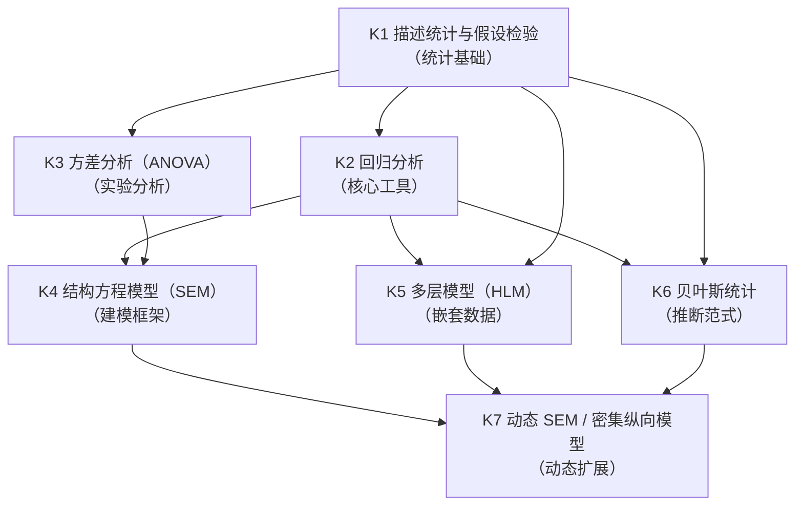
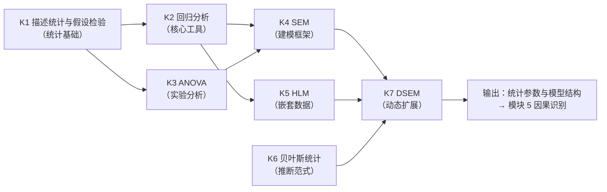

# MOD-04 · 模块 4：统计推断与数据建模（变量范式 × 状态范式对比）

> **来源与性质**：变量范式集体学习模块系列第 4/7 模块，

>
> **框架声明**：本件「四层次」结构系呈现层构造、非库内文档框架。

## 1.1 模块定位表

| 项 | 内容 |
|---|---|
| 所属范式 | 变量范式 |
| MECE 编号 | 模块 4 / 共 7 模块 |
| 核心问题 | 变量之间有什么关系？ |
| 关键知识 | 描述统计、假设检验、回归、ANOVA、SEM、多层模型、贝叶斯统计 |
| 代表方法/工具 | SPSS/R/Stata、SEM、HLM、贝叶斯建模 |
| 在知识生产链中的位置 | **第四环·核心引擎**——上游承接模块 2“测量模型”与模块 3“研究设计”，下游供给模块 5“因果识别”与模块 6“计算建模”以统计参数和模型结构 |
| 状态范式对位模块 | **模块 5“动力学与计算引擎”**（PSE、L2 状态估计、L3 动力学、BMA）＋**模块 6“测量与观测”**（逆问题、贝叶斯滤波） |
| 本模块的真正分歧 | 数学对象：概率分布/协方差矩阵/代数方程 vs 微分/差分方程/状态空间模型；时间维度：静态或离散时点 vs 连续时间动态演化；系统特性：线性、叠加、可逆 vs 非线性、反馈、阈值、涌现；数学工具：统计学/概率论/回归分析 vs 控制论/动力系统/贝叶斯滤波 |
| 变量范式的历史地位 | 这是变量范式的**核心堡垒**（统计建模是“变量范式最坚固的堡垒”之一）；也是变量范式与状态范式数学差异最直接的体现领域 |
| 关键张力 | 变量范式的统计工具在**观测层关系描述**上高度成熟；状态范式需要**状态层生成建模**，要求状态空间模型 + 贝叶斯滤波，二者数学对象不同 |

## 1.2 知识点清单表

| # | 知识点 | 一句话定位 | 在变量范式中的角色 |
|---|---|---|---|
| K1a | NHST 历史争议 | p 值误用史：Cohen (1994) 至 ASA (2016) 声明 | K1 的争议史单列备查 |
| K1 | 描述统计与假设检验 | 用均值/方差/分布描述数据；用 p 值判断差异是否显著 | 统计推断的入门基础 |
| K2 | 回归分析 | 用自变量预测因变量；估计条件均值 E(Y\|X) | 变量间关系建模的核心工具 |
| K3 | 方差分析（ANOVA） | 比较多个组均值差异；分解方差来源 | 实验设计的标准分析工具 |
| K4 | 结构方程模型（SEM） | 同时建模潜变量与观测指标；路径分析 + 因子分析 | 变量范式最成熟的建模框架 |
| K5 | 多层模型（HLM） | 处理嵌套数据结构；区分个体间与个体内效应 | 纵向/嵌套数据的标准工具 |
| K6 | 贝叶斯统计 | 用先验 + 似然 → 后验；参数是分布而非点估计 | 统计推断的范式转换 |
| K7 | 动态 SEM / 密集纵向模型 | 引入时间维度；建模变量间的动态关系 | 变量范式的动态工具扩展 |

## 1.3 每个知识点的大纲解释表

| 知识点 | 简要大纲解释 |
|---|---|
| **K1a NHST 历史争议** | 零假设显著性检验的争议史：Cohen (1994)「p<.05 仪式」批评、效应量与置信区间运动、Wasserstein & Lazar (2016) ASA 声明「p 值本身不衡量效应大小与证据强度」。（延伸阅读见 3.1 增） |
| **K1 描述统计与假设检验** | 描述统计：均值、中位数、标准差、偏度、峰度、相关系数。假设检验：零假设显著性检验（NHST）、p 值、α 水平、第一类/第二类错误、效应量。核心逻辑：如果零假设为真，观察到当前数据的概率是多少？局限：p 值不衡量效应大小、不衡量证据强度、依赖样本量。 |
| **K2 回归分析** | 用自变量预测因变量。简单线性回归：Y = β₀ + β₁X + ε。多元回归：Y = β₀ + β₁X₁ + … + βₖXₖ + ε。逻辑回归：因变量为二分。核心概念：最小二乘法、R²、调整 R²、共线性、交互作用、调节效应。局限：线性假设、独立性假设、同方差性、正态性。 |
| **K3 方差分析（ANOVA）** | 比较多个组均值差异。单因素 ANOVA：一个自变量（多水平）。双因素 ANOVA：两个自变量 + 交互作用。重复测量 ANOVA：同一被试多次测量。核心逻辑：分解方差为组间方差 + 组内方差；F 检验。事后检验：Tukey、Bonferroni。 |
| **K4 结构方程模型（SEM）** | 同时建模潜变量与观测指标。组成：测量模型（CFA）+ 结构模型（路径分析）。核心概念：潜变量、观测指标、因子载荷、路径系数、模型拟合（CFI、RMSEA、SRMR）、修正指数。类型：CFA、路径分析、完整 SEM、多组 SEM、潜增长模型。 |
| **K5 多层模型（HLM）** | 处理嵌套数据结构（学生嵌套于班级、重复测量嵌套于个体）。核心概念：固定效应、随机效应、组内相关系数（ICC）、跨层交互。类型：两层模型、三层模型、增长曲线模型。优势：正确处理嵌套数据的依赖结构；区分个体间与个体内效应。 |
| **K6 贝叶斯统计** | 用先验 + 似然 → 后验。贝叶斯定理：P(θ\|Data) ∝ P(Data\|θ) × P(θ)。核心概念：先验分布、似然函数、后验分布、可信区间、贝叶斯因子、MCMC 采样。优势：参数是分布而非点估计；可纳入先验知识；天然处理不确定性。 |
| **K7 动态 SEM / 密集纵向模型** | 引入时间维度。动态 SEM（DSEM）：结合多层模型 + SEM + 时间序列。交叉滞后模型（CLPM）：X_t → Y_{t+1} 和 Y_t → X_{t+1}。随机截距交叉滞后模型（RI-CLPM）：分离个体间与个体内效应。潜增长模型（LGM）：建模变化轨迹。 |

## 2.1 K1 描述统计与假设检验 —— 详细对比

| 维度 | 变量范式（描述统计 + NHST） | 状态范式（状态描述 + 贝叶斯推断） |
|---|---|---|
| 核心对象 | 变量分布（均值、方差、相关系数） | 状态向量 Ψ（42 维） + 状态后验分布 |
| 描述方式 | 群体统计量（均值、标准差） | 个体化状态估计（均值向量 + 协方差矩阵） |
| 推断逻辑 | 零假设显著性检验（NHST） | 贝叶斯后验更新 |
| 核心指标 | p 值、效应量、置信区间 | 后验分布、可信区间、收敛性 |
| 证据强度 | p < .05 为显著 | 后验概率 + 贝叶斯因子 |
| 样本依赖 | 强依赖样本量（大样本易显著） | 后验分布随数据累积更新 |
| 不确定性 | 置信区间（频率派） | 可信区间（贝叶斯派） |
| 库内对应 | — | 01-M-11（L2 状态估计）；01-M-03 §八（PSE-C 贝叶斯更新） |
| 关键分歧 | 变量范式：NHST 判断变量间差异是否显著；状态范式：贝叶斯后验估计状态分布 | 前者关注“差异是否显著”；后者关注“状态后验分布是什么” |

## 2.2 K2 回归分析 —— 详细对比

| 维度 | 变量范式（回归分析） | 状态范式（状态转移方程 + 观测函数） |
|---|---|---|
| 核心目标 | 用自变量预测因变量 | 用状态转移方程预测状态演化 + 观测函数映射状态到观测 |
| 数学形式 | Y = β₀ + β₁X + ε | y = h(Ψ, E) + ε；dΨ/dt = f(Ψ, E, θ) |
| 关系类型 | 线性、叠加、可逆 | 非线性、反馈、阈值、涌现 |
| 时间维度 | 静态横截面或离散时点 | 连续时间动态演化 |
| 因果地位 | 回归系数不等于因果效应 | 状态转移方程刻画生成机制 |
| 解释对象 | 方差解释（R²） | 轨迹预测、级联路径、干预靶点 |
| 模型假设 | 线性、独立性、同方差、正态性 | 状态转移方程形式 + 观测函数形式 |
| 库内对应 | — | 01-M-03 §四（核心方程）；01-M-08（操作语法） |
| 关键分歧 | 变量范式：回归估计条件均值 E(Y\|X)；状态范式：状态空间模型估计状态轨迹 p(Ψ_t\|y_{1:t}) | 前者是观测层关系模型；后者是状态层生成模型 |

> **承载边界判据**：两边的「动态」不是同一种动态——变量范式的动态止于第二层（变化率无功能语义），状态范式的动态可进第三层（变化率有功能语义，且受守恒、阈值、靶点合法性约束，判据见 MOD-08 §1.6）。功能清单对位不等于承载边界等同。

## 2.3 K3 方差分析（ANOVA） —— 详细对比

| 维度 | 变量范式（ANOVA） | 状态范式（级联分析 + 干预实验） |
|---|---|---|
| 核心目标 | 比较多个组均值差异 | 比较不同干预序列对状态轨迹的影响 |
| 分析对象 | 组间方差 vs 组内方差 | 状态轨迹差异 + 级联路径 + 干预效果 |
| 核心指标 | F 值、p 值、效应量（η²、ω²） | 轨迹预测精度、干预靶点效应 |
| 设计类型 | 单因素、双因素、重复测量、混合设计 | 随机化 + 密集纵向 + 多模态 |
| 交互作用 | 双因素 ANOVA 可检验交互 | 环境×干预×状态的交互 |
| 时间维度 | 通常前后测 | 连续时间动态 |
| 库内对应 | — | 01-M-03 §四（级联路径）；03-C-13 §六（DMD-P2a） |
| 关键分歧 | 变量范式：ANOVA 分解方差来源；状态范式：级联分析分解状态轨迹来源 | 前者关注均值差异；后者关注轨迹差异与干预靶点 |

## 2.4 K4 结构方程模型（SEM） —— 详细对比

| 维度 | 变量范式（SEM） | 状态范式（状态空间模型 + 功能架构） |
|---|---|---|
| 核心目标 | 同时建模潜变量与观测指标 | 同时建模功能状态、观测函数、动力学方程 |
| 组成 | 测量模型（CFA）+ 结构模型（路径分析） | 观测函数 h + 状态转移方程 f + 功能架构 |
| 潜变量/状态 | 潜变量由观测协方差定义 | Ψ 由功能架构定义 + 动力学演化 |
| 模型结构 | 路径图（变量间箭头） | 功能组件依赖矩阵 D + 级联规则 |
| 拟合指标 | CFI、RMSEA、SRMR、χ² | 预测精度、轨迹拟合、状态估计收敛性 |
| 时间维度 | 通常静态；潜增长模型引入时间 | 连续时间动态演化 |
| 干预对应 | 无直接对应 | G-M-A-R 靶点合法性矩阵 |
| 库内对应 | — | 01-M-02 §三（结构约束）；01-M-03 §四（核心方程） |
| 关键分歧 | 变量范式：SEM 建模变量间路径关系；状态范式：状态空间模型建模功能组件间生成关系 | 前者是变量间路径图；后者是状态空间生成模型 |

## 2.5 K5 多层模型（HLM） —— 详细对比

| 维度 | 变量范式（HLM） | 状态范式（层级贝叶斯 + 群体→个体校准） |
|---|---|---|
| 核心目标 | 处理嵌套数据结构 | 处理个体化状态估计 + 群体先验 |
| 核心概念 | 固定效应、随机效应、ICC | 群体先验、个体后验、层级收缩 |
| 个体间 vs 个体内 | HLM 可区分，但仍以变量为对象 | Ψ_t 本身就是个体内状态 |
| 数据结构 | 嵌套（学生嵌套于班级） | 个体化密集纵向（个体内多时点） |
| 估计方法 | 极大似然、限制极大似然 | 贝叶斯层级模型 + MCMC |
| 个体差异 | 随机效应 | 个体化参数 |
| 库内对应 | — | 01-M-03 §七（群体→个体校准轴）；01-M-11（L2 状态估计） |
| 关键分歧 | 变量范式：HLM 处理嵌套变量；状态范式：层级贝叶斯估计个体化状态 | 前者关注嵌套结构；后者关注个体化状态 + 群体先验校准 |

## 2.6 K6 贝叶斯统计 —— 详细对比

| 维度 | 变量范式（贝叶斯统计） | 状态范式（贝叶斯滤波 + PSE-C 校准） |
|---|---|---|
| 核心逻辑 | 先验 + 似然 → 后验 | 状态先验 + 观测似然 → 状态后验 |
| 数学形式 | P(θ\|Data) ∝ P(Data\|θ) × P(θ) | p(Ψ_t\|y_{1:t}) ∝ p(y_t\|Ψ_t) × p(Ψ_t\|y_{1:t-1}) |
| 参数/状态 | 参数 θ 是分布 | 状态 Ψ_t 是分布 + 动力学演化 |
| 时间维度 | 通常静态；贝叶斯动态模型引入时间 | 连续时间动态演化 |
| 先验来源 | 主观先验、无信息先验、经验先验 | PSE-M 仿真先验 + PSE-C 后验校准 |
| 计算工具 | MCMC、变分推断 | 卡尔曼滤波、粒子滤波、BMA |
| 模型选择 | 贝叶斯因子 | BMA 权重 w_k |
| 库内对应 | — | 01-M-03 §八（PSE-C）；01-M-11（L2 状态估计）；01-M-03 §六（BMA） |
| 关键分歧 | 变量范式：贝叶斯统计估计参数分布；状态范式：贝叶斯滤波估计状态轨迹 + 动力学参数 | 前者是参数推断；后者是状态估计 + 动力学建模 |

## 2.7 K7 动态 SEM / 密集纵向模型 —— 详细对比

| 维度 | 变量范式（DSEM/RI-CLPM） | 状态范式（状态空间模型 + 动力学方程） |
|---|---|---|
| 核心目标 | 建模变量间的动态关系 | 建模状态演化 + 观测映射 |
| 数学形式 | 交叉滞后路径 + 随机截距 | dΨ/dt = f(Ψ, E, θ) |
| 时间维度 | 离散时间点 | 连续时间动态演化 |
| 个体间 vs 个体内 | RI-CLPM 可分离 | Ψ_t 本身就是个体内状态 |
| 变量/状态 | 变量间动态关系 | 状态向量 + 功能架构 |
| 分析工具 | DSEM、RI-CLPM、LGM | 状态空间模型 + 贝叶斯滤波 |
| 干预对应 | 无直接对应 | G-M-A-R 靶点合法性矩阵 |
| 库内对应 | — | 01-M-03 §四（核心方程）；01-M-11（L2 状态估计）；03-A-07 §7.4 |
| 关键分歧 | 变量范式：DSEM 建模变量间动态关系；状态范式：状态空间模型建模状态演化 | 前者是变量间动态模型；后者是状态层生成模型 |

## 2.8 补遗：研究者自由度（RDF）与刚性约束——统计合法性的范式对比

> 本节系「研究者自由度与刚性约束」范式对比节；与 §2.2 承载边界判据互补，与 `DISC-09`（复制危机）分工见本节末。

**为什么"显著"可以是幻觉**。Simmons 等（2011）指出，实证研究在数据收集、样本剔除与分析模型选择上存在巨大的**研究者自由度**（Researcher Degrees of Freedom, RDF）——不伪造任何数据，仅靠灵活的变量组合、样本筛选与模型调整，就能把随机噪声做成 p<.05 的"显著"。这种灵活性由变量范式的基本单位决定：构念可自由命名、时序可自由设定、协变量可自由进出、模型可自由比较——同一份数据的"合法"分析路径以组合数爆炸（多宇宙分析，Steegen et al., 2016）。P 值操纵（P-hacking）与选择性报告正是这一自由度的产物；而生成式 AI 能以算力穷举分析路径，等于把这种自由度放大到极限——旧范式的学术通胀被机器加速。开放科学改革（预注册、开放数据、specification curve）是在**制度层**收窄它。

**状态范式的另一条路径：把约束写进语法本身**。变量范式靠外部纪律管住研究者的手；状态范式的约束内建于数学结构：

| 约束层 | 机制 | 在册权威位 |
|---|---|---|
| 状态空间边界 | 42 维 Ψ 由功能架构显式定义，构念不能自由命名——潜变量必须锚定 M1-M6 功能组件 | 01-M-02 §二；01-M-01 |
| 算子-靶点合法性 | G-M-A-R 四操作各有主靶点：GATE→DSP／STR-S 激活面，MODULATE→RES-D，ALIGN→STR-R，RELINK→STR-C；非任意对应 | 01-M-08（靶点合法性矩阵） |
| 动力学约束 | 六条动力学约束（资源流守恒／恢复不对称／级联阈值／改变耗时／弹性回滞／系统-环境耦合）作用于状态量而非统计读数 | 01-M-02 §3.5；01-M-03 §L3 26 条假设 |

一句话：变量范式里"捏造一个中介变量"是合法操作（只要拟合指标过关）；状态范式里，任何干预都必须落在靶点合法性矩阵内、任何状态量都受动力学约束——**研究者自由度被语法结构预先压缩**。约束不是算力的对立面，而是算力可用的前提：状态空间边界清晰、运算路径受约束时，AI 的算力成为状态反解与动力学推演的资源，而非造假放大器。

**边界与自反**（承接 `DISC-09` §六与 §自反）：其一，本节说的是方法层——复制危机的结构性根源主线仍在"缺第五层"（构念层），RDF 只是常识解释之一，不把危机全部归因于变量范式。其二，刚性约束是必要条件而非充分条件：状态范式自身的状态估计、参数校准与模型选择环节同样存在研究者选择，`DISC-09` §自反所列复制风险对状态范式同样适用。其三，本节是规范性论证与对比教学，非实证结论；"压缩自由度→可复现性提升"是有待实证检验的预测（探针位＝18-DIVE）。

## 3.1 K1 描述统计与假设检验 —— 知识库链接表

| 类别 | 内容 | 库内/库外对应 |
|---|---|---|
| 核心工具 | 均值、标准差、t 检验、卡方检验、p 值、效应量 | — |
| 相关理论 | 零假设显著性检验（NHST）、频率派统计 | Fisher (1925)；Neyman & Pearson (1933) |
| 心理学表现 | 描述统计、假设检验、效应量报告 | — |
| 状态范式对位 | 状态描述、贝叶斯后验、可信区间 | 01-M-11；01-M-03 §八 |
| 关键文档 | 01-M-11《L2 状态估计》；01-M-03《PSE》§八 | 库内 |
| 关键论证 | NHST 判断差异是否显著 ↔ 贝叶斯后验估计状态分布 | 01-M-11；01-M-03 §八 |
| 延伸阅读 | Cohen (1994)；Wasserstein & Lazar (2016) | 库外 |
| 相关争议 | p 值的误用；NHST vs 贝叶斯 | — |

## 3.2 K2 回归分析 —— 知识库链接表

| 类别 | 内容 | 库内/库外对应 |
|---|---|---|
| 核心工具 | 线性回归、多元回归、逻辑回归、最小二乘法 | — |
| 相关理论 | 回归分析、广义线性模型 | Fox (2015)；Cohen et al. (2003) |
| 心理学表现 | 预测建模、中介/调节分析 | — |
| 状态范式对位 | 状态转移方程 f: Ψ_t→Ψ_{t+1}、观测函数 h: Ψ→y | 01-M-03 §四 |
| 关键文档 | 01-M-03《PSE》§四（核心方程）；01-M-08《G-M-A-R 操作语法》 | 库内 |
| 关键论证 | 回归估计 E(Y\|X) ↔ 状态空间模型估计 p(Ψ_t\|y_{1:t}) | 01-M-03 §四；01-M-11 |
| 延伸阅读 | Fox (2015)；Cohen et al. (2003) | 库外 |
| 相关争议 | 线性假设；共线性；因果解释 | — |

## 3.3 K3 方差分析（ANOVA） —— 知识库链接表

| 类别 | 内容 | 库内/库外对应 |
|---|---|---|
| 核心工具 | 单因素 ANOVA、双因素 ANOVA、重复测量 ANOVA、F 检验 | — |
| 相关理论 | 方差分析、实验设计 | Fisher (1935)；Kirk (2013) |
| 心理学表现 | 实验组间比较、交互作用检验 | — |
| 状态范式对位 | 级联分析、干预实验、轨迹差异 | 01-M-03 §四；03-C-13 §六 |
| 关键文档 | 01-M-03《PSE》§四（级联路径）；03-C-13《DMD》§六 | 库内 |
| 关键论证 | ANOVA 分解方差来源 ↔ 级联分析分解状态轨迹来源 | 01-M-03 §四 |
| 延伸阅读 | Fisher (1935)；Kirk (2013) | 库外 |
| 相关争议 | 交互作用解释；多重比较校正 | — |

## 3.4 K4 结构方程模型（SEM） —— 知识库链接表

| 类别 | 内容 | 库内/库外对应 |
|---|---|---|
| 核心工具 | CFA、路径分析、完整 SEM、多组 SEM、潜增长模型 | — |
| 相关理论 | 结构方程模型、潜变量模型 | Bollen (1989)；Kline (2016) |
| 心理学表现 | 构念验证、路径分析、测量模型 | — |
| 状态范式对位 | 状态空间模型 + 功能架构 + 观测函数 | 01-M-02 §三；01-M-03 §四 |
| 关键文档 | 01-M-02《IODS》§三（结构约束）；01-M-03《PSE》§四 | 库内 |
| 关键论证 | SEM 建模变量间路径关系 ↔ 状态空间模型建模功能组件间生成关系 | 01-M-02 §三；01-M-03 §四 |
| 延伸阅读 | Bollen (1989)；Kline (2016) | 库外 |
| 相关争议 | 模型拟合；等价模型；因果解释 | — |

## 3.5 K5 多层模型（HLM） —— 知识库链接表

| 类别 | 内容 | 库内/库外对应 |
|---|---|---|
| 核心工具 | 两层模型、三层模型、增长曲线模型、ICC | — |
| 相关理论 | 多层模型、层级线性模型 | Raudenbush & Bryk (2002)；Snijders & Bosker (2012) |
| 心理学表现 | 嵌套数据分析、纵向数据分析 | — |
| 状态范式对位 | 层级贝叶斯 + 群体→个体校准 | 01-M-03 §七；01-M-11 |
| 关键文档 | 01-M-03《PSE》§七（群体→个体校准轴）；01-M-11《L2 状态估计》 | 库内 |
| 关键论证 | HLM 处理嵌套变量 ↔ 层级贝叶斯估计个体化状态 | 01-M-03 §七 |
| 延伸阅读 | Raudenbush & Bryk (2002)；Snijders & Bosker (2012) | 库外 |
| 相关争议 | 中心化策略；随机效应选择；ICC 解释 | — |

## 3.6 K6 贝叶斯统计 —— 知识库链接表

| 类别 | 内容 | 库内/库外对应 |
|---|---|---|
| 核心工具 | 贝叶斯定理、MCMC、变分推断、贝叶斯因子 | — |
| 相关理论 | 贝叶斯统计、贝叶斯推断 | Gelman et al. (2013)；Kruschke (2014) |
| 心理学表现 | 贝叶斯建模、贝叶斯因子、可信区间 | — |
| 状态范式对位 | 贝叶斯滤波 + PSE-C 校准 + BMA | 01-M-03 §八；01-M-11；01-M-03 §六 |
| 关键文档 | 01-M-03《PSE》§八（PSE-C）；01-M-11《L2 状态估计》；01-M-03 §六（BMA） | 库内 |
| 关键论证 | 贝叶斯统计估计参数分布 ↔ 贝叶斯滤波估计状态轨迹 + 动力学参数 | 01-M-03 §八；01-M-11 |
| 延伸阅读 | Gelman et al. (2013)；Kruschke (2014) | 库外 |
| 相关争议 | 先验选择；MCMC 收敛；贝叶斯因子 vs p 值 | — |

## 3.7 K7 动态 SEM / 密集纵向模型 —— 知识库链接表

| 类别 | 内容 | 库内/库外对应 |
|---|---|---|
| 核心工具 | DSEM、RI-CLPM、LGM、交叉滞后模型 | — |
| 相关理论 | 动态结构方程模型、密集纵向模型 | Asparouhov et al. (2018)；Hamaker et al. (2015) |
| 心理学表现 | 纵向动态建模、个体内效应 | — |
| 状态范式对位 | 状态空间模型 + 贝叶斯滤波 + 动力学方程 | 01-M-03 §四；01-M-11；03-A-07 §7.4 |
| 关键文档 | 01-M-03《PSE》§四；01-M-11《L2 状态估计》；03-A-07《走出洞穴》§7.4 | 库内 |
| 关键论证 | DSEM 建模变量间动态关系 ↔ 状态空间模型建模状态演化 | 01-M-03 §四；03-A-07 §7.4 |
| 延伸阅读 | Asparouhov et al. (2018)；Hamaker et al. (2015) | 库外 |
| 相关争议 | 时间间隔选择；个体间 vs 个体内效应分离 | — |

## 4.1 依赖关系总表

| 知识点 | 依赖 | 被依赖 | 依赖类型 | 说明 |
|---|---|---|---|---|
| K1 描述统计与假设检验 | 模块 2（K3 信度、K4 效度） | K2、K3 | 统计基础 | 描述统计与假设检验是回归和 ANOVA 的基础 |
| K2 回归分析 | K1 | K4、K5、K6、K7 | 核心工具 | 回归是 SEM、HLM、贝叶斯、DSEM 的基础 |
| K3 方差分析（ANOVA） | K1 | K4、K5 | 实验分析 | ANOVA 是实验设计的标准分析工具 |
| K4 结构方程模型（SEM） | K1、K2、K3 | K5、K6、K7 | 建模框架 | SEM 整合了回归、因子分析、路径分析 |
| K5 多层模型（HLM） | K1、K2 | K6、K7 | 嵌套数据工具 | HLM 处理嵌套数据；是 DSEM 的基础 |
| K6 贝叶斯统计 | K1、K2 | K7 | 推断范式 | 贝叶斯统计为 DSEM 提供推断框架 |
| K7 动态 SEM / 密集纵向模型 | K2、K4、K5、K6 | — | 动态扩展 | DSEM 整合了 SEM、HLM、贝叶斯、时间序列 |

## 4.2 依赖关系图

## 4.3 依赖关系深度解剖表

| 依赖对 | 依赖内容 | 深度 | 结构性后果 |
|---|---|---|---|
| K1 → K2 | 描述统计 → 回归 | 强 | 回归依赖描述统计和假设检验框架 |
| K1 → K3 | 描述统计 → ANOVA | 强 | ANOVA 依赖方差分解和 F 检验 |
| K2 → K4 | 回归 → SEM | 强 | SEM 的结构模型部分本质上是回归/路径分析 |
| K3 → K4 | ANOVA → SEM | 中 | SEM 可替代 ANOVA 进行组间比较（多组 SEM） |
| K2 → K5 | 回归 → HLM | 强 | HLM 是回归的嵌套数据扩展 |
| K1 → K5 | 描述统计 → HLM | 中 | HLM 依赖方差分解（ICC） |
| K2 → K6 | 回归 → 贝叶斯 | 中 | 贝叶斯回归是频率派回归的替代 |
| K1 → K6 | 描述统计 → 贝叶斯 | 中 | 贝叶斯统计依赖概率分布描述 |
| K4 → K7 | SEM → DSEM | 强 | DSEM 是 SEM 的时间序列扩展 |
| K5 → K7 | HLM → DSEM | 强 | DSEM 整合了 HLM 的嵌套数据框架 |
| K6 → K7 | 贝叶斯 → DSEM | 强 | DSEM 通常用贝叶斯估计（MCMC） |

## 4.4 与状态范式的依赖关系对比

| 变量范式依赖 | 状态范式对应 | 差异 |
|---|---|---|
| K1 描述统计 → K2 回归 | 状态描述 → 状态转移方程 | 变量范式描述变量分布；状态范式描述状态向量 + 动力学方程 |
| K2 回归 → K4 SEM | 状态转移方程 → 状态空间模型 | 变量范式用回归估计 E(Y\|X)；状态范式用状态空间模型估计 p(Ψ_t\|y_{1:t}) |
| K3 ANOVA → K4 SEM | 级联分析 → 功能架构 | 变量范式用 ANOVA 分解方差；状态范式用级联分析分解状态轨迹 |
| K4 SEM → K7 DSEM | 状态空间模型 → 贝叶斯滤波 + BMA | 变量范式用 SEM 建模变量间路径；状态范式用状态空间模型建模功能组件间生成关系 |
| K5 HLM → K7 DSEM | 层级贝叶斯 → 个体化状态估计 | 变量范式用 HLM 处理嵌套数据；状态范式用层级贝叶斯估计个体化状态 |
| K6 贝叶斯 → K7 DSEM | 贝叶斯滤波 → 状态估计 + 动力学建模 | 变量范式用贝叶斯统计估计参数分布；状态范式用贝叶斯滤波估计状态轨迹 |
| K7 DSEM | 状态空间模型 + 动力学方程 | 变量范式 DSEM 建模变量间动态关系；状态范式建模状态演化 |

## 4.5 关键依赖链：从描述统计到动态 SEM

**关键结论：**

1. **描述统计与假设检验是统计基础**：所有后续工具都依赖描述统计和推断框架。
2. **回归是核心工具**：回归是 SEM、HLM、贝叶斯、DSEM 的基础。
3. **SEM 是变量范式最成熟的建模框架**：整合了回归、因子分析、路径分析。
4. **HLM 处理嵌套数据**：是纵向数据和密集纵向模型的基础。
5. **贝叶斯统计是推断范式转换**：参数是分布而非点估计；为 DSEM 提供推断框架。
6. **DSEM 是变量范式的动态扩展**：整合了 SEM、HLM、贝叶斯、时间序列；但仍是变量间动态关系模型，不是状态层生成模型。
7. **模块 4 的输出是统计参数与模型结构**：这些参数供给模块 5（因果识别）、模块 6（计算建模）。
8. **与状态范式的根本差异**：变量范式的数学对象是概率分布/协方差矩阵/代数方程；状态范式的数学对象是微分/差分方程/状态空间模型。变量范式处理 P(Y)/P(Y|X)；状态范式处理 h: Ψ→y 和 f: Ψₜ→Ψₜ₊₁。

## 4.6 模块间依赖：模块 4 与相邻模块的关系

| 关系 | 上游 | 下游 | 依赖内容 |
|---|---|---|---|
| 模块 2 → 模块 4 | 测量模型（信度、效度） | 统计推断与数据建模 | 模块 2 提供变量和测量模型，模块 4 建模变量间关系 |
| 模块 3 → 模块 4 | 研究设计与数据 | 统计推断与数据建模 | 模块 3 提供数据，模块 4 进行分析 |
| 模块 4 → 模块 5 | 统计参数与模型结构 | 因果识别与因果推断 | 模块 4 提供统计模型，模块 5 进行因果识别 |
| 模块 4 → 模块 6 | 统计模型 | 计算建模与预测 | 模块 4 提供统计基础，模块 6 进行形式化建模 |
| 模块 4 ↔ 模块 2/3 | 分析策略 ↔ 测量/设计 | 双向依赖 | 分析需求影响测量和设计；测量和设计约束分析 |

## 疑问解答（附属·v0.2.0 增）

本节为附属疑问解答（13 条）。

### 疑问 1：模块四“本模块的真正分歧”指出数学对象、时间维度、系统特性、数学工具四重分歧。这四重分歧如何与模块一至模块三的预设衔接？

| 维度 | 变量范式 | 状态范式 |
|---|---|---|
| 数学对象 | 概率分布/协方差矩阵/代数方程 | 微分/差分方程/状态空间模型 |
| 时间维度 | 静态或离散时点 | 连续时间动态演化 |
| 系统特性 | 线性、叠加、可逆 | 非线性、反馈、阈值、涌现 |
| 数学工具 | 统计学/概率论/回归分析 | 控制论/动力系统/贝叶斯滤波 |
| 与模块一衔接 | 模块一决定“变量是什么”，模块四决定“变量之间有什么关系”；数学对象继承变量实在论 | 模块一决定“功能层是什么”，模块四决定“状态如何演化”；数学对象继承约束功能主义 |
| 与模块二衔接 | 模块二提供测量模型，模块四建模变量间关系 | 模块二提供观测函数 h，模块四建模状态转移方程 f |
| 与模块三衔接 | 模块三提供可推断数据，模块四进行统计推断 | 模块三提供密集纵向数据，模块四进行状态估计与动力学建模 |
| 一句话 | 模块四是变量范式的“核心引擎”，上承测量与设计，下接因果识别与计算建模；状态范式把数学对象从“概率分布”换为“状态空间模型” |

---

### 疑问 2：K1a NHST 历史争议（Cohen 1994 至 ASA 2016）对变量范式意味着什么？状态范式是否面临类似的争议？

| 维度 | 变量范式（NHST 争议） | 状态范式（贝叶斯推断） |
|---|---|---|
| 争议焦点 | p 值误用：p 值不衡量效应大小、不衡量证据强度、依赖样本量 | 贝叶斯后验分布直接给出参数/状态的概率分布 |
| 关键文献 | Cohen (1994)「p<.05 仪式」批评；Wasserstein & Lazar (2016) ASA 声明 | — |
| 争议根源 | NHST 的逻辑结构：零假设显著性检验无法提供研究者真正想要的答案 | — |
| 改革方向 | 效应量与置信区间运动、贝叶斯统计、预注册 | 后验分布 + 可信区间 + 贝叶斯因子 |
| 状态范式是否免疫 | 部分免疫：贝叶斯推断不依赖 p 值，但面临先验选择、MCMC 收敛、模型比较等新问题 | — |
| 状态范式的优势 | 后验分布直接表达不确定性，无需“拒绝/不拒绝”二分 | — |
| 状态范式的挑战 | 先验选择的主观性；高维状态空间的 MCMC 收敛；模型选择（BMA）的计算成本 | — |
| 一句话 | NHST 的争议推动了变量范式向效应量与贝叶斯方向改革；状态范式用贝叶斯滤波替代 NHST，但面临先验选择与计算收敛的新挑战 |

---

### 疑问 3：K1 描述统计与假设检验的核心逻辑是“如果零假设为真，观察到当前数据的概率是多少”。这一逻辑在状态范式中如何被替代？

| 维度 | 变量范式（描述统计 + NHST） | 状态范式（状态描述 + 贝叶斯推断） |
|---|---|---|
| 核心对象 | 变量分布（均值、方差、相关系数） | 状态向量 Ψ（42 维）+ 状态后验分布 |
| 描述方式 | 群体统计量（均值、标准差） | 个体化状态估计（均值向量 + 协方差矩阵） |
| 推断逻辑 | 零假设显著性检验（NHST） | 贝叶斯后验更新 |
| 核心指标 | p 值、效应量、置信区间 | 后验分布、可信区间、收敛性 |
| 证据强度 | p < .05 为显著 | 后验概率 + 贝叶斯因子 |
| 样本依赖 | 强依赖样本量（大样本易显著） | 后验分布随数据累积更新 |
| 不确定性 | 置信区间（频率派） | 可信区间（贝叶斯派） |
| 替代关系 | NHST 判断变量间差异是否显著；状态范式用贝叶斯后验估计状态分布 | — |
| 一句话 | 变量范式问“差异是否显著”；状态范式问“状态后验分布是什么” |

---

### 疑问 4：K2 回归分析的核心方程 `Y = β₀ + β₁X + ε` 与状态范式的状态转移方程 `dΨ/dt = f(Ψ, E, θ)` 有何本质差异？

| 维度 | 变量范式（回归分析） | 状态范式（状态转移方程 + 观测函数） |
|---|---|---|
| 核心目标 | 用自变量预测因变量 | 用状态转移方程预测状态演化 + 观测函数映射状态到观测 |
| 数学形式 | `Y = β₀ + β₁X + ε` | `y = h(Ψ, E) + ε`；`dΨ/dt = f(Ψ, E, θ)` |
| 关系类型 | 线性、叠加、可逆 | 非线性、反馈、阈值、涌现 |
| 时间维度 | 静态横截面或离散时点 | 连续时间动态演化 |
| 因果地位 | 回归系数不等于因果效应 | 状态转移方程刻画生成机制 |
| 解释对象 | 方差解释（R²） | 轨迹预测、级联路径、干预靶点 |
| 模型假设 | 线性、独立性、同方差、正态性 | 状态转移方程形式 + 观测函数形式 |
| 关键差异 | 回归估计条件均值 `E(Y|X)`；状态范式估计状态轨迹 `p(Ψ_t|y_{1:t})` | — |
| 一句话 | 回归是观测层关系模型；状态空间模型是状态层生成模型 |

---

### 疑问 5：K3 方差分析（ANOVA）分解方差来源。这一逻辑在状态范式中如何被级联分析替代？

| 维度 | 变量范式（ANOVA） | 状态范式（级联分析 + 干预实验） |
|---|---|---|
| 核心目标 | 比较多个组均值差异 | 比较不同干预序列对状态轨迹的影响 |
| 分析对象 | 组间方差 vs 组内方差 | 状态轨迹差异 + 级联路径 + 干预效果 |
| 核心指标 | F 值、p 值、效应量（η²、ω²） | 轨迹预测精度、干预靶点效应 |
| 设计类型 | 单因素、双因素、重复测量、混合设计 | 随机化 + 密集纵向 + 多模态 |
| 交互作用 | 双因素 ANOVA 可检验交互 | 环境×干预×状态的交互 |
| 时间维度 | 通常前后测 | 连续时间动态 |
| 替代关系 | ANOVA 分解方差来源；状态范式用级联分析分解状态轨迹来源 | — |
| 一句话 | 变量范式关注均值差异；状态范式关注轨迹差异与干预靶点 |

---

### 疑问 6：K4 结构方程模型（SEM）同时建模潜变量与观测指标。这一框架与状态范式的状态空间模型有何根本差异？

| 维度 | 变量范式（SEM） | 状态范式（状态空间模型 + 功能架构） |
|---|---|---|
| 核心目标 | 同时建模潜变量与观测指标 | 同时建模功能状态、观测函数、动力学方程 |
| 组成 | 测量模型（CFA）+ 结构模型（路径分析） | 观测函数 h + 状态转移方程 f + 功能架构 |
| 潜变量/状态 | 潜变量由观测协方差定义 | Ψ 由功能架构定义 + 动力学演化 |
| 模型结构 | 路径图（变量间箭头） | 功能组件依赖矩阵 D + 级联规则 |
| 拟合指标 | CFI、RMSEA、SRMR、χ² | 预测精度、轨迹拟合、状态估计收敛性 |
| 时间维度 | 通常静态；潜增长模型引入时间 | 连续时间动态演化 |
| 干预对应 | 无直接对应 | G-M-A-R 靶点合法性矩阵 |
| 关键差异 | SEM 建模变量间路径关系；状态空间模型建模功能组件间生成关系 | — |
| 一句话 | SEM 是变量间路径图；状态空间模型是状态层生成模型 |

---

### 疑问 7：K5 多层模型（HLM）处理嵌套数据结构。这一工具在状态范式中如何被层级贝叶斯替代？

| 维度 | 变量范式（HLM） | 状态范式（层级贝叶斯 + 群体→个体校准） |
|---|---|---|
| 核心目标 | 处理嵌套数据结构 | 处理个体化状态估计 + 群体先验 |
| 核心概念 | 固定效应、随机效应、ICC | 群体先验、个体后验、层级收缩 |
| 个体间 vs 个体内 | HLM 可区分，但仍以变量为对象 | Ψ_t 本身就是个体内状态 |
| 数据结构 | 嵌套（学生嵌套于班级） | 个体化密集纵向（个体内多时点） |
| 估计方法 | 极大似然、限制极大似然 | 贝叶斯层级模型 + MCMC |
| 个体差异 | 随机效应 | 个体化参数 |
| 替代关系 | HLM 处理嵌套变量；状态范式用层级贝叶斯估计个体化状态 | — |
| 一句话 | 变量范式关注嵌套结构；状态范式关注个体化状态 + 群体先验校准 |

---

### 疑问 8：K6 贝叶斯统计在变量范式中是推断范式转换。它与状态范式的贝叶斯滤波有何异同？

| 维度 | 变量范式（贝叶斯统计） | 状态范式（贝叶斯滤波 + PSE-C 校准） |
|---|---|---|
| 核心逻辑 | 先验 + 似然 → 后验 | 状态先验 + 观测似然 → 状态后验 |
| 数学形式 | `P(θ|Data) ∝ P(Data|θ) × P(θ)` | `p(Ψ_t|y_{1:t}) ∝ p(y_t|Ψ_t) × p(Ψ_t|y_{1:t-1})` |
| 参数/状态 | 参数 θ 是分布 | 状态 Ψ_t 是分布 + 动力学演化 |
| 时间维度 | 通常静态；贝叶斯动态模型引入时间 | 连续时间动态演化 |
| 先验来源 | 主观先验、无信息先验、经验先验 | PSE-M 仿真先验 + PSE-C 后验校准 |
| 计算工具 | MCMC、变分推断 | 卡尔曼滤波、粒子滤波、BMA |
| 模型选择 | 贝叶斯因子 | BMA 权重 w_k |
| 异同 | 共享贝叶斯推断框架；变量范式估计参数分布，状态范式估计状态轨迹 + 动力学参数 | — |
| 一句话 | 变量范式用贝叶斯统计估计参数分布；状态范式用贝叶斯滤波估计状态轨迹 + 动力学参数 |

---

### 疑问 9：K7 动态 SEM（DSEM）是变量范式的动态扩展。它是否已经越过了“变量间动态关系模型”的边界，进入了状态范式？

| 维度 | 变量范式（DSEM/RI-CLPM） | 状态范式（状态空间模型 + 动力学方程） |
|---|---|---|
| 核心目标 | 建模变量间的动态关系 | 建模状态演化 + 观测映射 |
| 数学形式 | 交叉滞后路径 + 随机截距 | `dΨ/dt = f(Ψ, E, θ)` |
| 时间维度 | 离散时间点 | 连续时间动态演化 |
| 个体间 vs 个体内 | RI-CLPM 可分离 | Ψ_t 本身就是个体内状态 |
| 变量/状态 | 变量间动态关系 | 状态向量 + 功能架构 |
| 分析工具 | DSEM、RI-CLPM、LGM | 状态空间模型 + 贝叶斯滤波 |
| 干预对应 | 无直接对应 | G-M-A-R 靶点合法性矩阵 |
| 是否进入状态范式 | 未进入：DSEM 仍是变量间动态关系模型，不是状态层生成模型 | — |
| 一句话 | DSEM 是变量范式的动态扩展，但仍是变量间动态模型；状态范式是状态层生成模型 |

---

### 疑问 10：模块四的知识点依赖链是否闭合？状态范式如何对应？

| 变量范式依赖 | 状态范式对应 | 差异 |
|---|---|---|
| K1 描述统计 → K2 回归 | 状态描述 → 状态转移方程 | 变量范式描述变量分布；状态范式描述状态向量 + 动力学方程 |
| K2 回归 → K4 SEM | 状态转移方程 → 状态空间模型 | 变量范式用回归估计 `E(Y|X)`；状态范式用状态空间模型估计 `p(Ψ_t|y_{1:t})` |
| K3 ANOVA → K4 SEM | 级联分析 → 功能架构 | 变量范式用 ANOVA 分解方差；状态范式用级联分析分解状态轨迹 |
| K4 SEM → K7 DSEM | 状态空间模型 → 贝叶斯滤波 + BMA | 变量范式用 SEM 建模变量间路径；状态范式用状态空间模型建模功能组件间生成关系 |
| K5 HLM → K7 DSEM | 层级贝叶斯 → 个体化状态估计 | 变量范式用 HLM 处理嵌套数据；状态范式用层级贝叶斯估计个体化状态 |
| K6 贝叶斯 → K7 DSEM | 贝叶斯滤波 → 状态估计 + 动力学建模 | 变量范式用贝叶斯统计估计参数分布；状态范式用贝叶斯滤波估计状态轨迹 |
| K7 DSEM | 状态空间模型 + 动力学方程 | 变量范式 DSEM 建模变量间动态关系；状态范式建模状态演化 |
| 依赖链是否闭合 | 从描述统计出发，经由回归、ANOVA、SEM、HLM、贝叶斯，到达 DSEM；DSEM 整合了 SEM、HLM、贝叶斯、时间序列 | 状态范式从状态描述出发，经由状态转移方程、状态空间模型、层级贝叶斯，到达贝叶斯滤波 + BMA |
| 一句话 | 变量范式的依赖链以“描述统计”为地基；状态范式以“状态转移方程”为地基 |

---

### 疑问 11：模块四与模块二、模块三、模块五、模块六的模块间依赖关系如何？

| 关系 | 上游 | 下游 | 依赖内容 |
|---|---|---|---|
| 模块 2 → 模块 4 | 测量模型（信度、效度） | 统计推断与数据建模 | 模块 2 提供变量和测量模型，模块 4 建模变量间关系 |
| 模块 3 → 模块 4 | 研究设计与数据 | 统计推断与数据建模 | 模块 3 提供数据，模块 4 进行分析 |
| 模块 4 → 模块 5 | 统计参数与模型结构 | 因果识别与因果推断 | 模块 4 提供统计模型，模块 5 进行因果识别 |
| 模块 4 → 模块 6 | 统计模型 | 计算建模与预测 | 模块 4 提供统计基础，模块 6 进行形式化建模 |
| 模块 4 ↔ 模块 2/3 | 分析策略 ↔ 测量/设计 | 双向依赖 | 分析需求影响测量和设计；测量和设计约束分析 |
| 一句话 | 模块四是变量范式的“核心引擎”，上承测量与设计，下接因果识别与计算建模 | — | — |

---

### 疑问 12：模块四被称为“变量范式最坚固的堡垒”之一，这一判断如何理解？状态范式如何对待这一强项？

| 维度 | 解答 |
|---|---|
| 判断来源 | 统计建模是“变量范式最坚固的堡垒”之一 |
| 强项表现 | 回归、ANOVA、SEM、HLM、贝叶斯、DSEM 构成了完整的统计建模体系，工程成熟度高 |
| 强项的核心 | 观测层关系描述高度成熟；模型拟合、参数估计、不确定性量化工具完备 |
| 状态范式如何对待 | 不否定统计建模的价值，而是重新定位：变量范式的统计模型为状态空间模型提供先验分布和初始参数估计 |
| 状态范式的增量 | 把数学对象从“概率分布/协方差矩阵/代数方程”换为“微分/差分方程/状态空间模型” |
| 关键张力 | 变量范式的统计工具在观测层关系描述上高度成熟；状态范式需要状态层生成建模，要求状态空间模型 + 贝叶斯滤波，二者数学对象不同 |
| 一句话 | 统计建模是变量范式最坚固的堡垒，状态范式不否定其成就，而是重新定位为状态空间模型的冷启动先验 |

---

### 疑问 13：模块四与模块六的对位关系如何理解？

| 维度 | 变量范式（模块 4） | 状态范式（模块 5/6） |
|---|---|---|
| 对位模块 | 模块 4 统计推断与数据建模 | 模块 5 动力学与计算引擎 + 模块 6 测量与观测 |
| 共享关注 | 统计模型、参数估计、不确定性量化 | 状态空间模型、贝叶斯滤波、参数校准 |
| 关键差异 | 变量范式用概率分布/代数方程；状态范式用微分/差分方程/状态空间模型 | — |
| 对位内容 | 回归、ANOVA、SEM、HLM、贝叶斯、DSEM | PSE、L2 状态估计、L3 动力学、BMA、逆问题、贝叶斯滤波 |
| 一句话 | 模块 4 是变量范式的“核心引擎”；模块 5/6 是状态范式的“计算内核”与“观测反解” |

## 版本记录

| 版本 | 日期 | 变更说明 |
|---|---|---|
| v0.4.2 | 2026-10-31 | 主文减负批（B261031-05·未 commit）：1 处。判升 Patch。 |
| v0.4.1 | 2026-10-31 | 去过程化梳理批（14-ENGRAM-B261031-04·未 commit）：10 处清理。判升 Patch。 |
| v0.4.0 | 2026-10-29 | 双范式正名批（DR-2026-10-29-TERM-002 v1.4.0）：正文「结构范式」→「状态范式」；判升 Minor。 |
| v0.3.0 | 2026-10-28 | Minor·15-B261028-02：§2.7 后增 §2.8「研究者自由度（RDF）与刚性约束」（15-X-144 采·主理裁定·教材体详写·三重刚性约束对表＋边界自反）。 |
| v0.2.2 | 2026-10-25 | Patch·B261025-01：§2.2 增承载边界判据段（三层判据随批）。 |
| v0.2.1 | 2026-10-16 | Patch·B261016-04：外审机械订正批：rn v0.1.1 条拆碎段还原（外审候选×本窗独立解码双路对撞·并与末表 v0.1.1 同义行对撞）。… |
| v0.2.0 | 2026-10-13 | Minor·B261013-05：疑问解答增补批：增「疑问解答（附属）」一节（13 条）。 |
| v0.1.1 | 2026-10-13 | Patch·B261013-04：订正批：#23 增 K1a NHST 历史争议（1.2/1.3）；框架声明增（#1/#2）。判升 Patch。 |
| v0.1.0 | 2026-10-13 | 建件·B261013-02：模块 4/7 知识落盘（去四层次过渡包装改四节直陈·含 4.6 模块间依赖·mermaid 2 枚与全部表格零删减保留·库内锚点抽验见 rn 余未逐条复核）。… |

> 全量版本 v0.1.0–v0.2.1（共 4 版）见 [HIST-MOD §MOD-04-统计推断与数据建模-v0.1-2026-10-13](HIST-MOD_双范式对比学习模块-MOD系版本沿革-v1.0-2026-10-18.md#doc-22)；当前无外迁版本。
