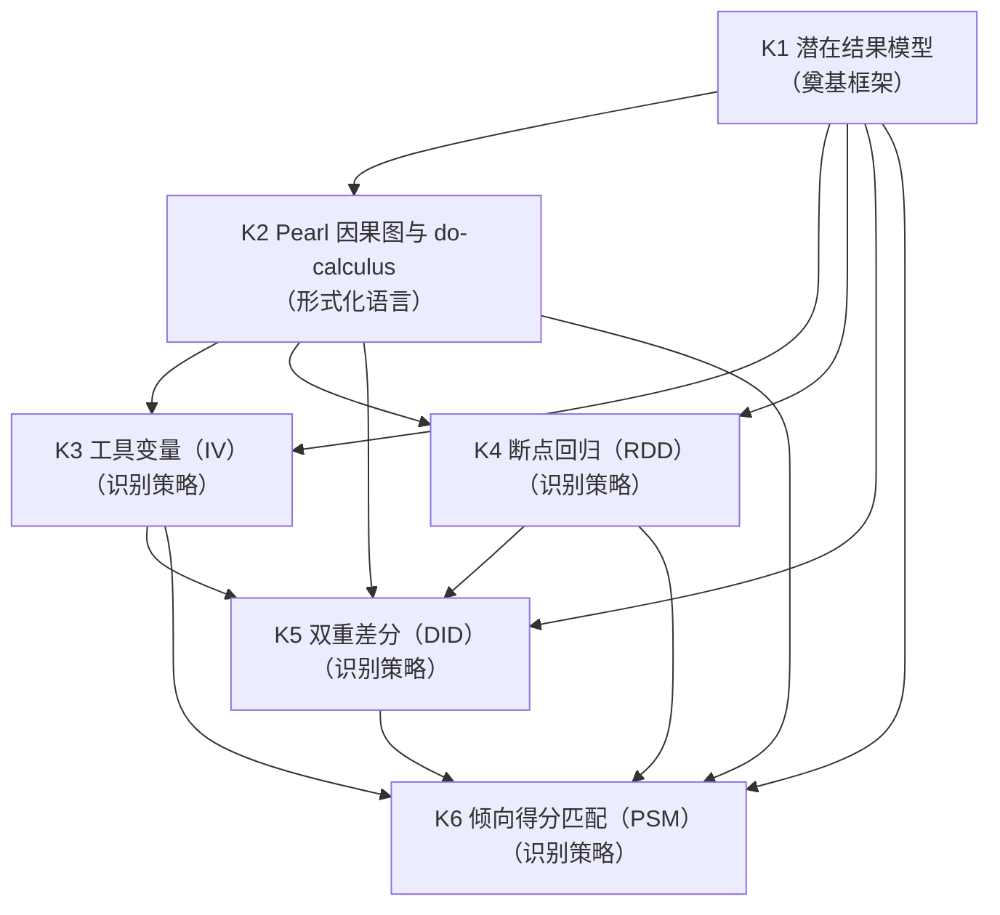
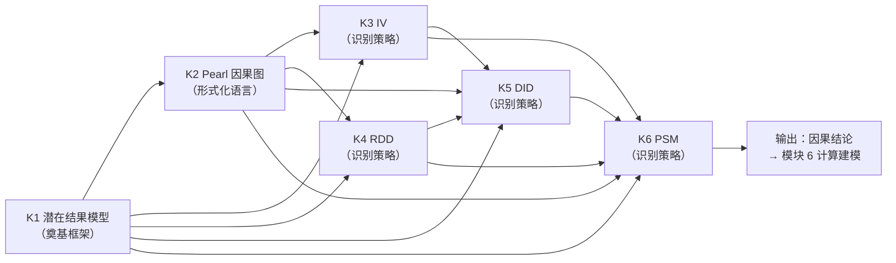

# MOD-05 · 模块 5：因果识别与因果推断（变量范式 × 状态范式对比）

> **来源与性质**：变量范式集体学习模块系列第 5/7 模块，与 15-X-112／113 议案七模块清单同源；本件依主理转入稿整理，去除呈现层过渡结构（四层次包装），知识内容全量保留。库内锚点引用前须自核（见 rn）。

>
> **框架声明（15-RPT-115 #1/#2·v0.1.1 订正批增）**：本件「四层次」结构系输出构造、非库内文档框架；模块 MECE 编号与知识点清单照 15-X-112 原文展开。

## 1.1 模块定位表

| 项 | 内容 |
|---|---|
| 所属范式 | 变量范式 |
| MECE 编号 | 模块 5 / 共 7 模块 |
| 核心问题 | 关系是否是因果？ |
| 关键知识 | 潜在结果模型、Pearl 因果图、工具变量、断点回归、双重差分、倾向得分 |
| 代表方法/工具 | do-calculus、IV、RDD、DID、PSM |
| 在知识生产链中的位置 | **第五环·识别引擎**——上游承接模块 3“研究设计”与模块 4“统计模型”，下游供给模块 6“计算建模”与模块 7“制度批判”以因果结论 |
| 状态范式对位模块 | **模块 5“动力学与计算引擎”**（状态转移方程 + 干预算子 + BMA）＋**模块 7“干预与验证”**（G-M-A-R 干预映射、D-R-S 序列、DMD、RCT） |
| 本模块的真正分歧 | 因果定义：潜在结果框架下的处理效应 vs 状态转移方程 + 干预算子；识别方式：外部干预推断（RCT、IV、DAG） vs 内部机制生成（状态转移方程 + 干预算子）；因果对象：变量间因果效应 vs 状态演化与干预靶点；前置条件：节点已被合理定义 vs 节点 = 功能组件，由坐标系定义 |
| 变量范式的历史地位 | 这是变量范式的**核心堡垒**（15-X-112 §六明确指出：因果推断是“变量范式最坚固的堡垒”之一）；Pearl 因果图、潜在结果模型是当代因果推断的奠基性进展 |
| 关键张力 | 变量范式的因果推断在**处理效应识别**上高度成熟；状态范式追问**状态如何演化、干预哪里会改变轨迹**，要求状态转移方程 + 干预算子，二者因果对象不同 |

## 1.2 知识点清单表

| # | 知识点 | 一句话定位 | 在变量范式中的角色 |
|---|---|---|---|
| K1 | 潜在结果模型（Rubin 因果模型） | 因果效应 = 同一单元在不同处理下的潜在结果之差 | 因果推断的奠基框架 |
| K2 | Pearl 因果图与 do-calculus | 用 DAG 表达因果假设，用 do-算子形式化干预 | 因果推断的形式化语言 |
| K3 | 工具变量（IV） | 利用与处理相关但与混淆无关的变量识别因果 | 未观测混淆下的识别策略 |
| K4 | 断点回归（RDD） | 利用阈值附近的断点识别因果 | 准实验设计的黄金标准之一 |
| K5 | 双重差分（DID） | 利用处理组与对照组的前后变化差异识别因果 | 政策评估的标准工具 |
| K6 | 倾向得分匹配（PSM） | 用倾向得分平衡处理组与对照组的协变量 | 观测数据因果推断的常用方法 |

## 1.3 每个知识点的大纲解释表

| 知识点 | 简要大纲解释 |
|---|---|
| **K1 潜在结果模型** | Rubin 因果模型：每个单元有多个潜在结果 Y(0)、Y(1)，因果效应 = Y(1) - Y(0)。核心问题：只观测到一个潜在结果（因果推断的基本问题）。识别假设：可忽略性（无混淆）、一致性、正性、SUTVA。估计方法：随机实验、匹配、IV、RDD、DID。 |
| **K2 Pearl 因果图与 do-calculus** | 用有向无环图（DAG）表达变量间因果假设。核心概念：后门准则、前门准则、do-算子、干预分布 P(Y\|do(X))。do-calculus 三规则：形式化从观测分布推导干预分布。优势：显式表达因果假设、可检验可识别性。局限：节点本体不清、因果结构需假设。 |
| **K3 工具变量（IV）** | 利用与处理相关但与混淆无关的变量（工具）识别因果。核心条件：相关性（工具→处理）、排除性（工具→结果仅通过处理）、外生性（工具与混淆无关）。估计方法：2SLS、Wald 估计。局限：弱工具、排除性假设不可检验、LATE 而非 ATE。 |
| **K4 断点回归（RDD）** | 利用阈值附近的断点识别因果。核心逻辑：在阈值附近，处理分配近似随机。类型：Sharp RDD（阈值决定处理）、Fuzzy RDD（阈值影响处理概率）。假设：连续性（断点处潜在结果连续）。优势：识别假设较弱、接近实验。局限：局部效应（仅断点附近）、带宽选择。 |
| **K5 双重差分（DID）** | 利用处理组与对照组的前后变化差异识别因果。核心逻辑：处理组变化 - 对照组变化 = 处理效应。关键假设：平行趋势（无处理时两组趋势相同）。扩展：事件研究、合成控制、交错 DID。优势：控制不随时间变化的混淆。局限：平行趋势不可检验、随时间变化的混淆。 |
| **K6 倾向得分匹配（PSM）** | 用倾向得分（接受处理的概率）平衡处理组与对照组的协变量。核心逻辑：在倾向得分相同的单元中，处理分配近似随机。步骤：估计倾向得分→匹配→平衡检验→估计效应。假设：可忽略性（无未观测混淆）。优势：降维、直观。局限：依赖可忽略性、共同支持、匹配质量。 |

## 2.1 K1 潜在结果模型 —— 详细对比

| 维度 | 变量范式（潜在结果模型） | 状态范式（状态转移方程 + 干预算子） |
|---|---|---|
| 因果定义 | 因果效应 = Y(1) - Y(0)（潜在结果之差） | 状态转移方程 + 干预算子 → 轨迹变化 |
| 核心对象 | 潜在结果 Y(0)、Y(1) | 状态 Ψ_t、干预算子 do(G-M-A-R) |
| 基本问题 | 只观测到一个潜在结果 | 只观测到一条状态轨迹 |
| 识别假设 | 可忽略性、一致性、正性、SUTVA | 状态转移方程正确性 + 观测函数稳定性 |
| 因果推断逻辑 | 随机化消除混淆 → 组间差异 = 处理效应 | 状态转移方程 + 干预算子 → 轨迹预测 + 效果归因 |
| 分析单位 | 个体/群体的潜在结果 | 个体内状态轨迹 |
| 效应类型 | ATE、ATT、LATE | 轨迹预测精度、干预靶点效应 |
| 时间维度 | 通常静态或两个时点 | 连续时间动态演化 |
| 库内对应 | — | 01-M-03 §四（核心方程）；01-M-08（操作语法）；03-C-13 §六（DMD-P2c） |
| 关键分歧 | 变量范式：潜在结果模型估计处理效应；状态范式：状态转移方程 + 干预算子估计状态轨迹变化 | 前者关注“处理效应是什么”；后者关注“状态如何演化、干预哪里会改变轨迹” |

## 2.2 K2 Pearl 因果图与 do-calculus —— 详细对比

| 维度 | 变量范式（Pearl 因果图） | 状态范式（功能架构 + 干预算子） |
|---|---|---|
| 核心对象 | DAG 节点（变量）、边（因果假设） | 功能组件（M-R-D-S）、依赖矩阵 D |
| 因果表达 | 有向边 X → Y；do-算子 | 状态转移方程 f: Ψ_t→Ψ_{t+1}；G-M-A-R 操作 |
| 干预形式化 | P(Y\|do(X)) | do(G-M-A-R) 作用于 Ψ |
| 识别准则 | 后门准则、前门准则 | 靶点合法性矩阵 + D-R-S 序列 |
| 节点本体 | 节点是观测变量（本体不清） | 节点 = 功能组件（由坐标系定义） |
| 因果结构 | 需假设（DAG 结构） | 由 D 矩阵 + 级联规则定义 |
| 时间维度 | 通常静态 | 连续时间动态 |
| 可检验性 | 可检验可识别性（图准则） | 可检验预测精度 + 干预效果 |
| 库内对应 | — | 01-M-02 §三（结构约束）；01-M-08（操作语法）；01-M-03 §四 |
| 关键分歧 | 变量范式：DAG 节点是观测变量，本体不清；状态范式：节点 = 功能组件，由坐标系定义 | 前者用 do-算子形式化干预；后者用 G-M-A-R 操作 + 状态转移方程形式化干预 |

## 2.3 K3 工具变量（IV） —— 详细对比

| 维度 | 变量范式（IV） | 状态范式（自然实验 + 状态建模） |
|---|---|---|
| 核心工具 | 工具变量 Z、2SLS、Wald 估计 | 自然实验 + 状态空间模型 + E(t) 驱动项 |
| 识别逻辑 | 工具 → 处理 → 结果；排除性约束 | 自然变异 + 状态转移方程约束 |
| 因果对象 | LATE（局部平均处理效应） | 状态轨迹变化 + 干预效果归因 |
| 假设条件 | 相关性、排除性、外生性 | 观测函数稳定性 + 状态转移方程正确性 |
| 数据需求 | 观测数据 + 工具变量 | 密集纵向 + 多模态 + 环境数据 |
| 外部有效性 | LATE 受限于依从者 | 需跨基质/跨模型泛化 |
| 库内对应 | — | 01-M-03 §四（E(t) 驱动项）；01-M-09（S-P 环境参照系） |
| 关键分歧 | 变量范式：IV 识别 LATE；状态范式：自然实验 + 状态建模识别状态轨迹变化 | 前者关注局部处理效应；后者关注状态演化与干预靶点 |

## 2.4 K4 断点回归（RDD） —— 详细对比

| 维度 | 变量范式（RDD） | 状态范式（阈值 + 状态转移） |
|---|---|---|
| 核心工具 | 断点、带宽、局部线性回归 | 阈值触发（L3.9）+ 状态转移方程 |
| 识别逻辑 | 阈值附近处理分配近似随机 | 阈值附近状态转移方程约束 |
| 因果对象 | 断点处的局部处理效应 | 阈值附近的状态轨迹变化 |
| 假设条件 | 连续性（断点处潜在结果连续） | 状态转移方程连续性 + 观测函数稳定性 |
| 数据需求 | 观测数据 + 断点变量 | 密集纵向 + 多模态 + 阈值数据 |
| 外部有效性 | 局部效应（仅断点附近） | 阈值附近的轨迹预测 |
| 库内对应 | — | 01-M-03 §五（L3.9 阈值触发）；01-M-03 §四（核心方程） |
| 关键分歧 | 变量范式：RDD 识别断点处局部处理效应；状态范式：阈值 + 状态转移识别阈值附近的状态轨迹变化 | 前者关注断点处的处理效应；后者关注阈值触发与状态演化 |

## 2.5 K5 双重差分（DID） —— 详细对比

| 维度 | 变量范式（DID） | 状态范式（干预实验 + 状态建模） |
|---|---|---|
| 核心工具 | 处理组×时间交互项、平行趋势检验 | 干预实验 + 状态空间模型 + 干预算子 |
| 识别逻辑 | 处理组变化 - 对照组变化 = 处理效应 | 状态轨迹变化 + 干预效果归因 |
| 因果对象 | ATT（处理组的平均处理效应） | 状态轨迹变化 + 干预靶点效应 |
| 假设条件 | 平行趋势（无处理时两组趋势相同） | 状态转移方程正确性 + 观测函数稳定性 |
| 数据需求 | 面板数据（处理组 + 对照组 × 前后） | 密集纵向 + 多模态 + 干预数据 |
| 外部有效性 | 受限于平行趋势 | 需跨基质/跨模型泛化 |
| 库内对应 | — | 01-M-03 §四（核心方程）；03-C-13 §六（DMD-P2a） |
| 关键分歧 | 变量范式：DID 识别 ATT；状态范式：干预实验 + 状态建模识别状态轨迹变化 | 前者关注处理组平均效应；后者关注状态演化与干预靶点 |

## 2.6 K6 倾向得分匹配（PSM） —— 详细对比

| 维度 | 变量范式（PSM） | 状态范式（层级贝叶斯 + 状态匹配） |
|---|---|---|
| 核心工具 | 倾向得分、匹配算法、平衡检验 | 层级贝叶斯 + 状态估计 + 个体化匹配 |
| 识别逻辑 | 倾向得分相同的单元中处理分配近似随机 | 状态估计相似的单元中干预效果可比 |
| 因果对象 | ATT（处理组的平均处理效应） | 个体化状态轨迹变化 + 干预靶点效应 |
| 假设条件 | 可忽略性（无未观测混淆） | 状态转移方程正确性 + 观测函数稳定性 |
| 数据需求 | 观测数据 + 协变量 | 密集纵向 + 多模态 + 状态估计 |
| 外部有效性 | 受限于可忽略性 | 需跨基质/跨模型泛化 |
| 库内对应 | — | 01-M-11（L2 状态估计）；01-M-03 §七（群体→个体校准轴） |
| 关键分歧 | 变量范式：PSM 用倾向得分平衡协变量；状态范式：层级贝叶斯 + 状态估计匹配个体化状态 | 前者关注协变量平衡；后者关注状态估计与个体化匹配 |

## 3.1 K1 潜在结果模型 —— 知识库链接表

| 类别 | 内容 | 库内/库外对应 |
|---|---|---|
| 核心工具 | 潜在结果 Y(0)、Y(1)、ATE、ATT、LATE | — |
| 相关理论 | Rubin 因果模型、随机化推断 | Rubin (1974)；Imbens & Rubin (2015) |
| 心理学表现 | 干预效果评估、RCT 分析 | — |
| 状态范式对位 | 状态转移方程 + 干预算子 + 轨迹预测 | 01-M-03 §四；01-M-08；03-C-13 §六 |
| 关键文档 | 01-M-03《PSE》§四（核心方程）；01-M-08《G-M-A-R 操作语法》；03-C-13《DMD》§六 | 库内 |
| 关键论证 | 潜在结果模型估计处理效应 ↔ 状态转移方程 + 干预算子估计状态轨迹变化 | 01-M-03 §四；03-C-13 §六（DMD-P2c） |
| 延伸阅读 | Rubin (1974)；Imbens & Rubin (2015)；Holland (1986) | 库外 |
| 相关争议 | SUTVA 假设；可忽略性不可检验；LATE vs ATE | — |

## 3.2 K2 Pearl 因果图与 do-calculus —— 知识库链接表

| 类别 | 内容 | 库内/库外对应 |
|---|---|---|
| 核心工具 | DAG、后门准则、前门准则、do-算子、do-calculus | — |
| 相关理论 | 结构因果模型、图因果框架 | Pearl (2009)；Spirtes et al. (2000) |
| 心理学表现 | 因果图、中介分析、因果识别 | — |
| 状态范式对位 | 功能架构 + 依赖矩阵 D + 干预算子 | 01-M-02 §三；01-M-08；01-M-03 §四 |
| 关键文档 | 01-M-02《IODS》§三（结构约束）；01-M-08《G-M-A-R 操作语法》；01-M-03《PSE》§四 | 库内 |
| 关键论证 | DAG 节点是观测变量、本体不清 ↔ 节点 = 功能组件、由坐标系定义 | 03-A-07 §7.3；01-M-02 §三 |
| 延伸阅读 | Pearl (2009)；Spirtes et al. (2000)；Peters et al. (2017) | 库外 |
| 相关争议 | 节点本体不清；DAG 结构不可检验；因果发现 vs 因果假设 | — |

## 3.3 K3 工具变量（IV） —— 知识库链接表

| 类别 | 内容 | 库内/库外对应 |
|---|---|---|
| 核心工具 | 工具变量 Z、2SLS、Wald 估计 | — |
| 相关理论 | 工具变量、自然实验 | Angrist & Pischke (2009)；Imbens & Rubin (2015) |
| 心理学表现 | 自然实验、政策评估 | — |
| 状态范式对位 | 自然实验 + 状态空间模型 + E(t) 驱动项 | 01-M-03 §四；01-M-09 |
| 关键文档 | 01-M-03《PSE》§四（E(t) 驱动项）；01-M-09《S-P 环境参照系》 | 库内 |
| 关键论证 | IV 识别 LATE ↔ 自然实验 + 状态建模识别状态轨迹变化 | 01-M-03 §四 |
| 延伸阅读 | Angrist & Pischke (2009)；Imbens & Rubin (2015) | 库外 |
| 相关争议 | 弱工具；排除性假设不可检验；LATE vs ATE | — |

## 3.4 K4 断点回归（RDD） —— 知识库链接表

| 类别 | 内容 | 库内/库外对应 |
|---|---|---|
| 核心工具 | 断点、带宽、局部线性回归 | — |
| 相关理论 | 断点回归、准实验设计 | Imbens & Lemieux (2008)；Lee & Lemieux (2010) |
| 心理学表现 | 政策评估、自然实验 | — |
| 状态范式对位 | 阈值触发（L3.9）+ 状态转移方程 | 01-M-03 §五（L3.9）；01-M-03 §四 |
| 关键文档 | 01-M-03《PSE》§五（L3.9 阈值触发）；01-M-03《PSE》§四（核心方程） | 库内 |
| 关键论证 | RDD 识别断点处局部处理效应 ↔ 阈值 + 状态转移识别阈值附近的状态轨迹变化 | 01-M-03 §五；01-M-03 §四 |
| 延伸阅读 | Imbens & Lemieux (2008)；Lee & Lemieux (2010) | 库外 |
| 相关争议 | 带宽选择；连续性假设；局部效应外部有效性 | — |

## 3.5 K5 双重差分（DID） —— 知识库链接表

| 类别 | 内容 | 库内/库外对应 |
|---|---|---|
| 核心工具 | 处理组×时间交互项、平行趋势检验 | — |
| 相关理论 | 双重差分、面板数据因果推断 | Angrist & Pischke (2009)；Goodman-Bacon (2021) |
| 心理学表现 | 政策评估、干预效果评估 | — |
| 状态范式对位 | 干预实验 + 状态空间模型 + 干预算子 | 01-M-03 §四；03-C-13 §六 |
| 关键文档 | 01-M-03《PSE》§四（核心方程）；03-C-13《DMD》§六 | 库内 |
| 关键论证 | DID 识别 ATT ↔ 干预实验 + 状态建模识别状态轨迹变化 | 01-M-03 §四；03-C-13 §六 |
| 延伸阅读 | Angrist & Pischke (2009)；Goodman-Bacon (2021) | 库外 |
| 相关争议 | 平行趋势不可检验；交错 DID 的偏误；随时间变化的混淆 | — |

## 3.6 K6 倾向得分匹配（PSM） —— 知识库链接表

| 类别 | 内容 | 库内/库外对应 |
|---|---|---|
| 核心工具 | 倾向得分、匹配算法、平衡检验 | — |
| 相关理论 | 倾向得分、观测数据因果推断 | Rosenbaum & Rubin (1983)；Guo & Fraser (2015) |
| 心理学表现 | 观测数据因果推断、干预效果评估 | — |
| 状态范式对位 | 层级贝叶斯 + 状态估计 + 个体化匹配 | 01-M-11；01-M-03 §七 |
| 关键文档 | 01-M-11《L2 状态估计》；01-M-03《PSE》§七（群体→个体校准轴） | 库内 |
| 关键论证 | PSM 用倾向得分平衡协变量 ↔ 层级贝叶斯 + 状态估计匹配个体化状态 | 01-M-11；01-M-03 §七 |
| 延伸阅读 | Rosenbaum & Rubin (1983)；Guo & Fraser (2015) | 库外 |
| 相关争议 | 可忽略性不可检验；共同支持；匹配质量 | — |

## 4.1 依赖关系总表

| 知识点 | 依赖 | 被依赖 | 依赖类型 | 说明 |
|---|---|---|---|---|
| K1 潜在结果模型 | 模块 1（K4 因果推断假设）、模块 3（K1 RCT） | K2、K3、K4、K5、K6 | 奠基框架 | 潜在结果模型是因果推断的奠基框架；所有其他方法都是其扩展或替代 |
| K2 Pearl 因果图与 do-calculus | K1、模块 1（K4） | K3、K4、K5、K6 | 形式化语言 | DAG 提供因果假设的形式化表达；do-calculus 形式化干预 |
| K3 工具变量（IV） | K1、K2 | K5、K6 | 识别策略 | IV 是未观测混淆下的识别策略；依赖 DAG 表达假设 |
| K4 断点回归（RDD） | K1、K2 | K5、K6 | 识别策略 | RDD 是准实验设计的黄金标准之一；依赖 DAG 表达假设 |
| K5 双重差分（DID） | K1、K2、K3、K4 | K6 | 识别策略 | DID 是政策评估的标准工具；可与其他方法结合 |
| K6 倾向得分匹配（PSM） | K1、K2、K3、K4、K5 | — | 识别策略 | PSM 是观测数据因果推断的常用方法；依赖可忽略性假设 |

## 4.2 依赖关系图

## 4.3 依赖关系深度解剖表

| 依赖对 | 依赖内容 | 深度 | 结构性后果 |
|---|---|---|---|
| K1 → K2 | 潜在结果模型 → Pearl 因果图 | 强 | DAG 提供因果假设的形式化表达；do-calculus 形式化干预 |
| K1 → K3 | 潜在结果模型 → IV | 强 | IV 依赖潜在结果框架定义 LATE |
| K2 → K3 | Pearl 因果图 → IV | 强 | IV 依赖 DAG 表达排除性约束 |
| K1 → K4 | 潜在结果模型 → RDD | 强 | RDD 依赖潜在结果框架定义局部处理效应 |
| K2 → K4 | Pearl 因果图 → RDD | 中 | RDD 可用 DAG 表达识别假设 |
| K1 → K5 | 潜在结果模型 → DID | 强 | DID 依赖潜在结果框架定义 ATT |
| K2 → K5 | Pearl 因果图 → DID | 中 | DID 可用 DAG 表达平行趋势假设 |
| K3 → K5 | IV → DID | 中 | DID 可与 IV 结合（如工具变量 DID） |
| K4 → K5 | RDD → DID | 弱 | RDD 与 DID 可结合（断点差分） |
| K1 → K6 | 潜在结果模型 → PSM | 强 | PSM 依赖潜在结果框架定义 ATT |
| K2 → K6 | Pearl 因果图 → PSM | 中 | PSM 可用 DAG 表达可忽略性假设 |
| K3 → K6 | IV → PSM | 弱 | IV 与 PSM 可结合（如工具变量匹配） |
| K4 → K6 | RDD → PSM | 弱 | RDD 与 PSM 可结合（断点匹配） |
| K5 → K6 | DID → PSM | 中 | DID 可与 PSM 结合（倾向得分加权 DID） |

## 4.4 与状态范式的依赖关系对比

| 变量范式依赖 | 状态范式对应 | 差异 |
|---|---|---|
| K1 潜在结果模型 → K2 Pearl 因果图 | 状态转移方程 → 功能架构 + 依赖矩阵 D | 变量范式用潜在结果定义因果效应；状态范式用状态转移方程定义生成机制 |
| K2 Pearl 因果图 → K3 IV | 功能架构 + 依赖矩阵 D → 干预算子 | 变量范式用 DAG 表达因果假设；状态范式用 D 矩阵 + 级联规则定义因果结构 |
| K3 IV → K5 DID | 自然实验 + 状态建模 → 干预实验 + 状态建模 | 变量范式用 IV/DID 识别处理效应；状态范式用自然实验 + 状态建模识别状态轨迹变化 |
| K4 RDD → K5 DID | 阈值 + 状态转移 → 干预实验 + 状态建模 | 变量范式用 RDD/DID 识别局部/平均处理效应；状态范式用阈值 + 干预实验识别状态轨迹变化 |
| K5 DID → K6 PSM | 干预实验 + 状态建模 → 层级贝叶斯 + 状态估计 | 变量范式用 DID/PSM 识别 ATT；状态范式用层级贝叶斯 + 状态估计匹配个体化状态 |
| K1-K6 | 状态转移方程 + 干预算子 | 变量范式用潜在结果 + DAG + IV/RDD/DID/PSM 识别因果效应；状态范式用状态转移方程 + 干预算子估计状态轨迹 + 干预靶点 |

## 4.5 关键依赖链：从潜在结果到 PSM

**关键结论：**

1. **潜在结果模型是奠基框架**：所有其他方法都是其扩展或替代；因果效应 = 潜在结果之差。
2. **Pearl 因果图是形式化语言**：DAG 提供因果假设的形式化表达；do-calculus 形式化干预。
3. **IV、RDD、DID、PSM 是识别策略**：在不同假设下识别因果效应；各自适用于不同场景。
4. **识别策略之间存在互补和结合**：IV+DID、RDD+DID、DID+PSM 等组合方法。
5. **核心瓶颈是节点本体不清**：因果图中的节点是观测变量，本体不清；状态范式用功能组件 + 坐标系定义节点。
6. **模块 5 的输出是因果结论**：这些结论供给模块 6（计算建模）、模块 7（制度批判）。
7. **与状态范式的根本差异**：变量范式的因果对象是变量间因果效应（ATE、ATT、LATE）；状态范式的因果对象是状态演化与干预靶点（状态转移方程 + 干预算子）。变量范式用外部干预推断（RCT、IV、DAG）；状态范式用内部机制生成（状态转移方程 + 干预算子）。

## 4.6 模块间依赖：模块 5 与相邻模块的关系

| 关系 | 上游 | 下游 | 依赖内容 |
|---|---|---|---|
| 模块 1 → 模块 5 | 因果推断假设（K4） | 因果识别与因果推断 | 模块 1 提供因果推断的形式条件（可忽略性、SUTVA 等） |
| 模块 3 → 模块 5 | 研究设计（RCT、准实验） | 因果识别与因果推断 | 模块 3 提供识别策略（RCT、IV、RDD、DID） |
| 模块 4 → 模块 5 | 统计模型 | 因果识别与因果推断 | 模块 4 提供统计模型，模块 5 进行因果识别 |
| 模块 5 → 模块 6 | 因果结论 | 计算建模与预测 | 模块 5 提供因果结论，模块 6 进行形式化建模 |
| 模块 5 → 模块 7 | 因果推断实践 | 制度、实践与批判 | 模块 5 的因果推断受模块 7 的制度批判约束（节点本体不清、可忽略性不可检验） |
| 模块 5 ↔ 模块 3/4 | 因果识别 ↔ 研究设计/统计模型 | 双向依赖 | 因果识别需求影响研究设计和统计模型；研究设计和统计模型约束因果识别 |

## 疑问解答（附属·v0.2.0 增）

本节系主理 Agent 2026-10-13 会话转入之附属疑问解答（14 条·逐条以表格作答），与正文四节互为补充、不替代；内容逐字落盘未改一字。

### 疑问 1：模块五“本模块的真正分歧”指出因果定义、识别方式、因果对象、前置条件四重分歧。这四重分歧如何与模块一至模块四的预设衔接？

| 维度 | 变量范式 | 状态范式 |
|---|---|---|
| 因果定义 | 潜在结果框架下的处理效应 | 状态转移方程 + 干预算子 |
| 识别方式 | 外部干预推断（RCT、IV、DAG） | 内部机制生成（状态转移方程 + 干预算子） |
| 因果对象 | 变量间因果效应（ATE、ATT、LATE） | 状态演化与干预靶点 |
| 前置条件 | 节点已被合理定义 | 节点 = 功能组件，由坐标系定义 |
| 与模块一衔接 | 模块一决定“变量是什么”，模块五决定“关系是否是因果”；因果对象继承变量实在论 | 模块一决定“功能层是什么”，模块五决定“状态如何演化、干预哪里会改变轨迹”；因果对象继承约束功能主义 |
| 与模块三衔接 | 模块三提供研究设计，模块五进行因果识别 | 模块三提供干预实验与密集纵向，模块五进行状态轨迹归因 |
| 与模块四衔接 | 模块四提供统计模型，模块五进行因果识别 | 模块四提供状态空间模型，模块五嵌入干预算子 |
| 一句话 | 模块五是变量范式的“识别引擎”，上承设计与统计，下接计算建模与制度批判；状态范式把因果对象从“处理效应”换为“状态演化与干预靶点” |

---

### 疑问 2：K1 潜在结果模型的核心定义是“因果效应 = Y(1) - Y(0)”。这一框架与状态范式的状态转移方程 + 干预算子有何本质差异？

| 维度 | 变量范式（潜在结果模型） | 状态范式（状态转移方程 + 干预算子） |
|---|---|---|
| 因果定义 | 因果效应 = `Y(1) - Y(0)`（潜在结果之差） | 状态转移方程 + 干预算子 → 轨迹变化 |
| 核心对象 | 潜在结果 `Y(0)`、`Y(1)` | 状态 `Ψ_t`、干预算子 `do(G-M-A-R)` |
| 基本问题 | 只观测到一个潜在结果 | 只观测到一条状态轨迹 |
| 识别假设 | 可忽略性、一致性、正性、SUTVA | 状态转移方程正确性 + 观测函数稳定性 |
| 因果推断逻辑 | 随机化消除混淆 → 组间差异 = 处理效应 | 状态转移方程 + 干预算子 → 轨迹预测 + 效果归因 |
| 分析单位 | 个体/群体的潜在结果 | 个体内状态轨迹 |
| 效应类型 | ATE、ATT、LATE | 轨迹预测精度、干预靶点效应 |
| 时间维度 | 通常静态或两个时点 | 连续时间动态演化 |
| 关键差异 | 潜在结果模型估计处理效应；状态范式用状态转移方程 + 干预算子估计状态轨迹变化 | — |
| 一句话 | 变量范式问“处理效应是什么”；状态范式问“状态如何演化、干预哪里会改变轨迹” |

---

### 疑问 3：K1 潜在结果模型面临“只观测到一个潜在结果”的基本问题。状态范式是否面临类似的基本问题？如何应对？

| 维度 | 变量范式（潜在结果模型） | 状态范式（状态空间模型） |
|---|---|---|
| 基本问题 | 只观测到一个潜在结果 | 只观测到一条状态轨迹 |
| 问题性质 | 反事实不可观测 | 反事实轨迹不可观测 |
| 应对方式 | 随机化、匹配、IV、RDD、DID 等识别策略 | 状态转移方程 + 干预算子 + 预测精度反推 |
| 核心假设 | 可忽略性、SUTVA、一致性、正性 | 状态转移方程正确性 + 观测函数稳定性 |
| 验证方式 | 敏感性分析、安慰剂检验 | 预测精度、轨迹拟合、干预效果归因 |
| 根本差异 | 潜在结果模型假设“处理分配机制已知或可识别” | 状态范式假设“状态转移方程形式已知或可学” |
| 一句话 | 两者都面临“反事实不可观测”的基本问题；变量范式用识别策略应对，状态范式用状态转移方程 + 干预算子应对 |

---

### 疑问 4：K2 Pearl 因果图的 DAG 节点与状态范式的功能组件在“节点身份”上有何根本差异？

| 维度 | 变量范式（Pearl 因果图） | 状态范式（功能架构 + 干预算子） |
|---|---|---|
| 核心对象 | DAG 节点（变量）、边（因果假设） | 功能组件（M-R-D-S）、依赖矩阵 D |
| 因果表达 | 有向边 `X → Y`；do-算子 | 状态转移方程 `f: Ψ_t→Ψ_{t+1}`；G-M-A-R 操作 |
| 干预形式化 | `P(Y|do(X))` | `do(G-M-A-R)` 作用于 Ψ |
| 识别准则 | 后门准则、前门准则 | 靶点合法性矩阵 + D-R-S 序列 |
| 节点本体 | 节点是观测变量（本体不清） | 节点 = 功能组件（由坐标系定义） |
| 因果结构 | 需假设（DAG 结构） | 由 D 矩阵 + 级联规则定义 |
| 时间维度 | 通常静态 | 连续时间动态 |
| 可检验性 | 可检验可识别性（图准则） | 可检验预测精度 + 干预效果 |
| 关键差异 | DAG 节点是观测变量，本体不清；状态范式节点 = 功能组件，由坐标系定义 | — |
| 一句话 | 变量范式用 do-算子形式化干预；状态范式用 G-M-A-R 操作 + 状态转移方程形式化干预 |

---

### 疑问 5：因果推断中“节点本体不清”具体指什么？为什么状态范式认为这是根本问题？

| 层面 | 解释 |
|---|---|
| 是什么 | 因果图里的节点，究竟指什么，未被独立定义清楚 |
| 表现1 | 节点是量表分数、潜变量还是真实属性？三者混着用 |
| 表现2 | 节点边界不清：一个“自我效能感”可能混合了信念、情感、行动预期 |
| 表现3 | 节点之间是否独立不清：两个节点可能只是同一底层状态的两个投影 |
| 表现4 | 节点的因果力来源不清：潜变量实在论说有，工具主义说没有，网络理论说不需要 |
| 表现5 | 节点的跨情境身份不清：换量表、换样本、换情境，含义可能漂移 |
| 为什么是根本问题 | 因果推断的流程是“先定义节点，再画边，再识别效应”；节点不清，后面全悬空 |
| 状态范式的判断 | 这不是统计方法能修的，是基本描述单位的问题——须先用功能层坐标系定义节点 |
| 一个例子 | “自我效能感低导致拖延”，可能类似于“温度计水银柱下降导致水结冰”——把伴随现象误认为生成机制 |
| 更可能的底层过程 | 高压教养环境同时导致 M3-RES-D 和 M4-STR-C 功能障碍，该底层级联过程在认知接口上表现为“自我效能感低”，在行为接口上表现为“拖延” |
| 一句话 | 因果工具再精密，也只能回答“若节点和边成立，效应可否识别”；它回答不了“节点究竟是什么” |

---

### 疑问 6：K2 do-calculus 的三规则与状态范式的干预算子 + 靶点合法性矩阵有何异同？

| 维度 | 变量范式（do-calculus） | 状态范式（干预算子 + 靶点合法性矩阵） |
|---|---|---|
| 核心工具 | 后门准则、前门准则、do-算子 | G-M-A-R 操作 + 靶点合法性矩阵 |
| 干预形式化 | `P(Y|do(X))` | `do(G-M-A-R)` 作用于 Ψ |
| 识别准则 | 图准则（后门/前门） | 靶点合法性矩阵 + D-R-S 序列 |
| 合法性约束 | 无操作合法性约束 | 严格的操作合法性约束（MODULATE→RES 等） |
| 节点定义 | 观测变量（本体不清） | 功能组件（由坐标系定义） |
| 因果结构 | 需假设（DAG 结构） | 由 D 矩阵 + 级联规则定义 |
| 异同 | 共享“干预形式化”思路；do-calculus 靠图准则识别，状态范式靠靶点合法性矩阵约束 | — |
| 一句话 | do-calculus 用图准则识别因果效应；状态范式用靶点合法性矩阵 + D-R-S 序列约束干预操作 |

---

### 疑问 7：K3 工具变量（IV）识别 LATE。这一策略在状态范式中如何被自然实验 + 状态建模替代？

| 维度 | 变量范式（IV） | 状态范式（自然实验 + 状态建模） |
|---|---|---|
| 核心工具 | 工具变量 Z、2SLS、Wald 估计 | 自然实验 + 状态空间模型 + E(t) 驱动项 |
| 识别逻辑 | 工具 → 处理 → 结果；排除性约束 | 自然变异 + 状态转移方程约束 |
| 因果对象 | LATE（局部平均处理效应） | 状态轨迹变化 + 干预效果归因 |
| 假设条件 | 相关性、排除性、外生性 | 观测函数稳定性 + 状态转移方程正确性 |
| 数据需求 | 观测数据 + 工具变量 | 密集纵向 + 多模态 + 环境数据 |
| 外部有效性 | LATE 受限于依从者 | 需跨基质/跨模型泛化 |
| 替代关系 | IV 识别 LATE；状态范式用自然实验 + 状态建模识别状态轨迹变化 | — |
| 一句话 | 变量范式关注局部处理效应；状态范式关注状态演化与干预靶点 |

---

### 疑问 8：K4 断点回归（RDD）利用阈值附近的断点识别因果。这一逻辑与状态范式的阈值触发（L3.9）+ 状态转移方程有何对应？

| 维度 | 变量范式（RDD） | 状态范式（阈值 + 状态转移） |
|---|---|---|
| 核心工具 | 断点、带宽、局部线性回归 | 阈值触发（L3.9）+ 状态转移方程 |
| 识别逻辑 | 阈值附近处理分配近似随机 | 阈值附近状态转移方程约束 |
| 因果对象 | 断点处的局部处理效应 | 阈值附近的状态轨迹变化 |
| 假设条件 | 连续性（断点处潜在结果连续） | 状态转移方程连续性 + 观测函数稳定性 |
| 数据需求 | 观测数据 + 断点变量 | 密集纵向 + 多模态 + 阈值数据 |
| 外部有效性 | 局部效应（仅断点附近） | 阈值附近的轨迹预测 |
| 对应关系 | RDD 识别断点处局部处理效应；状态范式用阈值 + 状态转移识别阈值附近的状态轨迹变化 | — |
| 一句话 | 变量范式关注断点处的处理效应；状态范式关注阈值触发与状态演化 |

---

### 疑问 9：K5 双重差分（DID）的核心假设是“平行趋势”。这一假设在状态范式中如何被状态转移方程正确性假设替代？

| 维度 | 变量范式（DID） | 状态范式（干预实验 + 状态建模） |
|---|---|---|
| 核心工具 | 处理组×时间交互项、平行趋势检验 | 干预实验 + 状态空间模型 + 干预算子 |
| 识别逻辑 | 处理组变化 - 对照组变化 = 处理效应 | 状态轨迹变化 + 干预效果归因 |
| 因果对象 | ATT（处理组的平均处理效应） | 状态轨迹变化 + 干预靶点效应 |
| 假设条件 | 平行趋势（无处理时两组趋势相同） | 状态转移方程正确性 + 观测函数稳定性 |
| 数据需求 | 面板数据（处理组 + 对照组 × 前后） | 密集纵向 + 多模态 + 干预数据 |
| 外部有效性 | 受限于平行趋势 | 需跨基质/跨模型泛化 |
| 替代关系 | DID 识别 ATT；状态范式用干预实验 + 状态建模识别状态轨迹变化 | — |
| 一句话 | 变量范式关注处理组平均效应；状态范式关注状态演化与干预靶点 |

---

### 疑问 10：K6 倾向得分匹配（PSM）依赖“可忽略性”假设。这一假设在状态范式中如何被状态转移方程正确性 + 观测函数稳定性替代？

| 维度 | 变量范式（PSM） | 状态范式（层级贝叶斯 + 状态匹配） |
|---|---|---|
| 核心工具 | 倾向得分、匹配算法、平衡检验 | 层级贝叶斯 + 状态估计 + 个体化匹配 |
| 识别逻辑 | 倾向得分相同的单元中处理分配近似随机 | 状态估计相似的单元中干预效果可比 |
| 因果对象 | ATT（处理组的平均处理效应） | 个体化状态轨迹变化 + 干预靶点效应 |
| 假设条件 | 可忽略性（无未观测混淆） | 状态转移方程正确性 + 观测函数稳定性 |
| 数据需求 | 观测数据 + 协变量 | 密集纵向 + 多模态 + 状态估计 |
| 外部有效性 | 受限于可忽略性 | 需跨基质/跨模型泛化 |
| 替代关系 | PSM 用倾向得分平衡协变量；状态范式用层级贝叶斯 + 状态估计匹配个体化状态 | — |
| 一句话 | 变量范式关注协变量平衡；状态范式关注状态估计与个体化匹配 |

---

### 疑问 11：模块五的知识点依赖链是否闭合？状态范式如何对应？

| 变量范式依赖 | 状态范式对应 | 差异 |
|---|---|---|
| K1 潜在结果模型 → K2 Pearl 因果图 | 状态转移方程 → 功能架构 + 依赖矩阵 D | 变量范式用潜在结果定义因果效应；状态范式用状态转移方程定义生成机制 |
| K2 Pearl 因果图 → K3 IV | 功能架构 + 依赖矩阵 D → 干预算子 | 变量范式用 DAG 表达因果假设；状态范式用 D 矩阵 + 级联规则定义因果结构 |
| K3 IV → K5 DID | 自然实验 + 状态建模 → 干预实验 + 状态建模 | 变量范式用 IV/DID 识别处理效应；状态范式用自然实验 + 状态建模识别状态轨迹变化 |
| K4 RDD → K5 DID | 阈值 + 状态转移 → 干预实验 + 状态建模 | 变量范式用 RDD/DID 识别局部/平均处理效应；状态范式用阈值 + 干预实验识别状态轨迹变化 |
| K5 DID → K6 PSM | 干预实验 + 状态建模 → 层级贝叶斯 + 状态估计 | 变量范式用 DID/PSM 识别 ATT；状态范式用层级贝叶斯 + 状态估计匹配个体化状态 |
| K1-K6 | 状态转移方程 + 干预算子 | 变量范式用潜在结果 + DAG + IV/RDD/DID/PSM 识别因果效应；状态范式用状态转移方程 + 干预算子估计状态轨迹 + 干预靶点 |
| 依赖链是否闭合 | 从潜在结果模型出发，经由 Pearl 因果图、IV、RDD、DID，到达 PSM；各识别策略之间存在互补和结合 | 状态范式从状态转移方程出发，经由功能架构 + 依赖矩阵 D、干预算子，到达状态轨迹 + 干预靶点 |
| 一句话 | 变量范式的依赖链以“潜在结果模型”为地基；状态范式以“状态转移方程 + 干预算子”为地基 |

---

### 疑问 12：模块五与模块一、模块三、模块四、模块六、模块七的模块间依赖关系如何？

| 关系 | 上游 | 下游 | 依赖内容 |
|---|---|---|---|
| 模块 1 → 模块 5 | 因果推断假设（K4） | 因果识别与因果推断 | 模块 1 提供因果推断的形式条件（可忽略性、SUTVA 等） |
| 模块 3 → 模块 5 | 研究设计（RCT、准实验） | 因果识别与因果推断 | 模块 3 提供识别策略（RCT、IV、RDD、DID） |
| 模块 4 → 模块 5 | 统计模型 | 因果识别与因果推断 | 模块 4 提供统计模型，模块 5 进行因果识别 |
| 模块 5 → 模块 6 | 因果结论 | 计算建模与预测 | 模块 5 提供因果结论，模块 6 进行形式化建模 |
| 模块 5 → 模块 7 | 因果推断实践 | 制度、实践与批判 | 模块 5 的因果推断受模块 7 的制度批判约束（节点本体不清、可忽略性不可检验） |
| 模块 5 ↔ 模块 3/4 | 因果识别 ↔ 研究设计/统计模型 | 双向依赖 | 因果识别需求影响研究设计和统计模型；研究设计和统计模型约束因果识别 |
| 一句话 | 模块五是变量范式的“识别引擎”，上承设计与统计，下接计算建模与制度批判 | — | — |

---

### 疑问 13：模块五被称为“变量范式最坚固的堡垒”之一，这一判断如何理解？状态范式如何对待这一强项？

| 维度 | 解答 |
|---|---|
| 判断来源 | 15-X-112 §六明确指出：因果推断是“变量范式最坚固的堡垒”之一 |
| 强项表现 | 潜在结果模型、Pearl 因果图、IV、RDD、DID、PSM 构成了完整的因果推断体系，工程成熟度高 |
| 强项的核心 | 处理效应识别在特定假设下高度可靠 |
| 状态范式如何对待 | 不否定因果推断的价值，而是重新定位：因果推断用于检验 G-M-A-R 操作的因果效力 |
| 状态范式的增量 | 追问“为什么有效、对谁有效、哪个成分有效、通过什么功能路径有效” |
| 关键张力 | 变量范式的因果推断在群体平均处理效应上不可替代；状态范式需要个体化状态轨迹，要求状态转移方程 + 干预算子 |
| 一句话 | 因果推断是变量范式最坚固的堡垒，状态范式不否定其成就，而是重新定位为状态层生成机制的外部校验工具 |

---

### 疑问 14：模块五的“前置条件：节点已被合理定义”在变量范式中是否可能满足？状态范式如何从根本上解决？

| 维度 | 变量范式 | 状态范式 |
|---|---|---|
| 前置条件 | 节点已被合理定义 | 节点 = 功能组件，由坐标系定义 |
| 节点定义来源 | 观测协方差、理论假设、量表编制 | 功能架构（M-R-D-S 42 维）+ 动力学 + 干预对应 |
| 是否可能满足 | 部分满足：单个节点可在操作层面被定义；但“合理”的标准不清，跨节点一致性无保障 | — |
| 根本困难 | 节点身份随测量程序变化；节点之间是否独立不清；因果力来源不清 | — |
| 状态范式的解决 | 先用功能层坐标系定义节点，再谈因果；节点 = Ψ 的分量 | — |
| 解决后的新挑战 | — | 功能层组件精确边界待实证；观测函数 h 的形式和参数待填充；高维、逆问题、参数校准 |
| 一句话 | 变量范式的“节点合理定义”在范式内难以彻底满足；状态范式用功能坐标系定义节点，但把风险转移到了“功能架构是否成立”上 |

## 版本记录

| 版本 | 日期 | 变更说明 |
|---|---|---|
| v0.3.0 | 2026-10-29 | 双范式正名批（DR-2026-10-29-TERM-002 v1.4.0）：正文「结构范式」→「状态范式」；判升 Minor。 |
| v0.2.0 | 2026-10-13 | Minor·B261013-05：疑问解答增补批：增「疑问解答（附属）」一节于版本记录之前——14 条疑问逐条以表格作答，内容自主理会话转入附件逐字落盘未改一字； 与正文四节互为补充、不替代。 |
| v0.1.1 | 2026-10-13 | Patch·B261013-04：订正批：框架声明增（#1/#2）；无其他成立待订项。判升 Patch。 |
| v0.1.0 | 2026-10-13 | 建件·B261013-02：模块 5/7 知识落盘（去四层次过渡包装改四节直陈·含 4.6 模块间依赖·mermaid 2 枚与全部表格零删减保留·库内锚点抽验见 rn 余未逐条复核）。… |

> 全量版本 v0.1.0–v0.2.0（共 3 版）见 [HIST-MOD §MOD-05-因果识别与因果推断-v0.1-2026-10-13](HIST-MOD_双范式对比学习模块-MOD系版本沿革-v1.0-2026-10-18.md#doc-23)；当前无外迁版本。
