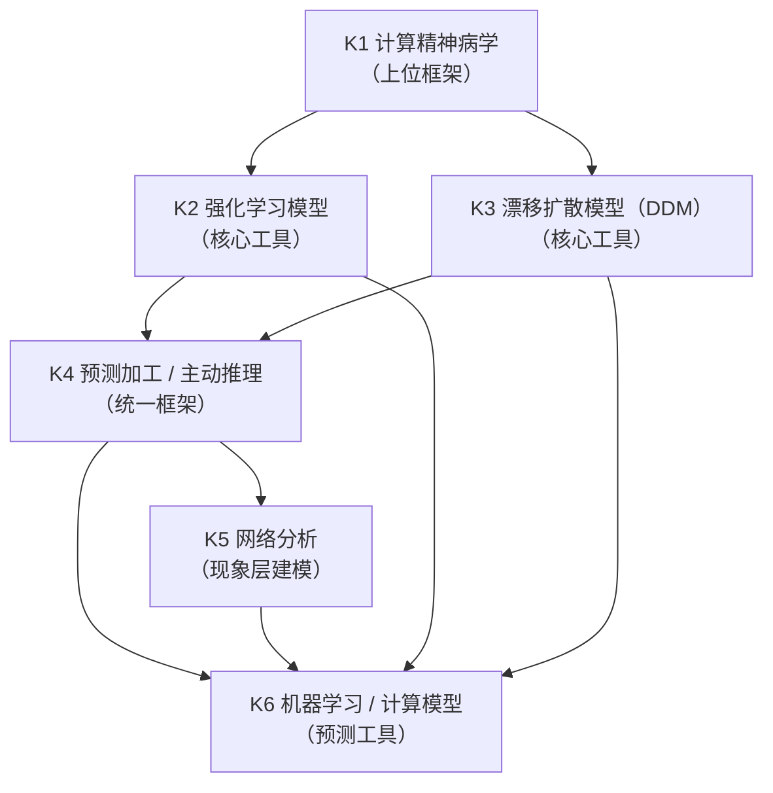
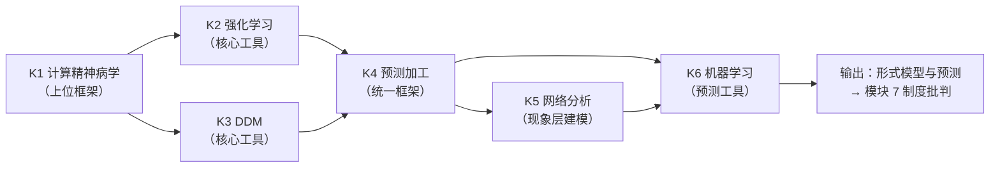

# MOD-06 · 模块 6：计算建模与预测（变量范式 × 状态范式对比）

> **来源与性质**：变量范式集体学习模块系列第 6/7 模块，

>
> **框架声明**：本件「四层次」结构系呈现层构造、非库内文档框架。

## 1.1 模块定位表

| 项 | 内容 |
|---|---|
| 所属范式 | 变量范式 |
| MECE 编号 | 模块 6 / 共 7 模块 |
| 核心问题 | 能否用形式模型生成和预测？ |
| 关键知识 | 计算精神病学、强化学习、漂移扩散模型、预测加工、网络分析 |
| 代表方法/工具 | 计算模型、机器学习、网络分析 |
| 在知识生产链中的位置 | **第六环·形式化引擎**——上游承接模块 4“统计模型”与模块 5“因果结论”，下游供给模块 7“制度批判”以可生成、可预测的形式模型 |
| 状态范式对位模块 | **模块 5“动力学与计算引擎”**（PSE、L3 动力学、BMA、数值积分、模型选择子层）＋**模块 9“跨基质与智能科学”**（GSR、碳基/硅基双柱、基质无关、Agent OS） |
| 本模块的真正分歧 | 建模对象：任务局部参数 vs 统一功能坐标系；模型范围：局部生成过程 vs 跨任务跨症状统一状态空间；时间维度：试次/阶段 vs 连续时间动态演化；参数身份：任务局部（学习率、决策阈值） vs 功能锚定（42 维状态参数）；预测目标：选择/反应时 vs 轨迹分布 + 级联路径 + 风险时点 |
| 变量范式的历史地位 | 这是变量范式中**最接近状态范式的方向**（03-A-07 §7.6 指出：计算精神病学等方向“最接近本文所谓状态范式”，且“已经部分越出了纯观测层描述的传统范围”） |
| 关键张力 | 变量范式的计算模型在**任务局部生成机制**上精细；状态范式追问**跨任务、跨症状、跨干预过程的统一功能层本体**，要求任务级参数映射到统一状态空间 |

## 1.2 知识点清单表

| # | 知识点 | 一句话定位 | 在变量范式中的角色 |
|---|---|---|---|
| K1 | 计算精神病学 | 用形式化模型（强化学习、漂移扩散、贝叶斯）建模精神症状的生成机制 | 变量范式内最接近状态范式的方向 |
| K2 | 强化学习模型 | 用奖赏预测误差、价值更新、探索-利用建模决策 | 计算精神病学的核心工具之一 |
| K3 | 漂移扩散模型（DDM） | 用证据积累过程建模二选一决策的反应时与选择 | 决策建模的经典工具 |
| K4 | 预测加工 / 主动推理 | 大脑是最小化预测误差的贝叶斯机器 | 统一认知与神经科学的理论框架 |
| K5 | 网络分析（心理网络） | 症状之间相互激活；症状是节点，不是潜变量的被动反映 | 对潜变量模型的修正 |
| K6 | 机器学习 / 计算模型 | 用数据驱动方法预测心理状态或行为 | 预测导向的建模工具 |

## 1.3 每个知识点的大纲解释表

| 知识点 | 简要大纲解释 |
|---|---|
| **K1 计算精神病学** | 用形式化模型（强化学习、漂移扩散、贝叶斯推断、预测加工）建模精神症状的生成机制。核心目标：从“描述症状”转向“生成症状”。代表工作：Huys、Maia & Frank（2016）、Montague et al.（2012）、Friston（2010）。优势：机制建模、参数可解释。局限：任务局部性、参数跨任务不稳定、无跨任务统一坐标系（数学对象承载边界）。 |
| **K2 强化学习模型** | 用奖赏预测误差（RPE）、价值更新、探索-利用建模决策。核心概念：状态、动作、奖赏、策略、价值函数、Q-learning、时序差分。参数：学习率 α、折扣因子 γ、逆温度 β。应用：成瘾、抑郁、焦虑、精神分裂症。局限：任务局部参数、跨任务功能身份不稳定。 |
| **K3 漂移扩散模型（DDM）** | 用证据积累过程建模二选一决策的反应时与选择。核心参数：漂移率 v（证据积累速度）、边界分离 a（决策阈值）、非决策时间 Ter。优势：同时解释选择与反应时、参数可解释。应用：决策、注意、认知控制。局限：限于二选一任务、参数跨任务不稳定。 |
| **K4 预测加工 / 主动推理** | 大脑是最小化预测误差的贝叶斯机器。核心概念：生成模型、预测误差、精度加权、主动推理、自由能最小化。优势：统一感知、行动、学习。应用：精神分裂症（异常显著性）、自闭症（精度异常）、抑郁（负性先验）。局限：过于抽象、难以直接对应工程实现。 |
| **K5 网络分析（心理网络）** | 症状之间相互激活；症状是节点，不是潜变量的被动反映。核心概念：节点、边、中心性、网络密度、桥接症状。代表工作：Borsboom（2017）、Borsboom & Cramer（2013）。优势：放弃潜变量实体假设、现象层杠杆识别。局限：仍工作在现象层、节点是临床表现而非功能组件。 |
| **K6 机器学习 / 计算模型** | 用数据驱动方法预测心理状态或行为。核心工具：监督学习、无监督学习、深度学习、集成方法。应用：预测情绪恶化、诊断分类、治疗反应预测。优势：预测能力强、高维数据处理。局限：预测能力不等于功能可解释性、缺乏机制解释。 |

## 2.1 K1 计算精神病学 —— 详细对比

| 维度 | 变量范式（计算精神病学） | 状态范式（PSE 动力学 + 状态空间模型） |
|---|---|---|
| 核心目标 | 用形式模型生成精神症状 | 用状态转移方程 + 观测函数生成状态轨迹与观测 |
| 建模对象 | 任务局部参数（学习率、决策阈值） | 功能锚定状态参数（42 维状态向量 + 340+ 参数） |
| 数学形式 | 强化学习、DDM、贝叶斯推断 | dΨ/dt = Σ w_k·f_k(Ψ, E(t), θ_k) |
| 参数身份 | 任务局部（跨任务功能身份不稳定） | 功能锚定（跨任务跨症状统一坐标系） |
| 模型范围 | 局部生成过程 | 跨任务、跨症状、跨干预过程的统一状态空间 |
| 时间维度 | 试次/阶段 | 连续时间动态演化 |
| 预测目标 | 选择/反应时 | 轨迹分布 + 级联路径 + 风险时点 |
| 干预对应 | 无直接对应 | G-M-A-R 靶点合法性矩阵 |
| 库内对应 | — | 01-M-03（PSE）；01-M-11（L2 状态估计）；01-M-03 §六（BMA） |
| 关键分歧 | 变量范式：任务局部生成模型；状态范式：统一功能坐标系 + 状态空间模型 | 前者是局部生成模型；后者是跨任务跨症状统一状态空间生成模型 |

> **承载边界判据**：两边的「动态」不是同一种动态——变量范式的动态止于第二层（变化率无功能语义），状态范式的动态可进第三层（变化率有功能语义，且受守恒、阈值、靶点合法性约束，判据见 MOD-08 §1.6）。功能清单对位不等于承载边界等同。

## 2.2 K2 强化学习模型 —— 详细对比

| 维度 | 变量范式（强化学习模型） | 状态范式（价值评估 + 决策调度） |
|---|---|---|
| 核心目标 | 用奖赏预测误差建模决策 | 用 M4（价值评估）+ M3（决策调度）建模动机与决策 |
| 核心参数 | 学习率 α、折扣因子 γ、逆温度 β | 功能参数（D 矩阵、k、σ、Tax、ELI） |
| 数学形式 | Q(s,a) ← Q(s,a) + α[r - Q(s,a)] | dΨ/dt = Σ w_k·f_k(Ψ, E, θ_k) |
| 功能对应 | 无直接对应 | M4-DSP-B（本能情绪）+ M3-DSP-F（主动决策） |
| 参数身份 | 任务局部 | 功能锚定（跨任务跨症状统一） |
| 时间维度 | 试次/阶段 | 连续时间动态演化 |
| 干预对应 | 无直接对应 | G-M-A-R 靶点合法性矩阵 |
| 库内对应 | — | 01-M-01 §3.2（M4/M3 定义）；01-M-03 §四（核心方程） |
| 关键分歧 | 变量范式：强化学习参数是任务局部的；状态范式：M4/M3 是功能组件，参数功能锚定 | 前者是任务局部决策模型；后者是功能层动机-决策模型 |

## 2.3 K3 漂移扩散模型（DDM） —— 详细对比

| 维度 | 变量范式（DDM） | 状态范式（决策动力学 + 证据积累） |
|---|---|---|
| 核心目标 | 用证据积累建模二选一决策 | 用 M3-DSP-F（主动决策）建模决策过程 |
| 核心参数 | 漂移率 v、边界分离 a、非决策时间 Ter | 功能参数（决策算法、资源约束） |
| 数学形式 | dx = v·dt + σ·dW | dΨ/dt = Σ w_k·f_k(Ψ, E, θ_k) |
| 功能对应 | 无直接对应 | M3-DSP-F（主动决策）+ M3-RES-D（意志储备） |
| 参数身份 | 任务局部 | 功能锚定（跨任务跨症状统一） |
| 任务范围 | 限于二选一任务 | 跨任务、跨症状、跨干预过程 |
| 时间维度 | 试次级 | 连续时间动态演化 |
| 干预对应 | 无直接对应 | G-M-A-R 靶点合法性矩阵 |
| 库内对应 | — | 01-M-01 §3.2（M3 定义）；01-M-03 §四（核心方程） |
| 关键分歧 | 变量范式：DDM 限于二选一任务；状态范式：M3-DSP-F 跨任务跨症状统一 | 前者是任务局部决策模型；后者是功能层决策模型 |

## 2.4 K4 预测加工 / 主动推理 —— 详细对比

| 维度 | 变量范式（预测加工） | 状态范式（PSE 动力学 + 贝叶斯滤波） |
|---|---|---|
| 核心目标 | 用预测误差最小化统一感知、行动、学习 | 用状态转移方程 + 观测函数统一感知、行动、学习 |
| 核心概念 | 生成模型、预测误差、精度加权、自由能 | 状态转移方程、观测函数、贝叶斯滤波、BMA |
| 数学形式 | 自由能最小化 | dΨ/dt = Σ w_k·f_k(Ψ, E, θ_k) |
| 功能对应 | 无直接对应 | M2（认知）+ M4（价值评估）+ M6（行为） |
| 参数身份 | 任务局部（精度、先验） | 功能锚定（跨任务跨症状统一） |
| 抽象层级 | 过于抽象，难以直接对应工程实现 | 可计算、可工程化 |
| 干预对应 | 无直接对应 | G-M-A-R 靶点合法性矩阵 |
| 库内对应 | — | 01-M-03 §四（核心方程）；01-M-03 §六（BMA） |
| 关键分歧 | 变量范式：预测加工是抽象理论框架；状态范式：PSE 是可计算工程框架 | 前者是抽象理论；后者是可计算工程模型 |

## 2.5 K5 网络分析（心理网络） —— 详细对比

| 维度 | 变量范式（网络分析） | 状态范式（功能架构 + 级联分析） |
|---|---|---|
| 核心目标 | 描述症状之间的相互激活 | 建模功能组件之间的生成关系 |
| 节点性质 | 临床表现（失眠、疲劳、反刍） | 功能组件（M-R-D-S 42 维） |
| 边性质 | 症状间相互激活 | D 矩阵 + 级联规则 |
| 中心性 | 症状中心性 | 枢纽节点（M4 最高 Hub Score） |
| 理论立场 | 放弃潜变量实体假设 | 功能组件是功能因果网络中的角色实体 |
| 时间维度 | 通常静态 | 连续时间动态演化 |
| 干预对应 | 现象层干预杠杆 | G-M-A-R 靶点合法性矩阵 |
| 库内对应 | — | 01-M-02 §三（结构约束）；01-M-03 §四（核心方程） |
| 关键分歧 | 变量范式：网络分析工作在现象层；状态范式：功能架构工作在功能层 | 前者节点是临床表现；后者节点是功能组件 |

## 2.6 K6 机器学习 / 计算模型 —— 详细对比

| 维度 | 变量范式（机器学习） | 状态范式（PSE + 状态估计） |
|---|---|---|
| 核心目标 | 用数据驱动方法预测心理状态或行为 | 用状态估计 + 动力学建模预测状态轨迹 |
| 核心工具 | 监督学习、无监督学习、深度学习 | 贝叶斯滤波、BMA、状态空间模型 |
| 预测目标 | 预测标签/连续值 | 预测轨迹分布 + 级联路径 + 风险时点 |
| 可解释性 | 预测能力强、功能可解释性弱 | 功能可解释、机制建模 |
| 数据需求 | 大规模标注数据 | 密集纵向 + 多模态 + 状态估计 |
| 因果地位 | 预测导向，不建模生成机制 | 生成机制建模，可预测可干预 |
| 干预对应 | 无直接对应 | G-M-A-R 靶点合法性矩阵 |
| 库内对应 | — | 01-M-03（PSE）；01-M-11（L2 状态估计）；01-M-03 §六（BMA） |
| 关键分歧 | 变量范式：机器学习预测导向；状态范式：状态估计 + 动力学建模生成导向 | 前者是预测工具；后者是生成模型 |

## 3.1 K1 计算精神病学 —— 知识库链接表

| 类别 | 内容 | 库内/库外对应 |
|---|---|---|
| 核心工具 | 强化学习、DDM、贝叶斯推断、预测加工 | — |
| 相关理论 | 计算精神病学、计算认知神经科学 | Huys et al. (2016)；Montague et al. (2012) |
| 心理学表现 | 精神症状建模、决策建模 | — |
| 状态范式对位 | PSE 动力学 + 状态空间模型 + 功能坐标系 | 01-M-03；01-M-11；01-M-02 |
| 关键文档 | 01-M-03《PSE》；01-M-11《L2 状态估计》；01-M-02《IODS》 | 库内 |
| 关键论证 | 任务局部生成模型 ↔ 统一功能坐标系 + 状态空间模型 | 03-A-07 §7.6；01-M-03 §四 |
| 延伸阅读 | Huys et al. (2016)；Montague et al. (2012)；Friston (2010) | 库外 |
| 相关争议 | 任务局部参数；跨任务功能身份不稳定；无跨任务统一坐标系（数学对象承载边界） | 03-A-07 §7.6 |

## 3.2 K2 强化学习模型 —— 知识库链接表

| 类别 | 内容 | 库内/库外对应 |
|---|---|---|
| 核心工具 | Q-learning、时序差分、价值函数、策略 | — |
| 相关理论 | 强化学习、计算精神病学 | Sutton & Barto (2018)；Huys et al. (2016) |
| 心理学表现 | 成瘾、抑郁、焦虑、精神分裂症 | — |
| 状态范式对位 | M4（价值评估）+ M3（决策调度）+ 功能参数 | 01-M-01 §3.2；01-M-03 §四 |
| 关键文档 | 01-M-01《BASE》§3.2（M4/M3 定义）；01-M-03《PSE》§四 | 库内 |
| 关键论证 | 任务局部学习率 ↔ 功能锚定参数 | 01-M-01 §3.2；01-M-03 §四 |
| 延伸阅读 | Sutton & Barto (2018)；Huys et al. (2016)；Montague et al. (2012) | 库外 |
| 相关争议 | 参数跨任务不稳定；任务局部性 | — |

## 3.3 K3 漂移扩散模型（DDM） —— 知识库链接表

| 类别 | 内容 | 库内/库外对应 |
|---|---|---|
| 核心工具 | 漂移率、边界分离、非决策时间 | — |
| 相关理论 | 漂移扩散模型、证据积累 | Ratcliff & McKoon (2008) |
| 心理学表现 | 决策、注意、认知控制 | — |
| 状态范式对位 | M3-DSP-F（主动决策）+ M3-RES-D（意志储备） | 01-M-01 §3.2；01-M-03 §四 |
| 关键文档 | 01-M-01《BASE》§3.2（M3 定义）；01-M-03《PSE》§四 | 库内 |
| 关键论证 | DDM 限于二选一任务 ↔ M3-DSP-F 跨任务跨症状统一 | 01-M-01 §3.2 |
| 延伸阅读 | Ratcliff & McKoon (2008) | 库外 |
| 相关争议 | 限于二选一任务；参数跨任务不稳定 | — |

## 3.4 K4 预测加工 / 主动推理 —— 知识库链接表

| 类别 | 内容 | 库内/库外对应 |
|---|---|---|
| 核心工具 | 自由能最小化、精度加权、主动推理 | — |
| 相关理论 | 预测加工、主动推理 | Friston (2010) |
| 心理学表现 | 精神分裂症、自闭症、抑郁 | — |
| 状态范式对位 | PSE 动力学 + 贝叶斯滤波 + BMA | 01-M-03 §四；01-M-03 §六 |
| 关键文档 | 01-M-03《PSE》§四（核心方程）；01-M-03《PSE》§六（BMA） | 库内 |
| 关键论证 | 预测加工过于抽象 ↔ PSE 可计算工程框架 | 01-M-03 §四；01-M-03 §六 |
| 延伸阅读 | Friston (2010) | 库外 |
| 相关争议 | 过于抽象；难以直接对应工程实现 | — |

## 3.5 K5 网络分析（心理网络） —— 知识库链接表

| 类别 | 内容 | 库内/库外对应 |
|---|---|---|
| 核心工具 | 节点、边、中心性、网络密度 | — |
| 相关理论 | 网络理论、心理网络 | Borsboom (2017)；Borsboom & Cramer (2013) |
| 心理学表现 | 症状网络、共病网络 | — |
| 状态范式对位 | 功能架构 + D 矩阵 + 级联分析 | 01-M-02 §三；01-M-03 §四 |
| 关键文档 | 01-M-02《IODS》§三（结构约束）；01-M-03《PSE》§四（核心方程） | 库内 |
| 关键论证 | 网络分析工作在现象层 ↔ 功能架构工作在功能层 | 03-A-07 §7.5；01-M-02 §三 |
| 延伸阅读 | Borsboom (2017)；Borsboom & Cramer (2013) | 库外 |
| 相关争议 | 节点是临床表现而非功能组件；仍工作在现象层 | 03-A-07 §7.5 |

## 3.6 K6 机器学习 / 计算模型 —— 知识库链接表

| 类别 | 内容 | 库内/库外对应 |
|---|---|---|
| 核心工具 | 监督学习、无监督学习、深度学习、集成方法 | — |
| 相关理论 | 机器学习、统计学习 | Hastie et al. (2009) |
| 心理学表现 | 预测情绪恶化、诊断分类、治疗反应预测 | — |
| 状态范式对位 | PSE + 状态估计 + 动力学建模 | 01-M-03；01-M-11；01-M-03 §六 |
| 关键文档 | 01-M-03《PSE》；01-M-11《L2 状态估计》；01-M-03《PSE》§六（BMA） | 库内 |
| 关键论证 | 预测能力不等于功能可解释性 ↔ 生成建模可解释可干预 | 03-A-07 §7.8；01-M-03 §四 |
| 延伸阅读 | Hastie et al. (2009)；Chernozhukov et al. (2018) | 库外 |
| 相关争议 | 预测能力 vs 功能可解释性；缺乏机制解释 | 03-A-07 §7.8 |

## 4.1 依赖关系总表

| 知识点 | 依赖 | 被依赖 | 依赖类型 | 说明 |
|---|---|---|---|---|
| K1 计算精神病学 | 模块 4（K2 回归、K6 贝叶斯）、模块 5（K1 潜在结果） | K2、K3、K4、K5、K6 | 上位框架 | 计算精神病学整合了强化学习、DDM、预测加工等工具 |
| K2 强化学习模型 | K1、模块 4（K6 贝叶斯） | K3、K4、K6 | 核心工具 | 强化学习是计算精神病学的核心工具之一 |
| K3 漂移扩散模型（DDM） | K1、模块 4（K6 贝叶斯） | K4、K6 | 核心工具 | DDM 是决策建模的经典工具 |
| K4 预测加工 / 主动推理 | K1、K2、K3 | K5、K6 | 统一框架 | 预测加工试图统一感知、行动、学习 |
| K5 网络分析 | K1、模块 4（K4 SEM） | K6 | 现象层建模 | 网络分析是现象层建模工具 |
| K6 机器学习 / 计算模型 | K1-K5、模块 4（K2 回归） | — | 预测工具 | 机器学习是预测导向的建模工具 |

## 4.2 依赖关系图

## 4.3 依赖关系深度解剖表

| 依赖对 | 依赖内容 | 深度 | 结构性后果 |
|---|---|---|---|
| K1 → K2 | 计算精神病学 → 强化学习 | 强 | 强化学习是计算精神病学的核心工具之一 |
| K1 → K3 | 计算精神病学 → DDM | 强 | DDM 是计算精神病学的核心工具之一 |
| K2 → K4 | 强化学习 → 预测加工 | 中 | 预测加工可统一强化学习（奖赏预测误差） |
| K3 → K4 | DDM → 预测加工 | 中 | 预测加工可统一证据积累（DDM） |
| K4 → K5 | 预测加工 → 网络分析 | 弱 | 预测加工与网络分析理论立场不同 |
| K4 → K6 | 预测加工 → 机器学习 | 中 | 预测加工可指导机器学习建模 |
| K5 → K6 | 网络分析 → 机器学习 | 中 | 网络分析结果可用于机器学习特征 |
| K2 → K6 | 强化学习 → 机器学习 | 中 | 强化学习是机器学习的一个分支 |
| K3 → K6 | DDM → 机器学习 | 弱 | DDM 参数可用于机器学习特征 |

## 4.4 与状态范式的依赖关系对比

| 变量范式依赖 | 状态范式对应 | 差异 |
|---|---|---|
| K1 计算精神病学 → K2 强化学习 | PSE 动力学 → M4/M3 功能组件 | 变量范式用任务局部模型；状态范式用功能锚定状态参数 |
| K1 计算精神病学 → K3 DDM | PSE 动力学 → M3-DSP-F 决策 | 变量范式用任务局部决策模型；状态范式用功能层决策模型 |
| K2 强化学习 → K4 预测加工 | M4/M3 → M2 认知 + M4 价值评估 | 变量范式用任务局部参数；状态范式用功能锚定参数 |
| K3 DDM → K4 预测加工 | M3-DSP-F → M2 认知 + M4 价值评估 | 变量范式用任务局部决策模型；状态范式用功能层决策模型 |
| K4 预测加工 → K5 网络分析 | PSE 动力学 + 贝叶斯滤波 → 功能架构 + 级联分析 | 变量范式用抽象理论框架；状态范式用可计算工程框架 |
| K5 网络分析 → K6 机器学习 | 功能架构 + 级联分析 → PSE + 状态估计 | 变量范式工作在现象层；状态范式工作在功能层 |
| K1-K6 | PSE + 状态估计 + 动力学建模 | 变量范式用任务局部生成模型；状态范式用统一功能坐标系 + 状态空间模型 |

## 4.5 关键依赖链：从计算精神病学到机器学习

**关键结论：**

1. **计算精神病学是上位框架**：整合了强化学习、DDM、预测加工等工具；是变量范式内最接近状态范式的方向。
2. **强化学习和 DDM 是核心工具**：分别建模决策的价值维度和证据积累维度。
3. **预测加工是统一框架**：试图统一感知、行动、学习；但过于抽象，难以直接对应工程实现。
4. **网络分析是现象层建模**：放弃潜变量实体假设，但仍工作在现象层，节点是临床表现而非功能组件。
5. **机器学习是预测工具**：预测能力强，但功能可解释性弱；预测能力不等于功能可解释性。
6. **模块 6 的输出是形式模型与预测**：这些模型供给模块 7（制度批判）。
7. **与状态范式的根本差异**：变量范式的计算模型是**任务局部生成模型**；状态范式是**跨任务跨症状统一状态空间生成模型**。变量范式的参数是任务局部的（学习率、决策阈值）；状态范式的参数是功能锚定的（42 维状态参数）。变量范式用试次/阶段时间尺度；状态范式用连续时间动态演化。变量范式预测选择/反应时；状态范式预测轨迹分布 + 级联路径 + 风险时点。

## 4.6 模块间依赖：模块 6 与相邻模块的关系

| 关系 | 上游 | 下游 | 依赖内容 |
|---|---|---|---|
| 模块 4 → 模块 6 | 统计模型（回归、贝叶斯） | 计算建模与预测 | 模块 4 提供统计基础，模块 6 进行形式化建模 |
| 模块 5 → 模块 6 | 因果结论 | 计算建模与预测 | 模块 5 提供因果结论，模块 6 进行生成建模 |
| 模块 6 → 模块 7 | 形式模型与预测 | 制度、实践与批判 | 模块 6 的形式模型受模块 7 的制度批判约束（预测能力 vs 可解释性、任务局部性） |
| 模块 6 ↔ 模块 4/5 | 形式建模 ↔ 统计模型/因果结论 | 双向依赖 | 形式建模需求影响统计模型和因果识别；统计模型和因果结论约束形式建模 |

## 疑问解答（附属·v0.2.0 增）

本节为附属疑问解答（13 条），与正文互为补充、不替代。

### 疑问 1：模块六“本模块的真正分歧”指出建模对象、模型范围、时间维度、参数身份、预测目标五重分歧。这五重分歧如何与模块一至模块五的预设衔接？

| 维度 | 变量范式 | 状态范式 |
|---|---|---|
| 建模对象 | 任务局部参数（学习率、决策阈值） | 功能锚定状态参数（42 维状态向量 + 340+ 参数） |
| 模型范围 | 局部生成过程 | 跨任务、跨症状、跨干预过程的统一状态空间 |
| 时间维度 | 试次/阶段 | 连续时间动态演化 |
| 参数身份 | 任务局部（跨任务功能身份不稳定） | 功能锚定（跨任务跨症状统一坐标系） |
| 预测目标 | 选择/反应时 | 轨迹分布 + 级联路径 + 风险时点 |
| 与模块一衔接 | 模块一决定“变量是什么”，模块六决定“能否用形式模型生成和预测”；建模对象继承变量实在论 | 模块一决定“功能层是什么”，模块六决定“状态如何被形式化生成”；建模对象继承约束功能主义 |
| 与模块五衔接 | 模块五提供因果结论，模块六进行形式化建模 | 模块五提供状态转移方程 + 干预算子，模块六将其工程化为 PSE 管线 |
| 一句话 | 模块六是变量范式的“形式化引擎”，上承统计与因果，下接制度批判；状态范式把建模对象从“任务局部参数”换为“功能锚定状态参数” |

---

### 疑问 2：K1 计算精神病学被称为“变量范式内最接近状态范式的方向”。这一判断如何理解？

| 维度 | 解答 |
|---|---|
| 判断来源 | 03-A-07 §7.6 指出：计算精神病学等方向“最接近本文所谓状态范式” |
| 接近表现 | 已不满足于描述观测变量共变，而是尝试建立可生成行为与症状表现的形式机制模型 |
| 代表工作 | Huys、Maia & Frank（2016）、Montague et al.（2012）、Friston（2010） |
| 核心优势 | 机制建模、参数可解释 |
| 核心局限 | 任务局部性、参数跨任务不稳定、无跨任务统一坐标系（数学对象承载边界） |
| 与状态范式的关系 | 不是否定对象，而是状态范式最需要吸收的机制建模资源之一 |
| 嵌套关系 | 任务级计算参数需要被映射到更广义的系统状态空间中，才能成为可累积、可迁移的心理系统知识 |
| 一句话 | 计算精神病学已部分越出纯观测层描述，但仍不承载跨任务、跨症状统一的功能本体；状态范式追问的是这些局部模型如何被组织进跨任务、跨症状、跨干预过程的功能层本体中 |

---

### 疑问 3：K1 计算精神病学的“任务局部生成模型”与状态范式的“统一功能坐标系”有何本质差异？

| 维度 | 变量范式（计算精神病学） | 状态范式（PSE 动力学 + 状态空间模型） |
|---|---|---|
| 核心目标 | 用形式模型生成精神症状 | 用状态转移方程 + 观测函数生成状态轨迹与观测 |
| 建模对象 | 任务局部参数（学习率、决策阈值） | 功能锚定状态参数（42 维状态向量 + 340+ 参数） |
| 数学形式 | 强化学习、DDM、贝叶斯推断 | `dΨ/dt = Σ w_k·f_k(Ψ, E(t), θ_k)` |
| 参数身份 | 任务局部（跨任务功能身份不稳定） | 功能锚定（跨任务跨症状统一坐标系） |
| 模型范围 | 局部生成过程 | 跨任务、跨症状、跨干预过程的统一状态空间 |
| 时间维度 | 试次/阶段 | 连续时间动态演化 |
| 预测目标 | 选择/反应时 | 轨迹分布 + 级联路径 + 风险时点 |
| 干预对应 | 无直接对应 | G-M-A-R 靶点合法性矩阵 |
| 关键差异 | 任务局部生成模型 vs 统一功能坐标系 + 状态空间模型 | — |
| 一句话 | 计算精神病学是局部生成模型；状态范式是跨任务跨症状统一状态空间生成模型 |

---

### 疑问 4：K2 强化学习模型的核心参数（学习率 α、折扣因子 γ、逆温度 β）与状态范式的功能参数（D 矩阵、k、σ、Tax、ELI）有何差异？

| 维度 | 变量范式（强化学习模型） | 状态范式（价值评估 + 决策调度） |
|---|---|---|
| 核心目标 | 用奖赏预测误差建模决策 | 用 M4（价值评估）+ M3（决策调度）建模动机与决策 |
| 核心参数 | 学习率 α、折扣因子 γ、逆温度 β | 功能参数（D 矩阵、k、σ、Tax、ELI） |
| 数学形式 | `Q(s,a) ← Q(s,a) + α[r - Q(s,a)]` | `dΨ/dt = Σ w_k·f_k(Ψ, E, θ_k)` |
| 功能对应 | 无直接对应 | M4-DSP-B（本能情绪）+ M3-DSP-F（主动决策） |
| 参数身份 | 任务局部 | 功能锚定（跨任务跨症状统一） |
| 时间维度 | 试次/阶段 | 连续时间动态演化 |
| 干预对应 | 无直接对应 | G-M-A-R 靶点合法性矩阵 |
| 关键差异 | 强化学习参数是任务局部的；状态范式的 M4/M3 是功能组件，参数功能锚定 | — |
| 一句话 | 强化学习是任务局部决策模型；状态范式是功能层动机-决策模型 |

---

### 疑问 5：K3 漂移扩散模型（DDM）限于二选一任务。状态范式如何超越这一任务局部性？

| 维度 | 变量范式（DDM） | 状态范式（决策动力学 + 证据积累） |
|---|---|---|
| 核心目标 | 用证据积累建模二选一决策 | 用 M3-DSP-F（主动决策）建模决策过程 |
| 核心参数 | 漂移率 v、边界分离 a、非决策时间 Ter | 功能参数（决策算法、资源约束） |
| 数学形式 | `dx = v·dt + σ·dW` | `dΨ/dt = Σ w_k·f_k(Ψ, E, θ_k)` |
| 功能对应 | 无直接对应 | M3-DSP-F（主动决策）+ M3-RES-D（意志储备） |
| 参数身份 | 任务局部 | 功能锚定（跨任务跨症状统一） |
| 任务范围 | 限于二选一任务 | 跨任务、跨症状、跨干预过程 |
| 时间维度 | 试次级 | 连续时间动态演化 |
| 干预对应 | 无直接对应 | G-M-A-R 靶点合法性矩阵 |
| 关键差异 | DDM 限于二选一任务；状态范式的 M3-DSP-F 跨任务跨症状统一 | — |
| 一句话 | DDM 是任务局部决策模型；状态范式是功能层决策模型 |

---

### 疑问 6：K4 预测加工/主动推理被称为“过于抽象，难以直接对应工程实现”。状态范式如何将其工程化？

| 维度 | 变量范式（预测加工） | 状态范式（PSE 动力学 + 贝叶斯滤波） |
|---|---|---|
| 核心目标 | 用预测误差最小化统一感知、行动、学习 | 用状态转移方程 + 观测函数统一感知、行动、学习 |
| 核心概念 | 生成模型、预测误差、精度加权、自由能 | 状态转移方程、观测函数、贝叶斯滤波、BMA |
| 数学形式 | 自由能最小化 | `dΨ/dt = Σ w_k·f_k(Ψ, E, θ_k)` |
| 功能对应 | 无直接对应 | M2（认知）+ M4（价值评估）+ M6（行为） |
| 参数身份 | 任务局部（精度、先验） | 功能锚定（跨任务跨症状统一） |
| 抽象层级 | 过于抽象，难以直接对应工程实现 | 可计算、可工程化 |
| 干预对应 | 无直接对应 | G-M-A-R 靶点合法性矩阵 |
| 关键差异 | 预测加工是抽象理论框架；PSE 是可计算工程框架 | — |
| 一句话 | 预测加工是抽象理论；状态范式是可计算工程模型 |

---

### 疑问 7：K5 网络分析工作在现象层。状态范式如何将其节点从“临床表现”换为“功能组件”？

| 维度 | 变量范式（网络分析） | 状态范式（功能架构 + 级联分析） |
|---|---|---|
| 核心目标 | 描述症状之间的相互激活 | 建模功能组件之间的生成关系 |
| 节点性质 | 临床表现（失眠、疲劳、反刍） | 功能组件（M-R-D-S 42 维） |
| 边性质 | 症状间相互激活 | D 矩阵 + 级联规则 |
| 中心性 | 症状中心性 | 枢纽节点（M4 最高 Hub Score） |
| 理论立场 | 放弃潜变量实体假设 | 功能组件是功能因果网络中的角色实体 |
| 时间维度 | 通常静态 | 连续时间动态演化 |
| 干预对应 | 现象层干预杠杆 | G-M-A-R 靶点合法性矩阵 |
| 关键差异 | 网络分析工作在现象层；功能架构工作在功能层 | — |
| 一句话 | 网络分析节点是临床表现；状态范式节点是功能组件 |

---

### 疑问 8：K6 机器学习/计算模型以预测为导向。状态范式如何处理“预测能力不等于功能可解释性”这一挑战？

| 维度 | 变量范式（机器学习） | 状态范式（PSE + 状态估计） |
|---|---|---|
| 核心目标 | 用数据驱动方法预测心理状态或行为 | 用状态估计 + 动力学建模预测状态轨迹 |
| 核心工具 | 监督学习、无监督学习、深度学习 | 贝叶斯滤波、BMA、状态空间模型 |
| 预测目标 | 预测标签/连续值 | 预测轨迹分布 + 级联路径 + 风险时点 |
| 可解释性 | 预测能力强、功能可解释性弱 | 功能可解释、机制建模 |
| 数据需求 | 大规模标注数据 | 密集纵向 + 多模态 + 状态估计 |
| 因果地位 | 预测导向，不建模生成机制 | 生成机制建模，可预测可干预 |
| 干预对应 | 无直接对应 | G-M-A-R 靶点合法性矩阵 |
| 关键差异 | 机器学习是预测工具；状态范式是生成模型 | — |
| 一句话 | 机器学习预测导向；状态范式生成导向 |

---

### 疑问 9：模块六的知识点依赖链是否闭合？状态范式如何对应？

| 变量范式依赖 | 状态范式对应 | 差异 |
|---|---|---|
| K1 计算精神病学 → K2 强化学习 | PSE 动力学 → M4/M3 功能组件 | 变量范式用任务局部模型；状态范式用功能锚定状态参数 |
| K1 计算精神病学 → K3 DDM | PSE 动力学 → M3-DSP-F 决策 | 变量范式用任务局部决策模型；状态范式用功能层决策模型 |
| K2 强化学习 → K4 预测加工 | M4/M3 → M2 认知 + M4 价值评估 | 变量范式用任务局部参数；状态范式用功能锚定参数 |
| K3 DDM → K4 预测加工 | M3-DSP-F → M2 认知 + M4 价值评估 | 变量范式用任务局部决策模型；状态范式用功能层决策模型 |
| K4 预测加工 → K5 网络分析 | PSE 动力学 + 贝叶斯滤波 → 功能架构 + 级联分析 | 变量范式用抽象理论框架；状态范式用可计算工程框架 |
| K5 网络分析 → K6 机器学习 | 功能架构 + 级联分析 → PSE + 状态估计 | 变量范式工作在现象层；状态范式工作在功能层 |
| K1-K6 | PSE + 状态估计 + 动力学建模 | 变量范式用任务局部生成模型；状态范式用统一功能坐标系 + 状态空间模型 |
| 依赖链是否闭合 | 从计算精神病学出发，经由强化学习、DDM、预测加工、网络分析，到达机器学习；各工具之间存在互补和结合 | 状态范式从 PSE 动力学出发，经由 M4/M3 功能组件、M3-DSP-F 决策、M2 认知 + M4 价值评估、功能架构 + 级联分析，到达 PSE + 状态估计 |
| 一句话 | 变量范式的依赖链以“任务局部生成模型”为地基；状态范式以“统一功能坐标系 + 状态空间模型”为地基 |

---

### 疑问 10：模块六与模块四、模块五、模块七的模块间依赖关系如何？

| 关系 | 上游 | 下游 | 依赖内容 |
|---|---|---|---|
| 模块 4 → 模块 6 | 统计模型（回归、贝叶斯） | 计算建模与预测 | 模块 4 提供统计基础，模块 6 进行形式化建模 |
| 模块 5 → 模块 6 | 因果结论 | 计算建模与预测 | 模块 5 提供因果结论，模块 6 进行生成建模 |
| 模块 6 → 模块 7 | 形式模型与预测 | 制度、实践与批判 | 模块 6 的形式模型受模块 7 的制度批判约束（预测能力 vs 可解释性、任务局部性） |
| 模块 6 ↔ 模块 4/5 | 形式建模 ↔ 统计模型/因果结论 | 双向依赖 | 形式建模需求影响统计模型和因果识别；统计模型和因果结论约束形式建模 |
| 一句话 | 模块六是变量范式的“形式化引擎”，上承统计与因果，下接制度批判 | — | — |

---

### 疑问 11：模块六的“预测能力不等于功能可解释性”这一判断如何理解？状态范式如何回应？

| 维度 | 解答 |
|---|---|
| 判断来源 | 03-A-07 §7.8：数字表型和机器学习生成的高维表征可以具有很强的预测能力，但预测能力不等于功能可解释性 |
| 问题表现 | 一个模型能预测某人未来一周情绪恶化，并不自动说明它已经识别出资源耗竭、调度失控、规则结构僵化或连接结构受损 |
| 变量范式的局限 | 高维预测与功能解释之间存在缺口；特征空间由现象变量构成，不承载功能层定位 |
| 状态范式的回应 | 从“高维预测”走向“功能解释”，需要观测函数、状态空间和干预操作之间的明确映射 |
| 具体路径 | 若特征空间被功能状态语法重组（以 M-R-D-S 状态向量而非现象层变量作为基础），外推稳健性和跨场景迁移能力可能得到提升 |
| 因果机器学习的定位 | 不是状态范式的替代物，而是状态范式中用于效应估计、异质性识别和个体化校准的估计引擎 |
| 一句话 | 变量范式提高的是观测层推断效率；状态范式追问的是功能层生成机制 |

---

### 疑问 12：模块六与模块九“跨基质与智能科学”的对位关系如何理解？

| 维度 | 变量范式（模块 6） | 状态范式（模块 9） |
|---|---|---|
| 对位模块 | 模块 6 计算建模与预测 | 模块 9 跨基质与智能科学 |
| 共享关注 | 形式模型、预测、生成机制 | 形式模型、跨基质扩展、统一功能框架 |
| 关键差异 | 变量范式限于人类、任务局部 | 状态范式涵盖碳基/硅基双柱、统一功能坐标系 |
| 对位内容 | 计算精神病学、强化学习、DDM、预测加工、网络分析、机器学习 | GSR 元公理、碳基/硅基双柱、基质无关性、Agent OS |
| 一句话 | 模块 6 是变量范式的“形式化引擎”；模块 9 是状态范式的“跨基质扩展引擎” |

---

### 疑问 13：模块六被称为“变量范式内最接近状态范式的方向”，这一判断与模块四“统计建模是变量范式最坚固的堡垒”如何并存？

| 维度 | 解答 |
|---|---|
| 两个判断的来源 | 均来自 03-A-07 §7.6 |
| 模块四的判断 | 统计建模是“变量范式最坚固的堡垒”之一；观测层关系描述高度成熟 |
| 模块六的判断 | 计算精神病学是变量范式中“最接近本文所谓状态范式的一组方向”；已部分越出纯观测层描述 |
| 并存关系 | 不矛盾：统计建模是变量范式的成熟强项；计算精神病学是变量范式内部向状态范式靠拢的方向 |
| 关键差异 | 统计建模仍在观测层关系描述；计算精神病学已尝试建立形式化生成模型 |
| 状态范式如何对待 | 统计建模为状态空间模型提供先验分布和初始参数估计；计算精神病学为状态范式提供局部生成模型，需映射到统一功能坐标系 |
| 一句话 | 统计建模是变量范式的成熟堡垒；计算精神病学是变量范式内部向状态范式靠拢的方向；二者在状态范式中分别承担“先验供给”与“机制建模资源”的角色 |

## 版本记录

| 版本 | 日期 | 变更说明 |
|---|---|---|
| v0.3.1 | 2026-10-31 | 去过程化梳理批（14-ENGRAM-B261031-04·未 commit）：5 处清理。判升 Patch。 |
| v0.3.0 | 2026-10-29 | 双范式正名批（DR-2026-10-29-TERM-002 v1.4.0）：正文「结构范式」→「状态范式」；判升 Minor。 |
| v0.2.4 | 2026-10-25 | Patch·B261025-01：§2.1 增承载边界判据段（三层判据随批）。 |
| v0.2.3 | 2026-10-17 | Patch·B261017-22：内容侧外审甲档订正批：:45/:349 引 03-A-07 §7.6 引文订正（随该件技术化失实）·:356/:518 意象评价标签改承载边界判语。 |
| v0.2.2 | 2026-10-16 | Patch·B261016-07：中立化续订批：四处「缺乏功能坐标系/功能层定位」订正为承载边界表述。 |
| v0.2.1 | 2026-10-16 | Patch·B261016-04：三处出处误指订正（15-X-112 §六→03-A-07 §7.6·一句一源合并·第三处复核自纠）。 |
| v0.2.0 | 2026-10-13 | Minor·B261013-05：疑问解答增补批：增「疑问解答（附属）」一节（13 条）。 |
| v0.1.1 | 2026-10-13 | Patch·B261013-04：订正批：框架声明增（#1/#2）；无其他成立待订项。判升 Patch。 |
| v0.1.0 | 2026-10-13 | 建件·B261013-02：模块 6/7 知识落盘（去四层次过渡包装改四节直陈·含 4.6 模块间依赖·mermaid 2 枚与全部表格零删减保留·库内锚点抽验见 rn 余未逐条复核）。… |

> 全量版本 v0.1.0–v0.2.3（共 6 版）见 [HIST-MOD §MOD-06-计算建模与预测-v0.1-2026-10-13](HIST-MOD_双范式对比学习模块-MOD系版本沿革-v1.0-2026-10-18.md#doc-24)；当前无外迁版本。
