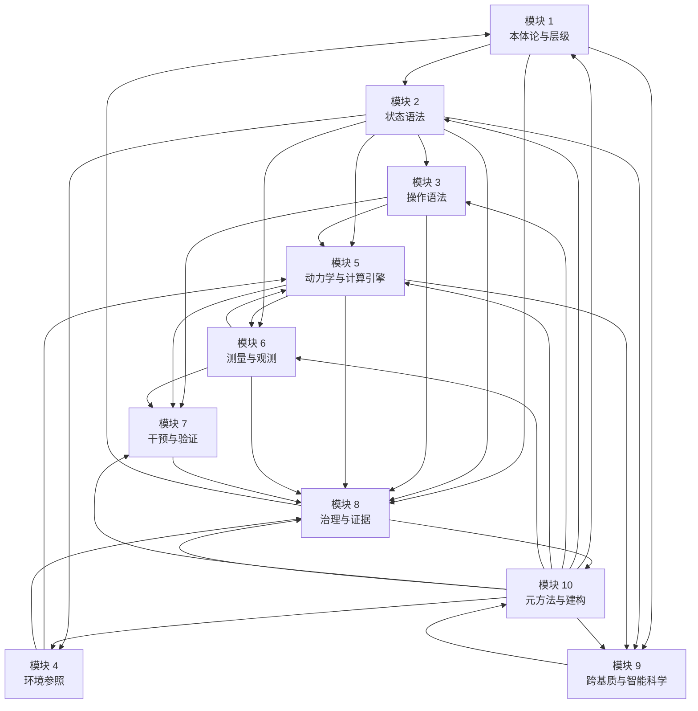

# SMOD-00 · 状态范式十模块总览与依赖总图

> **来源与性质**：状态范式十模块系总图·与变量范式 MOD-00 对称；本件依主理转入稿整理，去除呈现层过渡结构（四层次包装），知识内容全量保留。库内锚点引用前须自核（见 rn）。

>
> **框架声明**：本件「四层次」结构系呈现层构造、非库内文档框架。

## 状态范式十模块总览

| # | 模块 | 核心问题 | 关键知识 | 当前状态 | 变量范式对位模块 |
|---|---|---|---|---|---|
| 1 | 本体论与层级 | 功能层是什么？为何独立？ | 三层架构、约束功能主义、多重实现、描述层级 | 已形式化 | 模块 1 哲学与本体论预设 |
| 2 | 状态语法 | 心理状态如何描述？ | M-R-D-S、42 维、D 矩阵、STR 三分、级联规则、六条动力学约束 | 已形式化 | 模块 2 构念与测量 + 模块 4 统计推断 |
| 3 | 操作语法 | 能对系统做什么？ | G-M-A-R、靶点合法性矩阵、D-R-S 序列、正交性 | 已形式化 | 模块 5 因果识别 + 模块 3 研究设计 |
| 4 | 环境参照 | 系统在什么环境中运行？ | S-P、六系统、E(t) | 已形式化 | 模块 3 研究设计与抽样 |
| 5 | 动力学与计算引擎 | 状态如何演化？如何计算？ | L0-L5 六级管线、L1 三端口、L2 贝叶斯融合、L3 动力学、L4/L5 规划执行、PSE 校准 | 部分形式化，核心数学待交付 | 模块 4 统计推断 + 模块 6 计算建模 |
| 6 | 测量与观测 | 如何从观测反推状态？ | 观测函数 h、逆问题、多模态融合、状态估计、判者间信度、标签稳定性 | 部分工具在建 | 模块 2 构念与测量 + 模块 4 统计推断 |
| 7 | 干预与验证 | 如何干预？如何验证？ | G-M-A-R 干预映射、DMD、预测性流派、RCT、D-R-S 序列、跨学派转译 | 设计完成，待跑 | 模块 3 研究设计 + 模块 5 因果识别 + 模块 6 计算建模 |
| 8 | 治理与证据 | 如何保证可信、可证伪？ | IET 证据分级、ACCP、IEGP、预注册、六道隔离、边界登记 | 已建成，在执行 | 模块 7 制度、实践与批判 |
| 9 | 跨基质与智能科学 | 只适用于人类吗？ | GSR、碳基/硅基双柱、基质无关、Agent OS | 部分形式化，待实证 | 模块 6 计算建模 + 模块 3 研究设计 |
| 10 | 元方法与建构 | 这套范式如何被建出来？ | CI 训练、Cognitec-2、Constructec-2、CrystalOps、C6、ANA | 已提炼 | 模块 7 制度、实践与批判 |

## 状态范式十模块依赖总图

**状态范式十模块依赖总链：**

> **S1 本体论与层级** → **S2 状态语法** → **S3 操作语法** / **S4 环境参照** → **S5 动力学与计算引擎** → **S6 测量与观测** → **S7 干预与验证** → **S8 治理与证据** → **S9 跨基质与智能科学** → **S10 元方法与建构** → 反馈回 **S1–S9**

**核心结论：**

1. **状态范式是完整闭环**：从本体论与层级出发，经由状态语法、操作语法、环境参照、动力学与计算引擎、测量与观测、干预与验证，最终到达治理与证据、跨基质与智能科学、元方法与建构；元方法与建构又反馈回全部模块。
2. **状态范式的核心创新**：功能层作为独立描述层级；42 维状态空间；G-M-A-R 操作语法；L0-L5 六级管线；观测函数 h + 逆问题；DMD 实证探针；IEGP 治理规程；碳基/硅基双柱；元方法建构。
3. **与变量范式的根本差异**：变量范式是概率空间中的协方差几何学；状态范式是状态空间中的生成动力学。变量范式的数学对象是 P(Y)/P(Y\|X)；状态范式的数学对象是 h: Ψ→y 和 f: Ψₜ→Ψₜ₊₁。（中立口径：该差异以四目标为尺判「承载范围不同」、非「构件缺失」；两套数学对象各自承载四目标的不同项。）
4. **最坚固的四块**：测量理论、因果推断、统计建模、制度批判四块是“变量范式最坚固的堡垒”，也是挑战时最可能遭遇的正面战场。
5. **条件必要命题**：变量范式的数学工具与其研究对象的本体论性质存在结构性错位；状态范式的数学工具是“条件必要”而非“可选偏好”。

## 疑问解答（附属·v0.2.0 增）

本节为附属疑问解答（5 条），与正文互为补充、不替代。

### 疑问 1：SMOD-00 的“状态范式十模块总览”表与变量范式七模块总览表如何对称？

| 维度 | 变量范式 | 状态范式 |
|---|---|---|
| 模块数 | 7 模块 | 10 模块 |
| 核心问题域 | 哲学预设、构念测量、设计抽样、统计推断、因果识别、计算建模、制度批判 | 本体论、状态语法、操作语法、环境参照、动力学引擎、测量观测、干预验证、治理证据、跨基质、元方法 |
| 对位关系 | 变量范式七模块分别对位状态范式十模块中的 1–2 个模块 | 状态范式十模块分别对位变量范式七模块中的 1–3 个模块 |
| 对称性 | 7 vs 10，非一一对应；核心差异在描述单位与数学对象 | 10 vs 7，非一一对应；状态范式多出跨基质与元方法两个独有模块 |
| 一句话 | 两套总览表不对称：变量范式 7 模块，状态范式 10 模块；状态范式的 9、10 号模块在变量范式中无直接对位 | — |

---

### 疑问 2：SMOD-00 依赖总图与变量范式依赖总图的拓扑结构有何差异？

| 维度 | 变量范式 | 状态范式 |
|---|---|---|
| 拓扑结构 | M1→M2→M3→M4→M5→M6→M7→M1–M6 反馈回边 | S1→S2→S3/S4→S5→S6→S7→S8→S9→S10→S1–S9 反馈回边；S5↔S6 双向边 |
| 链式版本 | M1→M2→M3→M4→M5→M6 链式（不含反馈回边） | — |
| 关键差异 | 总链以“制度批判反馈回本体论”收束 | 总链以“元方法反馈回全部模块”收束；S5↔S6 存在双向边（动力学与观测互相依赖） |
| 一句话 | 变量范式反馈回边从 M7 出发；状态范式反馈回边从 S10 出发，且 S5↔S6 双向 | — |

---

### 疑问 3：状态范式「完整闭环」与「核心创新」分别包含什么？

| 维度 | 完整闭环 | 核心创新 |
|---|---|---|
| 内容 | 从本体论与层级出发，经由状态语法、操作语法、环境参照、动力学与计算引擎、测量与观测、干预与验证，最终到达治理与证据、跨基质与智能科学、元方法与建构；元方法与建构又反馈回全部模块 | 功能层作为独立描述层级；42 维状态空间；G-M-A-R 操作语法；L0-L5 六级管线；观测函数 h + 逆问题；DMD 实证探针；IEGP 治理规程；碳基/硅基双柱；元方法建构 |
| 功能 | 标定状态范式的完整结构 | 标定状态范式的核心贡献 |
| 一句话 | 第 1 条给总链，第 2 条给创新点；二者共同构成状态范式的自我定位 |

---

### 疑问 4：状态范式核心定位如何与两套范式的数学本质对比衔接？

| 维度 | 状态范式核心定位 | 八维对比 |
|---|---|---|
| 变量范式定位 | 概率空间中的协方差几何学 | D1 变量、D2 概率分布/代数方程、D5 关系描述、D8 方差解释 |
| 状态范式定位 | 状态空间中的生成动力学 | D1 状态向量、D2 微分方程/状态空间模型、D5 映射反解、D8 生成解释 |
| 衔接方式 | 总图给出总定位；八维对比把总定位展开为八个维度 | 八维对比是总图核心结论的详细展开 |
| 一句话 | 总图是总定位，八维对比是展开；二者是同一判断的不同粒度表述 |

---

### 疑问 5：状态范式核心结论中「四块堡垒」与「条件必要」分别指向什么？

| 维度 | 四块堡垒 | 条件必要 |
|---|---|---|
| 来源 | 最坚固的四块 | 条件必要命题 |
| 内容 | 测量理论、因果推断、统计建模、制度批判四块是“变量范式最坚固的堡垒” | 变量范式的数学工具与其研究对象的本体论性质存在结构性错位；状态范式的数学工具是“条件必要”而非“可选偏好” |
| 功能 | 标定挑战时最可能遭遇的正面战场 | 标定状态范式数学工具的合法性地位 |
| 一句话 | 四块堡垒标定战场，条件必要标定合法性；二者共同构成状态范式的挑战策略 |

## 版本记录

| 版本 | 日期 | 变更说明 |
|---|---|---|
| v0.3.1 | 2026-10-31 | 去过程化梳理批（14-ENGRAM-B261031-04·未 commit）：4 处清理。判升 Patch。 |
| v0.3.0 | 2026-10-29 | 双范式正名批（DR-2026-10-29-TERM-002 v1.4.0）：正文「结构范式」→「状态范式」；判升 Minor。 |
| v0.2.2 | 2026-10-16 | Patch·B261016-06：评价标准中立化随批：核心结论第 3 条补四目标中立口径括注。 |
| v0.2.1 | 2026-10-16 | Patch·B261016-04：外审机械订正批：rn v0.1.1 条拆碎段还原（外审候选×本窗独立解码双路对撞·并与末表 v0.1.1 同义行对撞）。… |
| v0.2.0 | 2026-10-13 | Minor·B261013-06：疑问解答增补批：增「疑问解答（附属）」一节（5 条）。 |
| v0.1.1 | 2026-10-13 | Patch·B261013-04：订正批：#22 七道→六道 1 处；#40 总图补 S6→S5 反向边（S5↔S6 双向）；框架声明增（#1/#2）。判升 Patch。 |
| v0.1.0 | 2026-10-13 | 建件·B261013-03：结构范式十模块总览与依赖总图落盘（总览表＋依赖总图 mermaid＋总链与核心结论·承 SMOD-01~10 十件为逐模块展开）。B261013-03。 |

> 全量版本 v0.1.0–v0.2.2（共 5 版）见 [HIST-SMOD §SMOD-00-十模块总览与依赖总图-v0.1-2026-10-13](HIST-SMOD_双范式对比学习模块-SMOD系版本沿革-v1.0-2026-10-18.md#doc-33)；当前无外迁版本。
