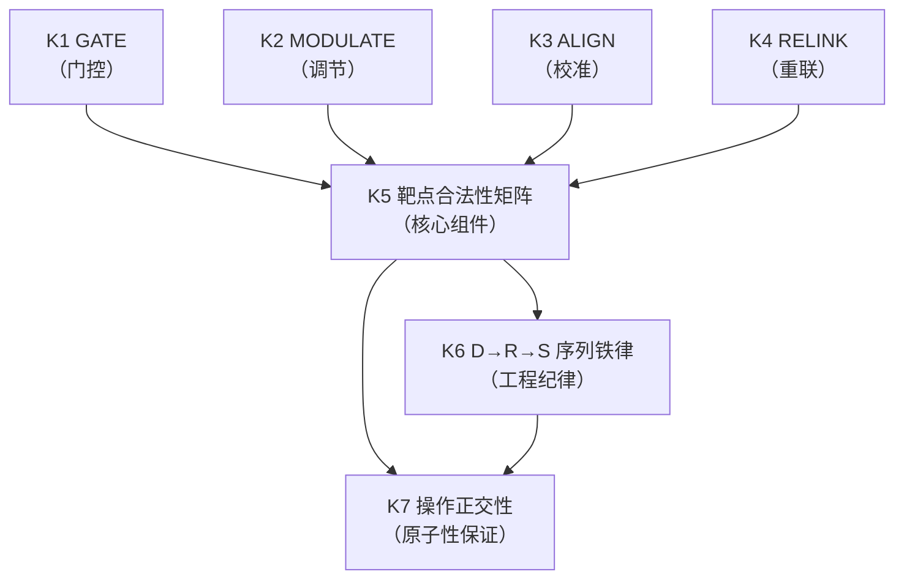
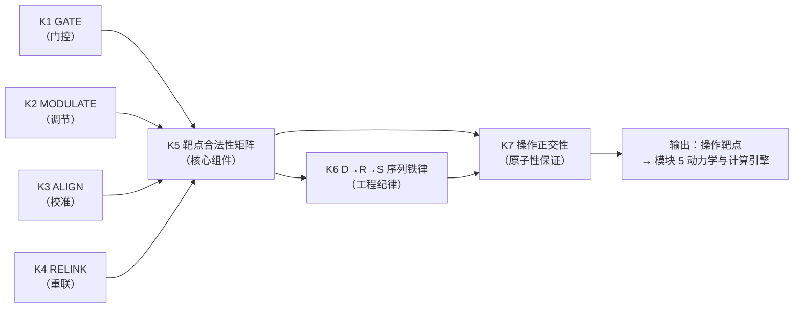

# SMOD-03 · 状态范式模块 3：操作语法（× 变量范式对位）

> **来源与性质**：状态范式模块 3/10·与变量范式 MOD 系对位（对位模块见 1.1 定位表）；本件依主理转入稿整理，去除呈现层过渡结构（四层次包装），知识内容全量保留。库内锚点引用前须自核（见 rn）。

>
> **框架声明**：本件「四层次」结构系呈现层构造、非库内文档框架。

## 一、模块定位与知识点总览

### 1.1 模块定位表

| 项 | 内容 |
|---|---|
| 所属范式 | 状态范式（功能层） |
| MECE 编号 | 模块 3 / 共 10 模块 |
| 核心问题 | 能对系统做什么？ |
| 关键知识 | G-M-A-R：GATE/MODULATE/ALIGN/RELINK、靶点合法性矩阵、D→R→S 序列、正交性 |
| 代表工具/方法 | 01-M-08、02-A-11 |
| 当前状态 | **已形式化** |
| 在知识生产链中的位置 | **第三环**——上游承接模块 2“状态语法”，下游供给模块 5“动力学与计算引擎”与模块 7“干预与验证”以操作靶点与干预语法 |
| 变量范式对位模块 | 模块 5“因果识别与因果推断”（潜在结果、DAG、IV/RDD/DID）＋模块 3“研究设计与抽样”（RCT） |
| 本模块的真正分歧 | 操作对象：变量 vs 功能状态 Ψ；操作形式：处理效应 vs G-M-A-R 原子操作；操作靶点：变量节点 vs R-D-S 层级；操作序列：无明确序列 vs D→R→S 序列铁律；操作正交性：无 vs 靶点合法性矩阵 |

### 1.2 知识点清单表

| # | 知识点 | 一句话定位 | 在状态范式中的角色 |
|---|---|---|---|
| K1 | GATE（门控） | 通道开关：启动、抑制或切换心理进程 | 作用于 D 层与 STR-S 激活面 |
| K2 | MODULATE（调节） | 数量调节：注入或节约能量改变资源存量 | 作用于 R 层（资源） |
| K3 | ALIGN（校准） | 规则修正：改写错误的信念或决策算法 | 作用于 STR-R（规则） |
| K4 | RELINK（重联） | 联系重构：解除病态绑定或建立新连接 | 作用于 STR-C（连接） |
| K5 | 靶点合法性矩阵 | 四操作与 R-D-S 各层级的严格对应 | 操作语法的核心组件 |
| K6 | D→R→S 序列铁律 | 先稳定调度、再补充资源、最后修复结构 | 干预序列的工程纪律 |
| K7 | 操作正交性 | 四操作在概念上互不重叠且覆盖主要干预机制 | G-M-A-R 的原子性保证 |

### 1.3 每个知识点的大纲解释表

| 知识点 | 简要大纲解释 |
|---|---|
| **K1 GATE** | 通道开关。作用于 D 层（调度）和 STR-S 序列（激活面）。本质是“通道开关”：启动、抑制或切换某个心理进程。GATE- 抑制失控进程（如情绪劫持），GATE+ 激活阻塞进程（如行为激活）。不作用于 STR-R、STR-C；GATE STR-S 须限定指激活面（内容面归约至 STR-R，由 ALIGN 处理）。 |
| **K2 MODULATE** | 数量调节。作用于 R 层（资源）。本质是“数量调节”：通过注入或节约能量来改变资源存量水平。MODULATE+ 补充资源（如睡眠优化），MODULATE- 节约资源。唯一直接作用于 RES 的操作；不作用于 RES-B（RES-B 需通过 ALIGN/RELINK 间接建设）。 |
| **K3 ALIGN** | 规则修正。作用于 STR-R（规则）。本质是“规则修正”：改写错误的、不合理的信念或决策算法。含 STR-S 内容面的归约（步骤序列本身归约至 STR-R）。不作用于 STR-C、STR-S 激活面。 |
| **K4 RELINK** | 联系重构。作用于 STR-C（连接）。本质是“联系重构”：解除病态的情感绑定或建立新的价值连接。不作用于 STR-R、STR-S。 |
| **K5 靶点合法性矩阵** | 四操作与 R-D-S 各层级的严格对应：MODULATE 唯一直接作用于 RES；GATE 作用于 DSP 和 STR-S 激活面；ALIGN 作用于 STR-R（含 STR-S 内容面归约）；RELINK 作用于 STR-C。是 G-M-A-R 形式语法的核心组件。 |
| **K6 D→R→S 序列铁律** | 系统性干预须遵循从浅到深、从表到里的阶段顺序：D 层稳定（GATE）→ R 层恢复（MODULATE）→ S 层重建（ALIGN/RELINK）。不遵守此铁律的干预有极大概率失败或导致二次创伤。序列刚性与系统失调程度正相关。 |
| **K7 操作正交性** | 四操作在概念上互不重叠（正交）且在功能层干预空间内共同覆盖了主要干预机制（完备）。正交性由操作靶点的严格分离保证；穷尽性由对功能层系统全部可干预维度的覆盖来论证。 |

## 二、知识点详解对比

### 2.1 K1 GATE —— 详细对比

| 维度 | 变量范式（干预/处理） | 状态范式（GATE） |
|---|---|---|
| 核心对象 | 处理变量 X | 调度进程（DSP）+ 序列激活面（STR-S） |
| 操作形式 | 操纵自变量、观察因变量 | GATE- 抑制失控进程；GATE+ 激活阻塞进程 |
| 靶点 | 变量节点 | D 层与 STR-S 激活面 |
| 与因果推断关系 | 处理效应识别 | 门控操作改变调度状态 |
| 时间性 | 通常静态或两个时点 | 实时门控 |
| 序列地位 | 无 | D 层稳定（D→R→S 序列第一步） |
| 库内对应 | — | 01-M-08 §2.1；02-A-11 §2.1；02-A-25（GATE 靶点跨层论证） |
| 关键分歧 | 变量范式用处理变量；状态范式用 GATE 门控操作 | 前者是外部干预；后者是功能层门控 |

### 2.2 K2 MODULATE —— 详细对比

| 维度 | 变量范式（资源/协变量） | 状态范式（MODULATE） |
|---|---|---|
| 核心对象 | 协变量、调节变量 | R 层（资源存量） |
| 操作形式 | 统计控制、调节效应 | MODULATE+ 补充资源；MODULATE- 节约资源 |
| 靶点 | 变量节点 | RES（资源） |
| 与因果推断关系 | 调节效应识别 | 资源调节改变状态 |
| 时间性 | 通常静态 | 实时调节 |
| 序列地位 | 无 | R 层恢复（D→R→S 序列第二步） |
| 库内对应 | — | 01-M-08 §2.1；02-A-11 §2.1 |
| 关键分歧 | 变量范式用协变量/调节变量；状态范式用 MODULATE 资源调节 | 前者是统计控制；后者是功能层资源调节 |

### 2.3 K3 ALIGN —— 详细对比

| 维度 | 变量范式（认知重构） | 状态范式（ALIGN） |
|---|---|---|
| 核心对象 | 信念、态度 | STR-R（规则结构） |
| 操作形式 | 认知重构、说服 | 修正错误的信念或决策算法 |
| 靶点 | 变量节点 | STR-R |
| 与因果推断关系 | 中介效应识别 | 规则修正改变评估算法 |
| 时间性 | 通常多次会谈 | 需高能耗，资源充足时进行 |
| 序列地位 | 无 | S 层重建（D→R→S 序列第三步） |
| 库内对应 | — | 01-M-08 §2.1；02-A-11 §2.1 |
| 关键分歧 | 变量范式用认知重构；状态范式用 ALIGN 规则修正 | 前者是内容修正；后者是规则结构修正 |

### 2.4 K4 RELINK —— 详细对比

| 维度 | 变量范式（关系重构） | 状态范式（RELINK） |
|---|---|---|
| 核心对象 | 关系、连接 | STR-C（连接结构） |
| 操作形式 | 关系修复、暴露疗法 | 解除病态绑定或建立新连接 |
| 靶点 | 变量节点 | STR-C |
| 与因果推断关系 | 关系效应识别 | 连接重构改变情感绑定 |
| 时间性 | 通常长期 | 需高能耗，资源充足时进行 |
| 序列地位 | 无 | S 层重建（D→R→S 序列第三步） |
| 库内对应 | — | 01-M-08 §2.1；02-A-11 §2.1 |
| 关键分歧 | 变量范式用关系重构；状态范式用 RELINK 连接重构 | 前者是关系修复；后者是连接结构重构 |

### 2.5 K5 靶点合法性矩阵 —— 详细对比

| 维度 | 变量范式（无对应） | 状态范式（靶点合法性矩阵） |
|---|---|---|
| 核心工具 | 无 | 四操作 × R-D-S 层级矩阵 |
| 矩阵结构 | 无 | MODULATE→RES；GATE→DSP/STR-S 激活面；ALIGN→STR-R；RELINK→STR-C |
| 合法性判据 | 无 | 操作靶点的严格分离 |
| 禁止表述 | 无 | GATE STR-R、MODULATE RES-B、ALIGN STR-C、RELINK STR-R 等 |
| 与因果推断关系 | 无 | 靶点合法性矩阵保证干预的因果合法性 |
| 库内对应 | — | 01-M-08 §2.1；02-A-11 §2.1/§3.2；02-A-25 |
| 关键分歧 | 变量范式无靶点合法性矩阵；状态范式用靶点合法性矩阵 | 前者无操作合法性约束；后者有严格的操作合法性约束 |

### 2.6 K6 D→R→S 序列铁律 —— 详细对比

| 维度 | 变量范式（无对应） | 状态范式（D→R→S 序列铁律） |
|---|---|---|
| 核心工具 | 无 | D 层稳定 → R 层恢复 → S 层重建 |
| 序列逻辑 | 无 | 从浅到深、从表到里的阶段顺序 |
| 序列刚性 | 无 | 与系统失调程度正相关（急性危机最严格） |
| 违反后果 | 无 | 干预有极大概率失败或导致二次创伤 |
| 与变量范式关系 | 无 | 变量范式无对应概念 |
| 库内对应 | — | 01-M-08 §2.2；02-A-11 §3.3；05-R-01 #11（序列必然性反例检验） |
| 关键分歧 | 变量范式无序列铁律；状态范式用 D→R→S 序列铁律 | 前者无序列约束；后者有严格的序列约束 |

### 2.7 K7 操作正交性 —— 详细对比

| 维度 | 变量范式（无对应） | 状态范式（操作正交性） |
|---|---|---|
| 核心工具 | 无 | 四操作在概念上互不重叠且覆盖主要干预机制 |
| 正交性保证 | 无 | 操作靶点的严格分离 |
| 穷尽性论证 | 无 | 对功能层系统全部可干预维度的覆盖 |
| 联合操作 | 无 | 协同效应可被系统内部因果链解释，不破坏正交性 |
| 与变量范式关系 | 无 | 变量范式无对应概念 |
| 库内对应 | — | 01-M-08 §2.1；02-A-11 §2.1；05-R-01 #12（覆盖充分性逆推穷举） |
| 关键分歧 | 变量范式无操作正交性；状态范式用操作正交性 | 前者无操作分类；后者有严格的操作分类 |

## 三、知识库链接

### 3.1 K1 GATE —— 知识库链接表

| 类别 | 内容 | 库内/库外对应 |
|---|---|---|
| 核心工具 | GATE+（激活）、GATE-（抑制） | — |
| 相关理论 | 控制论、门控机制 | Wiener (1948) |
| 心理学表现 | 正念呼吸、行为激活、注意训练 | — |
| 状态范式对位 | 01-M-08 §2.1；02-A-11 §2.1；02-A-25 | 库内 |
| 关键文档 | 01-M-08《G-M-A-R 操作语法》§2.1；02-A-11《G-M-A-R 覆盖充分性与主靶点区分度》§2.1；02-A-25《GATE 靶点跨层论证》 | 库内 |
| 关键论证 | GATE 作用于 DSP 和 STR-S 激活面（与 D 通道状态结构同构的二值激活态） | 02-A-25 §3.2-§5 |
| 延伸阅读 | Wiener (1948)；01-M-08 §2.1 | 库内/库外 |
| 相关争议 | GATE STR-S 激活面与内容面的区分 | 02-A-25 |

### 3.2 K2 MODULATE —— 知识库链接表

| 类别 | 内容 | 库内/库外对应 |
|---|---|---|
| 核心工具 | MODULATE+（补充）、MODULATE-（节约） | — |
| 相关理论 | 控制论、资源调节 | Wiener (1948) |
| 心理学表现 | 睡眠优化、放松训练、任务切换 | — |
| 状态范式对位 | 01-M-08 §2.1；02-A-11 §2.1 | 库内 |
| 关键文档 | 01-M-08《G-M-A-R 操作语法》§2.1；02-A-11《G-M-A-R 覆盖充分性与主靶点区分度》§2.1 | 库内 |
| 关键论证 | MODULATE 唯一直接作用于 RES（资源）；RES-B 需通过 ALIGN/RELINK 间接建设 | 01-M-08 §2.1 |
| 延伸阅读 | Wiener (1948)；01-M-08 §2.1 | 库内/库外 |
| 相关争议 | MODULATE RES-B 的合法性 | 01-M-08 §2.1 |

### 3.3 K3 ALIGN —— 知识库链接表

| 类别 | 内容 | 库内/库外对应 |
|---|---|---|
| 核心工具 | 认知重构、苏格拉底提问、思维记录 | — |
| 相关理论 | 认知疗法、控制论 | Beck (1979)；Wiener (1948) |
| 心理学表现 | CBT 认知重构 | — |
| 状态范式对位 | 01-M-08 §2.1；02-A-11 §2.1 | 库内 |
| 关键文档 | 01-M-08《G-M-A-R 操作语法》§2.1；02-A-11《G-M-A-R 覆盖充分性与主靶点区分度》§2.1 | 库内 |
| 关键论证 | ALIGN 作用于 STR-R（含 STR-S 内容面归约） | 01-M-08 §2.1 |
| 延伸阅读 | Beck (1979)；01-M-08 §2.1 | 库内/库外 |
| 相关争议 | ALIGN STR-S 内容面归约的合法性 | 02-A-11 §2.5 |

### 3.4 K4 RELINK —— 知识库链接表

| 类别 | 内容 | 库内/库外对应 |
|---|---|---|
| 核心工具 | 暴露疗法、移情分析、矫正性情感体验 | — |
| 相关理论 | 精神分析、人本主义、控制论 | Freud；Rogers；Wiener (1948) |
| 心理学表现 | 暴露与反应预防、移情分析 | — |
| 状态范式对位 | 01-M-08 §2.1；02-A-11 §2.1 | 库内 |
| 关键文档 | 01-M-08《G-M-A-R 操作语法》§2.1；02-A-11《G-M-A-R 覆盖充分性与主靶点区分度》§2.1 | 库内 |
| 关键论证 | RELINK 作用于 STR-C（连接拓扑） | 01-M-01 §4.3；01-M-08 §2.1 |
| 延伸阅读 | Freud；Rogers；01-M-01 §4.3 | 库内/库外 |
| 相关争议 | STR-C 独立构念地位 | 01-M-01 §4.3 |

### 3.5 K5 靶点合法性矩阵 —— 知识库链接表

| 类别 | 内容 | 库内/库外对应 |
|---|---|---|
| 核心工具 | 四操作 × R-D-S 层级矩阵 | — |
| 相关理论 | 控制论、操作语法 | Wiener (1948) |
| 心理学表现 | 干预靶点合法性 | — |
| 状态范式对位 | 01-M-08 §2.1；02-A-11 §2.1/§3.2；02-A-25 | 库内 |
| 关键文档 | 01-M-08《G-M-A-R 操作语法》§2.1；02-A-11《G-M-A-R 覆盖充分性与主靶点区分度》§2.1/§3.2；02-A-25《GATE 靶点跨层论证》 | 库内 |
| 关键论证 | 靶点合法性矩阵保证操作靶点的严格分离 | 01-M-08 §2.1；02-A-11 §3.2 |
| 延伸阅读 | Wiener (1948)；01-M-08 §2.1 | 库内/库外 |
| 相关争议 | 操作合法性矩阵的完备性 | 02-A-11 §2.5 |

### 3.6 K6 D→R→S 序列铁律 —— 知识库链接表

| 类别 | 内容 | 库内/库外对应 |
|---|---|---|
| 核心工具 | D 层稳定 → R 层恢复 → S 层重建 | — |
| 相关理论 | 控制论、系统动力学 | Wiener (1948)；Forrester (1961) |
| 心理学表现 | 干预序列、治疗阶段 | — |
| 状态范式对位 | 01-M-08 §2.2；02-A-11 §3.3；05-R-01 #11 | 库内 |
| 关键文档 | 01-M-08《G-M-A-R 操作语法》§2.2；02-A-11 §3.3；05-R-01《压力测试》#11 | 库内 |
| 关键论证 | D→R→S 序列铁律是系统动力学约束的工程纪律 | 01-M-08 §2.2；05-R-01 #11 |
| 延伸阅读 | Wiener (1948)；Forrester (1961)；01-M-08 §2.2 | 库内/库外 |
| 相关争议 | 序列刚性与失调程度的关系；危机例外协议 | 01-M-08 §2.2；05-R-01 #11 |

### 3.7 K7 操作正交性 —— 知识库链接表

| 类别 | 内容 | 库内/库外对应 |
|---|---|---|
| 核心工具 | 四操作正交性（概念上互不重叠且覆盖主要干预机制） | — |
| 相关理论 | 控制论、操作语法 | Wiener (1948) |
| 心理学表现 | 操作原子性 | — |
| 状态范式对位 | 01-M-08 §2.1；02-A-11 §2.1；05-R-01 #12 | 库内 |
| 关键文档 | 01-M-08《G-M-A-R 操作语法》§2.1；02-A-11《G-M-A-R 覆盖充分性与主靶点区分度》§2.1；05-R-01《压力测试》#12 | 库内 |
| 关键论证 | G-M-A-R 正交性与穷尽性共同保证操作原子性 | 01-M-08 §2.1；02-A-11 §2.1 |
| 延伸阅读 | Wiener (1948)；01-M-08 §2.1 | 库内/库外 |
| 相关争议 | 操作正交性与联合操作的关系；穷尽性边界 | 05-R-01 #12/#13 |

## 四、知识点依赖关系

### 4.1 依赖关系总表

| 知识点 | 依赖 | 被依赖 | 依赖类型 | 说明 |
|---|---|---|---|---|
| K1 GATE | 模块 2（K2 R-D-S、K5 STR 三分） | K5、K6、K7 | 操作之一 | GATE 作用于 D 层与 STR-S 激活面 |
| K2 MODULATE | 模块 2（K2 R-D-S） | K5、K6、K7 | 操作之一 | MODULATE 作用于 R 层 |
| K3 ALIGN | 模块 2（K5 STR 三分） | K5、K6、K7 | 操作之一 | ALIGN 作用于 STR-R |
| K4 RELINK | 模块 2（K5 STR 三分） | K5、K6、K7 | 操作之一 | RELINK 作用于 STR-C |
| K5 靶点合法性矩阵 | K1、K2、K3、K4 | K6、K7 | 核心组件 | 靶点合法性矩阵定义四操作的合法靶点 |
| K6 D→R→S 序列铁律 | K5 | K7 | 工程纪律 | 序列铁律基于靶点合法性矩阵 |
| K7 操作正交性 | K1、K2、K3、K4、K5 | — | 原子性保证 | 操作正交性保证 G-M-A-R 的原子性 |

### 4.2 依赖关系图

### 4.3 依赖关系深度解剖表

| 依赖对 | 依赖内容 | 深度 | 结构性后果 |
|---|---|---|---|
| K1 → K5 | GATE → 靶点合法性矩阵 | 强 | GATE 作用于 DSP 和 STR-S 激活面 |
| K2 → K5 | MODULATE → 靶点合法性矩阵 | 强 | MODULATE 唯一直接作用于 RES |
| K3 → K5 | ALIGN → 靶点合法性矩阵 | 强 | ALIGN 作用于 STR-R（含 STR-S 内容面归约） |
| K4 → K5 | RELINK → 靶点合法性矩阵 | 强 | RELINK 作用于 STR-C |
| K5 → K6 | 靶点合法性矩阵 → D→R→S 序列铁律 | 强 | 序列铁律基于靶点合法性矩阵 |
| K5 → K7 | 靶点合法性矩阵 → 操作正交性 | 强 | 操作正交性由操作靶点的严格分离保证 |
| K6 → K7 | 序列铁律 → 操作正交性 | 中 | 序列铁律与操作正交性共同保证干预合法性 |

### 4.4 与变量范式的依赖关系对比

| 状态范式依赖 | 变量范式对应 | 差异 |
|---|---|---|
| K1 GATE → K5 靶点合法性矩阵 | 处理变量 → 无对应 | 状态范式用 GATE 门控操作；变量范式用处理变量 |
| K2 MODULATE → K5 靶点合法性矩阵 | 调节变量 → 无对应 | 状态范式用 MODULATE 资源调节；变量范式用调节变量 |
| K3 ALIGN → K5 靶点合法性矩阵 | 认知重构 → 无对应 | 状态范式用 ALIGN 规则修正；变量范式用认知重构 |
| K4 RELINK → K5 靶点合法性矩阵 | 关系重构 → 无对应 | 状态范式用 RELINK 连接重构；变量范式用关系重构 |
| K5 靶点合法性矩阵 → K6 D→R→S 序列 | 无对应 → 无对应 | 状态范式用靶点合法性矩阵 + 序列铁律；变量范式无对应 |
| K6 D→R→S 序列 → K7 操作正交性 | 无对应 → 无对应 | 状态范式用序列铁律 + 操作正交性；变量范式无对应 |
| K1–K7 | 处理变量 + 调节变量 + 认知重构 + 关系重构 | 状态范式用 G-M-A-R 四操作 + 靶点合法性矩阵 + D→R→S 序列 + 操作正交性；变量范式用处理效应 + 中介/调节 |

### 4.5 关键依赖链：从 GATE 到操作正交性

**关键结论：**

1. **K1-K4 是四种原子操作**：GATE、MODULATE、ALIGN、RELINK 分别作用于 D 层/STR-S 激活面、R 层、STR-R、STR-C。
2. **K5 靶点合法性矩阵是核心组件**：定义四操作的合法靶点；保证操作靶点的严格分离。
3. **K6 D→R→S 序列铁律是工程纪律**：基于靶点合法性矩阵；干预序列的工程纪律。
4. **K7 操作正交性是原子性保证**：由操作靶点的严格分离保证；共同保证 G-M-A-R 的原子性。
5. **模块 3 的输出是操作靶点**：这些靶点供给模块 5（动力学与计算引擎）作为干预输入。
6. **与变量范式的根本差异**：变量范式用处理变量、调节变量、认知重构、关系重构；状态范式用 G-M-A-R 四操作、靶点合法性矩阵、D→R→S 序列、操作正交性。

### 4.6 模块间依赖：模块 3 与相邻模块的关系

| 关系 | 上游 | 下游 | 依赖内容 |
|---|---|---|---|
| 模块 2 → 模块 3 | 状态空间 | 操作语法 | 模块 2 定义状态空间，模块 3 定义操作靶点 |
| 模块 3 → 模块 5 | 操作靶点 | 动力学与计算引擎 | 模块 3 定义操作靶点，模块 5 定义状态如何响应操作 |
| 模块 3 → 模块 7 | 操作语法 | 干预与验证 | 模块 3 定义操作语法，模块 7 定义干预验证 |
| 模块 3 ↔ 模块 8 | 操作语法 ↔ 治理与证据 | 双向依赖 | 操作语法影响证据分级；证据分级验证操作语法 |

## 疑问解答（附属·v0.2.0 增）

本节为附属疑问解答（10 条），与正文互为补充、不替代。

### 疑问 1：本模块“真正分歧”的操作对象、操作形式、操作靶点、操作序列、操作正交性五重分歧如何与变量范式镜像？

| 维度 | 变量范式 | 状态范式 |
|---|---|---|
| 操作对象 | 变量 | 功能状态 Ψ |
| 操作形式 | 处理效应 | G-M-A-R 原子操作 |
| 操作靶点 | 变量节点 | R-D-S 层级 |
| 操作序列 | 无明确序列 | D→R→S 序列铁律 |
| 操作正交性 | 无 | 靶点合法性矩阵 |
| 镜像关系 | 用处理变量、调节变量、认知重构、关系重构 | 用 G-M-A-R 四操作、靶点合法性矩阵、D→R→S 序列、操作正交性 |
| 一句话 | 变量范式用处理效应 + 中介/调节；状态范式用 G-M-A-R 四操作 + 靶点合法性矩阵 + D→R→S 序列 + 操作正交性 |

---

### 疑问 2：K1 GATE 的靶点为何是 DSP 和 STR-S 激活面，而非 STR-R 或 STR-C？

| 维度 | 解答 |
|---|---|
| GATE 本质 | 通道开关：启动、抑制或切换某个心理进程 |
| 合法靶点 | DSP-F、DSP-B、STR-S 激活面（与 D 通道状态结构同构的二值激活态） |
| 为何不是 STR-R | 规则内容是 ALIGN 的靶点；GATE 不处理规则内容 |
| 为何不是 STR-C | 连接拓扑是 RELINK 的靶点；GATE 不处理连接关系 |
| STR-S 激活面 vs 内容面 | GATE 作用于 STR-S 激活面（运行中的序列实例）；STR-S 内容面（步骤序列本身）归约至 STR-R，由 ALIGN 处理 |
| 一句话 | GATE 作用于运行中的序列实例（激活面）；若目标是长期程序结构（内容面），应分解为 ALIGN + GATE/训练两步 |

---

### 疑问 3：K2 MODULATE 为何是唯一直接作用于 RES 的操作？RES-B 为何不能直接 MODULATE？

| 维度 | 解答 |
|---|---|
| MODULATE 本质 | 数量调节：通过注入或节约能量改变资源存量水平 |
| 合法靶点 | RES-D（调度资源） |
| 为何是唯一直接作用于 RES | 四操作中只有 MODULATE 作用于资源存量；GATE 作用于调度，ALIGN/RELINK 作用于结构 |
| RES-B 为何不能直接 MODULATE | RES-B 是长期基底资源，其薄弱通常依赖 ALIGN、RELINK、GATE 及必要的 MODULATE 支持进行间接建设 |
| 类比 | RES-D 像“现金”，可直接存取；RES-B 像“信用”，需要长期结构建设 |
| 一句话 | MODULATE 唯一直接作用于 RES-D；RES-B 的薄弱通过结构性操作间接建设 |

---

### 疑问 4：K3 ALIGN 作用于 STR-R，含 STR-S 内容面的归约，如何理解？

| 维度 | 解答 |
|---|---|
| ALIGN 本质 | 规则修正：改写错误的、不合理的信念或决策算法 |
| 合法靶点 | STR-R（含 STR-S 内容面归约） |
| 为何含 STR-S 内容面归约 | STR-S 内容面（步骤序列本身）属于规则内容，可归约至 STR-R 处理 |
| 与 GATE 的分工 | GATE 作用于 STR-S 激活面（运行中的序列）；ALIGN 作用于 STR-S 内容面（步骤序列本身） |
| 两步分解 | 若目标是长期程序结构，应分解为 ALIGN M-STR-R（修正步骤对应的规则）+ GATE/训练 M-STR-S（通过重复训练固化新序列） |
| 一句话 | ALIGN 作用于 STR-R，含 STR-S 内容面归约；GATE 作用于 STR-S 激活面；二者分工明确 |

---

### 疑问 5：K4 RELINK 作用于 STR-C，为何是独立原子操作？

| 维度 | 解答 |
|---|---|
| RELINK 本质 | 联系重构：解除病态的情感绑定或建立新的价值连接 |
| 合法靶点 | STR-C（连接结构） |
| 独立性依据 | STR-C 是独立构念，不可被 STR-R 或 STR-S 归并 |
| 创伤示例 | 创伤形成的刺激-恐惧绑定是 STR-C 异常；患者可以完全不相信这个刺激是危险的（STR-R 无异常），但情感连接仍会自动触发剧烈恐惧反应 |
| 干预方式 | 干预这个连接需要 RELINK（在治疗关系中重塑情感连接），而非 ALIGN（修正信念规则） |
| 一句话 | RELINK 的独立性建立在 STR-C 作为独立构念的理论基础上 |

---

### 疑问 6：K5 靶点合法性矩阵的禁止表述有哪些？为何需要严格禁止？

| 操作 | 禁止或需改写的表述 | 原因 |
|---|---|---|
| GATE | GATE STR-R、GATE STR-C；GATE STR-S 须限定指激活面 | GATE 不作用于规则内容和连接拓扑 |
| MODULATE | MODULATE RES-B、MODULATE STR | MODULATE 唯一直接作用于 RES-D |
| ALIGN | ALIGN STR-C、ALIGN STR-S 激活面 | ALIGN 作用于 STR-R，含 STR-S 内容面归约 |
| RELINK | RELINK STR-R、RELINK STR-S | RELINK 作用于 STR-C |
| 一句话 | 靶点合法性矩阵是 G-M-A-R 形式语法的核心组件；全文所有操作分解均以此矩阵为最终依据 |

---

### 疑问 7：K6 D→R→S 序列铁律的深层依据来自哪里？

| 维度 | 解答 |
|---|---|
| 序列内容 | D 层稳定（GATE）→ R 层恢复（MODULATE）→ S 层重建（ALIGN/RELINK） |
| 控制论依据 | 失控的调度进程（D 层）会持续消耗资源（R 层）；若在资源枯竭时强行进行高能耗的结构重建（S 层），如同在系统振荡未衰减时强行注入新信号，极易导致干预失败或二次创伤 |
| 系统动力学依据 | 结构层干预是高能耗操作，需要系统有充足的认知资源进行深度加工，有足够的情绪容限承受结构重组过程中的痛苦体验 |
| 序列刚性 | 与系统失调程度正相关：急性危机中最严格，高功能系统中可并行推进 |
| 危机例外协议 | INTRE 不替代危机干预、精神科诊断或紧急风险管理 |
| 一句话 | D→R→S 序列铁律是系统动力学约束的工程纪律，不是任意的经验规则 |

---

### 疑问 8：K7 操作正交性的“联合操作”压力测试结果如何？

| 维度 | 解答 |
|---|---|
| 测试来源 | 05-R-01 #13（联合操作压力测试） |
| 测试组合 | 组合一：ALIGN + RELINK（认知重构 + 暴露疗法）；组合二：GATE + MODULATE（正念 + 睡眠改善） |
| 测试结果 | 联合使用会产生协同或拮抗效应，但均可被系统内部因果链（资源约束、结构调制、时序冲突）解释 |
| 协同机制 | ALIGN 为 RELINK 提供认知容器；RELINK 为 ALIGN 提供体验证据；GATE 为 MODULATE 创造条件；MODULATE 为 GATE 提供资源 |
| 正交性判定 | 正交性在“组合态”下依然成立；协同效应是系统动力学的自然涌现，而非操作定义的失效 |
| 一句话 | 联合操作会产生协同或拮抗效应，但这些效应可被系统内部因果链解释，不构成操作正交性的反例 |

---

### 疑问 9：本模块知识点依赖链是否闭合？状态范式如何对应？

| 状态范式依赖 | 内容 | 差异 |
|---|---|---|
| K1 GATE → K5 靶点合法性矩阵 | GATE 作用于 DSP 和 STR-S 激活面 | — |
| K2 MODULATE → K5 靶点合法性矩阵 | MODULATE 唯一直接作用于 RES | — |
| K3 ALIGN → K5 靶点合法性矩阵 | ALIGN 作用于 STR-R（含 STR-S 内容面归约） | — |
| K4 RELINK → K5 靶点合法性矩阵 | RELINK 作用于 STR-C | — |
| K5 靶点合法性矩阵 → K6 D→R→S 序列铁律 | 序列铁律基于靶点合法性矩阵 | — |
| K5 靶点合法性矩阵 → K7 操作正交性 | 操作正交性由操作靶点的严格分离保证 | — |
| K6 D→R→S 序列 → K7 操作正交性 | 序列铁律与操作正交性共同保证干预合法性 | — |
| 依赖链是否闭合 | 从 GATE/MODULATE/ALIGN/RELINK 出发，经由靶点合法性矩阵，到达 D→R→S 序列铁律和操作正交性 | — |
| 一句话 | 变量范式用处理变量 + 调节变量 + 认知重构 + 关系重构；状态范式用 G-M-A-R 四操作 + 靶点合法性矩阵 + D→R→S 序列 + 操作正交性 |

---

### 疑问 10：本模块与相邻状态范式模块的依赖关系如何？

| 关系 | 上游 | 下游 | 依赖内容 |
|---|---|---|---|
| SMOD-02 → 本模块 | 状态空间 | 操作语法 | SMOD-02 定义状态空间，本模块定义操作靶点 |
| 本模块 → SMOD-05 | 操作靶点 | 动力学与计算引擎 | 本模块定义操作靶点，SMOD-05 定义状态如何响应操作 |
| 本模块 → SMOD-07 | 操作语法 | 干预与验证 | 本模块定义操作语法，SMOD-07 定义干预验证 |
| 本模块 ↔ SMOD-08 | 操作语法 ↔ 治理与证据 | 双向依赖 | 操作语法影响证据分级；证据分级验证操作语法 |
| 一句话 | 本模块是状态范式的“操作引擎”，上承状态空间，下接动力学、干预验证、治理证据 | — | — |

## 版本记录

| 版本 | 日期 | 变更说明 |
|---|---|---|
| v0.3.2 | 2026-10-31 | 去过程化梳理批（14-ENGRAM-B261031-04·未 commit）：2 处清理。判升 Patch。 |
| v0.3.1 | 2026-10-31 | 去绝对化梳理批（14-ENGRAM-B261031-03·未 commit）：「必然导致」→「极易导致」＋「完全解释」×2 去「完全」。判升 Patch。 |
| v0.3.0 | 2026-10-29 | 双范式正名批（DR-2026-10-29-TERM-002 v1.4.0）：正文「结构范式」→「状态范式」；判升 Minor。 |
| v0.2.1 | 2026-10-16 | Patch·B261016-04：外审机械订正批：deps 5 行反斜杠归一（缺陷类全目录清零）。 |
| v0.2.0 | 2026-10-13 | Minor·B261013-06：疑问解答增补批：增「疑问解答（附属）」一节于版本记录之前——10 条疑问逐条以表格作答，内容自主理会话转入附件逐字落盘未改一字； 与正文四节互为补充、不替代。 |
| v0.1.1 | 2026-10-13 | Patch·B261013-04：订正批：框架声明增（#1/#2）；无其他成立待订项。判升 Patch。 |
| v0.1.0 | 2026-10-13 | 建件·B261013-03：结构范式模块 3/10 落盘（去四层次包装改四节直陈·第四层次系「与变量范式的依赖关系对比」反向对位·表格与 mermaid 2 枚零删减保留）。B261013-03。 |

> 全量版本 v0.1.0–v0.2.1（共 4 版）见 [HIST-SMOD §SMOD-03-操作语法-v0.1-2026-10-13](HIST-SMOD_双范式对比学习模块-SMOD系版本沿革-v1.0-2026-10-18.md#doc-36)；当前无外迁版本。
