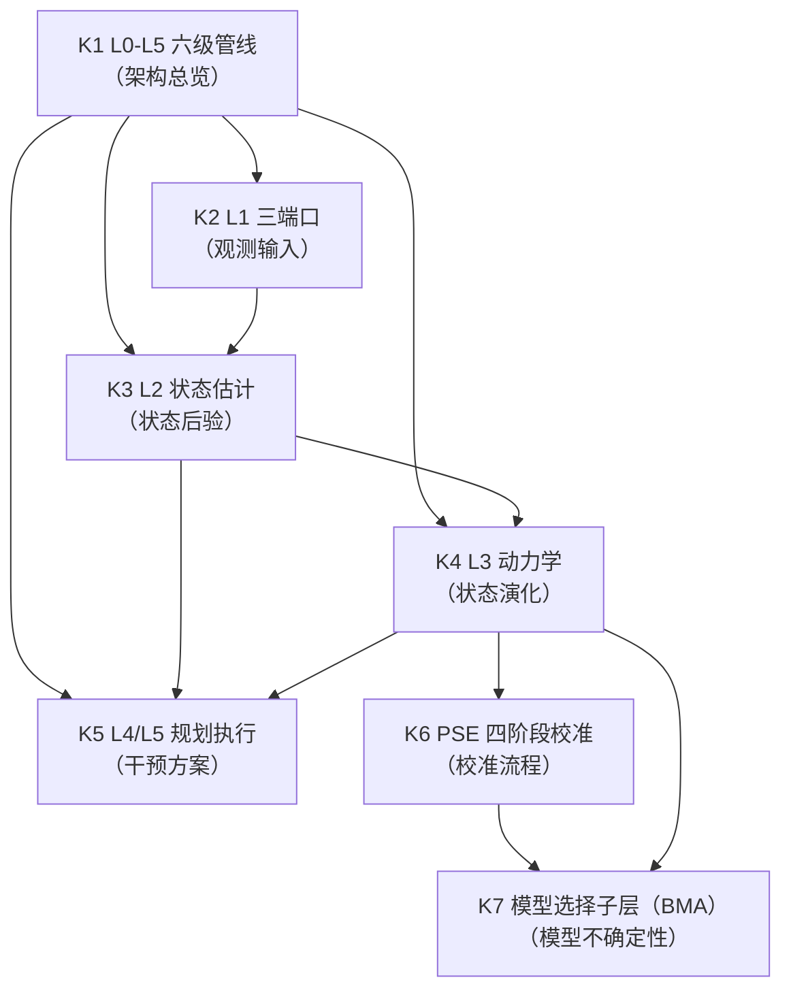
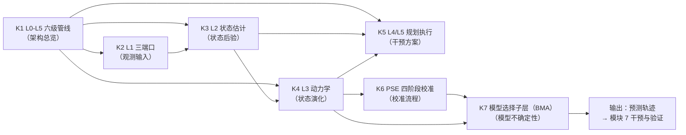

# SMOD-05 · 状态范式模块 5：动力学与计算引擎（× 变量范式对位）

> **来源与性质**：状态范式模块 5/10·与变量范式 MOD 系对位（对位模块见 1.1 定位表）；本件依主理转入稿整理，去除呈现层过渡结构（四层次包装），知识内容全量保留。库内锚点引用前须自核（见 rn）。

>
> **框架声明（15-RPT-115 #1/#2·v0.1.1 订正批增）**：本件「四层次」结构系输出构造、非库内文档框架；模块 MECE 编号与知识点清单照 15-X-112 原文展开。

## 一、模块定位与知识点总览

### 1.1 模块定位表

| 项 | 内容 |
|---|---|
| 所属范式 | 状态范式（功能层） |
| MECE 编号 | 模块 5 / 共 10 模块 |
| 核心问题 | 状态如何演化？如何计算？ |
| 关键知识 | L0-L5 六级管线、L1 三端口、L2 贝叶斯融合、L3 动力学、L4/L5 规划执行、PSE 校准 |
| 代表工具/方法 | PSE（01-M-03） |
| 当前状态 | **部分形式化，核心数学待交付** |
| 在知识生产链中的位置 | **第五环·计算内核**——上游承接模块 2“状态语法”、模块 3“操作语法”、模块 4“环境参照”，下游供给模块 7“干预与验证”以预测轨迹 |
| 变量范式对位模块 | 模块 4“统计推断与数据建模”（SEM、HLM、贝叶斯、DSEM）＋模块 6“计算建模与预测”（计算精神病学、强化学习、DDM、预测加工） |
| 本模块的真正分歧 | 数学对象：概率分布/代数方程 vs 微分/状态空间模型；时间维度：离散快照 vs 连续轨迹；系统特性：线性/可逆 vs 非线性/反馈/阈值/涌现；数学工具：统计学 vs 控制论/动力系统/贝叶斯滤波；模型不确定性：无显式处理 vs BMA 权重显式携带 |

### 1.2 知识点清单表

| # | 知识点 | 一句话定位 | 在状态范式中的角色 |
|---|---|---|---|
| K4b | 参数三态台账 | 参数定义／校准／待校准三态登记 | 参数治理的承载位（候核） |
| K4a | L3 内部层数论证 | L3 内部层为何是 D1-D5 而非六层 | L3 架构自洽性论证 |
| K1 | L0-L5 六级管线 | 从本体到执行的完整计算管线 | PSE 的架构总览 |
| K2 | L1 三端口 | 语义/行为/神经三模态观测端口 | 观测输入 |
| K3 | L2 状态估计 | 贝叶斯融合三模态观测与先验转移 | 状态后验估计 |
| K4 | L3 动力学 | 26 条动力学假设 + 340+ 参数 + BMA | 状态演化预测 |
| K5 | L4/L5 规划执行 | 在约束下搜索最优 G-M-A-R 操作序列 | 干预方案与执行 |
| K6 | PSE 四阶段校准 | PSE-I/M/P/C 校准流程 | 参数校准与模型选择 |
| K7 | 模型选择子层（BMA） | 候选方程族 + BMA 后验权重 | 模型不确定性的显式携带 |

> **K4 承载边界注（v0.2.2 增·15-X-131 采）**：L3 与变量范式的 DSEM 在数值形式上均可求导（第一层不区分），但 L3 的状态分量有功能语义、受六条动力学约束（01-M-02 §3.5）与 26 条动力学假设（01-M-03 §L3）约束（第二、三层区分）；DSEM 的交叉滞后路径不承载功能语义，也不受守恒律／阈值约束。详见 MOD-08 §1.6。

### 1.3 每个知识点的大纲解释表

| 知识点 | 简要大纲解释 |
|---|---|
| **K4b 参数三态台账** | 340+ 参数的「已定义／已校准／待校准」三态台账承载位。（条目内容候核 01-M-03 §五 参数子层原文后补全·15-RPT-115 #24 占位） |
| **K4a L3 内部层数论证** | L3 内部层 D1-D5（DEQ 方程／DPR 参数／DMS 模型选择／DIN 数值演化／DCF 校准）的划分系功能分解：五类职责互斥且联合覆盖动力学计算全流程，无第六类独立职责。（论证细节候核 01-M-03 §四/§五 原文后补全·15-RPT-115 #5） |
| **K1 L0-L5 六级管线** | INTRE 心理系统工程管线：L0 本体（定义坐标系、词汇、语法、结构约束）→ L1 观测（语义/行为/神经三端口）→ L2 状态估计（贝叶斯融合三模态观测）→ L3 动力学（26 条假设 + 340+ 参数 + BMA）→ L4 规划（搜索最优 G-M-A-R 序列）→ L5 执行（执行操作序列并采集反馈）。是 INTRE 的全部功能组织方式。 |
| **K2 L1 三端口** | UPLP 语义端口（语言 → p(y_s\|Ψ)）、UBMP 行为端口（行为 → p(y_b\|Ψ)）、UNIP 神经端口（神经 → p(y_n\|Ψ)）。三端口是 PSE 感知层（L1）的输入端口，而非并列系统。各端口输出似然，只有在 L2 融合环节才产生意义。 |
| **K3 L2 状态估计** | 贝叶斯融合三模态观测与先验转移，输出当前心理状态 Ψ_t 的后验分布（42 维均值向量 + 协方差矩阵）。核心公式：p(Ψ_t\|y_t) ∝ p(y_s\|Ψ_t)·p(y_b\|Ψ_t)·p(y_n\|Ψ_t)·p(Ψ_t\|Ψ_{t-1})。L2 无独立参数，消费 L1 仪器参数与 L3 系统参数。 |
| **K4 L3 动力学** | 用 26 条动力学假设与 340+ 参数推演心理状态的未来演化。核心方程：dΨ/dt = Σ_k w_k·f_k(Ψ, E(t), θ_k)。包含 D1-D5 内部层：DEQ 方程子层、DPR 参数子层、DMS 模型选择子层、DIN 数值演化、DCF 校准流程。〔口径注（15-RPT-115 #13）：26 条系在册假设总数，右端式候选子集 19 条见 K7——两口径并存勿混。〕 |
| **K5 L4/L5 规划执行** | L4 在资源与环境约束下搜索最优 G-M-A-R 操作序列，给出干预方案。L5 执行操作序列并采集反馈数据，形成闭环回到 L1。四操作在 L4/L5 中按靶点合法性矩阵和 D→R→S 序列应用。 |
| **K6 PSE 四阶段校准** | PSE-I（理论注入）：将 26 条动力学假设编码为仿真约束。PSE-M（大规模仿真）：10⁴-10⁶ 量级规则编码 ABM 演化，生成先验分布。PSE-P（先验提取）：从仿真数据中统计提取参数分布。PSE-C（临床锚定）：用真实数据贝叶斯校准。 |
| **K7 模型选择子层（BMA）** | 对每条动力学假设给出 2-3 个候选形式，遵循“理论驱动 + 文献约束 + 形式空间控制”。校准期用真实数据确定 BMA 后验权重 w_k；运行时用加权预测分布。模型不确定性在 L3 内部消化，L2 保持独立级地位。〔口径注（15-RPT-115 #13）：19 条右端式子集系 26 条在册假设的可参数化子集·互注见 K4。〕 |

## 二、知识点详解对比

### 2.1 K1 L0-L5 六级管线 —— 详细对比

| 维度 | 变量范式（无统一管线） | 状态范式（L0-L5 六级管线） |
|---|---|---|
| 管线结构 | 无统一管线 | L0 本体 → L1 观测 → L2 状态估计 → L3 动力学 → L4 规划 → L5 执行 |
| 功能组织 | 分散的统计工具 | 完整的计算管线 |
| 目标映射 | 无 | 描述（L2）、解释（L3）、预测（L3）、控制（L4+L5） |
| 降级模式 | 无 | 某模态不可用 → 该模态输出置为“无信息”，其余模态正常工作 |
| 库内对应 | — | 01-M-00 §二；01-M-03 §一 |
| 关键分歧 | 变量范式无统一管线；状态范式用 L0-L5 六级管线 | 前者是分散工具；后者是完整管线 |

### 2.2 K2 L1 三端口 —— 详细对比

| 维度 | 变量范式（多变量测量） | 状态范式（L1 三端口） |
|---|---|---|
| 观测模态 | 多变量测量 | 语义/行为/神经三模态 |
| 观测输出 | 变量值 | 似然函数 p(y\|Ψ) |
| 端口性质 | 独立变量 | PSE 感知层的输入端口 |
| 融合方式 | 多元回归/因子分析 | 贝叶斯乘积融合 |
| 测量理论负载 | 通常不显式建模 | p(y_b\|Ψ) 理论构成（观测与理论耦合） |
| 库内对应 | — | 01-M-07（UPLP）；01-M-05（UBMP）；01-M-06（UNIP） |
| 关键分歧 | 变量范式用多变量测量；状态范式用 L1 三端口 | 前者是变量；后者是似然输出 |

### 2.3 K3 L2 状态估计 —— 详细对比

| 维度 | 变量范式（参数估计） | 状态范式（L2 状态估计） |
|---|---|---|
| 核心目标 | 估计参数 θ | 估计状态后验 p(Ψ_t\|y_{1:t}) |
| 数学形式 | P(θ\|Data) ∝ P(Data\|θ) × P(θ) | p(Ψ_t\|y_t) ∝ p(y_s\|Ψ_t)·p(y_b\|Ψ_t)·p(y_n\|Ψ_t)·p(Ψ_t\|Ψ_{t-1}) |
| 估计对象 | 参数分布 | 状态后验（42 维均值 + 协方差） |
| 参数归属 | 参数估计是核心 | L2 无独立参数，消费 L1 与 L3 参数 |
| 独立性 | 无 | L2 是独立级（C1 概念正交、C4 验证独立、C3 修订隔离） |
| 验证方式 | 模型拟合 | 间接验证（多模态一致性、L3 预测精度反推、临床专家交叉校准） |
| 库内对应 | — | 01-M-11（L2 状态估计）；01-M-00 §4.3 |
| 关键分歧 | 变量范式估计参数；状态范式估计状态后验 | 前者是参数推断；后者是状态估计 |

### 2.4 K4 L3 动力学 —— 详细对比

| 维度 | 变量范式（SEM/DSEM） | 状态范式（L3 动力学） |
|---|---|---|
| 核心目标 | 建模变量间关系 | 建模状态演化 |
| 数学形式 | Y = BX + ε（代数方程） | dΨ/dt = Σ w_k·f_k(Ψ, E(t), θ_k)（微分方程） |
| 动力学假设 | 无 | 26 条动力学假设 |
| 参数数量 | 通常数十个 | 340+ 个 |
| 模型选择 | 模型拟合指标 | BMA 权重 w_k |
| 时间性 | 离散时点 | 连续时间动态演化 |
| 系统特性 | 线性、叠加、可逆 | 非线性、反馈、阈值、涌现 |
| 内部层结构 | 无 | D1-D5（DEQ/DPR/DMS/DIN/DCF） |
| 库内对应 | — | 01-M-03 §二-§八；01-M-13（L3 内部层架构） |
| 关键分歧 | 变量范式用代数方程；状态范式用微分方程 | 前者是静态结构；后者是动态生成 |

### 2.5 K5 L4/L5 规划执行 —— 详细对比

| 维度 | 变量范式（无对应） | 状态范式（L4/L5 规划执行） |
|---|---|---|
| 核心目标 | 无 | 搜索最优 G-M-A-R 操作序列 + 执行反馈 |
| 规划对象 | 无 | G-M-A-R 操作序列 |
| 约束条件 | 无 | 资源约束（RES-D）、环境约束（S-P）、伦理约束（REVER） |
| 输出 | 无 | 操作序列 + 成功概率 + 时间窗口 + 预期效果 |
| 执行反馈 | 无 | L5 执行反馈回 L1（闭环） |
| 降级模式 | 无 | 无可行解 → 降级为保守方案并报告 |
| 库内对应 | — | 01-M-12（L4+L5 规划执行） |
| 关键分歧 | 变量范式无对应；状态范式用 L4/L5 规划执行 | 前者无干预规划；后者有完整的干预规划与执行闭环 |

### 2.6 K6 PSE 四阶段校准 —— 详细对比

| 维度 | 变量范式（模型拟合） | 状态范式（PSE 四阶段校准） |
|---|---|---|
| 核心目标 | 估计模型参数 | 理论注入 → 仿真 → 先验提取 → 临床锚定 |
| 校准流程 | 单次或多次验证性研究 | PSE-I → PSE-M → PSE-P → PSE-C |
| 先验生成 | 无 | PSE-M 仿真生成先验分布 |
| 后验校准 | 贝叶斯更新 | PSE-C 贝叶斯更新 |
| 参数来源链 | 无 | L0 定义 → PSE-M 仿真 → L1 观测 → PSE-C 后验 → 方程子层消费 |
| 校准迭代 | 通常一次性 | 持续迭代（每收集新数据触发新一轮贝叶斯更新） |
| 库内对应 | — | 01-M-03 §八 |
| 关键分歧 | 变量范式用模型拟合；状态范式用 PSE 四阶段校准 | 前者是一次性；后者是持续迭代 |

### 2.7 K7 模型选择子层（BMA） —— 详细对比

| 维度 | 变量范式（模型选择） | 状态范式（BMA 模型选择子层） |
|---|---|---|
| 核心目标 | 选择最佳模型 | 用 BMA 权重加权多个候选模型 |
| 模型选择方式 | AIC/BIC/交叉验证 | BMA 后验权重 w_k |
| 模型不确定性 | 通常不显式处理 | 显式携带（模型选择子层） |
| 候选模型数 | 通常少数 | L3 右端式子集 19 条 × 2-3 候选 = 38-57 个候选方程 |
| 权重更新 | 无 | 校准期（PSE-C）联合推断确定 |
| 运行时行为 | 使用单一模型 | 加权预测分布（BMA 加权） |
| 库内对应 | — | 01-M-03 §六 |
| 关键分歧 | 变量范式用模型选择；状态范式用 BMA 加权 | 前者是单一模型；后者是多模型加权 |

## 三、知识库链接

### 3.1 K1 L0-L5 六级管线 —— 知识库链接表

| 类别 | 内容 | 库内/库外对应 |
|---|---|---|
| 核心工具 | L0-L5 六级管线 | — |
| 相关理论 | 自动驾驶工程架构、系统动力学 | Wiener (1948)；Forrester (1961) |
| 心理学表现 | 心理系统工程管线 | — |
| 状态范式对位 | 01-M-00 §二；01-M-03 §一 | 库内 |
| 关键文档 | 01-M-00《INTRE 核心纲要》§二；01-M-03《PSE》§一 | 库内 |
| 关键论证 | 六级管线匹配心理系统复杂度（心理系统较自动驾驶高 10²-10⁶ 倍·粗略估算——15-RPT-115 #54 补标·实位订正自议案误标的变量范式模块 3） | 01-M-00 §三 |
| 延伸阅读 | Wiener (1948)；Forrester (1961)；12-S-10（架构设计标准） | 库内/库外 |
| 相关争议 | 六级是否必要；与自动驾驶架构的类比边界 | 01-M-00 §三、§八 |

### 3.2 K2 L1 三端口 —— 知识库链接表

| 类别 | 内容 | 库内/库外对应 |
|---|---|---|
| 核心工具 | UPLP 语义端口、UBMP 行为端口、UNIP 神经端口 | — |
| 相关理论 | 多模态融合、贝叶斯推断 | Gelman et al. (2013) |
| 心理学表现 | 语义/行为/神经三模态观测 | — |
| 状态范式对位 | 01-M-07（UPLP）；01-M-05（UBMP）；01-M-06（UNIP） | 库内 |
| 关键文档 | 01-M-07《UPLP 统一心理语言端口》；01-M-05《UBMP 统一行为测量端口》；01-M-06《UNIP 统一神经接口端口》 | 库内 |
| 关键论证 | 三端口是 PSE 感知层（L1）的输入端口，而非并列系统 | 01-M-00 §10.2 |
| 延伸阅读 | Gelman et al. (2013)；01-M-10（L1-I 接口规范） | 库内/库外 |
| 相关争议 | 三端口的独立性；与并列系统的区别 | 01-M-00 §10.4 |

### 3.3 K3 L2 状态估计 —— 知识库链接表

| 类别 | 内容 | 库内/库外对应 |
|---|---|---|
| 核心工具 | 贝叶斯融合、迭代滤波（「迭代滤波」P2 已决编号候核 01-M-00／01-M-11 原文·15-RPT-115 #18） | — |
| 相关理论 | 贝叶斯推断、状态估计 | Kalman (1960)；Gelman et al. (2013) |
| 心理学表现 | 状态后验估计 | — |
| 状态范式对位 | 01-M-11（L2 状态估计）；01-M-00 §4.3 | 库内 |
| 关键文档 | 01-M-11《L2 状态估计》；01-M-00《INTRE 核心纲要》§4.3 | 库内 |
| 关键论证 | L2 的独立级地位由三点支撑（功能独特性、验证独立性、修订隔离性） | 01-M-00 §4.3 |
| 延伸阅读 | Kalman (1960)；Gelman et al. (2013)；01-M-11 | 库内/库外 |
| 相关争议 | L2 的间接验证路径；无地面真值下的状态估计 | 01-M-00 §4.3 |

### 3.4 K4 L3 动力学 —— 知识库链接表

| 类别 | 内容 | 库内/库外对应 |
|---|---|---|
| 核心工具 | 26 条动力学假设、340+ 参数、BMA | — |
| 相关理论 | 动力系统、控制论、贝叶斯模型平均 | Strogatz (2015)；Hoeting et al. (1999) |
| 心理学表现 | 状态演化预测 | — |
| 状态范式对位 | 01-M-03 §二-§八；01-M-13（L3 内部层架构） | 库内 |
| 关键文档 | 01-M-03《PSE》§二-§八；01-M-13《L3 内部层架构》 | 库内 |
| 关键论证 | 核心方程 dΨ/dt = Σ w_k·f_k(Ψ, E(t), θ_k) 以 BMA 加权形式统一了候选方程、参数与环境驱动 | 01-M-03 §四 |
| 延伸阅读 | Strogatz (2015)；Hoeting et al. (1999)；01-X-03（PSE 附录） | 库内/库外 |
| 相关争议 | 26 条假设的经验有效性；BMA 计算成本与权重退化 | 01-M-03 §六、边界声明 |

### 3.5 K5 L4/L5 规划执行 —— 知识库链接表

| 类别 | 内容 | 库内/库外对应 |
|---|---|---|
| 核心工具 | G-M-A-R 操作序列搜索、执行反馈闭环 | — |
| 相关理论 | 控制论、最优控制 | Wiener (1948) |
| 心理学表现 | 干预规划与执行 | — |
| 状态范式对位 | 01-M-12（L4+L5 规划执行） | 库内 |
| 关键文档 | 01-M-12《L4+L5 规划执行》 | 库内 |
| 关键论证 | L4 在约束下搜索最优 G-M-A-R 操作序列；L5 执行并采集反馈 | 01-M-12 |
| 延伸阅读 | Wiener (1948)；01-M-08（G-M-A-R 操作语法） | 库内/库外 |
| 相关争议 | 最优序列的搜索算法；资源约束的硬性 | 01-M-12 |

### 3.6 K6 PSE 四阶段校准 —— 知识库链接表

| 类别 | 内容 | 库内/库外对应 |
|---|---|---|
| 核心工具 | PSE-I（理论注入）、PSE-M（大规模仿真）、PSE-P（先验提取）、PSE-C（临床锚定） | — |
| 相关理论 | 贝叶斯校准、仿真建模 | Gelman et al. (2013) |
| 心理学表现 | 参数校准与模型选择 | — |
| 状态范式对位 | 01-M-03 §八 | 库内 |
| 关键文档 | 01-M-03《PSE》§八 | 库内 |
| 关键论证 | PSE 四阶段是 L3 的校准流程，而非独立系统 | 01-M-03 §八 |
| 延伸阅读 | Gelman et al. (2013)；01-M-03 §八 | 库内/库外 |
| 相关争议 | 校准数据的质量；仿真与真实数据的残差 | 01-M-03 边界声明 |

### 3.7 K7 模型选择子层（BMA） —— 知识库链接表

| 类别 | 内容 | 库内/库外对应 |
|---|---|---|
| 核心工具 | BMA 权重 w_k、候选方程族 | — |
| 相关理论 | 贝叶斯模型平均 | Hoeting et al. (1999) |
| 心理学表现 | 模型不确定性显式携带 | — |
| 状态范式对位 | 01-M-03 §六 | 库内 |
| 关键文档 | 01-M-03《PSE》§六 | 库内 |
| 关键论证 | 模型不确定性在 L3 内部消化，L2 保持独立级地位 | 01-M-03 §六 |
| 延伸阅读 | Hoeting et al. (1999)；01-M-03 §六 | 库内/库外 |
| 相关争议 | BMA 计算成本；权重退化（某候选权重趋近 1）的处理 | 01-M-03 §六、边界声明 |

## 四、知识点依赖关系

### 4.1 依赖关系总表

| 知识点 | 依赖 | 被依赖 | 依赖类型 | 说明 |
|---|---|---|---|---|
| K1 L0-L5 六级管线 | 模块 2（状态语法） | K2、K3、K4、K5 | 架构总览 | L0-L5 六级管线是 PSE 的架构总览 |
| K2 L1 三端口 | K1 | K3 | 观测输入 | L1 三端口提供观测输入 |
| K3 L2 状态估计 | K1、K2 | K4、K5 | 状态后验 | L2 输出状态后验给 L3 |
| K4 L3 动力学 | K1、K3 | K5、K6、K7 | 状态演化 | L3 用动力学假设推演未来状态 |
| K5 L4/L5 规划执行 | K1、K3、K4 | — | 干预方案 | L4/L5 基于 L3 预测搜索最优操作序列 |
| K6 PSE 四阶段校准 | K4 | K7 | 校准流程 | PSE 四阶段校准参数与模型权重 |
| K7 模型选择子层（BMA） | K4、K6 | — | 模型不确定性 | BMA 权重 w_k 由 PSE-C 确定 |

### 4.2 依赖关系图

### 4.3 依赖关系深度解剖表

| 依赖对 | 依赖内容 | 深度 | 结构性后果 |
|---|---|---|---|
| K1 → K2 | L0-L5 六级管线 → L1 三端口 | 强 | L1 三端口是六级管线的观测输入层 |
| K1 → K3 | L0-L5 六级管线 → L2 状态估计 | 强 | L2 状态估计是六级管线的状态估计层 |
| K2 → K3 | L1 三端口 → L2 状态估计 | 强 | L2 消费 L1 三端口的似然输出 |
| K1 → K4 | L0-L5 六级管线 → L3 动力学 | 强 | L3 动力学是六级管线的动力学层 |
| K3 → K4 | L2 状态估计 → L3 动力学 | 强 | L3 以 L2 输出的 Ψ_t 后验作为演化初始条件 |
| K1 → K5 | L0-L5 六级管线 → L4/L5 规划执行 | 强 | L4/L5 是六级管线的规划执行层 |
| K3 → K5 | L2 状态估计 → L4/L5 规划执行 | 中 | L4 消费 L2 输出的 Ψ_t |
| K4 → K5 | L3 动力学 → L4/L5 规划执行 | 强 | L4 消费 L3 输出的预测轨迹 |
| K4 → K6 | L3 动力学 → PSE 四阶段校准 | 强 | PSE 四阶段校准 L3 的参数与模型权重 |
| K6 → K7 | PSE 四阶段校准 → 模型选择子层 | 强 | PSE-C 确定 BMA 权重 w_k |
| K4 → K7 | L3 动力学 → 模型选择子层 | 强 | 模型选择子层是 L3 的内部层之一 |

### 4.4 与变量范式的依赖关系对比

| 状态范式依赖 | 变量范式对应 | 差异 |
|---|---|---|
| K1 L0-L5 六级管线 → K2 L1 三端口 | 无统一管线 → 多变量测量 | 状态范式用六级管线；变量范式无统一管线 |
| K2 L1 三端口 → K3 L2 状态估计 | 多变量测量 → 参数估计 | 状态范式用三端口似然；变量范式用变量 |
| K3 L2 状态估计 → K4 L3 动力学 | 参数估计 → SEM/DSEM | 状态范式用状态后验；变量范式用参数估计 |
| K4 L3 动力学 → K5 L4/L5 规划执行 | SEM/DSEM → 无对应 | 状态范式用 L3 动力学；变量范式用 SEM/DSEM |
| K5 L4/L5 规划执行 → K6 PSE 四阶段校准 | 无对应 → 模型拟合 | 状态范式用 L4/L5 规划执行；变量范式无对应 |
| K6 PSE 四阶段校准 → K7 模型选择子层 | 模型拟合 → 模型选择 | 状态范式用 PSE 四阶段校准；变量范式用模型拟合 |
| K1–K7 | 多变量测量 + 参数估计 + SEM/DSEM + 模型拟合 | 状态范式用 L0-L5 六级管线 + L1 三端口 + L2 状态估计 + L3 动力学 + L4/L5 规划执行 + PSE 四阶段校准 + BMA；变量范式用多变量测量 + 参数估计 + SEM/DSEM + 模型拟合 |

### 4.5 关键依赖链：从 L0-L5 到 BMA

**关键结论：**

1. **K1 L0-L5 六级管线是架构总览**：从本体到执行的完整计算管线。
2. **K2 L1 三端口是观测输入**：语义/行为/神经三模态观测端口。
3. **K3 L2 状态估计是状态后验**：贝叶斯融合三模态观测与先验转移。
4. **K4 L3 动力学是状态演化**：26 条动力学假设 + 340+ 参数 + BMA。
5. **K5 L4/L5 规划执行是干预方案**：在约束下搜索最优 G-M-A-R 操作序列。
6. **K6 PSE 四阶段校准是校准流程**：PSE-I/M/P/C 校准参数与模型权重。
7. **K7 模型选择子层（BMA）是模型不确定性**：BMA 权重 w_k 由 PSE-C 确定。
8. **模块 5 的输出是预测轨迹**：这个预测轨迹供给模块 7（干预与验证）作为干预规划输入。
9. **与变量范式的根本差异**：变量范式用多变量测量、参数估计、SEM/DSEM、模型拟合；状态范式用 L0-L5 六级管线、L1 三端口、L2 状态估计、L3 动力学、L4/L5 规划执行、PSE 四阶段校准、BMA。

### 4.6 模块间依赖：模块 5 与相邻模块的关系

| 关系 | 上游 | 下游 | 依赖内容 |
|---|---|---|---|
| 模块 2 → 模块 5 | 状态语法 | 动力学与计算引擎 | 模块 2 定义状态空间，模块 5 定义状态演化 |
| 模块 3 → 模块 5 | 操作语法 | 动力学与计算引擎 | 模块 3 定义操作靶点，模块 5 定义状态响应操作 |
| 模块 4 → 模块 5 | 环境参照 | 动力学与计算引擎 | 模块 4 提供 E(t)，模块 5 将其纳入动力学方程 |
| 模块 5 → 模块 7 | 预测轨迹 | 干预与验证 | 模块 5 提供预测轨迹，模块 7 基于其设计干预 |
| 模块 5 ↔ 模块 6 | 动力学与计算引擎 ↔ 测量与观测 | 双向依赖 | 模块 6 提供观测，模块 5 提供动力学；观测函数 h 连接两者 |
| 模块 5 ↔ 模块 8 | 动力学与计算引擎 ↔ 治理与证据 | 双向依赖 | 动力学引擎影响证据分级；证据分级验证动力学引擎 |

## 疑问解答（附属·v0.2.0 增）

本节系主理 Agent 2026-10-13 会话转入之附属疑问解答（13 条·逐条以表格作答），与正文四节互为补充、不替代；内容逐字落盘未改一字。

### 疑问 1：本模块“真正分歧”的数学对象、时间维度、系统特性、数学工具、模型不确定性五重分歧如何与变量范式镜像？

| 维度 | 变量范式 | 状态范式 |
|---|---|---|
| 数学对象 | 概率分布/代数方程 | 微分/状态空间模型 |
| 时间维度 | 离散快照 | 连续轨迹 |
| 系统特性 | 线性/可逆 | 非线性/反馈/阈值/涌现 |
| 数学工具 | 统计学 | 控制论/动力系统/贝叶斯滤波 |
| 模型不确定性 | 无显式处理 | BMA 权重显式携带 |
| 镜像关系 | 用多变量测量 + 参数估计 + SEM/DSEM + 模型拟合 | 用 L0-L5 六级管线 + L1 三端口 + L2 状态估计 + L3 动力学 + L4/L5 规划执行 + PSE 四阶段校准 + BMA |
| 一句话 | 变量范式的数学对象是概率分布/代数方程；状态范式的数学对象是微分/状态空间模型 |

---

### 疑问 2：K1 L0-L5 六级管线的结构如何？

| 管线级 | 一句话职责 |
|---|---|
| L0 本体 | 定义整条管线的坐标系、词汇、语法与结构约束 |
| L1 观测 | 通过语义/行为/神经三个输入端口，将原始观测编译为带不确定度的结构化观测向量 |
| L2 状态估计 | 贝叶斯融合三模态观测与先验转移，输出当前心理状态 Ψ_t 的后验分布 |
| L3 动力学 | 用 26 条动力学假设与 340+ 参数推演心理状态的未来演化 |
| L4 规划 | 在资源与环境约束下搜索最优 G-M-A-R 操作序列 |
| L5 执行 | 执行操作序列并采集反馈数据，形成闭环回到 L1 |
| 一句话 | L0-L5 六级管线将 INTRE 的全部功能组织为一条从本体到执行的完整计算管线 |

---

### 疑问 3：K2 L1 三端口的输出为何是似然而非变量值？

| 端口 | 转换 | 输出 |
|---|---|---|
| UPLP 语义端口 | 自然语言 → 语义似然 | p(y_s\|Ψ) |
| UBMP 行为端口 | 量表/EMA/数字表型 → 行为似然 | p(y_b\|Ψ) |
| UNIP 神经端口 | EEG/fNIRS/PPG → 神经似然 | p(y_n\|Ψ) |
| 为何是似然 | 三端口是 PSE 感知层（L1）的输入端口，而非并列系统；各端口输出似然，只有在 L2 融合环节才产生意义 | — |
| 一句话 | 三端口输出似然而非变量值；似然只有在 L2 融合环节才产生意义 |

---

### 疑问 4：K3 L2 状态估计的独立性由什么支撑？

| 支撑点 | 内容 |
|---|---|
| 功能独特性（C1） | “当前心理状态是什么”与“观测到了什么”、“状态将如何演化”是不同的问题 |
| 验证独立性（C4） | L2 输出可在不运行 L3 预测的情况下间接验证 |
| 修订隔离性（C3） | 融合算法的改进不触发 L1 仪器参数或 L3 动力学方程修订 |
| 间接验证路径 | (a) 多模态一致性检验；(b) L3 预测精度反推；(c) 临床专家交叉校准 |
| 一句话 | L2 是管线中的独立一级，不是 L1 与 L3 之间的“算法层” |

---

### 疑问 5：K4 L3 动力学的 D1-D5 内部层如何划分？

| 编号 | 缩写 | 职能 |
|---|---|---|
| D1 | DEQ | 持有 26 条动力学假设的候选方程族 |
| D2 | DPR | 持有 340+ 参数的概率分布 |
| D3 | DMS | 持有候选方程的 BMA 后验权重 w_k |
| D4 | DIN | 执行数值积分输出预测 |
| D5 | DCF | 管理 PSE-I/M/P/C 四阶段离线校准 |
| 层数论证 | D1-D3 为原有三子层；D4 独立因数值积分是独立工程决策；D5 独立因校准是离线流程 | — |
| 一句话 | L3 内部五层（DEQ/DPR/DMS/DIN/DCF）分别管理方程、参数、模型选择、数值演化、校准 |

---

### 疑问 6：K4a L3 内部层数论证的功能分解逻辑如何？

| 维度 | 解答 |
|---|---|
| 一句话定位 | L3 内部层为何是 D1-D5 而非六层 |
| 论证内容 | L3 内部层 D1-D5（DEQ 方程／DPR 参数／DMS 模型选择／DIN 数值演化／DCF 校准）的划分系功能分解：五类职责互斥且联合覆盖动力学计算全流程，无第六类独立职责 |
| 候核状态 | 论证细节候核 01-M-03 §四/§五 原文后补全 |
| 与 K4 关系 | K4 覆盖 L3 动力学总体；K4a 覆盖 L3 内部层数的自洽性论证 |
| 一句话 | K4a 是 L3 内部层数论证 |

---

### 疑问 7：K4b 参数三态台账的承载位与状态如何？

| 维度 | 解答 |
|---|---|
| 一句话定位 | 340+ 参数的「已定义／已校准／待校准」三态登记 |
| 承载位 | 参数治理的承载位 |
| 候核状态 | 条目内容候核 01-M-03 §五 参数子层原文后补全 |
| 与 K4 关系 | K4 覆盖 L3 动力学（26 条假设 + 340+ 参数 + BMA）；K4b 是参数治理的登记面 |
| 一句话 | K4b 是参数三态台账的承载位 |

---

### 疑问 8：K4（L3 动力学）中 26 条在册假设与 19 条右端式子集的口径如何互注？

| 口径 | 内容 |
|---|---|
| 在册数 26 | 26 条动力学假设（L1.1-L6.4），本表行数、§5.2 分布、§八 规模一律不变 |
| 右端式子集 19 | 26 条中 7 条不属 L3 方程子层右端式（L1.3/L1.4/L2.3/L5.1/L5.2/L6.2/L6.4），实际可实现子集为 26−7＝19 |
| 两口径关系 | 在册 26 条不变；实现与验证计数按右端式子集另行报数；两处口径不得混用 |
| 候选方程规模 | L3 右端式子集 19 条 × 2-3 候选 = 38-57 个候选方程 |
| 一句话 | 26 条系在册假设总数，右端式候选子集 19 条；两口径并存勿混 |

---

### 疑问 9：K5 L4/L5 规划执行的四操作如何按靶点合法性矩阵应用？

| 维度 | 解答 |
|---|---|
| L4 规划 | 在资源与环境约束下搜索最优 G-M-A-R 操作序列 |
| L5 执行 | 执行操作序列并采集反馈数据，形成闭环回到 L1 |
| 约束来源 | L0（G-M-A-R 组合规则）；L3（RES-D 水平决定认知预算）；S-P（环境约束）；REVER（伦理约束） |
| 靶点合法性 | 四操作在 L4/L5 中按靶点合法性矩阵和 D→R→S 序列应用 |
| 降级模式 | 无可行解 → 降级为保守方案（低风险操作子集）并报告 |
| 一句话 | L4 在约束下搜索最优 G-M-A-R 操作序列；L5 执行并采集反馈，形成闭环 |

---

### 疑问 10：K6 PSE 四阶段校准的流程与当前状态如何？

| 阶段 | 代码 | 功能 | 当前状态 |
|---|---|---|---|
| 理论注入 | PSE-I | 将 26 条动力学假设编码为仿真约束 | 理论设计（P2i-m） |
| 大规模仿真 | PSE-M | 10⁴-10⁶ 量级规则编码 ABM 演化，生成先验分布 | 理论设计（P2i-m） |
| 先验提取 | PSE-P | 从仿真数据中统计提取参数分布 | 理论设计（P2i-m） |
| 临床锚定 | PSE-C | 用真实数据贝叶斯校准 | 理论设计（P2i-m） |
| 一句话 | PSE 四阶段是 L3 的校准流程，而非独立系统；当前全部处于理论设计阶段 |

---

### 疑问 11：K7 模型选择子层（BMA）的候选方程族来源与裁决数据合法性如何？

| 维度 | 解答 |
|---|---|
| 候选方程族来源 | 理论驱动 + 文献约束 + 形式空间控制 |
| 候选方程数量 | L3 右端式子集 19 条 × 2-3 候选 = 38-57 个候选方程 |
| BMA 权重确定 | 校准期（PSE-C）用真实数据确定 BMA 后验权重 w_k |
| 运行时行为 | 用加权预测分布（BMA 加权） |
| 裁决数据合法性 | 参数填充（数据 → 参数值）完全合法；异常触发检查（参数异常 → 演绎链条审查）合法；直接修订（参数数据 → 架构层修订）非法 |
| 已知局限 | BMA 在此规模下的计算成本和权重退化处理策略尚未设计 |
| 一句话 | 模型选择子层持有候选方程族与 BMA 权重；模型不确定性在 L3 内部消化，L2 保持独立级地位 |

---

### 疑问 12：本模块知识点依赖链是否闭合？状态范式如何对应？

| 状态范式依赖 | 内容 | 差异 |
|---|---|---|
| K1 L0-L5 六级管线 → K2 L1 三端口 | L1 三端口是六级管线的观测输入层 | — |
| K1 L0-L5 六级管线 → K3 L2 状态估计 | L2 状态估计是六级管线的状态估计层 | — |
| K2 L1 三端口 → K3 L2 状态估计 | L2 消费 L1 三端口的似然输出 | — |
| K1 L0-L5 六级管线 → K4 L3 动力学 | L3 动力学是六级管线的动力学层 | — |
| K3 L2 状态估计 → K4 L3 动力学 | L3 以 L2 输出的 Ψ_t 后验作为演化初始条件 | — |
| K1 L0-L5 六级管线 → K5 L4/L5 规划执行 | L4/L5 是六级管线的规划执行层 | — |
| K4 L3 动力学 → K5 L4/L5 规划执行 | L4 消费 L3 输出的预测轨迹 | — |
| K4 L3 动力学 → K6 PSE 四阶段校准 | PSE 四阶段校准 L3 的参数与模型权重 | — |
| K6 PSE 四阶段校准 → K7 模型选择子层 | PSE-C 确定 BMA 权重 w_k | — |
| 依赖链是否闭合 | 从 L0-L5 六级管线出发，经由 L1 三端口、L2 状态估计、L3 动力学、L4/L5 规划执行、PSE 四阶段校准，到达 BMA | — |
| 一句话 | 变量范式用多变量测量 + 参数估计 + SEM/DSEM + 模型拟合；状态范式用 L0-L5 六级管线 + L1 三端口 + L2 状态估计 + L3 动力学 + L4/L5 规划执行 + PSE 四阶段校准 + BMA |

---

### 疑问 13：本模块与相邻状态范式模块的依赖关系如何？

| 关系 | 上游 | 下游 | 依赖内容 |
|---|---|---|---|
| SMOD-02 → 本模块 | 状态语法 | 动力学与计算引擎 | SMOD-02 定义状态空间，本模块定义状态演化 |
| SMOD-03 → 本模块 | 操作语法 | 动力学与计算引擎 | SMOD-03 定义操作靶点，本模块定义状态响应操作 |
| SMOD-04 → 本模块 | 环境参照 | 动力学与计算引擎 | SMOD-04 提供 E(t)，本模块将其纳入动力学方程 |
| 本模块 → SMOD-07 | 预测轨迹 | 干预与验证 | 本模块提供预测轨迹，SMOD-07 基于其设计干预 |
| 本模块 ↔ SMOD-06 | 动力学与计算引擎 ↔ 测量与观测 | 双向依赖 | SMOD-06 提供观测，本模块提供动力学；观测函数 h 连接两者 |
| 本模块 ↔ SMOD-08 | 动力学与计算引擎 ↔ 治理与证据 | 双向依赖 | 动力学引擎影响证据分级；证据分级验证动力学引擎 |
| 一句话 | 本模块是状态范式的“计算内核”，上承状态、操作、环境，下接干预验证、测量观测、治理证据 | — | — |

## 版本记录

| 版本 | 日期 | 变更说明 |
|---|---|---|
| v0.3.0 | 2026-10-29 | 双范式正名批（DR-2026-10-29-TERM-002 v1.4.0）：正文「结构范式」→「状态范式」；判升 Minor。 |
| v0.2.2 | 2026-10-25 | Patch·B261025-01：K4 增承载边界注（三层判据随批）。 |
| v0.2.1 | 2026-10-16 | Patch·B261016-04：外审机械订正批：rn v0.1.1 条拆碎段还原（外审候选×本窗独立解码双路对撞·并与末表 v0.1.1 同义行对撞）。… |
| v0.2.0 | 2026-10-13 | Minor·B261013-06：疑问解答增补批：增「疑问解答（附属）」一节（13 条）。 |
| v0.1.1 | 2026-10-13 | Patch·B261013-04：订正批：#5 增 K4a L3 内部层数论证（候核标注）；#13 K4/K7 26 条与 19 条口径互注；#18 迭代滤波 P2 编号候核注… |
| v0.1.0 | 2026-10-13 | 建件·B261013-03：结构范式模块 5/10 落盘（去四层次包装改四节直陈·第四层次系「与变量范式的依赖关系对比」反向对位·表格与 mermaid 2 枚零删减保留）。B261013-03。 |

> 全量版本 v0.1.0–v0.2.1（共 4 版）见 [HIST-SMOD §SMOD-05-动力学与计算引擎-v0.1-2026-10-13](HIST-SMOD_双范式对比学习模块-SMOD系版本沿革-v1.0-2026-10-18.md#doc-38)；当前无外迁版本。
