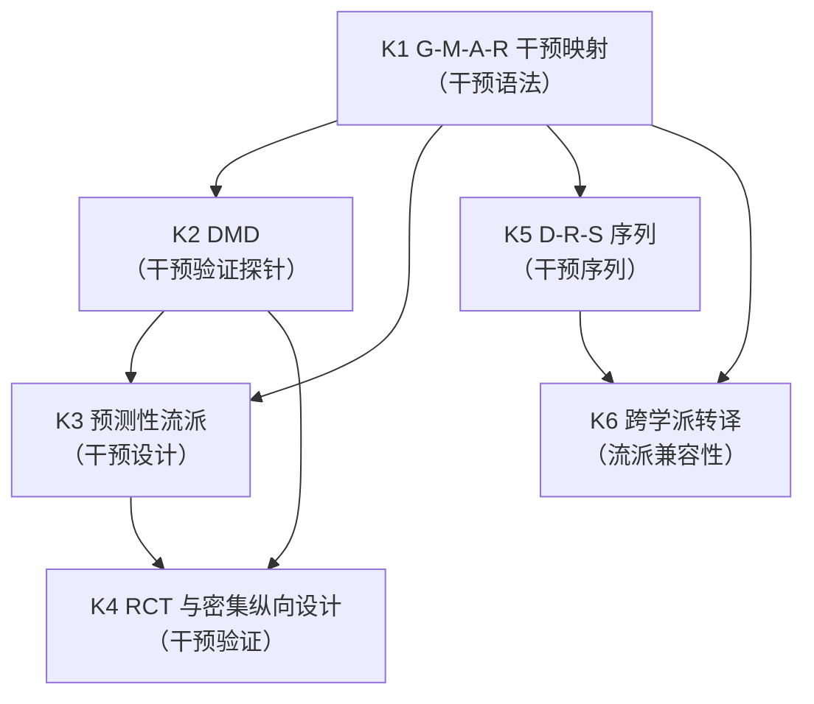
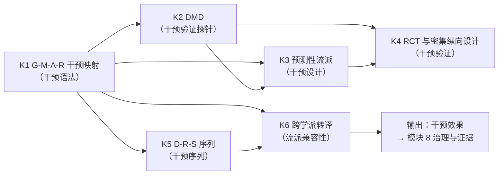

# SMOD-07 · 状态范式模块 7：干预与验证（× 变量范式对位）

> **来源与性质**：状态范式模块 7/10·与变量范式 MOD 系对位（对位模块见 1.1 定位表）；本件依主理转入稿整理，去除呈现层过渡结构（四层次包装），知识内容全量保留。库内锚点引用前须自核（见 rn）。

>
> **框架声明（15-RPT-115 #1/#2·v0.1.1 订正批增）**：本件「四层次」结构系输出构造、非库内文档框架；模块 MECE 编号与知识点清单照 15-X-112 原文展开。

## 一、模块定位与知识点总览

### 1.1 模块定位表

| 项 | 内容 |
|---|---|
| 所属范式 | 状态范式（功能层） |
| MECE 编号 | 模块 7 / 共 10 模块 |
| 核心问题 | 如何干预？如何验证？ |
| 关键知识 | G-M-A-R 干预映射、DMD、预测性流派、RCT、D-R-S 序列、跨学派转译 |
| 代表工具/方法 | 03-C-13、18-DIVE、26-SIPE |
| 当前状态 | **设计完成，待跑** |
| 在知识生产链中的位置 | **第七环·干预验证**——上游承接模块 3“操作语法”、模块 5“动力学与计算引擎”、模块 6“测量与观测”，下游供给模块 8“治理与证据”以干预效果 |
| 变量范式对位模块 | 模块 3“研究设计与抽样”（RCT）＋模块 5“因果识别与因果推断”（处理效应）＋模块 6“计算建模与预测”（计算精神病学） |
| 本模块的真正分歧 | 干预对象：变量 vs 功能状态 Ψ；干预形式：处理包 vs G-M-A-R 操作序列；干预验证：处理效应 vs 状态轨迹变化 + 干预靶点效应；干预设计：随机化 + 对照组 vs 随机化 + 密集纵向 + 多模态 |

### 1.2 知识点清单表

| # | 知识点 | 一句话定位 | 在状态范式中的角色 |
|---|---|---|---|
| K1 | G-M-A-R 干预映射 | 将各流派技术转译为 G-M-A-R 操作序列 | 干预语法的核心 |
| K2 | DMD（默认模式调度疗法） | 第一个详细开发与验证的预测性流派 | 干预验证的探针 |
| K3 | 预测性流派 | 从功能层语法演绎生成的十个流派 | 干预设计空间生成器 |
| K4 | RCT 与密集纵向设计 | 随机化 + 密集纵向 + 多模态 + 状态估计 | 干预验证的设计 |
| K5 | D-R-S 序列 | 先稳定调度、再补充资源、最后修复结构 | 干预序列的工程纪律 |
| K6 | 跨学派转译 | 将各流派技术转译为 G-M-A-R 操作序列 | 流派兼容性论证 |

### 1.3 每个知识点的大纲解释表

| 知识点 | 简要大纲解释 |
|---|---|
| **K1 G-M-A-R 干预映射** | 将各流派技术转译为 G-M-A-R 操作序列。CBT 认知重构 → ALIGN M2-STR-R；暴露疗法 → GATE- M4-DSP-B + RELINK M4-STR-C；正念呼吸 → GATE- M2-DSP-B + GATE+ M1-DSP-F；精神分析移情分析 → RELINK M4-STR-C。揭示各流派在功能层上“实际做了什么”。 |
| **K2 DMD** | 默认模式调度疗法：基于 INTRE 功能层语法的新型结构化心理干预，专门针对反刍、担忧、自动负性思维等“默认后台进程过度激活”问题。核心机制：注意调度失衡（DMN 与注意网络动态解耦合）及其上游通路（M2-DSP-B 无法被 M1-DSP-F 有效门控）。DMD 主攻调度通路，不否定内容通路——干预通路可概括为「双通道模型」：调度通路（主攻）＋内容通路（不否定·交由 ALIGN 类操作处理）（15-RPT-115 #26 补入）。 |
| **K3 预测性流派** | 从功能层语法演绎生成的十个预测性流派：SMI、NCB、DMD、VRB、SPR、BIE、AAR、CSC、TKE、DEB。每个流派都有功能签名、概念映射、技术映射、学派签名、可检验预测。是 INTRE 语法作为干预设计空间生成器的证明。 |
| **K4 RCT 与密集纵向设计** | 干预验证的设计：随机化 + 密集纵向 + 多模态 + 状态估计。变量范式用 RCT 估计 ATE；状态范式用密集纵向 + 状态估计估计个体化状态轨迹 + 干预靶点效应。DMD-P2a/P2b/P2c 是典型设计。 |
| **K5 D-R-S 序列** | 系统性干预须遵循从浅到深、从表到里的阶段顺序：D 层稳定（GATE）→ R 层恢复（MODULATE）→ S 层重建（ALIGN/RELINK）。不遵守此铁律的干预有极大概率失败或导致二次创伤。序列刚性与系统失调程度正相关。 |
| **K6 跨学派转译** | 将各流派技术转译为 G-M-A-R 操作序列。跨学派收敛分析揭示：RELINK 作为深层结构改变机制的收敛；治疗关系作为 S-P 架构的收敛；STR-R 与 STR-C 作为干预靶点的分歧；多阶段方案中隐含的 D-R-S 排序逻辑。 |

## 二、知识点详解对比

### 2.1 K1 G-M-A-R 干预映射 —— 详细对比

| 维度 | 变量范式（处理包） | 状态范式（G-M-A-R 干预映射） |
|---|---|---|
| 干预形式 | 处理包（如 CBT 组） | G-M-A-R 操作序列 |
| 干预分解 | 通常不分解 | 分解为 GATE/MODULATE/ALIGN/RELINK |
| 靶点 | 变量节点 | R-D-S 层级 |
| 干预映射 | 无 | 各流派技术 → G-M-A-R 操作序列 |
| 与因果推断关系 | 处理效应识别 | 干预靶点合法性矩阵 |
| 库内对应 | — | 01-M-08 §2.1；03-E-07（跨学派映射）；03-E-09（预测性流派） |
| 关键分歧 | 变量范式用处理包；状态范式用 G-M-A-R 操作序列 | 前者是处理包；后者是可分解的操作序列 |

### 2.2 K2 DMD —— 详细对比

| 维度 | 变量范式（CBT/正念/ACT） | 状态范式（DMD） |
|---|---|---|
| 核心机制 | 内容修正/观察接纳 | 注意调度（门控替代） |
| 靶点 | 信念内容（M2-STR-R） | M2-DSP-B（进程本身）+ M1-DSP-F |
| 操作 | ALIGN + GATE- | GATE+ M1-DSP-F / GATE- M2-DSP-B |
| 起效速度 | 4-6 次会谈 | 单次练习即可感受下降 |
| 对信念的依赖 | 必须修正信念 | 不依赖信念修正 |
| 可检验预测 | 无标准化预测 | DMD-P1、P2a、P2b、P2c、P3、P4、P5、P6 |
| 库内对应 | — | 03-C-13（DMD）；18-DIVE；26-SIPE |
| 关键分歧 | 变量范式用 CBT/正念/ACT；状态范式用 DMD | 前者是内容修正/观察接纳；后者是注意调度（门控替代） |

### 2.3 K3 预测性流派 —— 详细对比

| 维度 | 变量范式（无对应） | 状态范式（预测性流派） |
|---|---|---|
| 流派生成 | 无 | 从功能层语法演绎生成的十个流派 |
| 流派数量 | 无 | 10 个（SMI、NCB、DMD、VRB、SPR、BIE、AAR、CSC、TKE、DEB） |
| 生成方式 | 无 | 从 IODS 定义的功能层语法演绎 |
| 可检验预测 | 无 | 每个流派都有明确的可检验预测 |
| 流派评价 | 无 | 六维评价框架（理论基础、靶点区分度、可操作性、临床实用性、可检验性、风险） |
| 库内对应 | — | 03-E-09（预测性流派） |
| 关键分歧 | 变量范式无对应；状态范式用预测性流派 | 前者无流派生成；后者用功能层语法演绎生成新流派 |

### 2.4 K4 RCT 与密集纵向设计 —— 详细对比

| 维度 | 变量范式（RCT） | 状态范式（密集纵向 + 状态估计） |
|---|---|---|
| 核心目标 | 估计群体平均处理效应（ATE） | 估计个体化状态轨迹变化 + 干预效果 |
| 随机化对象 | 被试随机分配到处理/对照组 | 可保留随机化，但需密集纵向追踪状态 |
| 因果推断逻辑 | 随机化消除混淆 → 组间差异 = 处理效应 | 状态转移方程 + 干预算子 → 轨迹预测 + 效果归因 |
| 数据形态 | 前后测 + 少数时点 | 密集纵向 + 多模态 + 连续时间 |
| 分析单位 | 组间均值差异 | 个体内状态轨迹 |
| 干预定义 | 处理包（如 CBT 组） | G-M-A-R 操作序列（可分解） |
| 结果测量 | 主要结局（如 RRS-Brooding） | 状态向量变化 + 级联路径 + 风险时点 |
| 效果量 | Hedges g、Cohen's d | 轨迹预测精度、干预靶点效应 |
| 库内对应 | — | 03-C-13 §六（DMD-P2a/P2b/P2c）；18-DIVE；26-SIPE |
| 关键分歧 | 变量范式用 RCT；状态范式用密集纵向 + 状态估计 | 前者估计 ATE；后者估计个体化状态轨迹 |

### 2.5 K5 D-R-S 序列 —— 详细对比

| 维度 | 变量范式（无对应） | 状态范式（D-R-S 序列） |
|---|---|---|
| 核心工具 | 无 | D 层稳定 → R 层恢复 → S 层重建 |
| 序列逻辑 | 无 | 从浅到深、从表到里的阶段顺序 |
| 序列刚性 | 无 | 与系统失调程度正相关（急性危机最严格） |
| 违反后果 | 无 | 干预有极大概率失败或导致二次创伤 |
| 与变量范式关系 | 无 | 变量范式无对应概念 |
| 库内对应 | — | 01-M-08 §2.2；02-A-11 §3.3；05-R-01 #11 |
| 关键分歧 | 变量范式无序列铁律；状态范式用 D-R-S 序列铁律 | 前者无序列约束；后者有严格的序列约束 |

### 2.6 跨学派转译 —— 详细对比

| 维度 | 变量范式（流派竞争） | 状态范式（跨学派转译） |
|---|---|---|
| 流派关系 | 竞争关系 | 功能互补关系 |
| 转译方式 | 无 | 各流派技术 → G-M-A-R 操作序列 |
| 收敛分析 | 无 | RELINK 收敛、治疗关系收敛、STR-R/STR-C 分歧、D-R-S 排序逻辑 |
| 流派兼容性 | 无 | 揭示各流派在功能层上“实际做了什么” |
| 库内对应 | — | 03-E-07（跨学派映射）；03-E-09（预测性流派） |
| 关键分歧 | 变量范式用流派竞争；状态范式用跨学派转译 | 前者是竞争关系；后者是功能互补关系 |

## 三、知识库链接

### 3.1 K1 G-M-A-R 干预映射 —— 知识库链接表

| 类别 | 内容 | 库内/库外对应 |
|---|---|---|
| 核心工具 | 各流派技术 → G-M-A-R 操作序列 | — |
| 相关理论 | 控制论、干预语法 | Wiener (1948) |
| 心理学表现 | CBT、ACT、正念、精神分析 | — |
| 状态范式对位 | 01-M-08 §2.1；03-E-07；03-E-09 | 库内 |
| 关键文档 | 01-M-08《G-M-A-R 操作语法》§2.1；03-E-07《跨学派概念与操作映射汇编》；03-E-09《流派生成语法》 | 库内 |
| 关键论证 | 各流派技术可分解为 G-M-A-R 操作序列 | 03-E-07 §十二（跨流派收敛分析） |
| 延伸阅读 | Wiener (1948)；03-E-07；03-E-09 | 库内/库外 |
| 相关争议 | 系统式和叙事式流派的“有损翻译” | 03-E-07 保真度声明 |

### 3.2 K2 DMD —— 知识库链接表

| 类别 | 内容 | 库内/库外对应 |
|---|---|---|
| 核心工具 | DMD 七模块、5-4-3-2-1 技术、调度日志 | — |
| 相关理论 | 注意调度、DMN 神经科学 | Menon (2023)；Chen (2025) |
| 心理学表现 | 反刍、担忧、思维漫游 | — |
| 状态范式对位 | 03-C-13（DMD）；18-DIVE；26-SIPE | 库内 |
| 关键文档 | 03-C-13《DMD》；18-DIVE（DMD 迭代验证工程）；26-SIPE（硅基探针工程） | 库内 |
| 关键论证 | DMD 的核心机制是注意调度（门控替代） | 03-C-13 §1.3 |
| 延伸阅读 | Menon (2023)；Chen (2025)；03-C-13 | 库内/库外 |
| 相关争议 | DMD 与正念的区分度；5-4-3-2-1 的证据边界 | 03-C-13 §三 |

### 3.3 K3 预测性流派 —— 知识库链接表

| 类别 | 内容 | 库内/库外对应 |
|---|---|---|
| 核心工具 | 十流派生成语法、六维评价框架 | — |
| 相关理论 | 功能层设计、干预语法 | Wiener (1948) |
| 心理学表现 | SMI、NCB、DMD、VRB、SPR、BIE、AAR、CSC、TKE、DEB | — |
| 状态范式对位 | 03-E-09（预测性流派） | 库内 |
| 关键文档 | 03-E-09《流派生成语法与十个预测性流派方案》 | 库内 |
| 关键论证 | INTRE 语法可作为干预设计空间生成器 | 03-E-09 §一 |
| 延伸阅读 | Wiener (1948)；03-E-09 | 库内/库外 |
| 相关争议 | 预测性流派的临床实用性；与现有流派的重叠 | 03-E-09 附录 B |

### 3.4 K4 RCT 与密集纵向设计 —— 知识库链接表

| 类别 | 内容 | 库内/库外对应 |
|---|---|---|
| 核心工具 | 随机化 + 密集纵向 + 多模态 + 状态估计 | — |
| 相关理论 | 因果推断、密集纵向 | Rubin (1974)；Hamaker et al. (2015) |
| 心理学表现 | DMD-P2a/P2b/P2c | — |
| 状态范式对位 | 03-C-13 §六；18-DIVE；26-SIPE | 库内 |
| 关键文档 | 03-C-13《DMD》§六；18-DIVE；26-SIPE | 库内 |
| 关键论证 | 状态范式用密集纵向 + 状态估计估计个体化状态轨迹 + 干预靶点效应 | 03-C-13 §六 |
| 延伸阅读 | Rubin (1974)；Hamaker et al. (2015)；03-C-13 §六 | 库内/库外 |
| 相关争议 | RCT 的外部有效性；密集纵向的依从性 | 03-C-13 §8.2 |

### 3.5 K5 D-R-S 序列 —— 知识库链接表

| 类别 | 内容 | 库内/库外对应 |
|---|---|---|
| 核心工具 | D 层稳定 → R 层恢复 → S 层重建 | — |
| 相关理论 | 控制论、系统动力学 | Wiener (1948)；Forrester (1961) |
| 心理学表现 | 干预序列、治疗阶段 | — |
| 状态范式对位 | 01-M-08 §2.2；02-A-11 §3.3；05-R-01 #11 | 库内 |
| 关键文档 | 01-M-08《G-M-A-R 操作语法》§2.2；02-A-11 §3.3；05-R-01《压力测试》#11 | 库内 |
| 关键论证 | D→R→S 序列铁律是系统动力学约束的工程纪律 | 01-M-08 §2.2；05-R-01 #11 |
| 延伸阅读 | Wiener (1948)；Forrester (1961)；01-M-08 §2.2 | 库内/库外 |
| 相关争议 | 序列刚性与失调程度的关系；危机例外协议 | 01-M-08 §2.2；05-R-01 #11 |

### 3.6 跨学派转译 —— 知识库链接表

| 类别 | 内容 | 库内/库外对应 |
|---|---|---|
| 核心工具 | 各流派技术 → G-M-A-R 操作序列 | — |
| 相关理论 | 控制论、干预语法 | Wiener (1948) |
| 心理学表现 | CBT、ACT、正念、精神分析、人本主义、行为主义、系统治疗、DBT、叙事疗法、创伤聚焦、积极心理学 | — |
| 状态范式对位 | 03-E-07（跨学派映射）；03-E-09（预测性流派） | 库内 |
| 关键文档 | 03-E-07《跨学派概念与操作映射汇编》；03-E-09《流派生成语法》 | 库内 |
| 关键论证 | 跨流派收敛分析揭示功能层统一性 | 03-E-07 §十二 |
| 延伸阅读 | Wiener (1948)；03-E-07；03-E-09 | 库内/库外 |
| 相关争议 | 系统式和叙事式流派的“有损翻译” | 03-E-07 保真度声明 |

## 四、知识点依赖关系

### 4.1 依赖关系总表

| 知识点 | 依赖 | 被依赖 | 依赖类型 | 说明 |
|---|---|---|---|---|
| K1 G-M-A-R 干预映射 | 模块 3（操作语法） | K2、K3、K5、K6 | 干预语法 | G-M-A-R 干预映射是干预语法的核心 |
| K2 DMD | K1、模块 5（动力学）、模块 6（测量） | K3、K4 | 干预验证探针 | DMD 是第一个详细开发与验证的预测性流派 |
| K3 预测性流派 | K1 | K4 | 干预设计 | 预测性流派是干预设计空间生成器 |
| K4 RCT 与密集纵向设计 | K2、K3、模块 5（动力学）、模块 6（测量） | K5 | 干预验证 | RCT 与密集纵向设计是干预验证的设计 |
| K5 D-R-S 序列 | K1、模块 3（操作语法） | K6 | 干预序列 | D-R-S 序列是干预序列的工程纪律 |
| K6 跨学派转译 | K1、K5 | — | 流派兼容性 | 跨学派转译是流派兼容性论证 |

### 4.2 依赖关系图

### 4.3 依赖关系深度解剖表

| 依赖对 | 依赖内容 | 深度 | 结构性后果 |
|---|---|---|---|
| K1 → K2 | G-M-A-R 干预映射 → DMD | 强 | DMD 是 G-M-A-R 干预映射的具体应用 |
| K1 → K3 | G-M-A-R 干预映射 → 预测性流派 | 强 | 预测性流派从功能层语法演绎生成 |
| K1 → K5 | G-M-A-R 干预映射 → D-R-S 序列 | 强 | D-R-S 序列基于靶点合法性矩阵 |
| K1 → K6 | G-M-A-R 干预映射 → 跨学派转译 | 强 | 跨学派转译将各流派技术转译为 G-M-A-R 操作序列 |
| K2 → K3 | DMD → 预测性流派 | 强 | DMD 是预测性流派中最先开发的 |
| K2 → K4 | DMD → RCT 与密集纵向设计 | 强 | DMD-P2a/P2b/P2c 是典型的 RCT 与密集纵向设计 |
| K3 → K4 | 预测性流派 → RCT 与密集纵向设计 | 中 | 预测性流派提供可检验预测，RCT 与密集纵向设计验证这些预测 |
| K5 → K6 | D-R-S 序列 → 跨学派转译 | 中 | D-R-S 序列是跨学派转译的序列逻辑 |

### 4.4 与变量范式的依赖关系对比

| 状态范式依赖 | 变量范式对应 | 差异 |
|---|---|---|
| K1 G-M-A-R 干预映射 → K2 DMD | 处理包 → CBT/正念/ACT | 状态范式用 G-M-A-R 操作序列；变量范式用处理包 |
| K2 DMD → K3 预测性流派 | CBT/正念/ACT → 无对应 | 状态范式用 DMD；变量范式用 CBT/正念/ACT |
| K3 预测性流派 → K4 RCT 与密集纵向设计 | 无对应 → RCT | 状态范式用预测性流派；变量范式无对应 |
| K4 RCT 与密集纵向设计 → K5 D-R-S 序列 | RCT → 无对应 | 状态范式用 RCT 与密集纵向设计；变量范式用 RCT |
| K5 D-R-S 序列 → K6 跨学派转译 | 无对应 → 流派竞争 | 状态范式用 D-R-S 序列；变量范式无对应 |
| K1–K6 | 处理包 + CBT/正念/ACT + RCT + 流派竞争 | 状态范式用 G-M-A-R 干预映射 + DMD + 预测性流派 + RCT 与密集纵向设计 + D-R-S 序列 + 跨学派转译；变量范式用处理包 + CBT/正念/ACT + RCT + 流派竞争 |

### 4.5 关键依赖链：从 G-M-A-R 干预映射到跨学派转译

**关键结论：**

1. **K1 G-M-A-R 干预映射是干预语法**：将各流派技术转译为 G-M-A-R 操作序列。
2. **K2 DMD 是干预验证探针**：第一个详细开发与验证的预测性流派。
3. **K3 预测性流派是干预设计**：从功能层语法演绎生成的十个流派。
4. **K4 RCT 与密集纵向设计是干预验证**：随机化 + 密集纵向 + 多模态 + 状态估计。
5. **K5 D-R-S 序列是干预序列**：先稳定调度、再补充资源、最后修复结构。
6. **K6 跨学派转译是流派兼容性**：将各流派技术转译为 G-M-A-R 操作序列。
7. **模块 7 的输出是干预效果**：这个干预效果供给模块 8（治理与证据）作为证据分级输入。
8. **与变量范式的根本差异**：变量范式用处理包、CBT/正念/ACT、RCT、流派竞争；状态范式用 G-M-A-R 干预映射、DMD、预测性流派、RCT 与密集纵向设计、D-R-S 序列、跨学派转译。

### 4.6 模块间依赖：模块 7 与相邻模块的关系

| 关系 | 上游 | 下游 | 依赖内容 |
|---|---|---|---|
| 模块 3 → 模块 7 | 操作语法 | 干预与验证 | 模块 3 定义操作语法，模块 7 定义干预验证 |
| 模块 5 → 模块 7 | 动力学与计算引擎 | 干预与验证 | 模块 5 提供预测轨迹，模块 7 基于其设计干预 |
| 模块 6 → 模块 7 | 测量与观测 | 干预与验证 | 模块 6 提供状态估计，模块 7 基于其设计干预 |
| 模块 7 → 模块 8 | 干预效果 | 治理与证据 | 模块 7 提供干预效果，模块 8 进行证据分级 |
| 模块 7 ↔ 模块 9 | 干预与验证 ↔ 跨基质与智能科学 | 双向依赖 | 干预验证可跨基质扩展；跨基质对照验证干预效果 |
| 模块 7 ↔ 模块 10 | 干预与验证 ↔ 元方法与建构 | 双向依赖 | 干预验证方法受元方法约束；元方法指导干预验证 |

## 疑问解答（附属·v0.2.0 增）

本节系主理 Agent 2026-10-13 会话转入之附属疑问解答（9 条·逐条以表格作答），与正文四节互为补充、不替代；内容逐字落盘未改一字。

### 疑问 1：本模块“真正分歧”的干预对象、干预形式、干预验证、干预设计四重分歧如何与变量范式镜像？

| 维度 | 变量范式 | 状态范式 |
|---|---|---|
| 干预对象 | 变量 | 功能状态 Ψ |
| 干预形式 | 处理包 | G-M-A-R 操作序列 |
| 干预验证 | 处理效应 | 状态轨迹变化 + 干预靶点效应 |
| 干预设计 | 随机化 + 对照组 | 随机化 + 密集纵向 + 多模态 |
| 镜像关系 | 用处理包 + CBT/正念/ACT + RCT + 流派竞争 | 用 G-M-A-R 干预映射 + DMD + 预测性流派 + RCT 与密集纵向设计 + D-R-S 序列 + 跨学派转译 |
| 一句话 | 变量范式用处理包 + 处理效应 + RCT + 流派竞争；状态范式用 G-M-A-R 操作序列 + 状态轨迹变化 + 密集纵向设计 + 跨学派转译 |

---

### 疑问 2：K1 G-M-A-R 干预映射如何将各流派技术转译为操作序列？

| 流派 | 核心技术 | G-M-A-R 转译 |
|---|---|---|
| CBT | 认知重构 | ALIGN M2-STR-R + GATE- M2-DSP-B |
| 暴露疗法 | 暴露与反应预防 | GATE- M4-DSP-B + RELINK M4-STR-C |
| 正念/ACT | 正念呼吸 | GATE- M2-DSP-B + GATE+ M1-DSP-F |
| 精神分析 | 移情分析 | RELINK M4-STR-C |
| 人本主义 | 无条件积极关注 | RELINK M4-STR-C |
| 行为主义 | 系统脱敏 | GATE- M4-DSP-B + MODULATE+ M1-RES-D |
| 一句话 | 各流派技术可分解为 G-M-A-R 操作序列；揭示各流派在功能层上“实际做了什么” |

---

### 疑问 3：K2 DMD 的双通道模型如何理解？

| 维度 | 解答 |
|---|---|
| 双通道模型 | 调度通路（主攻）+ 内容通路（不否定·交由 ALIGN 类操作处理） |
| 调度通路 | M2-DSP-B → M1-DSP-F 门控转换 |
| 内容通路 | CBT 靶点（信念内容） |
| DMD 主攻 | 注意调度过程本身 |
| 不否定内容通路 | DMD 不否定内容通路存在；内容通路交由 ALIGN 类操作处理 |
| 一句话 | DMD 主攻调度通路，不否定内容通路——双通道模型 |

---

### 疑问 4：K3 预测性流派的生成语法如何运作？

| 维度 | 解答 |
|---|---|
| 生成方式 | 从 IODS 定义的功能层语法演绎 |
| 流派数量 | 10 个（SMI、NCB、DMD、VRB、SPR、BIE、AAR、CSC、TKE、DEB） |
| 生成流程 | 选择候选靶点 → 匹配原子操作 → 设计序列逻辑 → 界定适应症 → 形成可检验预测 → 标注边界与风险 |
| 流派评价 | 六维评价框架（理论基础、靶点区分度、可操作性、临床实用性、可检验性、风险） |
| 一句话 | 预测性流派从功能层语法演绎生成，是 INTRE 语法作为干预设计空间生成器的证明 |

---

### 疑问 5：K4 RCT 与密集纵向设计如何改造变量范式的 RCT？

| 维度 | 变量范式（RCT） | 状态范式（密集纵向 + 状态估计） |
|---|---|---|
| 核心目标 | 估计群体平均处理效应（ATE） | 估计个体化状态轨迹变化 + 干预效果 |
| 随机化对象 | 被试随机分配到处理/对照组 | 可保留随机化，但需密集纵向追踪状态 |
| 因果推断逻辑 | 随机化消除混淆 → 组间差异 = 处理效应 | 状态转移方程 + 干预算子 → 轨迹预测 + 效果归因 |
| 数据形态 | 前后测 + 少数时点 | 密集纵向 + 多模态 + 连续时间 |
| 分析单位 | 组间均值差异 | 个体内状态轨迹 |
| 干预定义 | 处理包（如 CBT 组） | G-M-A-R 操作序列（可分解） |
| 一句话 | 状态范式保留随机化但要求密集纵向 + 状态估计 + 干预分解，目标从“群体平均效应”换为“个体状态轨迹与最优干预序列” |

---

### 疑问 6：K5 D-R-S 序列在干预验证中的应用如何？

| 维度 | 解答 |
|---|---|
| 序列内容 | D 层稳定（GATE）→ R 层恢复（MODULATE）→ S 层重建（ALIGN/RELINK） |
| 序列刚性 | 与系统失调程度正相关：急性危机中最严格，高功能系统中可并行推进 |
| 违反后果 | 干预有极大概率失败或导致二次创伤 |
| 危机例外协议 | INTRE 不替代危机干预、精神科诊断或紧急风险管理 |
| 一句话 | D-R-S 序列是干预序列的工程纪律；序列刚性与系统失调程度正相关 |

---

### 疑问 7：K6 跨学派转译的收敛分析揭示了什么？

| 收敛模式 | 内容 |
|---|---|
| RELINK 收敛 | 六个流派在 RELINK 操作（STR-C 修正）作为最深层、最持久的心理改变机制上达成收敛 |
| 治疗关系收敛 | 十个流派中有八个将因果权重赋予治疗关系作为改变机制 |
| STR-R 与 STR-C 分歧 | 主要靶向 STR-R 的流派（CBT、叙事、积极心理学）与主要靶向 STR-C 的流派（精神动力学、人本主义、创伤聚焦）区分开来 |
| D-R-S 排序逻辑 | D-R-S 干预深度序列隐含于跨流派的多阶段治疗方案中 |
| 一句话 | 跨学派转译揭示在理论分歧之下存在真实的功能收敛，功能层捕获了心理系统的真实结构特征 |

---

### 疑问 8：本模块知识点依赖链是否闭合？状态范式如何对应？

| 状态范式依赖 | 内容 | 差异 |
|---|---|---|
| K1 G-M-A-R 干预映射 → K2 DMD | DMD 是 G-M-A-R 干预映射的具体应用 | — |
| K1 G-M-A-R 干预映射 → K3 预测性流派 | 预测性流派从功能层语法演绎生成 | — |
| K1 G-M-A-R 干预映射 → K5 D-R-S 序列 | D-R-S 序列基于靶点合法性矩阵 | — |
| K1 G-M-A-R 干预映射 → K6 跨学派转译 | 跨学派转译将各流派技术转译为 G-M-A-R 操作序列 | — |
| K2 DMD → K3 预测性流派 | DMD 是预测性流派中最先开发的 | — |
| K2 DMD → K4 RCT 与密集纵向设计 | DMD-P2a/P2b/P2c 是典型的 RCT 与密集纵向设计 | — |
| K3 预测性流派 → K4 RCT 与密集纵向设计 | 预测性流派提供可检验预测，RCT 与密集纵向设计验证这些预测 | — |
| K5 D-R-S 序列 → K6 跨学派转译 | D-R-S 序列是跨学派转译的序列逻辑 | — |
| 依赖链是否闭合 | 从 G-M-A-R 干预映射出发，经由 DMD、预测性流派、RCT 与密集纵向设计、D-R-S 序列，到达跨学派转译 | — |
| 一句话 | 变量范式用处理包 + CBT/正念/ACT + RCT + 流派竞争；状态范式用 G-M-A-R 干预映射 + DMD + 预测性流派 + RCT 与密集纵向设计 + D-R-S 序列 + 跨学派转译 |

---

### 疑问 9：本模块与相邻状态范式模块的依赖关系如何？

| 关系 | 上游 | 下游 | 依赖内容 |
|---|---|---|---|
| SMOD-03 → 本模块 | 操作语法 | 干预与验证 | SMOD-03 定义操作语法，本模块定义干预验证 |
| SMOD-05 → 本模块 | 动力学与计算引擎 | 干预与验证 | SMOD-05 提供预测轨迹，本模块基于其设计干预 |
| SMOD-06 → 本模块 | 测量与观测 | 干预与验证 | SMOD-06 提供状态估计，本模块基于其设计干预 |
| 本模块 → SMOD-08 | 干预效果 | 治理与证据 | 本模块提供干预效果，SMOD-08 进行证据分级 |
| 本模块 ↔ SMOD-09 | 干预与验证 ↔ 跨基质与智能科学 | 双向依赖 | 干预验证可跨基质扩展；跨基质对照验证干预效果 |
| 本模块 ↔ SMOD-10 | 干预与验证 ↔ 元方法与建构 | 双向依赖 | 干预验证方法受元方法约束；元方法指导干预验证 |
| 一句话 | 本模块是状态范式的“干预验证引擎”，上承操作、动力学、测量，下接治理证据、跨基质、元方法 | — | — |

## 版本记录

| 版本 | 日期 | 变更说明 |
|---|---|---|
| v0.3.0 | 2026-10-29 | 双范式正名批（DR-2026-10-29-TERM-002 v1.4.0）：正文「结构范式」→「状态范式」；判升 Minor。 |
| v0.2.1 | 2026-10-16 | Patch·B261016-04：外审机械订正批：rn v0.1.1 条拆碎段还原（外审候选×本窗独立解码双路对撞·并与末表 v0.1.1 同义行对撞）。… |
| v0.2.0 | 2026-10-13 | Minor·B261013-06：疑问解答增补批：增「疑问解答（附属）」一节（9 条）。 |
| v0.1.1 | 2026-10-13 | Patch·B261013-04：订正批：#26 K2 补 DMD 双通道模型概括；框架声明增（#1/#2）。判升 Patch。 |
| v0.1.0 | 2026-10-13 | 建件·B261013-03：结构范式模块 7/10 落盘（去四层次包装改四节直陈·第四层次系「与变量范式的依赖关系对比」反向对位·表格与 mermaid 2 枚零删减保留）。B261013-03。 |

> 全量版本 v0.1.0–v0.2.1（共 4 版）见 [HIST-SMOD §SMOD-07-干预与验证-v0.1-2026-10-13](HIST-SMOD_双范式对比学习模块-SMOD系版本沿革-v1.0-2026-10-18.md#doc-40)；当前无外迁版本。
