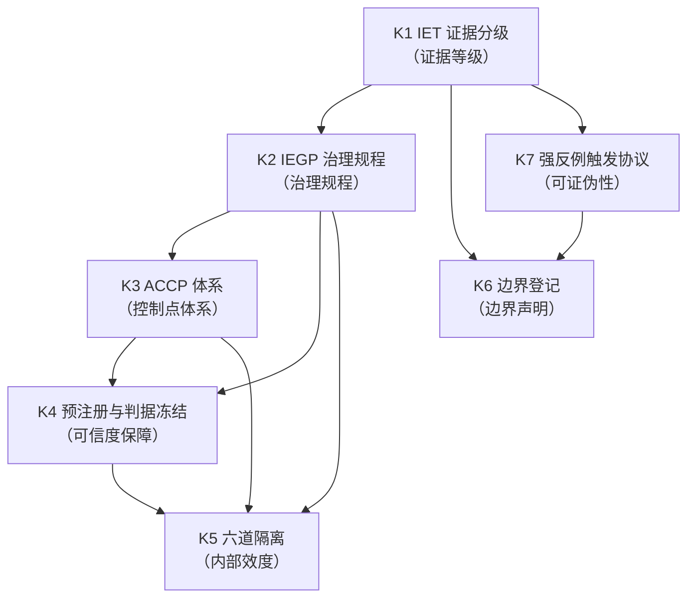

# SMOD-08 · 状态范式模块 8：治理与证据（× 变量范式对位）

> **来源与性质**：状态范式模块 8/10·与变量范式 MOD 系对位（对位模块见 1.1 定位表）。

>
> **框架声明**：本件「四层次」结构系呈现层构造、非库内文档框架。

## 一、模块定位与知识点总览

### 1.1 模块定位表

| 项 | 内容 |
|---|---|
| 所属范式 | 状态范式（功能层） |
| MECE 编号 | 模块 8 / 共 10 模块 |
| 核心问题 | 如何保证可信、可证伪？ |
| 关键知识 | IET 证据分级、ACCP、IEGP、预注册、六道隔离、边界登记 |
| 代表工具/方法 | 05-R-01、26-RPT-01 |
| 当前状态 | **已建成，在执行** |
| 在知识生产链中的位置 | **第八环·元层治理**——上游承接模块 1–7 的全部实践，下游反馈回模块 1–7 的问题诊断与修正方向 |
| 变量范式对位模块 | 模块 7“制度、实践与批判”（同行评审、发表偏差、p-hacking、复制危机、构念膨胀、WEIRD 样本） |
| 本模块的真正分歧 | 治理层级：研究层面 vs 实验全过程治理；证据分级：通常无统一分级 vs IET 八级体系 + IEGP 六级 M0-M5；可证伪性：内建强反例协议 vs 无统一机制；批判对象：方法缺陷/制度缺陷 vs 描述单位/数学对象错位 |

### 1.2 知识点清单表

| # | 知识点 | 一句话定位 | 在状态范式中的角色 |
|---|---|---|---|
| K2b | 保留锚件通则化 | 锚件保留规则的通则化表述 | 锚件治理承载位 |
| K2a | 审计帧自守纪律 | 治理循环的证据帧自守机制 | IEGP 审计面承载位 |
| K1 | IET 证据分级 | D/L/F/X/P/N/E/R 八级证据体系 | 证据等级权威源 |
| K2 | IEGP 治理规程 | INTRE 实验治理规程（v3.1） | 实验全过程治理 |
| K3 | ACCP 体系 | Agent 实验关键控制点体系 | 控制点三级制（ACCP/OPRP/PRP） |
| K4 | 预注册与判据冻结 | 研究前冻结判据、分析计划、种子 | 可信度保障 |
| K5 | 六道隔离 | 执行格的隔离条 | 内部效度承载 |
| K6 | 边界登记 | RDS/GMAR 边界外维度登记 | 可证伪性与边界声明 |
| K7 | 强反例触发协议 | 框架核心主张的可证伪条件 | 科学资格保障 |

### 1.3 每个知识点的大纲解释表

| 知识点 | 简要大纲解释 |
|---|---|
| **K2b 保留锚件通则化** | （条目待补） |
| **K2a 审计帧自守纪律** | （条目待补） |
| **K1 IET 证据分级** | INTRE 证据分类学 v3.0 八级体系：D（定义类）、L（推导类）、F（事实/历史规律）、X（解释类）、P（预测类）、N（规范类）、E（实证类）、R（复现类）。各件铰链主张标注证据等级；目标密度 1-3 个/千字符。 |
| **K2 IEGP 治理规程** | INTRE 实验治理规程 v3.1：一根主轴（测量过程）＋两档刻度（粗档四格/细档环节）＋六阶推进带＋治理循环与质量诊断表＋等级只住结果格＋四层压成责任栏。含三翼一体（如何治理/如何做好/如何定级）、五门签字序、六类角色席位、漏洞六类制、止损线 G1-G4。 |
| **K3 ACCP 体系** | Agent 实验关键控制点体系（ACCP）：控制点三级制——关一档（不可逆：证据灭失、判据解冻、种子失封）／关二档（可补救：分发泄露、判卷串台、回传错配）／关三档（常规：留痕补件、口径申明）。对外规范名 ACCP/OPRP/PRP（S1-16 v0.7.2 §3.1 在册原语）。 |
| **K4 预注册与判据冻结** | 预注册冻结件：冻结假设、分析计划、主要结局。判据冻结件（sha16 `3bd01dda989e021e`）：一字不动。种子封存：随机化隐匿。M3 级需预注册冻结＋判者认证＋机检留痕＋种子封存四要件同取。 |
| **K5 六道隔离** | 执行格的隔离条：备料污染、分发泄露、判卷串台、回传错配等。双挂带：六道隔离＝内部效度承载（§5.7）∩ 执行格控制点。 |
| **K6 边界登记** | RDS/GMAR 边界巡检登记的边界外维度：11 项（①Agent 身份/主体性、②Agent 经济/支付、③自修改/自主演化、④记忆治理、⑤人类维度、⑥委托级可靠性、⑦持续存在、⑧认知评估/自我效能感、⑨内源性 GMAR、⑩结构自创生、⑪涌现）。承接工程 PFM/PDE/REVER。 |
| **K7 强反例触发协议** | INTRE 核心主张的可证伪条件：N-S-R 元公理反例、M1-M6 完备性反例、R-D-S 充分性反例、G-M-A-R 覆盖充分性反例、D→R→S 序列优先性反例。是框架科学资格的核心保障。 |

## 二、知识点详解对比

### 2.1 K1 IET 证据分级 —— 详细对比

| 维度 | 变量范式（无统一分级） | 状态范式（IET 证据分级） |
|---|---|---|
| 分级体系 | 通常无统一分级 | D/L/F/X/P/N/E/R 八级体系 |
| 分级对象 | 无 | 各件铰链主张 |
| 标注密度 | 无 | 1-3 个/千字符 |
| 权威源 | 无 | 06-S-03《INTRE 证据分类学 v3.0》 |
| 与产出关系 | 无 | IEGP 分级（M0-M5）与 IET 双标制 |
| 库内对应 | — | 06-S-03（IET v3.0）；01-M-00（证据标签使用） |
| 关键分歧 | 变量范式无统一分级；状态范式用 IET 八级体系 | 前者无分级；后者有严格的八级体系 |

> **口径注**：本系「隔离」数目以 26-WP-S3-36 规程原文「六道隔离」为准。

### 2.2 K2 IEGP 治理规程 —— 详细对比

| 维度 | 变量范式（同行评审） | 状态范式（IEGP 治理规程） |
|---|---|---|
| 治理层级 | 研究层面（单篇论文） | 实验全过程治理 |
| 治理结构 | 无统一规程 | 一根主轴 + 两档刻度 + 六阶推进带 + 治理循环 + 质量诊断表 |
| 三翼一体 | 无 | 如何治理/如何做好/如何定级 |
| 五门签字序 | 无 | 门 1 方案与预注册 → 门 2 判据冻结 → 门 3 开跑 → 门 4 读数出账 → 门 5 对外声称 |
| 六类角色席位 | 无 | PI/EX/SU/QA/QC/EA |
| 漏洞六类制 | 无 | 发现→分类→分档→处置→回写 |
| 止损线 | 无 | G1-G4（一审/封卷线/停哨/复位） |
| 当前状态 | — | v3.1 已签发·域内生效（2026-10-09） |
| 库内对应 | — | 26-WP-S3-36《IEGP v3.1》 |
| 关键分歧 | 变量范式用同行评审；状态范式用 IEGP 治理规程 | 前者是研究层面质量控制；后者是实验全过程治理 |

### 2.3 K3 ACCP 体系 —— 详细对比

| 维度 | 变量范式（无对应） | 状态范式（ACCP 体系） |
|---|---|---|
| 控制点分类 | 无 | 关一档/关二档/关三档 |
| 关一档 | 无 | 不可逆（证据灭失、判据解冻、种子失封） |
| 关二档 | 无 | 可补救（分发泄露、判卷串台、回传错配） |
| 关三档 | 无 | 常规（留痕补件、口径申明） |
| 对外规范名 | 无 | ACCP/OPRP/PRP（S1-16 v0.7.2 §3.1 在册原语） |
| 与预注册关系 | 无 | 预注册四要件 ∩ 执行格控制点（双挂带） |
| 库内对应 | — | 26-WP-S1-16（ACCP 体系）；26-WP-S3-36 §3.5（控制点三级制） |
| 关键分歧 | 变量范式无控制点分类；状态范式用 ACCP 三级制 | 前者无控制点；后者有严格的三级制 |

### 2.4 K4 预注册与判据冻结 —— 详细对比

| 维度 | 变量范式（预注册） | 状态范式（预注册 + 判据冻结 + 种子封存） |
|---|---|---|
| 预注册对象 | 假设、分析计划、主要结局 | 判据、分析计划、种子、判者名册 |
| 冻结件 | 通常无判据冻结件 | 判据冻结件（sha16 `3bd01dda989e021e`·一字不动） |
| 种子封存 | 通常无 | 种子封存（随机化隐匿） |
| 判者认证 | 通常无 | 判者资格与执行度（JQC/JECC 内部件） |
| 四要件同取 | 无 | M3 级需预注册冻结+判者认证+机检留痕+种子封存四要件同取 |
| 库内对应 | — | 26-WP-S3-14（预注册冻结件）；26-WP-S3-36 §3.2（工具格） |
| 关键分歧 | 变量范式用预注册；状态范式用预注册+判据冻结+种子封存 | 前者关注假设冻结；后者关注判据冻结+种子封存+判者认证 |

### 2.5 K5 六道隔离 —— 详细对比

| 维度 | 变量范式（实验控制） | 状态范式（六道隔离） |
|---|---|---|
| 隔离条 | 实验控制（随机化、盲法） | 备料污染、分发泄露、判卷串台、回传错配等 |
| 双挂带 | 无 | 六道隔离＝内部效度承载（§5.7）∩ 执行格控制点 |
| 视角标签 | 无 | 稳健性系操作面视角、效度系论断面视角（强制） |
| 与治理循环关系 | 无 | 隔离条与治理循环回写 |
| 库内对应 | — | 26-WP-S3-36 §3.6（双挂带标签通则）；26-WP-S3-15（控制点五件套） |
| 关键分歧 | 变量范式用实验控制；状态范式用六道隔离 | 前者是实验控制；后者是执行格的隔离条 + 双挂带 |

### 2.6 K6 边界登记 —— 详细对比

| 维度 | 变量范式（无对应） | 状态范式（边界登记） |
|---|---|---|
| 边界登记 | 无 | RDS/GMAR 边界外维度 11 项 |
| 承接工程 | 无 | PFM/PDE/REVER |
| 登记机制 | 无 | 26-RPT-01 边界巡检 + 22-S-02 §九 登记表 |
| 登记性质 | 无 | 边界外维度或边界裁量 |
| 登记与坐标系关系 | 无 | 边界外维度不进入坐标系，但登记其存在 |
| 库内对应 | — | 26-RPT-01（边界巡检）；22-S-02 §九（边界外维度登记表） |
| 关键分歧 | 变量范式无边界登记；状态范式用边界登记 | 前者无边界概念；后者有严格的边界登记 |

### 2.7 K7 强反例触发协议 —— 详细对比

| 维度 | 变量范式（无统一机制） | 状态范式（强反例触发协议） |
|---|---|---|
| 可证伪机制 | 无统一机制 | 强反例触发协议 |
| 反例条件 | 无 | N-S-R 元公理反例、M1-M6 完备性反例、R-D-S 充分性反例、G-M-A-R 覆盖充分性反例、D→R→S 序列优先性反例 |
| 权威源 | 无 | 01-M-00 §强反例触发协议 |
| 与科学资格关系 | 无 | 强反例协议是框架科学资格的核心保障 |
| 压力测试 | 无 | 05-R-01（18 项内部压力测试） |
| 库内对应 | — | 01-M-00 §强反例触发协议；05-R-01（压力测试报告） |
| 关键分歧 | 变量范式无统一反例机制；状态范式用强反例触发协议 | 前者无统一机制；后者有严格的强反例协议 |

## 三、知识库链接

### 3.1 K1 IET 证据分级 —— 知识库链接表

| 类别 | 内容 | 库内/库外对应 |
|---|---|---|
| 核心工具 | D/L/F/X/P/N/E/R 八级体系 | — |
| 相关理论 | 证据分级、科学哲学 | 06-S-03 |
| 心理学表现 | 证据等级标注 | — |
| 状态范式对位 | 06-S-03（IET v3.0）；01-M-00（证据标签使用） | 库内 |
| 关键文档 | 06-S-03《INTRE 证据分类学 v3.0》；01-M-00《INTRE 核心纲要》 | 库内 |
| 关键论证 | IET 八级体系是证据等级权威源；各件铰链主张标注证据等级 | 06-S-03 |
| 延伸阅读 | 06-S-03；01-M-00 | 库内 |
| 相关争议 | 证据等级标注的密度；D/L/F/X/P/N/E/R 的判据 | 06-S-03 |

### 3.2 K2 IEGP 治理规程 —— 知识库链接表

| 类别 | 内容 | 库内/库外对应 |
|---|---|---|
| 核心工具 | 一根主轴 + 两档刻度 + 六阶推进带 + 治理循环 + 质量诊断表 | — |
| 相关理论 | 实验治理、质量诊断 | 26-WP-S3-36 |
| 心理学表现 | 实验全过程治理 | — |
| 状态范式对位 | 26-WP-S3-36《IEGP v3.1》 | 库内 |
| 关键文档 | 26-WP-S3-36《IEGP v3.1 规程草案》；26-S-01（正本） | 库内 |
| 关键论证 | IEGP 是实验全过程治理规程 | 26-WP-S3-36 §一 |
| 延伸阅读 | 26-WP-S3-36；26-S-01 | 库内 |
| 相关争议 | 治理规程的复杂度；五门签字序的可操作性 | 26-WP-S3-36 §5.2 |

### 3.3 K3 ACCP 体系 —— 知识库链接表

| 类别 | 内容 | 库内/库外对应 |
|---|---|---|
| 核心工具 | 关一档/关二档/关三档；ACCP/OPRP/PRP | — |
| 相关理论 | 控制点体系、实验治理 | 26-WP-S1-16 |
| 心理学表现 | 实验控制点 | — |
| 状态范式对位 | 26-WP-S1-16（ACCP 体系）；26-WP-S3-36 §3.5 | 库内 |
| 关键文档 | 26-WP-S1-16《ACCP 体系》；26-WP-S3-36《IEGP》§3.5（控制点三级制） | 库内 |
| 关键论证 | 控制点三级制（不可逆/可补救/常规） | 26-WP-S3-36 §3.5 |
| 延伸阅读 | 26-WP-S1-16；26-WP-S3-36 §3.5 | 库内 |
| 相关争议 | 控制点的分级判据；ACCP/OPRP/PRP 的对外规范名 | 26-WP-S3-36 §3.5 |

### 3.4 K4 预注册与判据冻结 —— 知识库链接表

| 类别 | 内容 | 库内/库外对应 |
|---|---|---|
| 核心工具 | 预注册冻结件、判据冻结件、种子封存、判者认证 | — |
| 相关理论 | 预注册、开放科学 | Nosek et al. (2015) |
| 心理学表现 | 研究前冻结 | — |
| 状态范式对位 | 26-WP-S3-14（预注册冻结件）；26-WP-S3-36 §3.2 | 库内 |
| 关键文档 | 26-WP-S3-14《预注册冻结件》；26-WP-S3-36《IEGP》§3.2（工具格） | 库内 |
| 关键论证 | M3 级需预注册冻结+判者认证+机检留痕+种子封存四要件同取 | 26-WP-S3-36 §4.1 |
| 延伸阅读 | Nosek et al. (2015)；26-WP-S3-14 | 库内/库外 |
| 相关争议 | 四要件同取的可行性；判据冻结件的更新 | 26-WP-S3-36 §4.1 |

### 3.5 K5 六道隔离 —— 知识库链接表

| 类别 | 内容 | 库内/库外对应 |
|---|---|---|
| 核心工具 | 备料污染、分发泄露、判卷串台、回传错配等 | — |
| 相关理论 | 内部效度、实验控制 | Shadish et al. (2002) |
| 心理学表现 | 执行格隔离条 | — |
| 状态范式对位 | 26-WP-S3-36 §3.6；26-WP-S3-15 | 库内 |
| 关键文档 | 26-WP-S3-36《IEGP》§3.6（双挂带标签通则）；26-WP-S3-15《控制点五件套》 | 库内 |
| 关键论证 | 六道隔离＝内部效度承载 ∩ 执行格控制点（双挂带） | 26-WP-S3-36 §3.6 |
| 延伸阅读 | Shadish et al. (2002)；26-WP-S3-36 §3.6 | 库内/库外 |
| 相关争议 | 双挂带的视角标签；隔离条与治理循环的关系 | 26-WP-S3-36 §3.6 |

### 3.6 K6 边界登记 —— 知识库链接表

| 类别 | 内容 | 库内/库外对应 |
|---|---|---|
| 核心工具 | RDS/GMAR 边界外维度 11 项 | — |
| 相关理论 | 边界巡检、可证伪性 | 26-RPT-01 |
| 心理学表现 | 边界外维度登记 | — |
| 状态范式对位 | 26-RPT-01（边界巡检）；22-S-02 §九（边界外维度登记表） | 库内 |
| 关键文档 | 26-RPT-01《RDS-GMAR 边界巡检》；22-S-02《智能科学域术语表》§九 | 库内 |
| 关键论证 | 边界外维度不进入坐标系，但登记其存在；承接工程 PFM/PDE/REVER | 26-RPT-01 §四 |
| 延伸阅读 | 26-RPT-01；22-S-02 §九 | 库内 |
| 相关争议 | 边界外维度的计数；11 项 vs 其他读数 | 26-RPT-01 §四；22-S-02 §九 |

### 3.7 K7 强反例触发协议 —— 知识库链接表

| 类别 | 内容 | 库内/库外对应 |
|---|---|---|
| 核心工具 | 强反例触发协议 | — |
| 相关理论 | 可证伪性、科学哲学 | Popper (1959) |
| 心理学表现 | 框架可证伪条件 | — |
| 状态范式对位 | 01-M-00 §强反例触发协议；05-R-01 | 库内 |
| 关键文档 | 01-M-00《INTRE 核心纲要》§强反例触发协议；05-R-01《压力测试报告》 | 库内 |
| 关键论证 | 强反例协议是框架科学资格的核心保障 | 01-M-00 §强反例触发协议；05-R-01 §四 |
| 延伸阅读 | Popper (1959)；05-R-01 | 库内/库外 |
| 相关争议 | 强反例的可操作性；压力测试的覆盖范围 | 05-R-01 §五 |

## 四、知识点依赖关系

### 4.1 依赖关系总表

| 知识点 | 依赖 | 被依赖 | 依赖类型 | 说明 |
|---|---|---|---|---|
| K1 IET 证据分级 | 模块 1（本体论）、模块 2（状态语法） | K2、K7 | 证据等级 | IET 证据分级是证据等级权威源 |
| K2 IEGP 治理规程 | K1、模块 3–7 全部实践 | K3、K4、K5 | 治理规程 | IEGP 治理规程是实验全过程治理 |
| K3 ACCP 体系 | K2 | K4、K5 | 控制点体系 | ACCP 体系是控制点三级制 |
| K4 预注册与判据冻结 | K2、K3 | K5 | 可信度保障 | 预注册与判据冻结是可信度保障 |
| K5 六道隔离 | K2、K3、K4 | K6 | 内部效度 | 六道隔离是内部效度承载 |
| K6 边界登记 | K1、K7 | — | 边界声明 | 边界登记是边界声明 |
| K7 强反例触发协议 | K1 | K6 | 可证伪性 | 强反例协议是框架科学资格的核心保障 |

### 4.2 依赖关系图

### 4.3 依赖关系深度解剖表

| 依赖对 | 依赖内容 | 深度 | 结构性后果 |
|---|---|---|---|
| K1 → K2 | IET 证据分级 → IEGP 治理规程 | 强 | IET 证据分级是 IEGP 治理规程的证据等级权威源 |
| K2 → K3 | IEGP 治理规程 → ACCP 体系 | 强 | IEGP 治理规程包含 ACCP 体系 |
| K2 → K4 | IEGP 治理规程 → 预注册与判据冻结 | 强 | IEGP 治理规程包含预注册与判据冻结 |
| K3 → K4 | ACCP 体系 → 预注册与判据冻结 | 强 | 预注册四要件与执行格控制点双挂带 |
| K2 → K5 | IEGP 治理规程 → 六道隔离 | 强 | IEGP 治理规程包含六道隔离 |
| K3 → K5 | ACCP 体系 → 六道隔离 | 强 | 六道隔离是控制点的一部分 |
| K4 → K5 | 预注册与判据冻结 → 六道隔离 | 强 | 预注册与判据冻结是六道隔离的前提 |
| K1 → K6 | IET 证据分级 → 边界登记 | 中 | 边界登记基于 IET 证据分级 |
| K7 → K6 | 强反例触发协议 → 边界登记 | 强 | 边界登记是强反例协议的实施 |
| K1 → K7 | IET 证据分级 → 强反例触发协议 | 中 | 强反例协议基于 IET 证据分级 |

### 4.4 与变量范式的依赖关系对比

| 状态范式依赖 | 变量范式对应 | 差异 |
|---|---|---|
| K1 IET 证据分级 → K2 IEGP 治理规程 | 无对应 → 同行评审 | 状态范式用 IET 证据分级；变量范式无统一分级 |
| K2 IEGP 治理规程 → K3 ACCP 体系 | 同行评审 → 无对应 | 状态范式用 IEGP 治理规程；变量范式用同行评审 |
| K3 ACCP 体系 → K4 预注册与判据冻结 | 无对应 → 预注册 | 状态范式用 ACCP 体系；变量范式无对应 |
| K4 预注册与判据冻结 → K5 六道隔离 | 预注册 → 实验控制 | 状态范式用预注册+判据冻结+种子封存；变量范式用预注册 |
| K2 → K5 六道隔离 | 无对应 → 实验控制 | 状态范式用六道隔离；变量范式用实验控制 |
| K6 边界登记 → K7 强反例触发协议 | 无对应 → 无统一机制 | 状态范式用边界登记+强反例协议；变量范式无统一机制 |
| K1–K7 | 无统一分级 + 同行评审 + 预注册 + 实验控制 + 无统一反例机制 | 状态范式用 IET + IEGP + ACCP + 预注册与判据冻结 + 六道隔离 + 边界登记 + 强反例协议；变量范式用同行评审 + 预注册 + 实验控制 + 无统一反例机制 |

### 4.5 关键依赖链：从 IET 到强反例协议

```mermaid
flowchart LR
    A["K1 IET 证据分级<br>（证据等级）"] --> B["K2 IEGP 治理规程<br>（治理规程）"]
    B --> C["K3 ACCP 体系<br>（控制点体系）"]
    B --> D["K4 预注册与判据冻结<br>（可信度保障）"]
    C --> D
    B --> E["K5 六道隔离<br>（内部效度）"]
    C --> E
    D --> E
    A --> F["K7 强反例触发协议<br>（可证伪性）"]
    F --> G["K6 边界登记<br>（边界声明）"]
    G --> H["输出：可信证据<br>→ 反馈回模块 1–7"]
```

**关键结论：**

1. **K1 IET 证据分级是证据等级**：D/L/F/X/P/N/E/R 八级体系。
2. **K2 IEGP 治理规程是治理规程**：实验全过程治理。
3. **K3 ACCP 体系是控制点体系**：关一档/关二档/关三档。
4. **K4 预注册与判据冻结是可信度保障**：预注册冻结件+判据冻结件+种子封存。
5. **K5 六道隔离是内部效度**：六道隔离=内部效度承载∩执行格控制点。
6. **K6 边界登记是边界声明**：RDS/GMAR 边界外维度 11 项。
7. **K7 强反例触发协议是可证伪性**：框架科学资格的核心保障。
8. **模块 8 的输出是可信证据**：这个可信证据反馈回模块 1–7 的问题诊断与修正方向。
9. **与变量范式的根本差异**：变量范式用同行评审、预注册、实验控制、无统一反例机制；状态范式用 IET 证据分级、IEGP 治理规程、ACCP 体系、预注册与判据冻结、六道隔离、边界登记、强反例触发协议。

### 4.6 模块间依赖：模块 8 与相邻模块的关系

| 关系 | 上游 | 下游 | 依赖内容 |
|---|---|---|---|
| 模块 1–7 → 模块 8 | 全部实践 | 治理与证据 | 模块 1–7 的实践供给模块 8 以证据 |
| 模块 8 → 模块 1–7 | 治理与证据 | 反馈修正 | 模块 8 的治理与证据反馈回模块 1–7 |
| 模块 8 → 模块 9 | 治理与证据 | 跨基质与智能科学 | 模块 8 的治理与证据支撑模块 9 的跨基质扩展 |
| 模块 8 → 模块 10 | 治理与证据 | 元方法与建构 | 模块 8 的治理与证据支撑模块 10 的元方法 |

## 疑问解答（附属·v0.2.0 增）

本节为附属疑问解答（12 条）。

### 疑问 1：本模块“真正分歧”的治理层级、证据分级、可证伪性、批判对象四重分歧如何与变量范式镜像？

| 维度 | 变量范式 | 状态范式 |
|---|---|---|
| 治理层级 | 研究层面 | 实验全过程治理 |
| 证据分级 | 通常无统一分级 | IET 八级体系 + IEGP 六级 M0-M5 |
| 可证伪性 | 无统一机制 | 强反例协议 + 边界登记 |
| 批判对象 | 方法缺陷/制度缺陷 | 描述单位/数学对象错位 |
| 镜像关系 | 用同行评审 + 预注册 + 实验控制 + 无统一反例机制 | 用 IET 证据分级 + IEGP 治理规程 + ACCP 体系 + 预注册与判据冻结 + 六道隔离 + 边界登记 + 强反例触发协议 |
| 一句话 | 变量范式用同行评审 + 预注册 + 实验控制；状态范式用 IET + IEGP + ACCP + 预注册与判据冻结 + 六道隔离 + 边界登记 + 强反例协议 |

---

### 疑问 2：K1 IET 证据分级的八级体系如何？

| 级别 | 含义 |
|---|---|
| D | 定义类 |
| L | 推导类 |
| F | 事实/历史规律 |
| X | 解释类 |
| P | 预测类 |
| N | 规范类 |
| E | 实证类 |
| R | 复现类 |
| 标注密度 | 目标密度 1-3 个/千字符 |
| 一句话 | IET 八级体系是证据等级权威源；各件铰链主张标注证据等级 |

---

### 疑问 3：K2 IEGP 治理规程的核心结构如何？

| 维度 | 内容 |
|---|---|
| 一根主轴 | 测量过程 |
| 两档刻度 | 粗档四格（对象 O/工具 T/执行 X/结果 R）+ 细档环节 |
| 六阶推进带 | 阶 1 仪器收口 → 阶 6 外部交付 |
| 治理循环 | 发现→分类→分档→处置→回写（横穿四格） |
| 质量诊断表 | 六维（信度、效度、可复现性、稳健性、可证伪性、客观性） |
| 等级只住结果格 | M0-M5 全部住结果格 R |
| 四层压成责任栏 | 四层不作轴，压成每格责任栏 |
| 当前状态 | v3.1 已签发·域内生效 |
| 一句话 | IEGP 治理规程是实验全过程治理；一根主轴 + 两档刻度 + 六阶推进带 + 治理循环 + 质量诊断表 |

---

### 疑问 4：K2a 审计帧自守纪律的条文与复燃钩子如何？

| 维度 | 解答 |
|---|---|
| 一句话定位 | 治理循环的证据帧自守机制 |
| 承载位 | IEGP 审计面承载位 |
| 条文内容 | 凡外审已发席而判定书未到期间，受审窗对本批已被判读的件只加行、不改已被判读数（可新建件、可追加注，不得改写外审席已引用过的行与读数）；如必须改，须在新行明写“某席已判读数 X 现改为 Y·成因”，不得原地替换 |
| 档级 | 惯例级·未入正本 |
| 复燃钩子 | 同类事件再发生一次，即呈裁升为机制化条文 |
| 一句话 | K2a 是审计帧自守纪律的承载位 |

---

### 疑问 5：K2b 保留锚件通则化的适用范围与解除条件如何？

| 维度 | 解答 |
|---|---|
| 一句话定位 | 锚件保留规则的通则化表述 |
| 承载位 | 锚件治理承载位 |
| 适用范围 | 判据位与桥引用位；普通条文不适用 |
| 程序 | 随对应签发批明载 |
| 解除条件 | 须 D7+ |
| 一句话 | K2b 是保留锚件通则化的承载位 |

---

### 疑问 6：K3 ACCP 体系的三级制如何？

| 档位 | 定义 | 举例 |
|---|---|---|
| 关一档 | 不可逆 | 证据灭失、判据解冻、种子失封 |
| 关二档 | 可补救 | 分发泄露、判卷串台、回传错配 |
| 关三档 | 常规 | 留痕补件、口径申明 |
| 对外规范名 | ACCP/OPRP/PRP（在册原语） | — |
| 一句话 | ACCP 三级制（关一档/关二档/关三档）是控制点体系；对外规范名为 ACCP/OPRP/PRP |

---

### 疑问 7：K4 预注册与判据冻结的四要件如何？

| 要件 | 内容 |
|---|---|
| 预注册冻结 | 假设、分析计划、主要结局 |
| 判据冻结件 | sha16 一字不动 |
| 机检留痕 | 遥测口径申明 + 隔离条逐条落实记录 |
| 种子封存 | 随机化隐匿 |
| 四要件同取 | M3 级需预注册冻结 + 判者认证 + 机检留痕 + 种子封存四要件同取 |
| 一句话 | M3 级需四要件同取；判据冻结件一字不动 |

---

### 疑问 8：K5 六道隔离的双挂带如何理解？

| 维度 | 解答 |
|---|---|
| 六道隔离 | 备料污染、分发泄露、判卷串台、回传错配等 |
| 双挂带 | 六道隔离＝内部效度承载 ∩ 执行格控制点 |
| 视角标签 | 稳健性系操作面视角、效度系论断面视角（强制） |
| 与治理循环关系 | 隔离条与治理循环回写 |
| 一句话 | 六道隔离＝内部效度承载 ∩ 执行格控制点（双挂带） |

---

### 疑问 9：K6 边界登记的 11 项边界外维度如何？

| 编号 | 维度 | 承接工程 |
|---|---|---|
| ① | Agent 身份/主体性 | PFM |
| ② | Agent 经济/支付 | PDE + PFM |
| ③ | 自修改/自主演化 | PFM |
| ④ | 记忆治理 | PFM |
| ⑤ | 人类维度 | REVER |
| ⑥ | 委托级可靠性 | PDE + PFM |
| ⑦ | 持续存在 | PFM |
| ⑧ | 认知评估/自我效能感 | PFM |
| ⑨ | 内源性 GMAR | PFM |
| ⑩ | 结构自创生 | PFM |
| ⑪ | 涌现 | PFM |
| 一句话 | 边界外维度不进入坐标系，但登记其存在；承接工程 PFM/PDE/REVER |

---

### 疑问 10：K7 强反例触发协议的五条反例条件如何？

| 编号 | 反例条件 |
|---|---|
| 1 | N-S-R 元公理反例 |
| 2 | M1-M6 完备性反例 |
| 3 | R-D-S 充分性反例 |
| 4 | G-M-A-R 覆盖充分性反例 |
| 5 | D→R→S 序列优先性反例 |
| 权威源 | 01-M-00 §强反例触发协议 |
| 一句话 | 强反例协议是框架科学资格的核心保障 |

---

### 疑问 11：本模块知识点依赖链是否闭合？状态范式如何对应？

| 状态范式依赖 | 内容 | 差异 |
|---|---|---|
| K1 IET 证据分级 → K2 IEGP 治理规程 | IET 证据分级是 IEGP 治理规程的证据等级权威源 | — |
| K2 IEGP 治理规程 → K3 ACCP 体系 | IEGP 治理规程包含 ACCP 体系 | — |
| K2 IEGP 治理规程 → K4 预注册与判据冻结 | IEGP 治理规程包含预注册与判据冻结 | — |
| K3 ACCP 体系 → K4 预注册与判据冻结 | 预注册四要件与执行格控制点双挂带 | — |
| K2 IEGP 治理规程 → K5 六道隔离 | IEGP 治理规程包含六道隔离 | — |
| K3 ACCP 体系 → K5 六道隔离 | 六道隔离是控制点的一部分 | — |
| K4 预注册与判据冻结 → K5 六道隔离 | 预注册与判据冻结是六道隔离的前提 | — |
| K1 IET 证据分级 → K6 边界登记 | 边界登记基于 IET 证据分级 | — |
| K7 强反例触发协议 → K6 边界登记 | 边界登记是强反例协议的实施 | — |
| K1 IET 证据分级 → K7 强反例触发协议 | 强反例协议基于 IET 证据分级 | — |
| 依赖链是否闭合 | 从 IET 证据分级出发，经由 IEGP 治理规程、ACCP 体系、预注册与判据冻结、六道隔离、边界登记，到达强反例触发协议 | — |
| 一句话 | 变量范式用同行评审 + 预注册 + 实验控制 + 无统一反例机制；状态范式用 IET + IEGP + ACCP + 预注册与判据冻结 + 六道隔离 + 边界登记 + 强反例协议 |

---

### 疑问 12：本模块与相邻状态范式模块的依赖关系如何？

| 关系 | 上游 | 下游 | 依赖内容 |
|---|---|---|---|
| SMOD-01 至 SMOD-07 → 本模块 | 全部实践 | 治理与证据 | SMOD-01 至 SMOD-07 的实践供给本模块以证据 |
| 本模块 → SMOD-01 至 SMOD-07 | 治理与证据 | 反馈修正 | 本模块的治理与证据反馈回 SMOD-01 至 SMOD-07 |
| 本模块 → SMOD-09 | 治理与证据 | 跨基质与智能科学 | 本模块的治理与证据支撑 SMOD-09 的跨基质扩展 |
| 本模块 → SMOD-10 | 治理与证据 | 元方法与建构 | 本模块的治理与证据支撑 SMOD-10 的元方法 |
| 一句话 | 本模块是状态范式的“元层治理引擎”，上承 SMOD-01 至 SMOD-07 的全部实践，下接 SMOD-09 跨基质、SMOD-10 元方法 | — | — |

## 版本记录

| 版本 | 日期 | 变更说明 |
|---|---|---|
| v0.3.2 | 2026-10-31 | 主文减负批（B261031-05·未 commit）：5 处。判升 Patch。 |
| v0.3.1 | 2026-10-31 | 去过程化梳理批（14-ENGRAM-B261031-04·未 commit）：4 处清理。判升 Patch。 |
| v0.3.0 | 2026-10-29 | 双范式正名批（DR-2026-10-29-TERM-002 v1.4.0）：正文「结构范式」→「状态范式」；判升 Minor。 |
| v0.2.1 | 2026-10-16 | Patch·B261016-04：外审机械订正批：rn v0.1.1 条拆碎段还原（外审候选×本窗独立解码双路对撞·并与末表 v0.1.1 同义行对撞）。… |
| v0.2.0 | 2026-10-13 | Minor·B261013-06：疑问解答增补批：增「疑问解答（附属）」一节（12 条）。 |
| v0.1.1 | 2026-10-13 | Patch·B261013-04：订正批：#22 七道→六道 18 处＋口径注（T-1 实锤 6:0）；#27/#28 增 K2a/K2b（候核占位）；框架声明增（#1/#2）。判升 Patch。 |
| v0.1.0 | 2026-10-13 | 建件·B261013-03：结构范式模块 8/10 落盘（去四层次包装改四节直陈·第四层次系「与变量范式的依赖关系对比」反向对位·表格与 mermaid 2 枚零删减保留）。B261013-03。 |

> 全量版本 v0.1.0–v0.2.1（共 4 版）见 [HIST-SMOD §SMOD-08-治理与证据-v0.1-2026-10-13](HIST-SMOD_双范式对比学习模块-SMOD系版本沿革-v1.0-2026-10-18.md#doc-41)；当前无外迁版本。
