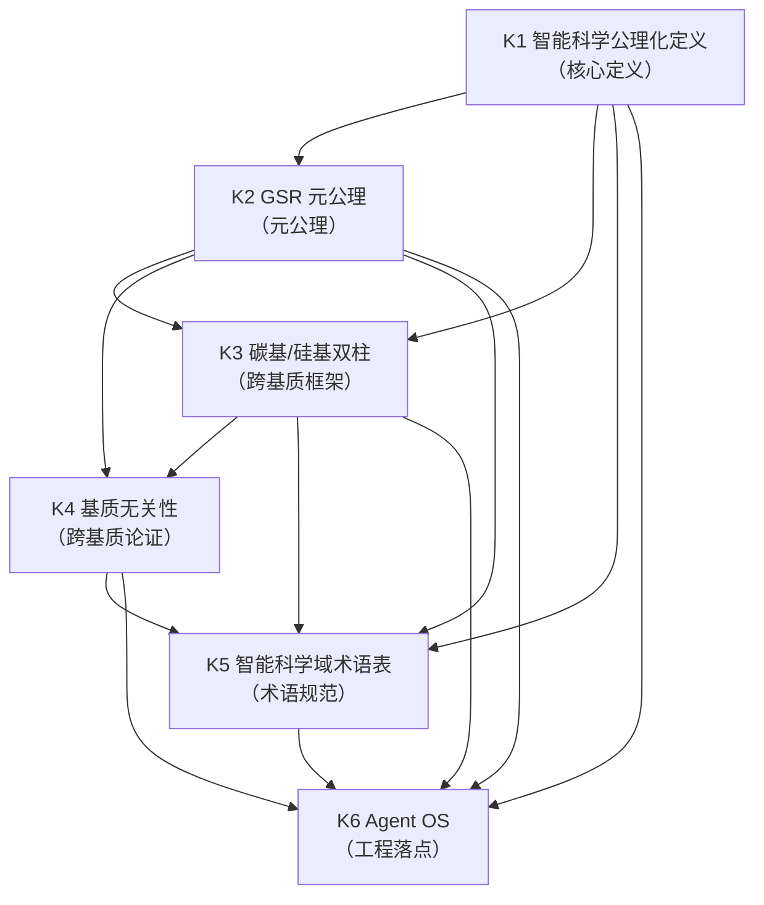
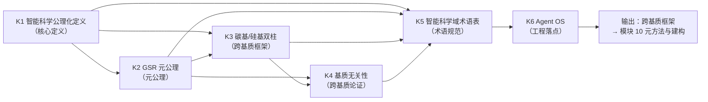

# SMOD-09 · 状态范式模块 9：跨基质与智能科学（× 变量范式对位）

> **来源与性质**：状态范式模块 9/10·与变量范式 MOD 系对位（对位模块见 1.1 定位表）。

>
> **框架声明**：本件「四层次」结构系呈现层构造、非库内文档框架。

## 一、模块定位与知识点总览

### 1.1 模块定位表

| 项 | 内容 |
|---|---|
| 所属范式 | 状态范式（功能层） |
| MECE 编号 | 模块 9 / 共 10 模块 |
| 核心问题 | 只适用于人类吗？ |
| 关键知识 | GSR、碳基/硅基双柱、基质无关、Agent OS |
| 代表工具/方法 | 22-DEF-01、22-A-01 |
| 当前状态 | **部分形式化，待实证** |
| 在知识生产链中的位置 | **第九环·跨基质扩展**——上游承接模块 1“本体论”、模块 2“状态语法”、模块 5“动力学与计算引擎”，下游供给模块 10“元方法与建构”以跨基质框架 |
| 变量范式对位模块 | 模块 6“计算建模与预测”（计算精神病学）＋模块 3“研究设计与抽样”（WEIRD 样本） |
| 本模块的真正分歧 | 适用范围：人类 vs 任何目标驱动系统；本体论：人类中心 vs 控制论中性；基质：碳基 vs 碳基/硅基/混合；术语：心理科学域 vs 智能科学域 |

### 1.2 知识点清单表

| # | 知识点 | 一句话定位 | 在状态范式中的角色 |
|---|---|---|---|
| K1 | 智能科学公理化定义 | 智能 = 智能体感知资源、调度资源、重塑结构的能力 | 智能科学域核心定义 |
| K2 | GSR 元公理 | Goal-Structure-Realization 目标-结构-实现循环 | 智能科学域元公理 |
| K3 | 碳基/硅基双柱 | 碳基智能（人类）与硅基智能（AI Agent）双柱 | 跨基质框架 |
| K4 | 基质无关性 | 功能系统层在不同基质实现层上可运行 | 跨基质论证 |
| K5 | 智能科学域术语表 | 22-S-02 智能科学域独立术语标准 | 智能科学域术语规范 |
| K6 | Agent OS | 智能体操作系统（AOSE） | 硅基智能体的工程落点 |

### 1.3 每个知识点的大纲解释表

| 知识点 | 简要大纲解释 |
|---|---|
| **三层规范用词对照** | 基质实现层↔物理／神经实现描述；功能系统层↔心理科学域原词「功能层」；现象呈现层↔「现象层」。权威对照表＝22-S-01《智能科学域↔心理科学域历史命名对照表》与 22-S-02 §4.1 两域一源原则。 |
| **K1 智能科学公理化定义** | 智能 = 智能体在持续变化的外部环境之中，能够感知资源状态、进行资源调度、必要时对结构进行重塑，从而维持自身有序存在并完成所承担目标的能力。门控、调制、校准、重联四种干预能力是必然延伸。**不预设物质基质**（碳基/硅基/混合均可）。 |
| **K2 GSR 元公理** | 智能科学域元公理：Goal-Structure-Realization（目标-结构-实现）。控制论等价物为负反馈回路。与心理科学域 N-S-R 关系：仅首字母+首全称差 1 词（Need→Goal），S/R 全称与中文操作性定义保留。不预设欲求主体。 |
| **K3 碳基/硅基双柱** | 碳基智能（人类）与硅基智能（AI Agent）双柱。18-DIVE（碳基）与 26-SIPE（硅基）双实例。共享同一套 G-M-A-R 干预语法、R-D-S 状态语法、S-P 环境参照系。双柱各有 ≥1 个 M3 实达产出后，双柱对齐与升位候选触发（06-S D9）。 |
| **K4 基质无关性** | 功能系统层在不同基质实现层上可运行。碳基（神经元回路）→6 模块全实例化→42 维；硅基（晶体管芯片）→不含 M5 为 4 模块→28 维；含 M5 为 5 模块→35 维（22-S-02 §8.4 口径 订正）。功能系统层等价：碳基 M-R-P = 神经回路驱动的目标-结构-实现循环；硅基 M-R-P = Transformer 驱动的目标-结构-实现循环；两者在抽象控制论层面等价。 |
| **K5 智能科学域术语表** | 22-S-02 智能科学域独立术语标准：M1-M6 双语义（心理科学域：具身/认知/意志/情绪/言语/行为；智能科学域：自稳/认知/裁度/价标/符联/习行）、G-S-R 元公理、G-M-A-R 操作语法、R-D-S 三轴、边界外维度登记表。双轨制规范用词（基质实现层/功能系统层/现象呈现层）。 |
| **K6 Agent OS** | 智能体操作系统（AOSE）：给 LLM 外挂白箱状态寄存器与资源调度器。LLM 是推理内核（覆盖 M2/M5），其他四模块（M1/M3/M4/M6）由外挂状态机/工具链补齐。G-M-A-R 运行时硬门控取代 RLHF：GATE 拦截、ALIGN 修正规则、MODULATE 资源调度、RELINK 热插拔。 |

## 二、知识点详解对比

### 2.1 K1 智能科学公理化定义 —— 详细对比

| 维度 | 变量范式（智能定义谱系） | 状态范式（智能科学公理化定义） |
|---|---|---|
| 定义方式 | 行为主义式、计算/信息处理式、认知结构式、生态/适应式、预测加工式 | 公理化定义：感知资源、调度资源、重塑结构 |
| 适用范围 | 通常限于人类或特定系统 | 任何目标驱动系统（碳基/硅基/混合） |
| 本体论 | 人类中心 | 控制论中性 |
| 术语 | 心理科学域术语 | 智能科学域术语 |
| 与 N-S-R 关系 | 无 | G-S-R 升格（Need→Goal）；仅首字母差 1 词 |
| 库内对应 | — | 22-DEF-01（智能科学公理化定义） |
| 关键分歧 | 变量范式用智能定义谱系；状态范式用公理化定义 | 前者是人类中心；后者是控制论中性 |

### 2.2 K2 GSR 元公理 —— 详细对比

| 维度 | 变量范式（无对应） | 状态范式（GSR 元公理） |
|---|---|---|
| 元公理 | 无 | Goal-Structure-Realization |
| 控制论等价物 | 无 | 负反馈回路 |
| 与 N-S-R 关系 | 无 | 仅首字母差 1 词（Need→Goal），S/R 全称保留 |
| 预设欲求主体 | 无 | 不预设 |
| 逻辑结构 | 无 | 目标-结构-实现循环 |
| 库内对应 | — | 22-S-02 §一；22-DEF-01 §二 |
| 关键分歧 | 变量范式无对应；状态范式用 GSR 元公理 | 前者无元公理；后者有严格的元公理 |

### 2.3 K3 碳基/硅基双柱 —— 详细对比

| 维度 | 变量范式（人类中心） | 状态范式（碳基/硅基双柱） |
|---|---|---|
| 适用范围 | 通常限于人类 | 碳基（人类）+ 硅基（AI Agent） |
| 双实例 | 无 | 18-DIVE（碳基）+ 26-SIPE（硅基） |
| 共享语法 | 无 | G-M-A-R 干预语法、R-D-S 状态语法、S-P 环境参照系 |
| 双柱对齐 | 无 | 双柱各有 ≥1 个 M3 实达产出后触发（06-S D9） |
| 实证探针 | 无 | DMD（碳基探针）+ 硅基坐标系（硅基探针） |
| 库内对应 | — | 22-DEF-01 §3.3.1；22-A-01（基质运行栈） |
| 关键分歧 | 变量范式用人类中心；状态范式用碳基/硅基双柱 | 前者限于人类；后者涵盖碳基/硅基 |

### 2.4 K4 基质无关性 —— 详细对比

| 维度 | 变量范式（无对应） | 状态范式（基质无关性） |
|---|---|---|
| 基质无关性 | 无 | 功能系统层在不同基质实现层上可运行 |
| 碳基实例 | 无 | 神经元回路 → 6 模块 → 42 维 |
| 硅基实例 | 无 | 晶体管芯片 → 不含 M5 为 4 模块→28 维；含 M5 为 5 模块→35 维（22-S-02 §8.4） |
| 功能等价性 | 无 | 碳基 M-R-P = 硅基 M-R-P（抽象控制论层面等价） |
| 观测前提 | 无 | 可观测性作为对照前提（白盒/黑盒/灰盒） |
| 库内对应 | — | 22-A-01（基质运行栈）；22-DEF-01 §3.3.1 |
| 关键分歧 | 变量范式无基质无关性；状态范式用基质无关性 | 前者限于单一基质；后者涵盖跨基质 |

> **展开注**：「可观测性作为对照前提」的具体形态＝白盒／黑盒／灰盒三重对照不对称，详见 22-A-01 §7.2。

### 2.5 K5 智能科学域术语表 —— 详细对比

| 维度 | 变量范式（心理科学域术语） | 状态范式（智能科学域术语） |
|---|---|---|
| 术语体系 | 心理科学域术语（构念、潜变量） | 智能科学域术语（G-S-R、M1-M6 双语义、G-M-A-R） |
| M1-M6 | 无对应 | 双语义：心理科学域（具身/认知/意志/情绪/言语/行为）vs 智能科学域（自稳/认知/裁度/价标/符联/习行） |
| 元公理 | 无对应 | G-S-R（Goal-Structure-Realization） |
| 三层规范用词 | 无对应 | 基质实现层/功能系统层/现象呈现层 |
| 边界外维度 | 无对应 | 22-S-02 §九 边界外维度登记表 11 项 |
| 双轨制 | 无 | 心理科学域保留原术语，智能科学域用新术语 |
| 库内对应 | — | 22-S-02（智能科学域术语表）；22-S-01（历史命名对照表） |
| 关键分歧 | 变量范式用心理科学域术语；状态范式用智能科学域术语 | 前者是心理科学域；后者是智能科学域 |

### 2.6 K6 Agent OS —— 详细对比

| 维度 | 变量范式（无对应） | 状态范式（Agent OS） |
|---|---|---|
| 核心工具 | 无 | 智能体操作系统（AOSE） |
| LLM 定位 | 无 | 推理内核（覆盖 M2/M5） |
| 外挂模块 | 无 | M1/M3/M4/M6 由外挂状态机/工具链补齐 |
| G-M-A-R 硬门控 | 无 | 取代 RLHF：GATE 拦截、ALIGN 修正规则、MODULATE 资源调度、RELINK 热插拔 |
| 白箱状态 | 无 | 42 维白箱状态 + 四类原子操作执行栈 |
| 库内对应 | — | 19-AOSE（智能体操作系统工程）；03-E-13（AGI 兼容性探索） |
| 关键分歧 | 变量范式无对应；状态范式用 Agent OS | 前者无工程落点；后者有完整的工程落点 |

## 三、知识库链接

### 3.1 K1 智能科学公理化定义 —— 知识库链接表

| 类别 | 内容 | 库内/库外对应 |
|---|---|---|
| 核心工具 | 智能科学公理化定义 | — |
| 相关理论 | 控制论、功能主义 | Wiener (1948) |
| 心理学表现 | 智能定义谱系 | — |
| 状态范式对位 | 22-DEF-01（智能科学公理化定义） | 库内 |
| 关键文档 | 22-DEF-01《智能科学公理化定义》 | 库内 |
| 关键论证 | 智能 = 智能体感知资源、调度资源、重塑结构的能力 | 22-DEF-01 §一 |
| 延伸阅读 | Wiener (1948)；22-DEF-01 | 库内/库外 |
| 相关争议 | 智能定义的公理化；与心理科学域定义的关系 | 22-DEF-01 §三 |

### 3.2 K2 GSR 元公理 —— 知识库链接表

| 类别 | 内容 | 库内/库外对应 |
|---|---|---|
| 核心工具 | G-S-R（Goal-Structure-Realization） | — |
| 相关理论 | 控制论、系统论 | Wiener (1948)；von Bertalanffy (1968) |
| 心理学表现 | 目标-结构-实现循环 | — |
| 状态范式对位 | 22-S-02 §一；22-DEF-01 §二 | 库内 |
| 关键文档 | 22-S-02《智能科学域术语表》§一；22-DEF-01《智能科学公理化定义》§二 | 库内 |
| 关键论证 | G-S-R 是智能科学域元公理；不预设欲求主体 | 22-S-02 §1.1 |
| 延伸阅读 | Wiener (1948)；von Bertalanffy (1968)；22-S-02 §一 | 库内/库外 |
| 相关争议 | G-S-R 与 N-S-R 的关系；升格论证 | 22-S-02 §1.1 |

### 3.3 K3 碳基/硅基双柱 —— 知识库链接表

| 类别 | 内容 | 库内/库外对应 |
|---|---|---|
| 核心工具 | 碳基智能（人类）+ 硅基智能（AI Agent） | — |
| 相关理论 | 控制论、智能科学 | Wiener (1948) |
| 心理学表现 | 双实例实证框架 | — |
| 状态范式对位 | 22-DEF-01 §3.3.1；22-A-01（基质运行栈） | 库内 |
| 关键文档 | 22-DEF-01《智能科学公理化定义》§3.3.1；22-A-01《基质运行栈三层模型》 | 库内 |
| 关键论证 | 碳基/硅基双柱共享同一套 G-M-A-R 干预语法、R-D-S 状态语法、S-P 环境参照系 | 22-DEF-01 §3.3.1 |
| 延伸阅读 | Wiener (1948)；22-A-01；22-DEF-01 §3.3.1 | 库内/库外 |
| 相关争议 | 双柱对齐的条件；跨基质实证 | 22-A-01 §三 |

### 3.4 K4 基质无关性 —— 知识库链接表

| 类别 | 内容 | 库内/库外对应 |
|---|---|---|
| 核心工具 | 基质无关性（功能系统层在不同基质实现层上可运行） | — |
| 相关理论 | 多重实现、功能主义 | Putnam (1967)；Fodor (1974) |
| 心理学表现 | 跨基质对照 | — |
| 状态范式对位 | 22-A-01（基质运行栈）；22-DEF-01 §3.3.1 | 库内 |
| 关键文档 | 22-A-01《基质运行栈三层模型》；22-DEF-01《智能科学公理化定义》§3.3.1 | 库内 |
| 关键论证 | 功能系统层等价：碳基 M-R-P = 硅基 M-R-P（抽象控制论层面等价） | 22-A-01 §6.1 |
| 延伸阅读 | Putnam (1967)；Fodor (1974)；22-A-01 | 库内/库外 |
| 相关争议 | 基质无关性的实证检验；跨基质效度可迁移性 | 22-DEF-01 §3.3.1 |

### 3.5 K5 智能科学域术语表 —— 知识库链接表

| 类别 | 内容 | 库内/库外对应 |
|---|---|---|
| 核心工具 | M1-M6 双语义、G-S-R、G-M-A-R、R-D-S、边界外维度 | — |
| 相关理论 | 术语治理、域分离 | 22-S-02 |
| 心理学表现 | 智能科学域术语标准 | — |
| 状态范式对位 | 22-S-02（智能科学域术语表）；22-S-01（历史命名对照表） | 库内 |
| 关键文档 | 22-S-02《智能科学域术语表》；22-S-01《历史命名对照表》 | 库内 |
| 关键论证 | 两域一源原则：心理学主域用原词，智能科学域用中性词 | 22-S-02 §4.1 |
| 延伸阅读 | 22-S-02；22-S-01 | 库内 |
| 相关争议 | 双语义原则；双轨制规范用词 | 22-S-02 §5.4 |

### 3.6 K6 Agent OS —— 知识库链接表

| 类别 | 内容 | 库内/库外对应 |
|---|---|---|
| 核心工具 | 智能体操作系统（AOSE） | — |
| 相关理论 | Agent OS、推理内核 | 19-AOSE |
| 心理学表现 | 硅基智能体工程 | — |
| 状态范式对位 | 19-AOSE（智能体操作系统工程）；03-E-13（AGI 兼容性探索） | 库内 |
| 关键文档 | 19-AOSE README；03-E-13《INTRE-AI 工程与 AGI 控制论兼容性探索》 | 库内 |
| 关键论证 | LLM 是推理内核（覆盖 M2/M5），其他四模块由外挂状态机/工具链补齐 | 03-E-13 §二 |
| 延伸阅读 | 19-AOSE README；03-E-13 | 库内 |
| 相关争议 | G-M-A-R 运行时硬门控取代 RLHF 的可行性 | 03-E-13 §二 |

## 四、知识点依赖关系

### 4.1 依赖关系总表

| 知识点 | 依赖 | 被依赖 | 依赖类型 | 说明 |
|---|---|---|---|---|
| K1 智能科学公理化定义 | 模块 1（本体论）、模块 2（状态语法） | K2、K3、K4、K5、K6 | 核心定义 | 智能科学公理化定义是智能科学域核心定义 |
| K2 GSR 元公理 | K1 | K3、K4 | 元公理 | GSR 元公理是智能科学域元公理 |
| K3 碳基/硅基双柱 | K1、K2、模块 5（动力学） | K4、K5、K6 | 跨基质框架 | 碳基/硅基双柱是跨基质框架 |
| K4 基质无关性 | K2、K3 | K5、K6 | 跨基质论证 | 基质无关性是跨基质论证 |
| K5 智能科学域术语表 | K1、K2、K3、K4 | K6 | 术语规范 | 智能科学域术语表是术语规范 |
| K6 Agent OS | K1、K2、K3、K4、K5 | — | 工程落点 | Agent OS 是硅基智能体的工程落点 |

### 4.2 依赖关系图

### 4.3 依赖关系深度解剖表

| 依赖对 | 依赖内容 | 深度 | 结构性后果 |
|---|---|---|---|
| K1 → K2 | 智能科学公理化定义 → GSR 元公理 | 强 | GSR 元公理基于智能科学公理化定义 |
| K1 → K3 | 智能科学公理化定义 → 碳基/硅基双柱 | 强 | 碳基/硅基双柱基于智能科学公理化定义 |
| K2 → K3 | GSR 元公理 → 碳基/硅基双柱 | 强 | 碳基/硅基双柱共享 GSR 元公理 |
| K2 → K4 | GSR 元公理 → 基质无关性 | 强 | 基质无关性基于 GSR 元公理 |
| K3 → K4 | 碳基/硅基双柱 → 基质无关性 | 强 | 基质无关性基于碳基/硅基双柱 |
| K1 → K5 | 智能科学公理化定义 → 智能科学域术语表 | 强 | 智能科学域术语表基于智能科学公理化定义 |
| K2 → K5 | GSR 元公理 → 智能科学域术语表 | 强 | 智能科学域术语表基于 GSR 元公理 |
| K3 → K5 | 碳基/硅基双柱 → 智能科学域术语表 | 强 | 智能科学域术语表基于碳基/硅基双柱 |
| K4 → K5 | 基质无关性 → 智能科学域术语表 | 强 | 智能科学域术语表基于基质无关性 |
| K1 → K6 | 智能科学公理化定义 → Agent OS | 强 | Agent OS 基于智能科学公理化定义 |
| K2 → K6 | GSR 元公理 → Agent OS | 强 | Agent OS 基于 GSR 元公理 |
| K3 → K6 | 碳基/硅基双柱 → Agent OS | 强 | Agent OS 基于碳基/硅基双柱 |
| K4 → K6 | 基质无关性 → Agent OS | 强 | Agent OS 基于基质无关性 |
| K5 → K6 | 智能科学域术语表 → Agent OS | 强 | Agent OS 基于智能科学域术语表 |

### 4.4 与变量范式的依赖关系对比

| 状态范式依赖 | 变量范式对应 | 差异 |
|---|---|---|
| K1 智能科学公理化定义 → K2 GSR 元公理 | 无对应 → 无对应 | 状态范式用智能科学公理化定义；变量范式无对应 |
| K2 GSR 元公理 → K3 碳基/硅基双柱 | 无对应 → 人类中心 | 状态范式用 GSR 元公理；变量范式用人类中心 |
| K3 碳基/硅基双柱 → K4 基质无关性 | 人类中心 → 无对应 | 状态范式用碳基/硅基双柱；变量范式用人类中心 |
| K4 基质无关性 → K5 智能科学域术语表 | 无对应 → 心理科学域术语 | 状态范式用基质无关性；变量范式用心理科学域术语 |
| K5 智能科学域术语表 → K6 Agent OS | 心理科学域术语 → 无对应 | 状态范式用智能科学域术语表；变量范式用心理科学域术语 |
| K1–K6 | 无对应 + 人类中心 + 心理科学域术语 | 状态范式用智能科学公理化定义 + GSR 元公理 + 碳基/硅基双柱 + 基质无关性 + 智能科学域术语表 + Agent OS；变量范式用人类中心 + 心理科学域术语 |

### 4.5 关键依赖链：从智能科学公理化定义到 Agent OS

**关键结论：**

1. **K1 智能科学公理化定义是核心定义**：智能 = 智能体感知资源、调度资源、重塑结构的能力。
2. **K2 GSR 元公理是元公理**：Goal-Structure-Realization（目标-结构-实现循环）。
3. **K3 碳基/硅基双柱是跨基质框架**：碳基智能（人类）与硅基智能（AI Agent）双柱。
4. **K4 基质无关性是跨基质论证**：功能系统层在不同基质实现层上可运行。
5. **K5 智能科学域术语表是术语规范**：M1-M6 双语义、G-S-R、G-M-A-R、R-D-S、边界外维度。
6. **K6 Agent OS 是工程落点**：智能体操作系统（AOSE）。
7. **模块 9 的输出是跨基质框架**：这个跨基质框架供给模块 10（元方法与建构）。
8. **与变量范式的根本差异**：变量范式用人类中心、心理科学域术语；状态范式用智能科学公理化定义、GSR 元公理、碳基/硅基双柱、基质无关性、智能科学域术语表、Agent OS。

### 4.6 模块间依赖：模块 9 与相邻模块的关系

| 关系 | 上游 | 下游 | 依赖内容 |
|---|---|---|---|
| 模块 1 → 模块 9 | 本体论与层级 | 跨基质与智能科学 | 模块 1 定义功能层定位，模块 9 定义跨基质扩展 |
| 模块 2 → 模块 9 | 状态语法 | 跨基质与智能科学 | 模块 2 定义状态空间，模块 9 定义跨基质状态空间 |
| 模块 5 → 模块 9 | 动力学与计算引擎 | 跨基质与智能科学 | 模块 5 定义动力学，模块 9 定义跨基质动力学 |
| 模块 9 → 模块 10 | 跨基质与智能科学 | 元方法与建构 | 模块 9 提供跨基质框架，模块 10 定义元方法 |
| 模块 9 ↔ 模块 7 | 跨基质与智能科学 ↔ 干预与验证 | 双向依赖 | 干预验证可跨基质扩展；跨基质对照验证干预效果 |
| 模块 9 ↔ 模块 8 | 跨基质与智能科学 ↔ 治理与证据 | 双向依赖 | 跨基质扩展影响证据分级；证据分级验证跨基质扩展 |

## 疑问解答（附属·v0.2.0 增）

本节为附属疑问解答（9 条）。

### 疑问 1：本模块“真正分歧”的适用范围、本体论、基质、术语四重分歧如何与变量范式镜像？

| 维度 | 变量范式 | 状态范式 |
|---|---|---|
| 适用范围 | 人类 | 任何目标驱动系统 |
| 本体论 | 人类中心 | 控制论中性 |
| 基质 | 碳基 | 碳基/硅基/混合 |
| 术语 | 心理科学域 | 智能科学域 |
| 镜像关系 | 用人类中心 + 心理科学域术语 | 用智能科学公理化定义 + GSR 元公理 + 碳基/硅基双柱 + 基质无关性 + 智能科学域术语表 + Agent OS |
| 一句话 | 变量范式用人类中心 + 心理科学域术语；状态范式用智能科学公理化定义 + GSR 元公理 + 碳基/硅基双柱 + 基质无关性 + 智能科学域术语表 + Agent OS |

---

### 疑问 2：K1 智能科学公理化定义的核心内容如何？

| 维度 | 解答 |
|---|---|
| 定义正文 | 智能，是智能体在持续变化的外部环境之中，能够感知资源状态、进行资源调度、必要时对结构进行重塑，从而维持自身有序存在并完成所承担目标的能力 |
| GMAR 四能力 | 门控、调制、校准、重联四种干预能力，是维持有序存在和完成目标这件事在可操作意义上的自然延伸 |
| 作用范围 | 既作用于自身，也作用于环境 |
| 不预设物质基质 | 碳基/硅基/混合均可 |
| 一句话 | 智能科学公理化定义不预设物质基质，适用任何目标驱动系统 |

---

### 疑问 3：K2 GSR 元公理与 N-S-R 元公理的关系如何？

| 维度 | 心理科学域（N-S-R） | 智能科学域（G-S-R） |
|---|---|---|
| 缩写 | N-S-R | G-S-R |
| 全称 | Need-Structure-Realization | Goal-Structure-Realization |
| 中文 | 需要-结构-实现 | 目标-结构-实现 |
| 差异 | 首字母 + 首全称差 1 词（Need→Goal） | — |
| S/R 全称 | 保留 | 保留 |
| 中文操作性定义 | 保留 | 保留 |
| 是否预设欲求主体 | 是 | 否 |
| 升格范围 | 心理学主域 | 智能科学域 |
| 一句话 | G-S-R 与 N-S-R 仅首字母 + 首全称差 1 词；S/R 全称与中文操作性定义保留；不预设欲求主体 |

---

### 疑问 4：K3 碳基/硅基双柱的共享语法与双实例如何？

| 维度 | 解答 |
|---|---|
| 双柱 | 碳基智能（人类）+ 硅基智能（AI Agent） |
| 双实例 | 18-DIVE（碳基）+ 26-SIPE（硅基） |
| 共享语法 | G-M-A-R 干预语法、R-D-S 状态语法、S-P 环境参照系 |
| 双柱对齐 | 双柱各有 ≥1 个 M3 实达产出后触发 |
| 实证探针 | DMD（碳基探针）+ 硅基坐标系（硅基探针） |
| 一句话 | 碳基/硅基双柱共享同一套 G-M-A-R 干预语法、R-D-S 状态语法、S-P 环境参照系 |

---

### 疑问 5：K4 基质无关性的实例化维度如何？

| 维度 | 解答 |
|---|---|
| 碳基实例 | 神经元回路 → 6 模块全实例化 → 42 维 |
| 硅基实例 | 晶体管芯片 → 不含 M5 为 4 模块→28 维；含 M5 为 5 模块→35 维 |
| 功能系统层等价 | 碳基 M-R-P = 神经回路驱动的目标-结构-实现循环；硅基 M-R-P = Transformer 驱动的目标-结构-实现循环 |
| 等价层面 | 抽象控制论层面等价 |
| 观测前提 | 可观测性作为对照前提（白盒/黑盒/灰盒） |
| 一句话 | 功能系统层在不同基质实现层上可运行；碳基 42 维，硅基 28-35 维 |

---

### 疑问 6：K5 智能科学域术语表的双语义原则如何？

| 维度 | 心理科学域 | 智能科学域 |
|---|---|---|
| M1 | 具身 | 自稳 |
| M2 | 认知 | 认知 |
| M3 | 意志 | 裁度 |
| M4 | 情绪 | 价标 |
| M5 | 言语 | 符联 |
| M6 | 行为 | 习行 |
| 双语义原则 | M1-M6 既是心理科学域人类实例化模块集合，也是智能科学域核心模块集合；阅读者依据文档所属工程域默认切换语义 | — |
| 一句话 | M1-M6 双语义：心理科学域用人类实例化语言，智能科学域用一般功能语言 |

---

### 疑问 7：K6 Agent OS 的工程落点如何？

| 维度 | 解答 |
|---|---|
| 核心工具 | 智能体操作系统（AOSE） |
| LLM 定位 | 推理内核（覆盖 M2/M5） |
| 外挂模块 | M1/M3/M4/M6 由外挂状态机/工具链补齐 |
| G-M-A-R 硬门控 | 取代 RLHF：GATE 拦截、ALIGN 修正规则、MODULATE 资源调度、RELINK 热插拔 |
| 白箱状态 | 42 维白箱状态 + 四类原子操作执行栈 |
| 一句话 | Agent OS 给 LLM 外挂白箱状态寄存器与资源调度器；G-M-A-R 运行时硬门控取代 RLHF |

---

### 疑问 8：本模块知识点依赖链是否闭合？状态范式如何对应？

| 状态范式依赖 | 内容 | 差异 |
|---|---|---|
| K1 智能科学公理化定义 → K2 GSR 元公理 | GSR 元公理基于智能科学公理化定义 | — |
| K1 智能科学公理化定义 → K3 碳基/硅基双柱 | 碳基/硅基双柱基于智能科学公理化定义 | — |
| K2 GSR 元公理 → K3 碳基/硅基双柱 | 碳基/硅基双柱共享 GSR 元公理 | — |
| K2 GSR 元公理 → K4 基质无关性 | 基质无关性基于 GSR 元公理 | — |
| K3 碳基/硅基双柱 → K4 基质无关性 | 基质无关性基于碳基/硅基双柱 | — |
| K1 智能科学公理化定义 → K5 智能科学域术语表 | 智能科学域术语表基于智能科学公理化定义 | — |
| K2 GSR 元公理 → K5 智能科学域术语表 | 智能科学域术语表基于 GSR 元公理 | — |
| K3 碳基/硅基双柱 → K5 智能科学域术语表 | 智能科学域术语表基于碳基/硅基双柱 | — |
| K4 基质无关性 → K5 智能科学域术语表 | 智能科学域术语表基于基质无关性 | — |
| K1 智能科学公理化定义 → K6 Agent OS | Agent OS 基于智能科学公理化定义 | — |
| K2 GSR 元公理 → K6 Agent OS | Agent OS 基于 GSR 元公理 | — |
| K3 碳基/硅基双柱 → K6 Agent OS | Agent OS 基于碳基/硅基双柱 | — |
| K4 基质无关性 → K6 Agent OS | Agent OS 基于基质无关性 | — |
| K5 智能科学域术语表 → K6 Agent OS | Agent OS 基于智能科学域术语表 | — |
| 依赖链是否闭合 | 从智能科学公理化定义出发，经由 GSR 元公理、碳基/硅基双柱、基质无关性、智能科学域术语表，到达 Agent OS | — |
| 一句话 | 变量范式用人类中心 + 心理科学域术语；状态范式用智能科学公理化定义 + GSR 元公理 + 碳基/硅基双柱 + 基质无关性 + 智能科学域术语表 + Agent OS |

---

### 疑问 9：本模块与相邻状态范式模块的依赖关系如何？

| 关系 | 上游 | 下游 | 依赖内容 |
|---|---|---|---|
| SMOD-01 → 本模块 | 本体论与层级 | 跨基质与智能科学 | SMOD-01 定义功能层定位，本模块定义跨基质扩展 |
| SMOD-02 → 本模块 | 状态语法 | 跨基质与智能科学 | SMOD-02 定义状态空间，本模块定义跨基质状态空间 |
| SMOD-05 → 本模块 | 动力学与计算引擎 | 跨基质与智能科学 | SMOD-05 定义动力学，本模块定义跨基质动力学 |
| 本模块 → SMOD-10 | 跨基质与智能科学 | 元方法与建构 | 本模块提供跨基质框架，SMOD-10 定义元方法 |
| 本模块 ↔ SMOD-07 | 跨基质与智能科学 ↔ 干预与验证 | 双向依赖 | 干预验证可跨基质扩展；跨基质对照验证干预效果 |
| 本模块 ↔ SMOD-08 | 跨基质与智能科学 ↔ 治理与证据 | 双向依赖 | 跨基质扩展影响证据分级；证据分级验证跨基质扩展 |
| 一句话 | 本模块是状态范式的“跨基质扩展引擎”，上承本体论、状态语法、动力学，下接元方法、干预验证、治理证据 | — | — |

## 版本记录

| 版本 | 日期 | 变更说明 |
|---|---|---|
| v0.3.3 | 2026-10-31 | 主文减负批（B261031-05·未 commit）：4 处。判升 Patch。 |
| v0.3.2 | 2026-10-31 | 去过程化梳理批（14-ENGRAM-B261031-04·未 commit）：5 处清理。判升 Patch。 |
| v0.3.1 | 2026-10-31 | 去绝对化梳理批（14-ENGRAM-B261031-03·未 commit）：「必然延伸」→「自然延伸」。判升 Patch。 |
| v0.3.0 | 2026-10-29 | 双范式正名批（DR-2026-10-29-TERM-002 v1.4.0）：正文「结构范式」→「状态范式」；判升 Minor。 |
| v0.2.1 | 2026-10-16 | Patch·B261016-04：外审机械订正批：rn v0.1.1 条拆碎段还原（外审候选×本窗独立解码双路对撞·并与末表 v0.1.1 同义行对撞）。… |
| v0.2.0 | 2026-10-13 | Minor·B261013-06：疑问解答增补批：增「疑问解答（附属）」一节（9 条）。 |
| v0.1.1 | 2026-10-13 | Patch·B261013-04：订正批：#3 硅基模块维数精确化两处（22-S-02 §8.4 口径）；#19 心理学域→心理科学域 11 处；#20 增三层规范用词对照注… |
| v0.1.0 | 2026-10-13 | 建件·B261013-03：结构范式模块 9/10 落盘（去四层次包装改四节直陈·第四层次系「与变量范式的依赖关系对比」反向对位·表格与 mermaid 2 枚零删减保留）。B261013-03。 |

> 全量版本 v0.1.0–v0.2.1（共 4 版）见 [HIST-SMOD §SMOD-09-跨基质与智能科学-v0.1-2026-10-13](HIST-SMOD_双范式对比学习模块-SMOD系版本沿革-v1.0-2026-10-18.md#doc-42)；当前无外迁版本。
