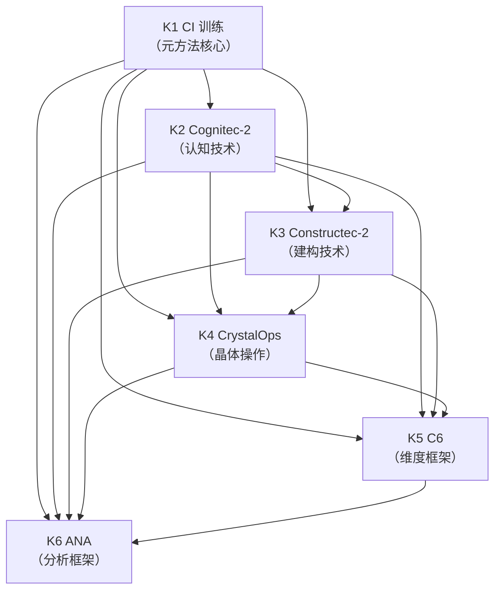
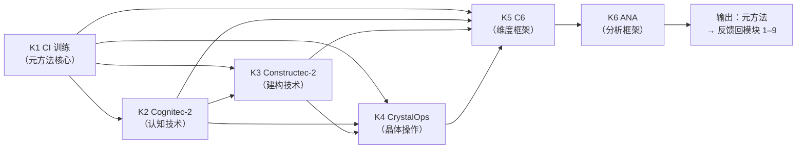

# SMOD-10 · 状态范式模块 10：元方法与建构（× 变量范式对位）

> **来源与性质**：状态范式模块 10/10·与变量范式 MOD 系对位（对位模块见 1.1 定位表）。

>
> **框架声明**：本件「四层次」结构系呈现层构造、非库内文档框架。

## 一、模块定位与知识点总览

### 1.1 模块定位表

| 项 | 内容 |
|---|---|
| 所属范式 | 状态范式（功能层） |
| MECE 编号 | 模块 10 / 共 10 模块 |
| 核心问题 | 这套范式如何被建出来？ |
| 关键知识 | CI 训练、Cognitec-2、Constructec-2、CrystalOps、C6、ANA |
| 代表工具/方法 | 09-M-01 |
| 当前状态 | **已提炼** |
| 在知识生产链中的位置 | **第十环·元层建构**——上游承接模块 1–9 的全部实践，下游反馈回模块 1–9 的建构方法 |
| 变量范式对位模块 | 模块 7“制度、实践与批判”（同行评审、开放科学、元分析） |
| 本模块的真正分歧 | 建构方法：分散的研究实践 vs 系统化的元方法；建构层级：研究层面 vs 范式建构层面；建构对象：知识条目 vs 范式本身 |

### 1.2 知识点清单表

| # | 知识点 | 一句话定位 | 在状态范式中的角色 |
|---|---|---|---|
| K1 | CI 训练 | 建构智能训练 | 元方法的核心训练 |
| K2 | Cognitec-2 | 认知技术 2.0 | 元方法的技术框架 |
| K3 | Constructec-2 | 建构技术 2.0 | 元方法的建构框架 |
| K4 | CrystalOps | 晶体操作 | 元方法的操作框架 |
| K5 | C6 | 六维建构框架 | 元方法的维度框架 |
| K6 | ANA | 分析框架 | 元方法的分析框架 |

### 1.3 每个知识点的大纲解释表

| 知识点 | 简要大纲解释 |
|---|---|
| **K1 CI 训练** | 建构智能训练（Constructive Intelligence）：训练建构者的元认知能力，使其能够系统化地建构范式。核心：从“研究实践”提升到“范式建构”。 |
| **K2 Cognitec-2** | 认知技术 2.0：系统化的认知技术框架。核心：认知建模、概念操作化、形式化。 |
| **K3 Constructec-2** | 建构技术 2.0：系统化的建构技术框架。核心：从概念到形式化、从形式化到工程化、从工程化到实证化。 |
| **K4 CrystalOps** | 晶体操作：晶体化的操作框架。核心：将模糊概念晶体化为可操作的形式化结构。 |
| **K5 C6** | 六维建构框架：六个维度的建构框架。核心：多维度系统化建构。 |
| **K6 ANA** | 分析框架：系统化的分析框架。核心：从现象到结构、从结构到机制、从机制到干预的分析路径。 |

## 二、知识点详解对比

### 2.1 K1 CI 训练 —— 详细对比

| 维度 | 变量范式（无对应） | 状态范式（CI 训练） |
|---|---|---|
| 核心工具 | 无 | 建构智能训练 |
| 训练对象 | 无 | 建构者的元认知能力 |
| 训练目标 | 无 | 系统化建构范式 |
| 训练层级 | 无 | 从“研究实践”到“范式建构” |
| 库内对应 | — | 09-M-01（元方法与建构） |
| 关键分歧 | 变量范式无对应；状态范式用 CI 训练 | 前者无元方法；后者有系统的元方法 |

### 2.2 K2 Cognitec-2 —— 详细对比

| 维度 | 变量范式（无对应） | 状态范式（Cognitec-2） |
|---|---|---|
| 核心工具 | 无 | 认知技术 2.0 |
| 核心功能 | 无 | 认知建模、概念操作化、形式化 |
| 系统化程度 | 无 | 系统化框架 |
| 与变量范式关系 | 无 | 变量范式无对应 |
| 库内对应 | — | 09-M-01（元方法与建构） |
| 关键分歧 | 变量范式无对应；状态范式用 Cognitec-2 | 前者无系统化认知技术；后者有 |

### 2.3 K3 Constructec-2 —— 详细对比

| 维度 | 变量范式（无对应） | 状态范式（Constructec-2） |
|---|---|---|
| 核心工具 | 无 | 建构技术 2.0 |
| 核心功能 | 无 | 从概念到形式化、从形式化到工程化、从工程化到实证化 |
| 系统化程度 | 无 | 系统化框架 |
| 与变量范式关系 | 无 | 变量范式无对应 |
| 库内对应 | — | 09-M-01（元方法与建构） |
| 关键分歧 | 变量范式无对应；状态范式用 Constructec-2 | 前者无系统化建构技术；后者有 |

### 2.4 K4 CrystalOps —— 详细对比

| 维度 | 变量范式（无对应） | 状态范式（CrystalOps） |
|---|---|---|
| 核心工具 | 无 | 晶体操作 |
| 核心功能 | 无 | 将模糊概念晶体化为可操作的形式化结构 |
| 系统化程度 | 无 | 系统化框架 |
| 与变量范式关系 | 无 | 变量范式无对应 |
| 库内对应 | — | 09-M-01（元方法与建构） |
| 关键分歧 | 变量范式无对应；状态范式用 CrystalOps | 前者无晶体化操作；后者有 |

### 2.5 K5 C6 —— 详细对比

| 维度 | 变量范式（无对应） | 状态范式（C6） |
|---|---|---|
| 核心工具 | 无 | 六维建构框架 |
| 核心功能 | 无 | 多维度系统化建构 |
| 系统化程度 | 无 | 系统化框架 |
| 与变量范式关系 | 无 | 变量范式无对应 |
| 库内对应 | — | 09-M-01（元方法与建构） |
| 关键分歧 | 变量范式无对应；状态范式用 C6 | 前者无多维度建构框架；后者有 |

### 2.6 K6 ANA —— 详细对比

| 维度 | 变量范式（无对应） | 状态范式（ANA） |
|---|---|---|
| 核心工具 | 无 | 分析框架 |
| 核心功能 | 无 | 从现象到结构、从结构到机制、从机制到干预 |
| 系统化程度 | 无 | 系统化框架 |
| 与变量范式关系 | 无 | 变量范式无对应 |
| 库内对应 | — | 09-M-01（元方法与建构） |
| 关键分歧 | 变量范式无对应；状态范式用 ANA | 前者无系统化分析框架；后者有 |

## 三、知识库链接

### 3.1 K1 CI 训练 —— 知识库链接表

| 类别 | 内容 | 库内/库外对应 |
|---|---|---|
| 核心工具 | 建构智能训练 | — |
| 相关理论 | 元认知、范式建构 | 09-M-01 |
| 心理学表现 | 建构者训练 | — |
| 状态范式对位 | 09-M-01（元方法与建构） | 库内 |
| 关键文档 | 09-M-01《元方法与建构》 | 库内 |
| 关键论证 | CI 训练是元方法的核心训练 | 09-M-01 |
| 延伸阅读 | 09-M-01 | 库内 |
| 相关争议 | CI 训练的系统性；范式建构的可训练性 | 09-M-01 |

### 3.2 K2 Cognitec-2 —— 知识库链接表

| 类别 | 内容 | 库内/库外对应 |
|---|---|---|
| 核心工具 | 认知技术 2.0 | — |
| 相关理论 | 认知建模、概念操作化 | 09-M-01 |
| 心理学表现 | 认知技术框架 | — |
| 状态范式对位 | 09-M-01（元方法与建构） | 库内 |
| 关键文档 | 09-M-01《元方法与建构》 | 库内 |
| 关键论证 | Cognitec-2 是系统化认知技术框架 | 09-M-01 |
| 延伸阅读 | 09-M-01 | 库内 |
| 相关争议 | Cognitec-2 的系统性；与变量范式的区别 | 09-M-01 |

### 3.3 K3 Constructec-2 —— 知识库链接表

| 类别 | 内容 | 库内/库外对应 |
|---|---|---|
| 核心工具 | 建构技术 2.0 | — |
| 相关理论 | 建构技术、形式化 | 09-M-01 |
| 心理学表现 | 建构技术框架 | — |
| 状态范式对位 | 09-M-01（元方法与建构） | 库内 |
| 关键文档 | 09-M-01《元方法与建构》 | 库内 |
| 关键论证 | Constructec-2 是系统化建构技术框架 | 09-M-01 |
| 延伸阅读 | 09-M-01 | 库内 |
| 相关争议 | Constructec-2 的系统性；与变量范式的区别 | 09-M-01 |

### 3.4 K4 CrystalOps —— 知识库链接表

| 类别 | 内容 | 库内/库外对应 |
|---|---|---|
| 核心工具 | 晶体操作 | — |
| 相关理论 | 晶体化、形式化 | 09-M-01 |
| 心理学表现 | 晶体化操作框架 | — |
| 状态范式对位 | 09-M-01（元方法与建构） | 库内 |
| 关键文档 | 09-M-01《元方法与建构》 | 库内 |
| 关键论证 | CrystalOps 是将模糊概念晶体化为可操作形式化结构的框架 | 09-M-01 |
| 延伸阅读 | 09-M-01 | 库内 |
| 相关争议 | 晶体化的判据；与变量范式的区别 | 09-M-01 |

### 3.5 K5 C6 —— 知识库链接表

| 类别 | 内容 | 库内/库外对应 |
|---|---|---|
| 核心工具 | 六维建构框架 | — |
| 相关理论 | 多维建构 | 09-M-01 |
| 心理学表现 | 多维建构框架 | — |
| 状态范式对位 | 09-M-01（元方法与建构） | 库内 |
| 关键文档 | 09-M-01《元方法与建构》 | 库内 |
| 关键论证 | C6 是多维度系统化建构框架 | 09-M-01 |
| 延伸阅读 | 09-M-01 | 库内 |
| 相关争议 | 六维的判据；与变量范式的区别 | 09-M-01 |

### 3.6 K6 ANA —— 知识库链接表

| 类别 | 内容 | 库内/库外对应 |
|---|---|---|
| 核心工具 | 分析框架 | — |
| 相关理论 | 系统分析 | 09-M-01 |
| 心理学表现 | 分析框架 | — |
| 状态范式对位 | 09-M-01（元方法与建构） | 库内 |
| 关键文档 | 09-M-01《元方法与建构》 | 库内 |
| 关键论证 | ANA 是从现象到结构、从结构到机制、从机制到干预的分析路径 | 09-M-01 |
| 延伸阅读 | 09-M-01 | 库内 |
| 相关争议 | ANA 的系统性；与变量范式的区别 | 09-M-01 |

## 四、知识点依赖关系

### 4.1 依赖关系总表

| 知识点 | 依赖 | 被依赖 | 依赖类型 | 说明 |
|---|---|---|---|---|
| K1 CI 训练 | 模块 1–9 全部实践 | K2、K3、K4、K5、K6 | 元方法核心 | CI 训练是元方法的核心训练 |
| K2 Cognitec-2 | K1 | K3、K4、K5、K6 | 认知技术 | Cognitec-2 是系统化认知技术框架 |
| K3 Constructec-2 | K1、K2 | K4、K5、K6 | 建构技术 | Constructec-2 是系统化建构技术框架 |
| K4 CrystalOps | K1、K2、K3 | K5、K6 | 晶体操作 | CrystalOps 是将模糊概念晶体化的框架 |
| K5 C6 | K1、K2、K3、K4 | K6 | 维度框架 | C6 是多维度系统化建构框架 |
| K6 ANA | K1、K2、K3、K4、K5 | — | 分析框架 | ANA 是系统化分析框架 |

### 4.2 依赖关系图

### 4.3 依赖关系深度解剖表

| 依赖对 | 依赖内容 | 深度 | 结构性后果 |
|---|---|---|---|
| K1 → K2 | CI 训练 → Cognitec-2 | 强 | CI 训练是 Cognitec-2 的基础 |
| K1 → K3 | CI 训练 → Constructec-2 | 强 | CI 训练是 Constructec-2 的基础 |
| K2 → K3 | Cognitec-2 → Constructec-2 | 强 | Cognitec-2 是 Constructec-2 的基础 |
| K1 → K4 | CI 训练 → CrystalOps | 强 | CI 训练是 CrystalOps 的基础 |
| K2 → K4 | Cognitec-2 → CrystalOps | 强 | Cognitec-2 是 CrystalOps 的基础 |
| K3 → K4 | Constructec-2 → CrystalOps | 强 | Constructec-2 是 CrystalOps 的基础 |
| K1 → K5 | CI 训练 → C6 | 强 | CI 训练是 C6 的基础 |
| K2 → K5 | Cognitec-2 → C6 | 强 | Cognitec-2 是 C6 的基础 |
| K3 → K5 | Constructec-2 → C6 | 强 | Constructec-2 是 C6 的基础 |
| K4 → K5 | CrystalOps → C6 | 强 | CrystalOps 是 C6 的基础 |
| K1 → K6 | CI 训练 → ANA | 强 | CI 训练是 ANA 的基础 |
| K2 → K6 | Cognitec-2 → ANA | 强 | Cognitec-2 是 ANA 的基础 |
| K3 → K6 | Constructec-2 → ANA | 强 | Constructec-2 是 ANA 的基础 |
| K4 → K6 | CrystalOps → ANA | 强 | CrystalOps 是 ANA 的基础 |
| K5 → K6 | C6 → ANA | 强 | C6 是 ANA 的基础 |

### 4.4 与变量范式的依赖关系对比

| 状态范式依赖 | 变量范式对应 | 差异 |
|---|---|---|
| K1 CI 训练 → K2 Cognitec-2 | 无对应 → 无对应 | 状态范式用 CI 训练；变量范式无对应 |
| K2 Cognitec-2 → K3 Constructec-2 | 无对应 → 无对应 | 状态范式用 Cognitec-2；变量范式无对应 |
| K3 Constructec-2 → K4 CrystalOps | 无对应 → 无对应 | 状态范式用 Constructec-2；变量范式无对应 |
| K4 CrystalOps → K5 C6 | 无对应 → 无对应 | 状态范式用 CrystalOps；变量范式无对应 |
| K5 C6 → K6 ANA | 无对应 → 无对应 | 状态范式用 C6；变量范式无对应 |
| K1–K6 | 无对应 | 状态范式用 CI 训练 + Cognitec-2 + Constructec-2 + CrystalOps + C6 + ANA；变量范式无对应 |

### 4.5 关键依赖链：从 CI 训练到 ANA

**关键结论：**

1. **K1 CI 训练是元方法核心**：建构智能训练，训练建构者的元认知能力。
2. **K2 Cognitec-2 是认知技术**：系统化认知技术框架。
3. **K3 Constructec-2 是建构技术**：系统化建构技术框架。
4. **K4 CrystalOps 是晶体操作**：将模糊概念晶体化为可操作的形式化结构。
5. **K5 C6 是维度框架**：多维度系统化建构框架。
6. **K6 ANA 是分析框架**：从现象到结构、从结构到机制、从机制到干预的分析路径。
7. **模块 10 的输出是元方法**：这个元方法反馈回模块 1–9 的建构方法。
8. **与变量范式的根本差异**：变量范式无对应；状态范式用 CI 训练、Cognitec-2、Constructec-2、CrystalOps、C6、ANA。

### 4.6 模块间依赖：模块 10 与相邻模块的关系

| 关系 | 上游 | 下游 | 依赖内容 |
|---|---|---|---|
| 模块 1–9 → 模块 10 | 全部实践 | 元方法与建构 | 模块 1–9 的实践供给模块 10 以元方法素材 |
| 模块 10 → 模块 1–9 | 元方法与建构 | 反馈修正 | 模块 10 的元方法反馈回模块 1–9 的建构方法 |
| 模块 10 → 模块 8 | 元方法与建构 | 治理与证据 | 模块 10 的元方法支撑模块 8 的治理与证据 |
| 模块 10 ↔ 模块 9 | 元方法与建构 ↔ 跨基质与智能科学 | 双向依赖 | 元方法支撑跨基质扩展；跨基质扩展验证元方法 |

## 疑问解答（附属·v0.2.0 增）

本节为附属疑问解答（7 条）。

### 疑问 1：本模块“真正分歧”的建构方法、建构层级、建构对象三重分歧如何与变量范式镜像？

| 维度 | 变量范式 | 状态范式 |
|---|---|---|
| 建构方法 | 分散的研究实践 | 系统化的元方法 |
| 建构层级 | 研究层面 | 范式建构层面 |
| 建构对象 | 知识条目 | 范式本身 |
| 镜像关系 | 无对应 | 用 CI 训练 + Cognitec-2 + Constructec-2 + CrystalOps + C6 + ANA |
| 一句话 | 变量范式用分散的研究实践；状态范式用系统化的元方法 |

---

### 疑问 2：K1 CI 训练的核心内容如何？

| 维度 | 解答 |
|---|---|
| 核心工具 | 建构智能训练 |
| 训练对象 | 建构者的元认知能力 |
| 训练目标 | 系统化建构范式 |
| 训练层级 | 从“研究实践”到“范式建构” |
| 一句话 | CI 训练是元方法的核心训练，训练建构者的元认知能力 |

---

### 疑问 3：K2 Cognitec-2 与 K3 Constructec-2 的分工如何？

| 维度 | Cognitec-2 | Constructec-2 |
|---|---|---|
| 核心工具 | 认知技术 2.0 | 建构技术 2.0 |
| 核心功能 | 认知建模、概念操作化、形式化 | 从概念到形式化、从形式化到工程化、从工程化到实证化 |
| 层级 | 认知技术层 | 建构技术层 |
| 一句话 | Cognitec-2 是认知技术框架；Constructec-2 是建构技术框架；二者分工明确 |

---

### 疑问 4：K4 CrystalOps 的核心功能如何？

| 维度 | 解答 |
|---|---|
| 核心工具 | 晶体操作 |
| 核心功能 | 将模糊概念晶体化为可操作的形式化结构 |
| 系统化程度 | 系统化框架 |
| 与变量范式关系 | 变量范式无对应 |
| 一句话 | CrystalOps 是将模糊概念晶体化为可操作形式化结构的框架 |

---

### 疑问 5：K5 C6 与 K6 ANA 的分工如何？

| 维度 | C6 | ANA |
|---|---|---|
| 核心工具 | 六维建构框架 | 分析框架 |
| 核心功能 | 多维度系统化建构 | 从现象到结构、从结构到机制、从机制到干预 |
| 层级 | 维度框架 | 分析框架 |
| 一句话 | C6 是多维度系统化建构框架；ANA 是从现象到干预的分析路径 |

---

### 疑问 6：本模块知识点依赖链是否闭合？状态范式如何对应？

| 状态范式依赖 | 内容 | 差异 |
|---|---|---|
| K1 CI 训练 → K2 Cognitec-2 | CI 训练是 Cognitec-2 的基础 | — |
| K1 CI 训练 → K3 Constructec-2 | CI 训练是 Constructec-2 的基础 | — |
| K2 Cognitec-2 → K3 Constructec-2 | Cognitec-2 是 Constructec-2 的基础 | — |
| K1 CI 训练 → K4 CrystalOps | CI 训练是 CrystalOps 的基础 | — |
| K2 Cognitec-2 → K4 CrystalOps | Cognitec-2 是 CrystalOps 的基础 | — |
| K3 Constructec-2 → K4 CrystalOps | Constructec-2 是 CrystalOps 的基础 | — |
| K1 CI 训练 → K5 C6 | CI 训练是 C6 的基础 | — |
| K2 Cognitec-2 → K5 C6 | Cognitec-2 是 C6 的基础 | — |
| K3 Constructec-2 → K5 C6 | Constructec-2 是 C6 的基础 | — |
| K4 CrystalOps → K5 C6 | CrystalOps 是 C6 的基础 | — |
| K1 CI 训练 → K6 ANA | CI 训练是 ANA 的基础 | — |
| K2 Cognitec-2 → K6 ANA | Cognitec-2 是 ANA 的基础 | — |
| K3 Constructec-2 → K6 ANA | Constructec-2 是 ANA 的基础 | — |
| K4 CrystalOps → K6 ANA | CrystalOps 是 ANA 的基础 | — |
| K5 C6 → K6 ANA | C6 是 ANA 的基础 | — |
| 依赖链是否闭合 | 从 CI 训练出发，经由 Cognitec-2、Constructec-2、CrystalOps、C6，到达 ANA | — |
| 一句话 | 变量范式无对应；状态范式用 CI 训练 + Cognitec-2 + Constructec-2 + CrystalOps + C6 + ANA |

---

### 疑问 7：本模块与相邻模块的依赖关系如何？

| 关系 | 上游 | 下游 | 依赖内容 |
|---|---|---|---|
| 全部前置模块 → 本模块 | 全部实践 | 元方法与建构 | 前置模块的实践供给本模块以元方法素材 |
| 本模块 → 全部前置模块 | 元方法与建构 | 反馈修正 | 本模块的元方法反馈回前置模块的建构方法 |
| 本模块 → SMOD-08 | 元方法与建构 | 治理与证据 | 本模块的元方法支撑 SMOD-08 的治理与证据 |
| 本模块 ↔ SMOD-09 | 元方法与建构 ↔ 跨基质与智能科学 | 双向依赖 | 元方法支撑跨基质扩展；跨基质扩展验证元方法 |
| 一句话 | 本模块是状态范式的“元层建构引擎”，上承全部前置模块的实践，下接治理与跨基质，并反馈回全部模块 | — | — |

## 版本记录

| 版本 | 日期 | 变更说明 |
|---|---|---|
| v0.3.2 | 2026-10-31 | 主文减负批（B261031-05·未 commit）：3 处。判升 Patch。 |
| v0.3.1 | 2026-10-31 | 去过程化梳理批（14-ENGRAM-B261031-04·未 commit）：2 处清理。判升 Patch。 |
| v0.3.0 | 2026-10-29 | 双范式正名批（DR-2026-10-29-TERM-002 v1.4.0）：正文「结构范式」→「状态范式」；判升 Minor。 |
| v0.2.1 | 2026-10-16 | Patch·B261016-04：外审机械订正批：rn v0.1.1 条拆碎段还原（外审候选×本窗独立解码双路对撞·并与末表 v0.1.1 同义行对撞）。… |
| v0.2.0 | 2026-10-13 | Minor·B261013-06：疑问解答增补批：增「疑问解答（附属）」一节（7 条）。 |
| v0.1.1 | 2026-10-13 | Patch·B261013-04：订正批：#30 T-2 结案注（09-M-01 六项全命中）；框架声明增（#1/#2）。判升 Patch。 |
| v0.1.0 | 2026-10-13 | 建件·B261013-03：结构范式模块 10/10 落盘（去四层次包装改四节直陈·第四层次系「与变量范式的依赖关系对比」反向对位·表格与 mermaid 2 枚零删减保留）。B261013-03。 |

> 全量版本 v0.1.0–v0.2.1（共 4 版）见 [HIST-SMOD §SMOD-10-元方法与建构-v0.1-2026-10-13](HIST-SMOD_双范式对比学习模块-SMOD系版本沿革-v1.0-2026-10-18.md#doc-43)；当前无外迁版本。
